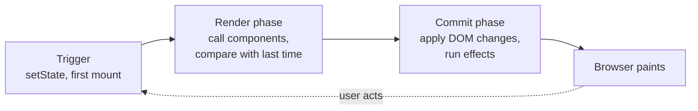

# 核心思想：UI 是状态的函数（UI Is a Function of State）

> [!summary] 核心速览（TL;DR）
> 在 React 中，你永远不需要手动命令浏览器“修改这段文字”或“追加那一行 DOM”。你只需编写一个函数，描述当前状态下 UI 应该是什么样子，React 会自动推导并决定屏幕上需要更新什么。这一过程分为两大阶段：**渲染（Render）**（调用你的组件函数获取一份全新的 UI 描述）与 **提交（Commit）**（将计算出的差异实际应用到真实 DOM 上）。

每个 React 开发者都曾经历过那个“顿悟魔法”的瞬间：你调用了 `setItems`，列表中便神奇地多出了一行。你从未真正触碰过真实的 DOM 列表，从未查找过任何 DOM 节点，从未调用过 `appendChild`，也从未手动隐藏过“暂无数据”的空提示。屏幕究竟是如何知道该怎么变的？

答案就蕴含在一个核心思想中，而本专栏余下的全部内容，都是在拆解 React 如何将这个思想化为现实。

## 构建界面的两种范式

假设我们要脱离 React 来构建一个简易的购物清单。用户在输入框输入 "Eggs" 并点击“添加”按钮。如果使用原生 DOM 命令式代码，你必须事无巨细地亲手编写每一个步骤：

```js
// 命令式（Imperative）：你需要手动指挥每一个变更步骤
addButton.addEventListener("click", () => {
  const li = document.createElement("li");
  li.textContent = input.value;
  list.appendChild(li);
  input.value = "";
  counter.textContent = `${list.children.length} 项清单`;
  emptyMessage.hidden = true;
});
```

这就是**命令式（Imperative）**代码：一条条具体的执行指令，指引着屏幕一步步从当前状态迁移到下一个状态。这种方式确实可行，但每增加一个新功能，你需要小心维护的“状态转移”逻辑就会呈指数级爆炸。比如切换完成状态、删除项目、根据条件过滤列表：每一个交互都需要单独写一套“从这里变到那里”的 DOM 操作代码，而且每一次都必须时刻记着同步更新计数器和空状态提示。稍有遗漏，界面和真实数据就会悄悄脱节。

React 提出了一种截然不同的解法。你只需要描述在任意特定状态下屏幕**应该呈现什么状态**，而不用再操心它是如何一步步变过去的：

```jsx
function App() {
  const [items, setItems] = useState([{ id: 1, name: "Milk", done: false }]);
  const [text, setText] = useState("");
  return (
    <main>
      <Header count={items.length} />
      <AddItem
        text={text}
        onChange={setText}
        onAdd={() => {
          setItems([...items, { id: Date.now(), name: text, done: false }]);
          setText("");
        }}
      />
      <List
        items={items}
        onToggle={(id) =>
          setItems(items.map((i) => (i.id === id ? { ...i, done: !i.done } : i)))
        }
      />
    </main>
  );
}
```

这就是**声明式（Declarative）**代码。在这段代码中，没有任何一处写着“向列表追加一个 li 节点”。它表达的意思非常直接：只要给定这份 `items` 数据，标题就必须展示这个数字，列表就必须展示这些数据行。点击事件的处理函数完全不碰屏幕上的任何 DOM，它唯一做的事情，就是更新数据本身。

## 黄金公式：UI = f(state)

用一句话来概括这种声明式范式，就是：

**UI = f(state)**

你的组件函数就是这个数学函数 `f`。只要传入相同的状态（state）和属性（props），它就会始终如一地返回同一份 UI 描述。一旦状态发生变化，React 就会再次调用 `f`，拿到一份全新的 UI 描述，然后使真实屏幕与这份最新描述保持一致。

这一转变将一个极其复杂的工程难题简化为了一个简单的模型。你不再需要去为每一对“状态变迁路径”单独编写繁琐的 DOM 胶水代码，而是编写一个能够纯粹处理任何状态的函数。计数器再也不会和列表数量产生不同步的 bug，因为在每一次计算中，它们始终是从同一份 `items` 派生出来的。

> [!tip] 核心心智模型
> 你的组件是一份**菜谱**，而不是一套**改动指令**。每当配料（state、props、context）可能发生变化时，React 就会重新执行这份菜谱；而由 React 负责将“新菜谱做出来的成品”转化为“真实 DOM 所需的具体修改”。

不过，这个数学比喻有一个值得提前了解的边界：`f` 并不**完全等同于**纯粹的数学纯函数。因为组件可以通过 Hooks 持久化自身的状态，也可以调度异步副作用（Side Effects）。React 会以一种受控的方式来协调这两者（后文会详尽展开）。但在组件函数执行调用的这一刻，你的组件必须表现得像一个没有副作用的纯函数。[[03 What Rendering Really Means|第 3 篇：渲染的真正含义]] 将深入解析为什么这一点至关重要。

## 两者分工：开发者与 React 的职责边界

React 在你与框架本身之间划定了一条极其清晰的职责分工界限：

- **你负责「描述」**：你的组件函数根据当前状态，返回一份界面的结构描述。你全权决定屏幕上**应该显示什么**。
- **React 负责「协调」**：它将新生成的 UI 描述与上一次的描述进行比对，精确推导出究竟发生了哪些变动。这一过程被称为**协调（Reconciliation）**。
- **React 负责「提交」**：它将这些经过精密计算后的真实差异批量更新到浏览器的 DOM 树上，随后按序触发那些注册在更新之后执行的副作用。

第一步归你所有，后两步全权交给 React。这正是为什么在 React 开发中我们极少需要调用原生 DOM API：操作 DOM 是 React 的核心职责；直接手动修改 DOM 往往是在绕过 React 的心智模型——尽管有时出于不可避免的原因（例如手动聚焦、尺寸测量、集成第三方无缝库）你确实需要这么做，但那也必须是深思熟虑后的特例。

## 渲染与提交：两大核心阶段

每当发生状态变化后，React 所做的一切工作都可以清晰划分为两大阶段。这两个词将贯穿整门课程的始终，因此务必在此刻厘清它们的明确定义：



**渲染（Render）阶段**：指的是 React 调用你的组件函数，获取一份最新的 UI 描述，并将其与上一次的描述进行比对。**在渲染阶段，屏幕上不会发生任何实质性的像素变化**。这完全是内存中的纯计算阶段，正因如此，React 在并发模式下才能做到随意暂停它、丢弃它、或者重新开始计算。

**提交（Commit）阶段**：指的是 React 拿着比对出来的变动清单，一次性将其真正应用到宿主 DOM 上：插入这个节点、修改那个属性、移除某一行。随后，依次执行副作用函数。**提交阶段绝对不会中途暂停**，因为如果在更新 DOM 的中途停下来，用户在屏幕上就会看到支离破碎、半生不熟的错误界面。

“Render” 这个词经常让人产生误解，因为在日常口语或计算机图形学中，“渲染”往往意味着“在屏幕上把像素画出来”。但在 React 的世界里完全不是这样。**React 中的 Rendering 仅仅是指调用你的组件函数并推导结构**。将像素画在屏幕上是**浏览器**在提交阶段之后的工作（Browser Paint）。把这两个阶段界定清晰，许多看似玄学的概念就会迎刃而解，[[03 What Rendering Really Means|第 3 篇]] 将专门为你彻底拆透它。

## 破除误区：React 究竟不是什么

社区中流传着一些关于 React 的常见谣传与误解，它们往往会严重妨碍你建立正确的心智模型。

### 1. React 不是「细粒度响应式」（Fine-grained Reactivity）

以 Signal（信号）为核心的框架（如 SolidJS、Svelte 5 Runes、Preact Signals）能够精确追踪 DOM 的哪一个具体文本节点依赖了哪一个具体的数据变量，并在数据变化时，直接精准定位并更新那一个微小的 DOM 片段。React 从来不是这么工作的。

当组件内的状态发生改变时，React 会**重新执行整个拥有该状态的组件函数**，并且在默认情况下，该组件下挂载的所有子组件也都会被重新执行一遍。React 压根不知道你 JSX 里的哪一行用到了 `items.length`。它是通过再次调用你的整个函数、拿到一整棵新树并与旧树做比对，才发现具体变了什么。这是 React 设计之初的一项深思熟虑的取舍：让你的组件永远保持为普通的 JavaScript 函数，不需要特殊的响应式代理包装；代价则是每次更新时 React 在内存中需要做更多的推导计算。为了缓解这部分开销，才有了记忆化（Memoization）以及我们将在 [[11 Memoization and the React Compiler|第 11 篇]] 深入探讨的 React Compiler。

### 2. “虚拟 DOM” 从来不是为了“比原生更快”

你可能听过这样一种说法：“React 很快是因为它拥有虚拟 DOM（Virtual DOM）”。这种认知完全本末倒置了。构建一份内存对象描述、将其与旧对象深度比对、然后再去操作 DOM，所付出的计算量注定远大于直接手写一行原生的 `li.textContent = "Eggs"`。一段精心手写的命令式 DOM 更新在纯性能上永远能够轻松击败 React。

内存比对真正带给我们的价值是**以极低的心智负担换取绝对的正确性**：你只需要以声明式风格编写覆盖任意状态的代码，React 保证只将最终必要的变化精准应用到 DOM 上。它让声明式开发的性能损耗处于可接受的合理区间。它绝不是免费的午餐，更不会比人工编写的极简原生操作更快。

如今 React 官方团队甚至已经不再频繁提及“Virtual DOM”这个概念。那些对界面的轻量描述现在被称为**元素（Elements）**，而 React 内部维护运行树的轻量工作节点则被称为 **Fiber**。这两部分都将在后面的专属章节中逐一剖析。

> [!warning] 减少 DOM 操作并不等同于总计算量变少
> React 确实尽全力帮你避免了不必要的真实 DOM 修改，但为了找出到底哪些 DOM 需要变，它依然必须完整执行你的组件函数。如果一个组件在渲染期间执行了昂贵的高耗时计算，那么哪怕最终真实 DOM 没有任何变化，每次重新渲染也依然会老老实实付出这笔性能代价。

## 前方路线图

在后续的内容中，我们将把“渲染 → 提交”工作循环中的每一个齿轮拆开给你看：

1. **核心思想**（即本篇）：UI = f(state)、渲染阶段与提交阶段的分野。
2. **元素、组件与树模型**：JSX 在底层究竟变成了什么？React 处理的“三棵树”分别是什么？
3. **渲染的真正含义**：到底是什么触发了重新渲染？为什么渲染过程必须是纯粹无副作用的？
4. **状态更新**：为什么 state 本质上是一张不可变快照？React 批处理（Batching）是如何运作的？
5. **协调（Reconciliation）**：React 如何聪明地比对新旧差异？`key` 的底层作用到底是什么？
6. **Fiber**：让 React 能够随时暂停、让出主线程并恢复工作的革命性数据结构。
7. **优先级调度与并发**：为什么某些状态更新可以等待？`startTransition` 的底层调度奥秘。
8. **Commit 阶段与副作用**：真实 DOM 是在何时被修改的？你的各种 `useEffect` 究竟在什么时候触发？
9. **Hooks 机制**：状态究竟寄宿在什么地方？为什么不能在条件语句中调用 Hook？
10. **事件系统**：挂载在 Root 节点上的单一事件监听器，以及用户的一次点击如何被转化为优先调度。
11. **记忆化与 React 编译器**：React 如何智能跳过无用功？React Compiler 的工作原理。
12. **从一次点击到屏幕绘制**：将前面所有的机制连成一线，完整重演一次点击背后的全生命周期。

## 常见认知误区

- **“React 只会更新那些直接使用了变更数据的页面局部”**：错误。React 会默认重新执行拥有该状态的组件及其所有子组件函数，然后比对生成的新旧描述。只有最终在 DOM 树上的写入是最小化的，而为了推导这些写入所进行的组件执行工作并不是局部的。
- **“虚拟 DOM 让 React 比原生 DOM 更加高效”**：错误。比对虚拟描述本身就需要额外的 CPU 计算。它的意义在于让开发者享受声明式开发便利的同时，性能依然保持在合理范围，绝非比极致手写的原生更新更快。
- **“渲染（Render）就是指在屏幕上把像素画出来”**：错误。在 React 语境下，渲染仅仅是指执行组件函数以生成界面的结构描述。真实 DOM 的修改发生在 Commit 阶段，而像素的实际绘制则是在 Commit 完成后由浏览器渲染引擎负责。
- **“在 React 里开发者完全不需要关心真实 DOM”**：过于绝对。绝大部分时间你只需要面向声明式数据编程，但遇到焦点控制、尺寸位置精确测量、或者集成非 React 原生第三方插件时，你仍然必须借助 `ref` 和副作用穿透到真实 DOM。

## 总结

React 的基石思想在于 **UI 是状态的函数**：你负责编写声明式组件来描述当前状态下的理想界面，React 负责将真实 DOM 顺滑地从旧描述平移到新描述。这一过程严谨地拆分为两大阶段：**渲染阶段**（调用组件函数并与前次比对）与 **提交阶段**（将计算出的真实差异写入 DOM 并触发副作用）。React 采取的是组件级的整树比对而非细粒度依赖追踪，这种权衡以合理的计算开销赋予了我们极佳的开发体验与不易出错的正确性。

在下一篇 [[02 Elements, Components and the Tree|第 2 篇]] 中，我们将进一步深入：探究所谓的“界面描述”在底层到底是由什么数据构成的。

### 核心要点归纳

- **声明式 UI**：只需表达任意状态下的理想结果，而不是一步步指挥如何修改界面。
- **UI = f(state)**：组件将状态和属性映射为界面描述，派生数据永远不会脱节。
- **权责分明**：你负责用函数做描述，React 负责比对协调（推导变动）和提交（落地修改）。
- **渲染阶段（Render）**：在内存中执行组件函数并比对差异，屏幕无任何真实像素变化。
- **提交阶段（Commit）**：将变更一次性同步应用到 DOM 树，随后触发副作用执行。
- **非细粒度追踪**：React 依赖组件重新执行和树比对推导变化，而不是细粒度追踪每个变量绑定的 DOM 节点。
- **非纯粹速度技巧**：虚拟树比对的核心目的是以可控的计算代价，换取声明式架构的稳健与优雅。

**深入探究源码实现：** [[00 React Internals Index|React Internals：从 createRoot 到像素绘制]]

---

← [[react-concepts|返回专栏目录]] · [[react-concepts|专栏主页]] · [[02 Elements, Components and the Tree|下一篇：第 02 篇 · 元素、组件与树模型]] →
