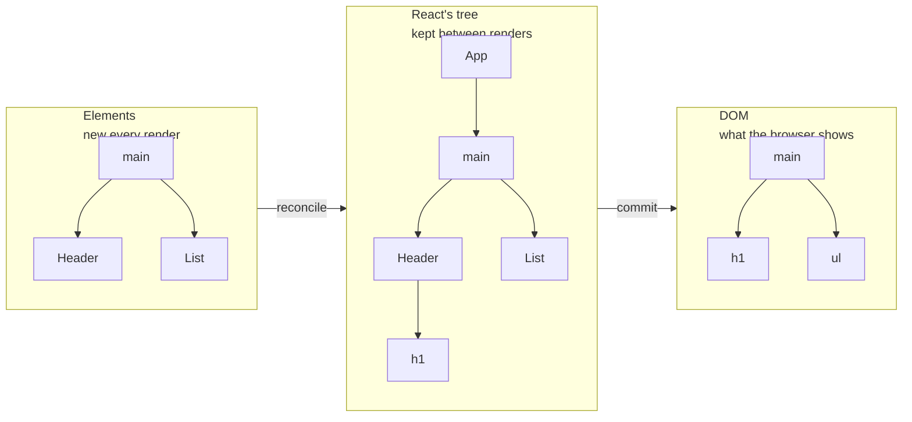
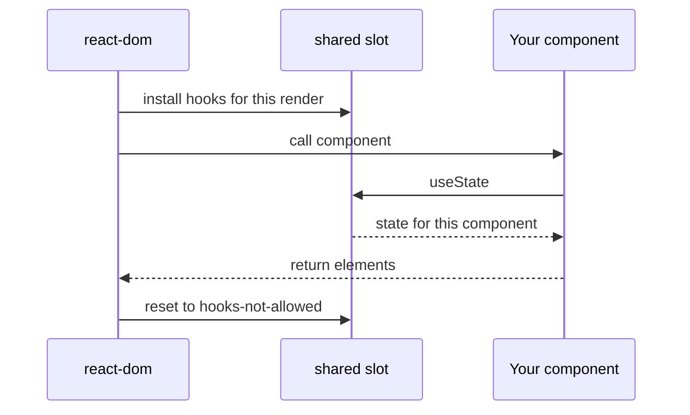

# 元素、组件与树模型（Elements, Components and the Tree）

> [!summary] 核心速览（TL;DR）
> JSX 本质上只是一次普通的函数调用，它返回一个微小、不可变的普通对象，被称为 **React 元素（Element）**，其核心包含 `type`、`props` 和 `key`。**组件（Component）**则是返回这些元素的函数，且**由 React（而非你）负责调用**。React 在内部维护着一棵生命周期漫长的常驻树，用来将每次新生成的轻量描述与当前屏幕上的内容进行比对；而你安装的渲染器（如 `react-dom`），正是将这套底层运转机制与你日常引入的 `react` 包连接起来的桥梁。

在 [[01 The Big Idea - UI Is a Function of State|第 1 篇：核心思想]] 中，我们提到组件返回的是“对 UI 的一份结构描述”。但这句话背后其实隐藏着一个绝大多数开发者从未深究过的问题：`<Header count={2} />` 到底*是个什么东西*？它既不是真实的 DOM 节点，也不是组件实例。你可以用 `console.log` 将它打印出来，可以保存在变量里，也可以作为参数到处传递。那么它究竟是什么？React 又是如何把它变成页面上那个真实可见的标题的？

## JSX 本质上只是一次函数调用

浏览器根本无法识别 JSX 语法。在你代码运行之前，构建工具就已经将其转译掉了。自 React 17 起，默认的转译输出（即所谓的“自动运行时”（Automatic Runtime））会调用来自 `react/jsx-runtime` 的 `jsx` 函数。到了 React 19，更是强制要求使用该运行时。

```jsx
// 你的源码写法
<Header count={items.length} />

// 编译器转译后的输出大致如下
import { jsx as _jsx } from "react/jsx-runtime";
_jsx(Header, { count: items.length });
```

子元素（`children`）会被合并进 `props` 对象中；而如果你显式传入了 `key`，它则会作为独立的单独参数传递：

```jsx
// 你的源码写法
<Item key={item.id} item={item} onToggle={onToggle} />

// 编译器转译后的输出大致如下
_jsx(Item, { item: item, onToggle: onToggle }, item.id);
```

你或许在早期的教程中见过 `React.createElement(type, props, ...children)`。它们做的事情完全一样，区别仅在于调用约定的传参格式不同。无论哪种形式，核心本质都毫无二致：**JSX 就是普普通通的 JavaScript，用于计算并构建出一个值**。这里没有任何模板语言，也没有任何黑魔法。正因如此，你才能在其中自由使用 `map`、`&&` 和三元运算符——它们无非就是求值并生成参数的普通 JS 表达式。

## 元素只是普通的 JavaScript 对象

那么 `_jsx` 执行后到底返回了什么？一个轻量级的小对象。在生产环境中，它大致长成这个样子：

```js
{
  $$typeof: Symbol.for("react.transitional.element"),
  type: Header,            // 可以是一个函数，也可以是类似 "li" 的字符串
  key: null,               // 字符串或 null
  props: { count: 1 },     // 包含 children（在 React 19 中也包含 ref）
}
```

这就是所谓的 **React 元素（Element）**。其中有四个核心属性至关重要：

- **`type`**：标明要渲染什么。如果是一个字符串（如 `"main"` 或 `"li"`），代表宿主元素（Host Element，在浏览器环境下就是原生 DOM 节点）；如果是一个函数（如 `Header`），则代表一个自定义组件。
- **`props`**：包含你传递的所有属性与子元素（`children`）。在 React 19 中，`ref` 也已回归为普通的 prop。
- **`key`**：列表元素的唯一身份标识提示。React 会特意把它从 props 中抽离出来，这也是为什么组件内部无法通过 `props.key` 读取到它的原因。[[05 Reconciliation - Finding What Changed|第 5 篇：协调机制]] 会详细拆解它的深层原理。
- **`$$typeof`**：一个特殊的 Symbol，用于将该对象标记为一个合法的 React 元素。由于 JSON 格式无法序列化 Symbol，这可以有效防止恶意 JSON 攻击伪造 React 元素注入页面（防范 XSS 漏洞）。

元素是**极其轻量且不可变（Immutable）**的。组件的每一次渲染都会重新创建一批全新的元素对象，并在协调结束后很快被垃圾回收。在开发模式下，React 甚至会通过 `Object.freeze` 冻结它们，任何试图直接修改 `element.props` 的操作都会抛出异常。**你永远无法更新一个已有的元素，你只能重新创建一个新的**。

> [!tip] 核心心智模型
> React 元素就像一张轻飘飘的便签纸，上面写着：“请在这里放一个 `Header`，并传入 `count: 1`”。它只负责**描述**，自己从不**执行**任何动作。写这样一张便签的成本极其低廉，而 React 在每次渲染时都会重新写下一叠全新的便签。

## 组件是返回元素的函数

组件本质上就是一个接收 props 作为输入并返回 React 元素的普通函数：

```jsx
function Header({ count }) {
  return <h1>Shopping list ({count})</h1>;
}

function List({ items, onToggle }) {
  return (
    <ul>
      {items.map((item) => (
        <Item key={item.id} item={item} onToggle={onToggle} />
      ))}
    </ul>
  );
}
```

请格外注意父组件（如 `App`）**没有做的事情**：它从未直接去执行 `Header(...)`。它只是创建了一个 `type` 为 `Header` 的元素对象。**真正调用组件函数是 React 的工作，并且由 React 全权决定调用的时机**。

这种“掌控调用权”的职责分离，正是支撑起 React 其余所有强大特性的基石。正是因为由 React 来负责调用函数，它才能在执行前做好环境准备（明确当前是哪个组件在渲染、其对应的状态存储在哪里）、在数据未变更时聪明地跳过调用，或是根据调度策略在稍后重试执行。

> [!warning] 切勿直接像普通函数那样调用组件
> 在 JSX 中写 `{Header({ count })}` 表面上看起来也能渲染，但此时 `Header` 仅仅是父组件内部执行的一段普通逻辑。它在 React 内部树中完全没有属于自己的独立节点，导致它内部调用的任何 Hooks 都会错乱地挂载在父组件身上，React 也无法为其独立维护状态或跳过无用重渲染。请务必始终以 `<Header count={count} />` 的形式来渲染组件。

## 是三棵树，而非一棵树

当大家提到“React 树”时，他们所指的往往是三种截然不同的树形结构之一。把这三者厘清分辨，能瞬间解开很多困扰已久的谜团。



1. **元素树（The Element Tree）**：组件在特定渲染阶段返回的对象树。它是“局部”且不完整的：例如 `App` 返回了 `main`、`Header`、`AddItem` 和 `List` 的元素描述，但并不包含 `Header` 内部的 `h1`，因为此时 `Header` 函数本身还没被执行。这棵树在每次渲染时都会从零重新构建，用完即弃。
2. **React 内部树（React's Internal Tree）**：为每一个已挂载的组件以及原生宿主元素建立的内部节点树。只要组件还展示在屏幕上，它就一直存活；这里是组件状态（State）、Hooks 链表以及待处理工作（Pending Work）真正寄宿的地方。React 将这些节点称为 **Fiber**，[[06 Fiber - Work You Can Pause|第 6 篇：Fiber 架构]] 将对此专门剖析。你编写的自定义组件全部存在于这棵树中，但在最终的 DOM 结构里则不留一丝痕迹。
3. **DOM 树（The DOM Tree）**：仅包含原生的宿主元素，如 `main`、`h1`、`ul`、`li`。`App`、`Header` 或 `List` 在真实 DOM 树中根本不存在。

简而言之：**元素树是「输入」，React 内部树是「记忆」，而 DOM 树是「输出」**。渲染过程会遍历 React 内部树，调用你的组件函数以获取全新的元素描述，并更新内部树以反映最新变化；随后在提交阶段，React 将变动批量同步至真实 DOM。

这同时也揭开了“状态（State）到底保存在哪里”的秘密：状态不可能存在于元素中，因为元素每次渲染都会全部推倒重来；状态也不可能保存在你的组件函数内部，因为函数一旦执行完毕就会出栈。**状态真正寄宿在 React 内部常驻树上对应的组件实例节点（Fiber）之中**，在不同的渲染周期之间得以稳固留存。

## react 与 react-dom：负责「描述」与负责「干活」

你在项目中通常会安装两个包，而它们的分工截然不同。

**`react`** 非常精简，仅包含 `jsx`、`useState`、`memo`、`createContext`、`startTransition` 等 API。它对 DOM 一无所知，对 Fiber 架构一无所知，甚至完全不知道渲染的具体执行机制。它本质上只是供开发者用来描述 UI 的**声明式词汇表**。

**`react-dom`** 则是一个**渲染器（Renderer）**。它包含了真正干粗活的核心引擎：负责遍历 React 内部树的协调器（Reconciler）、任务调度器集成（Scheduler），以及直接创建和修改浏览器真实 DOM 节点的底层代码。其他的渲染器（比如移动端的 React Native，或是面向 3D 场景的 `react-three-fiber`）都承载着同样一套协调调度机制，只是最终创建的是原生移动端视图或 3D 物体，而不是浏览器 DOM 节点。

正是这种“职责解耦”的架构设计，使得同一套组件化模型能够无缝复用于多端平台。你的 `Header` 组件只管返回一个 `<h1>` 描述，至于最终究竟由谁把它转化为屏幕上真实可见的像素，组件本身根本无须关心。

## Hooks 的威力究竟源自何处？

上述分工带来了一个耐人寻味的技术谜题：`useState` 明明是从 `react` 包中导出的，而 `react` 对渲染引擎又一无所知，那 `useState` 到底是如何精准找到属于当前组件的状态数据的？

在概念设计上，`react` 包在底层维护着一个共享槽位，专门用来存放“当前有效的 Hooks 具体实现”，这在 React 源码中被称为 **Dispatcher（调度分发器）**。你在代码中 import 进来的 `useState` 本质上只是一个极其轻量的转发代理：它直接读取这个全局槽位，并调用里面当前挂载的具体函数。

```js
// 简化后的概念伪代码，非真实源码
function useState(initial) {
  const dispatcher = shared.currentDispatcher;
  return dispatcher.useState(initial);
}
```

在 React 准备调用你的某个组件函数**之前的一瞬间**，渲染器（`react-dom`）会将自己内部对应的 Hooks 实现注入到这个共享槽位中——首次挂载（Mount）与后续更新（Update）分别注入不同版本的实现。而一旦你的组件函数执行完毕并返回结果，渲染器会立刻将该槽位切换为一个“只要调用就会抛出异常”的报错版本。



单单这一个精妙的架构设计，就彻底解释了每个 React 开发者都必定见过的经典报错——“Invalid hook call”（Hooks 调用无效）：

- **你在组件渲染流程之外调用了 Hook**（例如在事件处理回调函数中）：此时共享槽位中挂载的是报错版本，因为渲染器并未处于组件执行窗口期。
- **构建打包产物中存在多份重复的 React 副本（Duplicate React）**：渲染器将实现注入到了其中一份 `react` 实例的槽位中，而你的组件却从另一份未被注入的 `react` 实例中引入了 `useState`。

## 常见认知误区

- **“JSX 会直接创建 DOM 节点”**：错误。JSX 仅仅创建轻量级的普通元素对象。真实的 DOM 节点是在后续的提交阶段（Commit）由渲染器统一创建并挂载的。
- **“一个 React 元素就是一个组件实例”**：错误。元素只是一份用完即弃的纯数据描述。真正常驻内存并承载组件状态的实体，是 React 内部树上对应的 Fiber 节点。
- **“因为每次渲染元素都是全新的，所以 React 每次都会重建 DOM”**：错误。每次生成的新元素只会与 React 内部常驻树进行比对，只有真正计算出差异的部分才会最终写入 DOM。
- **“从 react 包引入的 `useState` 在编译时就已经和你的组件绑定在一起了”**：错误。引入的函数只是一个空壳转发器，它仅仅将调用动态转发给渲染器在当前组件渲染前注入的具体 Dispatcher 实现。

## 总结

JSX 在底层会被编译为对 `jsx` 函数的调用，返回包含 `type`、`props` 和 `key` 的轻量、不可变元素对象，且在每次渲染时都会全新创建。组件则是接收属性并返回元素描述的普通函数，而**由 React 全权负责调用它们**——正是这种调用权的让渡，使得 React 能够自主管理状态生命周期、智能跳过不必要的重复计算并在需要时重新执行代码。

请务必在脑海中清晰划分三棵树的界限：**用完即弃的元素树**、**存储状态与 Fiber 节点的常驻内部树**，以及**仅包含原生宿主节点的 DOM 树**。在宏观架构上，`react` 包负责提供描述 UI 的词汇表，`react-dom` 等渲染器负责执行协调与 DOM 变动的实际工作，而 Hooks 则通过渲染器在组件执行前动态装载的 Dispatcher 共享槽位与底层引擎连通。在下一篇 [[03 What Rendering Really Means|第 3 篇：渲染的真正含义]] 中，我们将深入剖析 React 究竟在何时、因何缘由才会去重新调用你的组件。

### 核心要点归纳

- **JSX 本质**：被编译为来自 `react/jsx-runtime` 的 `jsx(type, props, key)` 调用；它就是用于计算生成普通 JavaScript 对象的常规代码。
- **React 元素**：拥有 `type`、`props`、`key` 以及防篡改的 `$$typeof` 标记的普通不可变对象；每次渲染全新生成。
- **组件角色**：将 props 映射为元素描述的纯函数；由 React 决定何时调用，开发者切勿手动调用。
- **三棵树分工**：元素树是「输入」，React 内部树（Fiber）是「记忆」，真实 DOM 是「输出」。
- **状态归属**：状态存储于 React 内部常驻树中对应的组件实例节点上，既不在元素中，也不在函数闭包内。
- **渲染器解耦**：`react` 负责界面描述，`react-dom` 封装了核心协调器以及真正的 DOM 操作引擎。
- **Dispatcher 机制**：Hooks 只是将调用转发给渲染器在组件执行前即时装入的实现；这一机制解释了为何在渲染上下文之外调用 Hook 或存在多个 React 副本时会导致报错。

**深入探究源码实现：** [[01 Bootstrap - Packages, JSX and the Dispatcher|初始化引导：包结构、JSX 与 Dispatcher]] · [[05 The Fiber Data Structure|Fiber 数据结构剖析]]

---

← [[01 The Big Idea - UI Is a Function of State|上一篇：核心思想]] · [[react-concepts|专栏目录]] · [[03 What Rendering Really Means|下一篇：渲染的真正含义]] →
