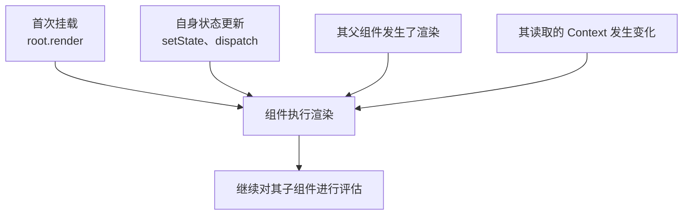
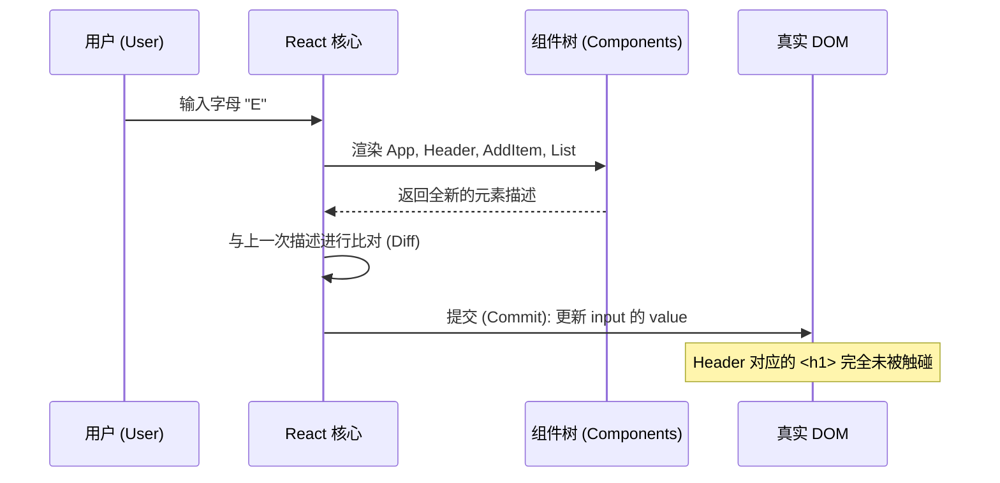

# 渲染的真正含义（What Rendering Really Means）

> [!summary] 核心速览（TL;DR）
> **渲染（Render）**本质上就是 React 调用你的组件函数，以获取一份全新的元素描述。有且仅有四种原因会触发渲染：**首次挂载**、**自身状态更新**、**父组件重新渲染**以及**读取的 Context 发生变化**。渲染过程必须保持为**纯函数**，因为 React 可能会多次调用你的组件，或者在渲染中途将未完成的结果直接废弃；而且，重新渲染只有在**提交阶段（Commit）**检测到真实差异时，才会真正改动浏览器 DOM。

“我的组件重新渲染得太频繁了。”——几乎每个 React 开发者都说过这句话。通常是在组件里随手加了一句 `console.log`，然后看着控制台在每次敲击键盘时疯狂刷屏。

但是，究竟什么是“重新渲染（Re-render）”？它真的很慢吗？它会直接操作 DOM 吗？为什么当你在输入框里打字时，连 `Header` 组件也会跟着重新渲染，明明它的 props 和输入框里的文字八竿子打不着？

## 渲染的本质：调用你的组件函数

抛开所有高深莫测的专业术语，渲染的本质其实非常单纯：**React 传入当前最新的 props 调用你的组件，你的函数从头到尾执行一遍，并返回一组元素（Elements）。** 仅此而已。

```jsx
function Header({ count }) {
  console.log("Header rendered");
  return <h1>购物清单 ({count})</h1>;
}
```

控制台每次输出 `"Header rendered"`，都仅仅意味着 **React 执行了一次 `Header` 函数**。这绝不意味着屏幕上的像素发生了任何变化，它只代表 React 向 `Header` 索要了一份最新的界面结构描述。

当 React 渲染完一个组件后，它会紧接着检查该组件返回的子元素，并沿着组件树继续向下递归：**它会继续渲染这些子组件**，除非它能明确证明某个子组件完全不需要重新渲染（后文会详尽展开）。因此，一次渲染总是从某个特定组件开始，沿着组件树**自顶向下流动（Flows down）**。

## 触发渲染的四大原因

一个组件重新执行渲染，有且仅有以下四种原因：



**1. 首次挂载（The first mount）**：一切的起点是 `createRoot(container).render(<App />)`。React 首先调用根组件 `App`，随后递归调用其下方的每一个子组件，并在内存中完成首屏 DOM 结构的创建。

**2. 自身状态更新（A state update）**：调用状态更新函数（来自 `useState`、`useReducer`，或通过 `useSyncExternalStore` 订阅外部 store）会为**拥有该状态的组件**调度一次渲染。请特别注意“**拥有**”二字：调用 `setItems` 会重新渲染 `App`，因为是 `App` 声明了对应的 `useState`；无论这个 setter 是被哪一个深层子组件触发的，重新渲染的起点都是 `App`。

**3. 父组件发生了渲染（The parent rendered）**：当 `App` 渲染时，它会为 `Header`、`AddItem` 和 `List` 生成全新的 React 元素对象。在默认机制下，React 也会顺理成章地重新渲染这些子组件。这往往是让许多初学者感到最意外的一点：在输入框打字触发了 `setText`，导致 `App` 重新渲染，进而引发了 `Header` 的重新渲染——即使 `Header` 所接收的 `count` 属性自始至终没有任何改变。

**4. 读取的 Context 发生变化（A context changed）**：如果一个组件通过 `useContext`（或 React 19 的 `use`）读取了某个 Context，只要对应 Provider 的 `value` 发生变更，该组件就会重新渲染——哪怕它与 Provider 之间隔着的所有中间组件都被完全跳过了。

请注意列表中**并不存在**的一项：**props 自身发生变化**。Props 永远不可能平白无故自己改变；它们之所以改变，是因为**父组件先发生了重新渲染**并传入了新的数据，这本质上属于第 3 种触发原因。

> [!tip] 核心心智模型（Mental Model）
> 一次渲染总是从状态发生变化的那个组件开始，自顶向下流动，依序重新执行其下方的每一个子组件函数——除非 React 能够明确证明该子组件的输入与上一次完全一致，从而触发跳过优化。

## 为什么渲染过程必须是纯函数？

React 对于在渲染期间执行的代码有一条不可逾越的铁律：**它必须是纯函数（Pure function）**。给定相同的 props、state 和 context，它必须始终返回相同的元素结构，且**绝不能产生任何外部副作用**。这意味着：不能修改任何在本次渲染外部创建的对象、不能发起网络请求、不能直接写入 `document`、也不能调用 `setTimeout`。

这条规则并非出于代码美学或代码风格的执念，而是因为：**React 保留了以你无法预见的方式随时调用组件的权利**：

- **可能被多次调用**：在开发环境下，`<StrictMode>`（严格模式）会刻意对每个组件执行两次渲染，专门用来揪出不纯的代码。如果调用两次会导致逻辑出错，就说明你的渲染逻辑是不纯的。
- **可能被半途废弃**：在并发特性（Concurrent Features，如 transitions、Suspense）下，React 可以在后台启动渲染，中途被更高优先级的用户交互打断，然后直接扔掉未完成的工作。此时你的函数确实执行了，但其计算结果永远不会出现在屏幕上。
- **可能在稍后重试**：被废弃的渲染任务，或者因等待异步数据而挂起（Suspend）的渲染，随时可能从头重新尝试执行。

```jsx
let renderCount = 0;

function List({ items }) {
  renderCount++;              // 不纯：修改了渲染函数作用域之外的外部变量
  items.sort(byName);         // 不纯：修改了传入的 props 引用，而 React 或其他组件可能仍在使用它
  return <ul>{/* ... */}</ul>;
}
```

上面这两行代码都严重违反了纯函数法则。`renderCount` 会把那些最终被废弃、从未真正提交到屏幕上的无效渲染也统计进去；而 `items.sort` 则原地篡改了属于父组件状态的数组。正确的做法是在副本上进行排序（使用 `[...items].sort(byName)`，或者现代标准的 `items.toSorted(byName)`）。

任何必须“在每次真正反映到屏幕上的更新中恰好执行一次”的操作，都属于以下两者之一：
- **事件处理函数（Event handlers）**：由用户的主动交互行为触发；
- **副作用（Effects）**：必须紧随提交阶段（Commit）之后执行。关于副作用的深入机制，详见 [[08 The Commit Phase and Effects|第 8 篇：提交阶段与副作用]]。

> [!warning] StrictMode 双重渲染仅在开发环境下生效
> 生产环境下的 React 绝不会对单次渲染调用两次组件函数。如果某段代码只在开发环境下表现异常，大概率是 `<StrictMode>` 提前暴露了隐蔽的副作用——这种不纯的代码在生产环境下一旦遭遇并发中断（例如 transition 渲染被插队打断），同样会引发难以排查的 bug。

## 渲染阶段 vs 提交阶段（Render vs Commit）

在 [[01 The Big Idea - UI Is a Function of State|第 1 篇：核心思想]] 中，我们已经了解了这两个核心阶段。下图以购物清单中用户单次敲击键盘输入为例，清晰地划分了两者之间的边界：



在**渲染阶段（Render）**，React 调用组件函数并比对新旧计算结果。在**提交阶段（Commit）**，React 仅将真实的差异部分应用到 DOM 上。在上面的例子中，`Header` 确实重新执行了渲染，但由于其返回的 `<h1>` 文本与上一次完全相同，因此在提交阶段，DOM 树上的 `<h1>` 节点完全没有受到任何打扰。

## 重新渲染并不等同于 DOM 更新

如果只能从本篇文章中带走一句话，那一定是这一句：**重新渲染（Re-render）仅仅是一次 JavaScript 函数调用加上一次内存中的比对；只有当比对发现真实差异时，才会触发真正的 DOM 更新。**

这个认知具有两面性：

- **重新渲染通常开销极小**：一个仅仅返回少量元素的组件，执行耗时往往只有几微秒。在用户每次按键时重新执行一次 `Header`，对性能完全构不成威胁。
- **重新渲染并非毫无代价**：如果一个组件在渲染期间执行了昂贵的高开销计算（例如过滤 10,000 条复杂数据、在大型表格中格式化日期），那么每次重新渲染都会反复跑这些计算——哪怕最终 DOM 树根本纹丝不动。

因此，在日常性能优化中，关键问题往往不是“我怎样才能杜绝所有重新渲染？”，而是“**是否有任何渲染在不需要的情况下，执行了昂贵的繁重计算，或者牵连渲染了极其庞大的子组件树？**”

## 跳过优化（Bailouts）：React 何时能跳过组件渲染？

React 绝非盲目地无脑重跑所有组件。在渲染遍历过程中，每当触达一个组件，React 都会快速评估一个核心问题：**我能否直接复用上一次的结果？**

在概念层面上，当且仅当满足以下**全部三个条件**时，React 才会跳过（Bailout）该组件的函数调用：

- **props 对象在引用上完全相同**（即全等引用对比 `===`，而非深比较）；
- 该组件自身**没有任何待处理的状态更新（Pending state update）**；
- 该组件所读取的任何 **Context 均未发生变化**。

如果这三个条件同时成立，React 就会直接跳过该组件的函数执行。但它的工作并未结束：如果该组件下方的某个更深层子组件自身有待处理的状态更新，React 会继续向下寻路找到它；而如果该组件整棵子树下都没有任何待处理工作，React 就会**一并跳过整棵子树**。

**然而，这里隐藏着一个关键玄机。**
当父组件 `App` 重新渲染时，JSX `<Header count={items.length} />` 实际上会在执行时创建一个**全新的 props 对象**，哪怕 `count` 的数值完全没有变。相同的键值，不同的对象引用——这导致引用对比立即失效，`Header` 依然会被调用。这就是第 3 种触发原因存在的底层逻辑：**只要父组件重新渲染，其子组件几乎必然会收到全新的 props 对象。**

那么，跳过机制（Bailout）在什么时候才会真正生效？
**当父组件自身没有发生重新渲染时。**
假设每个 `Item` 组件都独立维护着自身的编辑状态 `editing`。当其中某一个 `Item` 内部调用了 `setEditing(true)` 时，React 仅为该 `Item` 调度渲染。React 会自顶向下巡检，但由于 `App`、`Header`、`AddItem` 和 `List` 都没有状态更新，且它们的 props 对象引用与上一次完全一致，React **完全不需要调用它们**即可直接路过，直奔发生更新的那个特定 `Item` 执行渲染，而其余所有兄弟 `Item` 也全部相安无事。

- **`React.memo`** 的作用，就是将该组件的对比规则从“检查 props 对象引用是否相同”放宽为“按 key 浅比较每个 prop 的值是否相等”。
- **React Compiler（React 编译器）** 则走得更远：只要组件的输入没有发生改变，编译器就会在底层直接复用相同的 React 元素对象。
关于两者的详细机制，请参见 [[11 Memoization and the React Compiler|第 11 篇：记忆化与 React 编译器]]。

> [!warning] 即使设置相同的状态，有时仍可能执行一次渲染
> 如果你向状态更新函数传入了一个与当前状态完全相同的值（基于 `Object.is` 判断），在大多数情况下 React 会直接跳过渲染调度。但并不绝对：在某些特殊时机下（例如队列中尚存未处理工作），React 可能会调用一次你的组件函数，在发现结果毫无变化后，于向下递归子组件之前将结果直接抛弃。因此，绝不能依赖“绝对不会执行组件函数”来保证代码逻辑的正确性。

## 常见认知误区

- **“重新渲染意味着 DOM 发生了更新”**：错误。重新渲染只是执行组件函数并在内存中比对新旧描述。只有比对发现真实差异的局部，DOM 才会发生变更。
- **“组件是因为 props 发生改变才重新渲染的”**：不准确。Props 绝不会孤立改变，它们必然源于父组件的重新渲染。而在默认机制下，只要父组件重新渲染，子组件无论 props 是否相等都会跟着重新执行。
- **“重新渲染一定会引发性能瓶颈”**：错误。绝大多数日常渲染开销极小。真正的性能杀手是“在渲染函数内同步执行重度计算”，或者“毫无必要地级联重绘极其庞大的庞大子树”。
- **“我的组件只有在即将展示到屏幕上时才会执行”**：错误。在开发环境下 `<StrictMode>` 会执行双重调用，在并发模式下渲染还可能被中途打断并废弃。因此，渲染代码必须是无副作用的纯函数。

## 总结

所谓**渲染（Rendering）**，本质就是 React 调用你的组件函数以获取全新的 React 元素，并继续递归处理其子组件的过程。触发渲染的原因有且仅有四种：**首次挂载**、**组件自身状态更新**、**父组件发生渲染**，以及**其读取的 Context 发生改变**。React 可能会多次调用组件，也可能会在半途中废弃计算结果，这正是为什么渲染函数必须严格保持为纯函数，而所有副作用必须隔离在事件处理函数或 Effect 中。重新渲染绝不等于 DOM 更新；当组件的 props 对象引用、自身状态以及 Context 均未改变时，React 会直接跳过该组件的执行——只不过普通的 JSX 每次都会生成全新的 props 引用，使得子组件默认无法享受到这一跳过待遇。

在接下来的 [[04 State Updates - Snapshots and Batching|第 4 篇：状态更新——快照与批处理]] 中，我们将深入剖析当你调用状态设置函数（setter）时，底层究竟发生了什么。

### 核心要点归纳

- **渲染本质**：React 调用你的组件函数并获取返回值（元素树）；此时屏幕没有任何变化。
- **四大触发源**：首次挂载、自身状态更新、父组件重新渲染、Context 变化；props 从不会单独孤立改变。
- **自顶向下流动**：渲染始于发起状态更新的组件，并默认递归向下级联至其所有子组件。
- **纯函数约束**：React 随时可能双重调用（开发环境 StrictMode）、半途废弃或重新执行渲染代码。
- **渲染 vs 提交**：渲染阶段负责纯内存中的计算与比对，提交阶段负责将真实差异一次性应用到 DOM。
- **重新渲染 ≠ DOM 更新**：函数调用通常只需几微秒，渲染函数内部的繁重计算才是真正的性能瓶颈。
- **跳过机制（Bailouts）**：在 props 对象引用不变、无待处理状态且 Context 未变时，React 可直接跳过组件或整棵子树。
- **全新的 Props**：每次 JSX 运行都会生成新的 props 包装对象，因此父组件重新渲染必然带动子组件重新渲染，除非配合了记忆化手段。

**深入探究源码实现：** [[06 The Work Loop - Render Phase|工作循环：渲染阶段底层剖析]] · [[20 Walkthrough - First Render End to End|全流程穿透：首屏渲染端到端]]

---

← [[02 Elements, Components and the Tree|上一篇：第 02 篇 · 元素、组件与树]] · [[react-concepts|返回专栏目录]] · [[04 State Updates - Snapshots and Batching|下一篇：第 04 篇 · 状态更新：快照与批处理]] →
