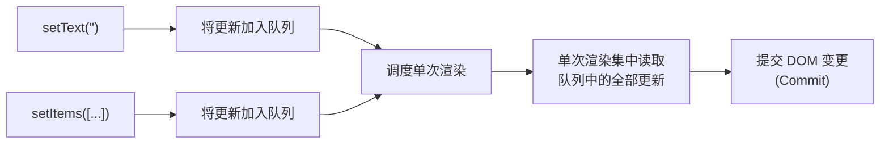
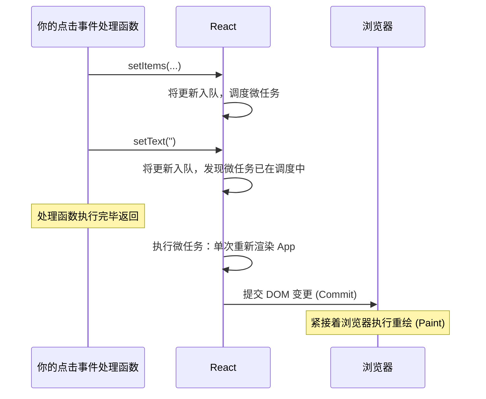

# 状态更新：快照与批处理（State Updates: Snapshots and Batching）

> [!summary] 核心速览（TL;DR）
> 在单次渲染中，状态是一张不可变快照：在当前渲染的生命周期内，它是一个绝不会改变的常量。调用 setter 并不会直接修改该变量，而是**将更新推入队列**并请求 React 安排一次全新渲染。React 会把同一个事件中触发的所有更新自动合并（批处理）到单次渲染中；以点击事件为例，这次渲染会在你的事件处理函数执行完毕后立即触发。

这里有一个几乎所有 React 开发者都曾经写出过的经典 Bug：

```jsx
function handleAdd() {
  setText("");
  console.log(text); // 打印出的依然是旧的 text。为什么？
}
```

你刚刚明明把 `text` 设成了 `""`，紧接着下一行代码却显示它依然是 `"Eggs"`。直觉上，你可能会觉得 `setText` 是“异步”的、还没执行完。但这并不是根本原因——弄清楚背后的真正机制，能让你彻底参透一整类困扰已久的 React 谜团。

## 状态是一张不可变快照（State is a snapshot）

让我们再次回顾购物清单应用中的 `App` 组件：

```jsx
function App() {
  const [items, setItems] = useState([{ id: 1, name: "Milk", done: false }]);
  const [text, setText] = useState("");
  // ...
}
```

`text` 是用 `const` 声明的局部变量，它属于 `App` 组件的**当前这一次函数调用**。当 React 渲染 `App` 时，它会把当前的状态值传递给你；在该函数执行完毕返回之前，这个值都会保持绝对恒定。你在本次渲染期间创建的每一个事件处理函数，闭包捕获的也都是这同一个 `text`。

因此，在单次渲染的生命周期中，`text` 就是一张**快照（Snapshot）**：如同 React 在调用你的组件函数那一瞬间，给当前状态拍下的一张照片。调用 `setText("")` 根本不可能伸手钻进那张照片里去篡改它。更何况它被声明为 `const` 常量，哪怕 React 想这么做，JavaScript 语言本身的语法规则也绝不允许。

新值只会在**下一次渲染**中登场：那是 React 对 `App` 进行的全新一次函数调用，伴随着一个全新的 `text` 局部变量，以及闭包捕获了该新值的全新事件处理函数。

> [!tip] 心智模型（Mental Model）
> 每次渲染就像是电影胶片里的一帧画面。该帧中的 state、props 以及所有事件处理函数，都严格归属于这一帧，并且永远保持不变。调用 setter 绝不是在涂改当前这一帧画面，而是在请求 React 开机拍摄下一帧。

## Setter 的本质：将更新推入队列（A setter queues an update）

那么，调用 `setText("")` 时到底发生了什么？在它同步执行完毕并返回之前，大致完成了三件事：

1. 创建一个轻量的**更新对象（Update object）**，内容大致标记为“将此状态设置为 `""`”。
2. 将该更新对象推入属于该状态的**更新队列（Queue）**中；该队列挂载在组件对应的 React 内部 Fiber 节点上（参见 [[02 Elements, Components and the Tree|第 2 篇 · 元素、组件与树模型]]）。
3. 告知 React 该组件需要重新渲染，React 随即调度并安排一次后续的渲染工作。

更新记录在调用的瞬间就已同步生成。真正被推迟延后的，是**读取并消费这些更新的“渲染阶段”**。这就是为什么说“setState 是异步的”容易让人产生误解：这里根本没有任何 Promise 在等待，你也无法通过 `await` 去等待它。更严谨准确的描述应当是：**入队排队，批量处理（Queued and batched）**。



## 直接传值 vs 传递更新函数（Values vs updater functions）

Setter 函数既可以接收一个具体的新值，也可以接收一个函数。当你需要对同一个状态连续触发多次更新时，两者的差异就会立刻显现。

假设我们要添加一个“快捷添加”按钮，希望一次性添加两件物品：

```jsx
function quickAdd() {
  setItems([...items, { id: 1001, name: "Bread", done: false }]);
  setItems([...items, { id: 1002, name: "Butter", done: false }]);
}
```

然而最终列表中只出现了 Butter。这是因为两行代码读取的都是 `items` 在当前渲染中的同一份快照，第二行更新的意思其实是“把列表替换为：旧列表加上 Butter”，从而直接覆盖了第一行的更新。

如果改用**更新函数（Updater function）**，React 就会按顺序依次执行队列中的函数，每个函数都会接收到上一个函数计算后的最新结果：

```jsx
function quickAdd() {
  setItems((prev) => [...prev, { id: 1001, name: "Bread", done: false }]);
  setItems((prev) => [...prev, { id: 1002, name: "Butter", done: false }]);
}
```

在下一次渲染时，React 会依次遍历整个队列：从当前列表状态出发，应用第一个更新函数，再应用第二个更新函数。最终，两件物品都会稳稳地写入新状态中。

实践中的黄金法则：**只要新状态需要依赖旧状态推导得出，务必使用更新函数。** 而当你只是单纯地全量替换状态时（例如 `setText("")`），直接传入普通值完全没问题。

> [!warning] 更新函数必须是纯函数（Updaters must be pure）
> React 可能会在调用 setter 时立即执行你的更新函数（以此判断状态是否真的发生了变化），也可能会推迟到下一次渲染时才执行；而在开发模式的严格模式（StrictMode）下，React 还会刻意调用它两次来帮你排查隐患。切勿在更新函数内部执行副作用（如打点统计、就地修改 `prev` 对象等）。

## 自动批处理（Automatic batching）

看一下我们示例中的添加事件处理函数：

```jsx
onAdd={() => {
  setItems([...items, { id: Date.now(), name: text, done: false }]);
  setText("");
}}
```

两次调用 setter，更新了两个独立的状态。然而 `App` 组件只重新渲染了**一次**，而不是两次。这就是**批处理（Batching）**：React 会把在同一个事件上下文中入队的所有更新统一收集起来，并在单次渲染中合并处理。

你不需要显式进入某种特殊的“批处理模式”。批处理其实是 React 调度机制自然而然的产物：第一个 setter 触发时，会请求 React 调度一次渲染；而后续的 setter 执行时，发现渲染任务已经被调度在途，于是只需要把新的更新直接追加到各自的队列中即可。当那次被调度的渲染真正执行时，它能一次性看到并处理所有的更新。

自 React 18 引入 `createRoot` 以来，这种批处理机制在**所有场景下完全通用**：无论是 React 自身的合成事件处理函数、`setTimeout` 异步回调、`await fetch(...)` 之后的 Promise 回调，还是通过原生 `addEventListener` 绑定的监听器中，都能享受自动批处理。而在 React 18 之前，只有 React 原生合成事件内部的更新才能被批处理，在 `setTimeout` 中连续调用两次 setter 会直接引发两次独立的重新渲染。

## 渲染究竟在何时真正发生？（When does the render actually happen?）

对于点击、按键等离散的用户交互事件，答案是：**就在你的事件处理函数刚执行完毕那一刻**，赶在浏览器获得重绘（Paint）机会之前。

当你调用第一个 setter 时，React 会将渲染工作调度到一个**微任务（Microtask）**中——也就是 resolved 状态的 Promise 所使用的同一个异步任务队列。微任务会在当前同步 JavaScript 执行栈清空后立即执行。因此，你的事件处理函数会先同步执行至返回，在此期间调用的每个 setter 只负责把更新推入队列；只有当同步代码全部走完，微任务才会启动。对于点击这类离散事件带来的更新，React 会在微任务内部同步完成渲染与提交（Commit）。



如果是来自非紧急源头的更新（如定时器、网络请求响应），虽然同样会被批处理，但 React 会为其分配较低的优先级，并在稍后的宏任务调度中执行，而非塞在微任务里抢占主线程。如果使用 `startTransition` 包裹更新，优先级还会被进一步调低。在 [[07 Priorities, Transitions and Concurrency|第 7 篇 · 优先级调度与并发]] 中，我们将详细剖析这套优先级调度机制。

这也彻底解开了开头提到的谜团。`console.log(text)` 是在你的事件处理函数内部同步执行的，早于微任务的启动，此时新的渲染根本还没发生。更重要的是，即便渲染发生了，*当前*这个事件处理函数所闭包持有的 `text` 也永远是那张旧快照。新值只存在于下一次渲染所生成的闭包里。

## 传入相同的值会发生什么？（Setting the same value）

如果你调用 setter 时传入的值与当前状态完全相同，React 就可以直接跳过后续的渲染工作。这里的“相同”是指 `Object.is` 比较；对于对象和数组而言，它比对的是**引用是否相同**，而不是比对内部的数据内容。

```jsx
setText(text);                 // 相同的字符串：React 可以跳过渲染
setItems(items);               // 相同的数组引用：React 可以跳过渲染
setItems([...items]);          // 新数组，但内容相同：依然会触发渲染
```

这正是为什么直接在原 state 上就地修改（Mutation）再调用 setter 无法生效的根本原因：

```jsx
items.push(newItem);
setItems(items);               // 相同的引用：React 判定“无变化”从而跳过
```

React 检查发现传入的数组和它手里持有的是同一个引用，便直接放弃后续更新（Bailout），你的就地修改对 React 而言形同虚设。因此，更新状态时切记**始终创建全新的对象或数组**。

不过正如 [[03 What Rendering Really Means|第 3 篇 · 渲染的真正含义]] 中所提醒的，“可以跳过”并不代表“总能跳过”。有时 React 必须先调用你的组件函数执行一次，才能最终确认没有发生任何变化，然后丢弃本次结果，不再向下递归渲染子组件。

## flushSync：紧急逃生通道（flushSync: the escape hatch）

在少数特定场景下，你可能需要让真实 DOM 在事件处理函数的下一行代码执行前**立刻**反映出更新。最典型的场景就是动态添加元素后立即滚动定位到底部：

```jsx
import { flushSync } from "react-dom";

function handleAdd() {
  flushSync(() => {
    setItems((prev) => [...prev, { id: Date.now(), name: text, done: false }]);
  });
  listRef.current.lastElementChild.scrollIntoView(); // 此时新增的 DOM 节点已经挂载进树中
}
```

`flushSync` 会强迫 React 在该回调函数返回之前，同步完成回调内所有更新的**渲染与提交（Commit）**，而不再等待微任务队列。这是一种刻意为之的反向优化（De-optimisation）：它强行插入了一次同步渲染，破坏了原有的自动批处理合并。请仅在为了实现滚动定位、焦点切换、或者精确测量 DOM 尺寸等极少数必须立刻拿到最新 DOM 的场景下，才考虑使用这个逃生通道。

## 闭包陷阱：陈旧闭包（The stale closure gotcha）

状态的快照特性带来了一个非常著名的副作用（Gotcha）：任何长久持有旧渲染中事件处理函数或回调引用的代码，都会持续看到那个历史渲染中的状态快照。

```jsx
function AddItem({ text, onAdd }) {
  function handleSlowAdd() {
    setTimeout(() => {
      console.log(`Adding ${text}`); // 捕获的是创建该定时器那一帧渲染中的 text
      onAdd();
    }, 2000);
  }
  // ...
}
```

如果用户在这两秒钟内继续打字输入，定时器触发时打印出来的依然是旧的 `text`，它所调用的 `onAdd` 也是旧渲染中生成的函数，从而把旧文本添加了进去。这个回调函数就像是对已经被换掉的某一帧旧胶片形成了闭包。

当 Effect 或计时器（Interval）捕获了状态却未能及时重新创建时，也会遇到完全一样的问题。解决之道取决于你的具体诉求：

- **更新函数（Updater function）**：当你仅仅需要依据最新状态计算出下一状态时，`setItems(prev => ...)` 保证拿到的 `prev` 永远是最新的，绝不会陈旧。
- **Ref 引用**：当长生命周期的异步回调必须读取最新值时，可以使用 `ref`。Ref 是一个在所有渲染之间共享的、可变的数据容器。
- **`useEffectEvent`**：用于在 Effect 内部编写那些需要读取最新 props 和 state、但又不想因此导致 Effect 频繁重新执行的逻辑代码。

## 常见认知误区（Common misconceptions）

- **“setState 是异步的”**：更新对象的入队操作在调用时完全是同步完成的。被推迟延后的只有读取它的渲染过程，这里既没有 Promise，也无法通过 `await` 等待。
- **“执行完 `setX(5)` 后，`x` 的值就变成了 5”**：在当前渲染中，`x` 是一个固定不变的常量快照。新值只存在于下一次渲染的函数作用域中。
- **“调用两次 setter 就会触发两次渲染”**：从 React 18 起，同一个事件上下文中触发的所有更新都会被自动批处理合并为单次渲染，即使在 `setTimeout` 和 Promise 回调中也是如此。
- **“先调用 `items.push()` 再调用 `setItems(items)` 会触发重新渲染”**：React 在进行 `Object.is` 比对时发现数组引用并未发生改变，因此会直接跳过渲染（Bailout）。请务必创建并传入全新数组。

## 总结（Summary）

在 React 中，状态本质上是一张**不可变快照**：每次渲染都会获得一组独立的常量值，而在该次渲染期间创建的所有处理函数，闭包捕获的也始终是这组快照值。调用 setter 并不会在原地篡改变量，而是将更新推入队列并调度一次新的渲染；更新函数则让排队的多次更新能够层层累加生效。React 会将同一个事件中入队的所有更新自动批处理合并为单次渲染；对于点击等离散事件，这次渲染会在处理函数执行返回后的微任务中极速完成；同时，基于 `Object.is` 的比对机制允许 React 在数据未发生实际变动时果断跳过无用渲染。`flushSync` 提供了在特定场景下强制同步提交 DOM 的逃生通道，而陈旧闭包则是快照机制下必须掌握的核心心智模型。在接下来的 [[05 Reconciliation - Finding What Changed|第 5 篇 · 协调：比对新旧差异]] 中，我们将跟随这些更新所触发的渲染流程，深入探究 React 如何高效比对新旧界面的差异。

### 核心要点归纳（Key takeaways）

- **不可变快照（Snapshot）**：state、props 和事件处理函数在单次渲染的整个生命周期中都是恒定不变的常量。
- **Setter 的队列机制（Setters queue）**：setter 会立即同步记录更新并调度渲染，绝对不会在原地就地修改变量。
- **更新函数（Updater functions）**：`setX(prev => ...)` 能够将队列中的更新串联成链；凡是新状态依赖旧状态时，务必使用更新函数。
- **自动批处理（Automatic batching）**：来自同一个事件的所有更新最终只会引发一次渲染，全面适用于事件处理函数、定时器、Promise 以及原生 DOM 监听器。
- **渲染触发时机（Timing）**：点击事件的更新会在事件函数返回后的微任务中完成渲染与提交（赶在浏览器重绘之前）；低优先级更新则会在稍后调度执行。
- **`Object.is` 跳过机制（Bailout）**：传入相同引用的值会让 React 跳过渲染，这也是为什么就地修改对象再 set 会失效的原因。
- **`flushSync` 逃生通道**：牺牲批处理性能，强制立即同步完成渲染与提交，专供滚动、焦点和测量等特定场景使用。
- **陈旧闭包（Stale closures）**：旧回调永远闭包捕获旧快照；使用更新函数、Ref 或 `useEffectEvent` 来化解闭包陷阱。

**深入探究源码实现：** [[12 setState - dispatchSetState and Batching|setState：dispatchSetState 与批处理机制]] · [[11 Hooks on Update|Update 阶段的 Hooks 机制]]

---

← [[03 What Rendering Really Means|上一篇：第 03 篇 · 渲染的真正含义]] · [[react-concepts|返回专栏目录]] · [[05 Reconciliation - Finding What Changed|下一篇：第 05 篇 · 协调：比对新旧差异]] →
