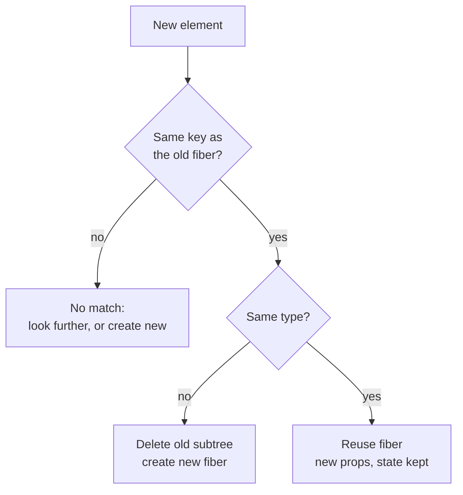

# 协调（Reconciliation）：探寻真正变化的部分

> [!summary] 核心速览（TL;DR）
> React 并不会去计算两棵树之间的“理论最小差异”。在遍历新生成的元素树与现有的 Fiber 树时，它巧妙地应用了两条开销极低的启发式规则：**元素类型不同**意味着“彻底丢弃并重建”，而 **key 属性**则用于在一组同级兄弟节点中指明新旧子节点的对应关系。只要一个新元素能够匹配到旧 Fiber，该 Fiber、内部状态及其对应的真实 DOM 节点就会被完整复用；所有检测到的变动则会被记录为变更标记（Flags），留待后续的 Commit 阶段统一应用到屏幕上。

你的购物清单应用触发了重新渲染。`App` 组件返回了一棵全新的元素树：一个 `<main>`，一个 `<Header>`，一个 `<AddItem>`，以及一个包含三个 `<Item>` 的 `<List>`。而上一次渲染时，它返回的结构几乎完全一样。React 必须在每一次渲染时，精准推导出哪些东西应该保留、哪些需要更新、哪些应当销毁——并且这一切必须快如闪电，绝不能成为应用的性能瓶颈。

这种在新旧结构之间寻找差异的比对过程，就叫做**协调（Reconciliation）**。协调机制遵循的核心规则，能够完美解释你在日常开发中大概率遇到过的三大谜团：
1. 为什么组件的状态有时会“莫名其妙”地被重置？
2. 为什么控制台总是弹出关于缺少 key 的警告？
3. 为什么滥用 `key={index}` 会导致输入框里的内容错位、显示错误？

## 为什么不直接求两棵树的最优 Diff？

在计算机科学领域，求解“将树 A 转换为树 B 所需的最少编辑操作”是一个经典问题。然而，学术界已知的通用最优树 Diff 算法，时间复杂度高达 O(n³)。这意味着，对于一个仅有 1,000 个节点的现代 UI 界面，单次渲染就需要进行高达 10 亿次运算——这在要求 60fps 流畅响应的前端交互中显然是不可接受的。

因此，React 放弃了追求数学上的“理论最小解”，转而采用了一种开销仅为 O(n)（即近乎线性时间复杂度）的启发式（Heuristic）实用算法。这个算法建立在两条大胆却极其贴合真实 UI 场景的假设之上：

1. **两个不同类型的元素会产生完全不同的树结构**：如果一个 `<div>` 变成了 `<section>`，或者 `<Item>` 变成了 `<EditableItem>`，React 绝不会浪费算力去深究两棵树内部可能存在的相似之处。它会干脆利落地卸载并销毁整棵旧子树，从零开始构建全新的子树。
2. **通过 key 属性标识同级兄弟节点中的唯一身份**：当父组件渲染一个列表时，`key` 明确告诉了 React 哪个新子节点对应哪一个旧子节点，即便它们在列表中的排列顺序发生了调整。

在真实的 Web 界面中，这两条假设几乎 100% 成立；而在极少数可能产生误判的边缘场景下，开发者只需显式提供 `key` 属性，就能轻松纠偏。

## React 真正比对的对象到底是什么？

初学者常有一种误解，以为 React 是拿“旧 JSX”与“新 JSX”直接做对比。实际上并非如此。比对的旧端是 **Fiber 树**——即 React 在内存中为每一个已挂载的组件和真实 DOM 节点所持久维护的对象（详见 [[02 Elements, Components and the Tree|第 02 篇 · 元素、组件与树模型]]）；而新端则是组件刚刚执行并返回的新一批 React 元素（即轻量的虚拟对象）。

对于每一个父节点，React 在遍历其新返回的子元素列表时，本质上都在向旧 Fiber 树发出一次灵魂拷问：**在旧树对应的位置上，是否存在一个原本就属于这个新元素的旧 Fiber？**



当新元素的 **key** 和 **type（组件或标签类型）** 同时与旧 Fiber 匹配时，React 就会执行**复用 Fiber（Reuse Fiber）**。此时，该 Fiber 会接收全新的 props，但它内部由 Hook 管理的内部状态（state）以及它所关联的真实 DOM 节点都会被原封不动地保留下来。

这种“复用”正是整个协调机制的精髓所在：
- **保留真实 DOM 节点**：能够无缝保持输入框的光标位置、页面焦点（Focus）以及滚动条位置；
- **保留 Fiber 对象**：能够完好无损地延续组件内部的 `useState` 和 `useReducer` 状态值。

相反，一旦发现类型（type）不匹配，React 就会判定“结构彻底更迭”。它会果断销毁旧 Fiber 及其下属的所有子孙节点，并重新创建全新的 Fiber。这意味着该子树中的所有内部状态瞬时归零，旧的真实 DOM 节点被全数从页面中拔除并重新构建。

> [!tip] 核心心智模型
> 组件的状态（State）从来都不是存放在“你的组件函数代码”里的。状态是寄宿在 **UI 树的特定位置** 上的。只要每一次重新渲染在那个位置上放入的仍然是 **相同类型（type）且拥有相同 key** 的元素，React 就会忠实地将状态锁在原位。

## 状态寄宿在树的具体位置上

这个心智模型能为你解开大量看似不可思议的开发谜题。让我们来看 `App` 中的一个条件切换示例：

```jsx
{editing ? <AddItem text={text} onChange={setText} /> : <AddItem text="" onChange={() => {}} />}
```

在上述代码中，两个分支都在完全相同的树层级和位置上渲染 `<AddItem>`。它们具有相同的类型（`AddItem` 函数引用一致），且都没有指定 key（即 key 均为 `null`）。因此，在 React 眼中，这根本不是什么“新老组件替换”，而始终是**同一个组件接收到了新的 props**！哪怕你在代码中写下了两行独立的 JSX 表达式，`AddItem` 内部的所有局部状态（如输入草稿）在切换时依然会被完整保留。

再来看看相反的情况：

```jsx
{editing ? <EditableHeader count={items.length} /> : <Header count={items.length} />}
```

此时，相同位置上出现的是完全不同的元素类型（`EditableHeader` 与 `Header`）。React 会毫不犹豫地销毁 `Header` 及其整棵子树，然后从零开始挂载 `EditableHeader`。原组件内部的所有状态就此重置，对应的 DOM 结构也会被全量销毁并重建。

> [!warning] 绝对不要在组件内部定义新组件
> ```jsx
> function List({ items }) {
>   function Row({ item }) { return <li>{item.name}</li>; } // 每次渲染都会生成一个全新的函数引用！
>   return <ul>{items.map(i => <Row key={i.id} item={i} />)}</ul>;
> }
> ```
> 在 `List` 每次渲染时，内部的 `Row` 都会被重新分配为一个崭新的函数对象。这意味着每轮渲染中元素的 `type` 引用都与上一轮不同！结果就是：列表中的每一行在每次父组件渲染时都会经历**全量卸载与重新挂载**——内部状态全部丢失，真实 DOM 频繁销毁重建，造成极其严重的性能损耗与输入闪烁。请务必将 `Row` 提升到模块顶层进行定义。

## Key 属性：在兄弟节点中辨明身份

如果没有提供 key，React 只能退化为**按索引位置逐一比对**：旧的第一个子节点与新的第一个子节点比对，第二个与第二个比对，以此类推。只要列表结构保持不变，这种方式尚可工作；但一旦列表结构发生增删或重新排序，这种朴素机制就会瞬间崩溃。

来看看购物清单中的 `List` 组件：

```jsx
function List({ items, onToggle }) {
  return (
    <ul>
      {items.map(item => <Item key={item.id} item={item} onToggle={onToggle} />)}
    </ul>
  );
}
```

有了 `key={item.id}`，当你在列表最前面插入一项 "Eggs" 时，React 能够准确识别出原本的 "Milk" 依然是那个 "Milk"。从概念上讲，React 会为那些无法按原有顺序直接匹配的旧子节点构建一个基于 key 的哈希映射表（Map: `key -> oldFiber`）。随后遍历每一个新元素时，新元素都能通过自己的 key 在这个表中迅速认领属于自己的旧 Fiber：
- **成功匹配的 Fiber**：完好保留自身状态，仅更新 props 并根据需要标记移动；
- **未能匹配的新元素**：作为新增节点创建全新 Fiber；
- **旧树中未被认领的旧 Fiber**：全数打上删除标记并从 DOM 中移除。

为了追求极致性能，React 的单链表 Diff 算法针对最常见的几种场景设计了**双轮遍历与快路径（Fast Path）**：例如列表内容未变、就地更新某些项的属性、或仅仅在列表末尾追加新元素。在这些场景下，React 只需单次线性前向遍历就能完成比对，完全不需要额外构建哈希表；只有在遍历中首次遭遇 key 不匹配时，才会触发慢路径降级为哈希表查找。

值得注意的是，由于 Fiber 树在底层是以单向链表（`child` / `sibling`）结构组织的，React 在比对兄弟节点时**只能向前推进**。因此，某些重排序的实际开销可能会超出你的直觉：比如当你将**最后一项移动到最前面**时，React 并不是单纯把最后一项挪到前面，而是会将前面的所有旧节点依次向后挪动一位以完成重排。尽管这样处理在 DOM 操作上并非“理论最少”，但它完全保证了视觉与逻辑的绝对正确，同时规避了双向指针遍历带来的复杂度和内存开销。

### 为什么滥用数组索引作为 key 会导致严重的逻辑 Bug？

假设每一个 `Item` 组件都包含少许局部状态，比如一个用于记录备注的非受控输入框（`<input>`）：

```jsx
items.map((item, index) => <Item key={index} item={item} />)
```

现在，我们在原有的 `[Milk, Bread]` 最前面插入一项新数据 `"Eggs"`。由于此时的 key 本质上就是数组的下标位置，比对过程将发生灾难性的错位：

| Key（索引） | 旧 Fiber 承载的实际内容 | 传入的新元素数据 |
|---|---|---|
| 0 | Milk（输入框备注："2 litres"） | Eggs |
| 1 | Bread | Milk |
| 2 | （无旧节点） | Bread |

比对时，新数据的 key 为 `0`，恰好匹配到旧树中 key 同样为 `0` 的 Fiber，且组件类型相同！于是，React 误以为“这是同一个组件，只是接收了新属性”，直接复用了原属于 "Milk" 的 Fiber 节点及其 DOM，并强行将 "Eggs" 的 props 灌入其中。

最终的结果是：**原本属于牛奶的备注“2 litres”，离奇地出现在了鸡蛋旁边！** 业务数据虽然换了位置，但组件内部的状态和未受控的真实 DOM 却被死死钉在了原本的“位置 0”上。程序没有任何报错，控制台没有任何警告，但界面呈现的逻辑却已经完全错乱。

使用业务数据中全局稳定的唯一 ID（例如 `item.id`），能确保 key 始终与**实体数据本身**绑定，而不是与**物理槽位**绑定。唯有在列表满足以下全部苛刻条件时，使用 `index` 作为 key 才是安全的：列表纯静态、绝不会发生插入/删除/重排序、且列表项组件本身及所有后代节点都不包含任何局部状态。

## 妙用 `key` 属性：声明式重置组件状态

既然 key 的变动对 React 而言意味着“这是一个截然不同的新实体”，那么你完全可以把 `key` 应用在常规列表之外的场景，用来主动指示 React：“这个组件需要彻底重置”：

```jsx
<ItemEditor key={selectedItem.id} item={selectedItem} />
```

当用户选择切换了 `selectedItem` 时，传入的 `key` 也随之改变。React 会在协调阶段判定前后两个节点不匹配，从而干脆利落地销毁旧的 `ItemEditor`（包括其内部所有的局部草稿状态、未完成的 Effects 以及关联 DOM），并从零挂载一个全新的实例。

这是处理“根据选中对象切换表单内容”时**最优雅、最纯粹的解法**。它彻底避免了在组件内部编写臃肿且容易引发 Bug 的 `useEffect`（即监听 props 变化再手动调用 `setState` 重置表单的“反模式”）。

## 开销最低的比对：全等元素对象引用（Element Identity）

比对（Matching）让 React 确立了新元素究竟对应哪一个旧 Fiber。但接下来，React 还必须做出关键抉择：这个 Fiber 真的需要重新执行组件函数进行渲染吗？

React 进行的第一道检查极其廉价高效：**新的 props 对象与上一次渲染时的 props 对象是否是同一个内存引用？**

在平时的代码中，每一次 JSX 表达式的求值（例如 `<Header />`）本质上都是在调用 `jsx()` 工厂函数，这必然会生成一个新的 React 元素对象以及一个新的 props 对象。因此在绝大多数情况下，引用比对的结果都是 `false`。哪怕每一个具体的 prop 数值完全一致，子组件依然会被迫重新执行渲染。这正是为什么一旦 `App` 发生状态变化，其下属的 `Header`、`AddItem` 和 `List` 会通通被连带重新渲染——在默认情况下，状态更新组件下方的整棵子树都会无差别地进入重新渲染流程。

然而，如果一个组件返回了**与上一次渲染完全相同的元素对象引用（Same Element Reference）**，那么它的 props 对象自然也是同一个内存引用。只要满足以下条件：该子组件自身没有排队的挂起更新、且所消费的 React Context 未曾改变，React 就会直接**跳过（Bail out）**该组件，根本不会调用其组件函数！如果该节点之下的整棵子树同样没有待处理的更新，React 将直接整树复用。

你通常可以通过以下三种方式获得这种珍贵的“对象全等性”：

- **将组件作为 `children` 或 prop 从更上层传递下来**，并在当前组件中原封不动地渲染它（例如布局容器组件）；
- **使用 `useMemo` 手动缓存 JSX 元素**（例如 `useMemo(() => <ExpensiveList />, [])`）；
- **引入 React Compiler（React 编译器）**，由编译器在构建期自动为你完成 JSX 元素的细粒度记忆化（详见 [[11 Memoization and the React Compiler|第 11 篇 · 记忆化与 React 编译器]]）。

而 `React.memo` 则是另一件利器。它改变了这一默认规则，将“对象引用全等比对”替换为了“对每个 prop 进行浅层比较（Shallow Compare）”。但这也意味着，一旦父组件在渲染时传递了内联定义的箭头函数或新建的对象字面量，`React.memo` 的浅比较优化就会直接失效。

## 协调的产物：Fiber 上的变更标记（Flags）

必须牢记：**协调阶段完全不会触碰任何真实的 DOM 节点**。协调过程唯一的产出，就是推导出在后续 Commit 阶段必须执行的具体任务，并将它们以二进制位掩码的形式记录在各个 Fiber 节点的 **`flags`（副作用标记）** 属性上。

在概念上，最核心的标记包括：

- **Placement（插入或移动）**：表示该 Fiber 所对应的真实 DOM 节点需要被新插入到页面中，或者其在兄弟节点间的相对位置发生了改变，需要移动物理 DOM。
- **Update（更新）**：表示该 Fiber 的某些属性发生了变更，例如 DOM 属性/文本内容需要修改，或者组件内部存在需要重新执行的副作用（Effect）。*注：原生 DOM 属性的具体更新标记，实际上是在协调后“向上归并（completeWork）”遍历树的过程中精确标记的。*
- **ChildDeletion（删除子节点）**：表示旧树中的某些子节点在新结构中已不复存在。父级 Fiber 会专门开辟一个列表（`deletions`）来收拢它们，以便在 Commit 阶段将它们对应的真实 DOM 一并拔除，并触发卸载生命周期。

这里还有一个极其优美且高效的设计细节：在初次挂载（首次渲染）时，React **仅仅会在新树的最顶层 Fiber 节点上打上 `Placement` 标记**。整个下层 DOM 子树都会在内存中预先离屏拼装完成，最后只需一次原生的 DOM 插入操作即可整体呈现到页面上。此后任何动态新增挂载的整棵组件子树同样遵循这一规则——永远在子树顶端执行单次挂载插入，而不是逐个节点频繁触发 DOM 写入。

## 常见认知误区

- **“React 是将虚拟 DOM 与真实 DOM 进行对比”**：绝非如此。React 始终是将新生成的 React 元素（虚拟描述）与内存中已有的 **Fiber 树** 进行比对，整个协调阶段绝不会读取或触碰真实 DOM。唯有在 Commit 阶段落实各项标记时，才会真正操作 DOM。
- **“React 只会重新渲染真正发生变化的部分”**：这是混淆了“组件渲染执行”与“DOM 写入”。当状态更新时，React 默认会自上而下重新执行该组件及其**下属的所有子孙组件函数**。协调算法的作用是在这些组件全部执行完毕后，分析出哪些执行结果真正导致了 DOM 变化。想要真正跳过子组件的执行，必须依赖元素引用全等、`React.memo` 浅比较、或由 React 编译器进行缓存优化。
- **“Key 属性只是一种性能优化提示”**：大错特错。`key` 的核心职责是决定节点的**唯一身份（Identity）**，而身份直接决定了状态（State）寄宿在何处。错误的 key 首当其冲是一个会导致状态串门、数据错位的**功能正确性 Bug**，其次才谈得上性能问题。
- **“写了两段不同的 JSX 表达式就代表两个不同的组件”**：React 只关注树的逻辑位置以及元素的 `type`。只要两段三元分支在同一树位置返回了相同 `type` 且无 key 差异的元素，React 就会将其视为同一个组件实例，只做属性更新，并完整保留其内部状态。

## 总结

协调（Reconciliation）是 React 在每轮渲染中将新生成的元素树与内存中现存的 Fiber 树进行精确匹配的核心机制。为了避免通用树 Diff 算法高达 O(n³) 的灾难级开销，React 依托两条极其贴切的启发式假设，将比对复杂度缩减到了近乎 O(n) 的线性水平：**类型不同则整树重建**，以及**借助 key 属性在兄弟节点间精确锚定身份**。

只要新元素在相同位置成功匹配到了 key 与 type 均相同的旧 Fiber，React 就会完整复用该 Fiber 节点、内部挂载的状态以及关联的物理 DOM。这也揭示了 React 的核心心智法则：**状态始终寄宿在树的特定位置与身份上**。正因如此，`key` 既能用来保护列表项的状态不发生串位，也可以被主动用来声明式地销毁并重置组件。

在比对之初，全等元素引用的判断（Same Element Reference）构成了跳过组件执行的最廉价手段。而整场协调推导的最终结晶，是一棵挂满了 `Placement`、`Update`、`ChildDeletion` 标记的 Fiber 树，这些标记将在随后的 Commit 阶段集中兑现为真实的 DOM 变更。

在接下来的 [[06 Fiber - Work You Can Pause|第 06 篇 · Fiber：可被中断与恢复的工作单元]] 中，我们将把聚光灯对准协调算法所遍历的核心主角——Fiber 节点，揭开 React 能够随时暂停、让出主线程并精准恢复工作的底层技术秘密。

### 核心要点归纳

- **放弃通用树 Diff**：通用最小编辑距离算法复杂度高达 O(n³)，React 采用两条开销仅为 O(n) 的启发式规则替代。
- **类型不同直接重建**：一旦元素 `type` 发生改变，React 会直接卸载销毁整棵旧子树（包括状态与 DOM），从零构建新子树。
- **类型与 key 均相同则复用**：React 复用旧 Fiber 节点，传入新的 props，并完整保留其 Hook 状态和真实 DOM 节点。
- **状态寄宿于树的位置**：状态属于树的结构槽位；只要该位置上的元素类型和 key 保持稳定，内部状态就能跨渲染存活。
- **基于业务 ID 的稳定 key**：来自数据的唯一 ID 让组件状态如影随形地跟着数据走；而数组索引 key 只绑定物理位置，在列表增删排时会导致严重的状态错位 Bug。
- **巧用 key 重置组件**：当需要彻底重置表单或组件时，改变 key 是最优雅的声明式解法，无需手写多余的副作用。
- **元素引用全等（Element Identity）**：完全相同的元素引用意味着 props 绝对未变，React 会直接跳过组件函数的执行（Bail out）。
- **副作用标记（Flags）**：协调阶段纯粹在内存中计算变动，绝不直接碰触真实 DOM，所有待执行任务均以 Placement、Update、ChildDeletion 等标记沉淀在 Fiber 上供 Commit 阶段消费。

**深入探究源码实现：** [[07 beginWork and Reconciliation|beginWork 与协调（Reconciliation）源码深度拆解]]

---

← [[04 State Updates - Snapshots and Batching|上一篇：第 04 篇 · 状态更新：快照与批处理]] · [[react-concepts|返回专栏目录]] · [[06 Fiber - Work You Can Pause|下一篇：第 06 篇 · Fiber：可被中断与恢复的工作单元]] →
