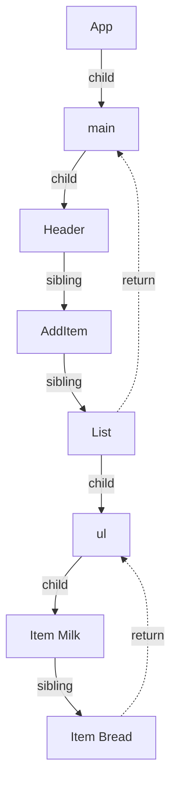
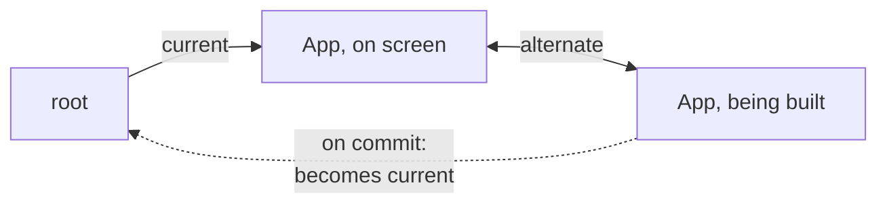

# Fiber：可被中断与恢复的工作单元（Fiber - Work You Can Pause）

> [!summary] 核心速览（TL;DR）
> **Fiber** 是 React 为每个组件实例或真实 DOM 节点维护的一个轻量、长期存活的 JavaScript 对象，同时它也是渲染流程中的一个**工作单元（Unit of Work）**。所有 Fiber 节点通过 `child`（子节点）、`sibling`（兄弟节点）以及 `return`（父级返回指针）连接为单向链表树，使 React 能够摆脱传统的递归调用，改用普通循环遍历整棵树。由于是循环，React 可以在处理完任意一个 Fiber 后随时停下来把主线程让给浏览器，稍后再无缝恢复；甚至可以直接把只构建了一半的工作树全盘废弃。在整个渲染过程中，React 始终维护两棵树：屏幕上正在展示的 **current（当前树）** 与后台正在构建的 **workInProgress（正在构建的工作进展树）**，并在最终提交（Commit）时仅通过一行指针切换完成瞬间替换。

在购物清单应用的搜索框里快速打字时，下方庞大的过滤列表正在同步触发重新渲染。在理想的用户体验下，你在输入框敲下的每一个英文字符都应立即响应上屏，而下方庞大的过滤列表则可以稍后跟进更新。为了实现这种流畅感，React 必须具备一种前所未有的能力：**在渲染庞大树结构的中途随时暂停，将主线程控制权归还给浏览器以响应用户的按键事件，随后再继续完成剩余渲染，或者直接推倒重来。**

这听起来很美好，但在传统的 JavaScript 函数调用机制下，这在技术上是**根本不可能实现的**。本章节要拆解的，正是 React 为打破这一语言层面的物理限制而精心打造的数据结构：**Fiber**。

## 调用栈无法被中途暂停

遍历并渲染一棵树，最直观的编程范式无疑是**递归（Recursion）**：首先渲染 `App`，然后遍历其子节点递归渲染每个子组件，子组件再递归渲染孙组件，层层递进。在 React 16 诞生之前（即著名的 Stack Reconciler 时代），React 正是这么干的。然而，这种模式的死穴在于 **JavaScript 的原生调用栈（Call Stack）**。

一旦递归遍历启动，执行引擎便深陷调用栈之中，除了一路执行到底直至栈空，或者中途抛出异常崩溃之外，根本没有任何手段能够优雅地中途退出。你无法对 JavaScript 引擎下令：“先在这里停一下，把主线程让给浏览器绘制一帧，5 毫秒后再精准回到这个节点继续递归”。因为函数执行的中间状态（局部变量、当前指针）全部封存在调用栈的**栈帧（Stack Frames）**中；一旦执行 `return` 跳出，栈帧便会被彻底销毁。因此，一棵层级庞大且深邃的组件树，就意味着一段漫长且**不可打断的铁板一块的工作（Unbreakable chunk of work）**。如果遍历耗时 100 毫秒，浏览器的整个页面与交互就会被死死卡顿 100 毫秒。

React 团队给出的破局方案是：**彻底放弃将调用栈作为待办任务列表**。React 将“当前遍历到树的哪个具体位置”、“当前执行进度如何”等一切状态信息，从底层的调用栈抽离出来，保存在**堆内存（Heap）**中的普通 JavaScript 对象上——在堆内存中，只要有引用维系，这些数据就能跨越任意多次事件循环（Event Loop）轮次而持久存活。

## Fiber 既是树节点，也是工作单元

对于页面中每一个挂载的组件实例、原生 DOM 元素（Host Component）和文本节点，React 都会在堆内存中维护一个对应的 **Fiber**。我们在代码中书写的 JSX 元素（Elements）只是短暂的结构描述，在每次执行渲染函数时都会被重新创建并丢弃；而 **Fiber 才是 React 在多次渲染之间持久驻留的核心载体**。从概念上看，一个 Fiber 节点封装了以下关键信息：

- **节点类型（what it is）**：它究竟是一个函数组件、原生 DOM 标签（如 `ul`），还是纯文本节点等；
- **输入数据（inputs）**：本次渲染传入的新 props，以及上一次渲染完成时生效的旧 props；
- **自身状态（state）**：对于函数组件而言，这里保存着它内部的 Hook 链表（`memoizedState`）；
- **输出产物（output）**：对于原生宿主 Fiber 而言，这里持有指向真实 DOM 节点的直接引用（`stateNode`）；
- **副作用标记（flags）**：记录在 Commit 阶段需要对其执行什么 DOM 操作（例如新增、更新、删除，源自 [[05 Reconciliation - Finding What Changed|第 05 篇 · 协调：探寻真正变化的部分]]）；
- **待处理工作（pending work）**：标记自身或其下方的子树中是否存在尚未执行的状态更新与调度工作（如 Lanes 优先级标记）。

更为精妙的是，每个 Fiber 节点通过三个核心指针与邻居节点紧密咬合：

- **`child`**：指向它的**第一个子节点（大儿子）**；
- **`sibling`**：指向其父节点下的**下一个兄弟节点**；
- **`return`**：指向它的**父节点**。之所以命名为 `return` 而非 `parent`，是因为在工作循环遍历中，当一个 Fiber 处理完毕后，代码需要“返回”到该节点继续处理，它就像函数调用中的返回地址（Return Address）。

以下是购物清单应用局部结构在 Fiber 链表树中的拓扑形态：



注意：所有的子节点不再保存在一个扁平数组中，而是组织成一条**单向链表**。凭借 `child`、`sibling` 和 `return` 这三个指针，React 仅凭一个普通的 `while` 循环和一个记录“当前正在处理哪个 Fiber”的全局变量，就能在组件树中自如穿梭：向下深潜、横向平移、向上回溯。

> [!tip] 核心心智模型
> 一次渲染过程本质上就是一张待办任务清单，清单上的每一个任务项就是一个 Fiber 节点；而 React 唯一的进度书签，就是一个名为“下一个待处理 Fiber（`workInProgress`）”的简单变量。只要手握这张书签，React 就能在处理完任意一个任务项后停下休整，随后精准恢复；若将书签随手扔掉，所有未完成的临时工作便会瞬间烟消云散。

## 工作循环：先自顶向下深入，再自底向上回溯

在渲染阶段（Render Phase），React 遍历整棵树采用的是由其自身逻辑手动控制的**深度优先遍历（DFS）**。针对每一个 Fiber 节点，React 在自顶向下探索的过程中执行 `begin`（开始工作，源码中为 `beginWork`），在自底向上回溯的过程中执行 `complete`（完成工作，源码中为 `completeWork`）。

- **开始工作（Begin / 下潜阶段）**：调用函数组件以获取最新的元素描述，或者读取原生 DOM 元素的 `children`，并将其与旧 Fiber 进行比对协调（Reconcile），生成或更新子级 Fiber 节点。随后将指针移动到它的第一个子节点（`child`）。
- **完成工作（Complete / 回溯阶段）**：一旦某个 Fiber 没有子节点可访问（或所有子节点均已处理完毕），便对其执行收尾工作。对于原生 DOM 节点而言，正是在这个阶段在内存中创建出真实的 DOM 元素实例，或者为其收集计算需要更新的属性集合。收尾完成后，指针移动至它的下一个兄弟节点（`sibling`）；若没有下一个兄弟节点，则回溯至父节点（`return`）并对父节点执行完成工作。

以下是高度抽象的简化伪代码（展示其调度逻辑内核，非 React 内部完整实现）：

```js
// 渲染工作循环逻辑精简示意
let fiber = rootOfTheWork;

while (fiber !== null) {
  // 1. 向下探寻：执行当前节点的工作，并返回其第一个子节点
  const child = begin(fiber);
  if (child) {
    fiber = child;
    continue;
  }

  // 2. 向上回溯：若没有子节点，或子节点已全部搞定，完成当前节点并回退到父级
  while (fiber && !fiber.sibling) {
    complete(fiber);
    fiber = fiber.return;
  }

  // 3. 横向平移：完成当前节点并处理下一个兄弟节点
  if (fiber) {
    complete(fiber);
    fiber = fiber.sibling;
  }
}
```

以渲染 `List` 组件为例，真实的遍历执行时序如下：
开始 `List` → 开始 `ul` → 开始 `Item 牛奶` → 完成 `Item 牛奶` → 开始 `Item 面包` → 完成 `Item 面包` → 完成 `ul` → 完成 `List`。

请特别注意这一规律：**父节点的完成工作（complete）永远晚于其所有子节点**。这一设计具有重大工程价值——正因如此，React 能够在内存离屏环境（Off-screen）中，**自底向上**一次性组装好一整棵全新的真实 DOM 子树，随后在后续的提交阶段仅凭一次轻量的 DOM API 调用即可将其整体插入页面。

此外，这套工作循环绝不会在每次状态更新时无脑遍历整棵树的每个角落。每个 Fiber 节点都清楚地知晓自身或其下方子树是否存在待处理的更新（基于优先级位掩码）。当某棵子树完全没有任何待处理工作时，React 会直接实施跳过机制（Bailout），甚至根本不需要走入这棵子树深处。当深层组件触发 `setState` 时，React 只会顺着根节点直奔该组件所在的单条路径下潜，并仅针对其下方真正需要重新渲染的部分展开遍历。

## 双缓存架构：current 树与 workInProgress 树

在渲染阶段进行期间，React **绝不会直接触碰或修改屏幕上当前正在展示的树结构**。在底层，React 为每个 Fiber 节点同时维护两个版本：

- **current（当前树）**：代表已经完成提交、当前正真实呈现在浏览器屏幕上的 Fiber 节点。
- **workInProgress（正在构建的工作进展树）**：代表正在后台默默构建、准备在下一帧渲染到屏幕上的版本。它是基于 current 树的镜像拷贝，并融合了本次待处理的所有最新状态更新。

每个 Fiber 节点都持有一个 `alternate`（双缓存对应项）指针，精准指向它的另一版本。当一次全新的渲染启动时，React 在访问到每个节点时，会优先复用已有的 `alternate` 节点，或者按需克隆生成对应的 workInProgress Fiber。值得注意的是，**这两个版本的 Fiber 节点共享同一个真实 DOM 节点的引用**——因为物理世界上只有一份真实的浏览器 DOM。



当渲染阶段大功告成进入 Commit 阶段时，React **不需要做任何繁琐的数据深拷贝**。它仅仅是将根节点（`FiberRoot`）的 `current` 引用一指，直接指向构建完毕的 workInProgress 树——顷刻间，原本后台构建的树摇身一变成为最新的 current 树；而原先退役的旧 current 树则沦为下一次渲染草稿本（Scratch space）以便重复利用内存空间。在图形学与游戏开发中，这种经典技术被称为**双缓存（Double Buffering）**：在后台缓冲区（Back Buffer）绘制完下一帧的所有画面，然后极速翻转（Flip）到前台屏幕。

不过这个类比有一个微妙的边界差异：在图形显卡中，后台缓冲区绘制的是完整的像素点阵；而在 React 中，workInProgress 树在内存中描述的仅是一套**变更蓝图与副作用标记（Flags）**。真正的 DOM 节点结构变更与样式修补，依然严格被延迟到切换决断完成后的提交阶段中集中执行（详见 [[08 The Commit Phase and Effects|第 08 篇 · Commit 阶段与副作用（Effects）]]）。

## 节点之间的时间分片与主线程让出

正因为整个工作循环在堆内存中维护的唯一进度指示器只是一个指向“下一个待处理 Fiber”的指针，React 获得了一种非凡的自由度：**它可以在任意两个 Fiber 节点的间隙检查系统时钟，并自主决断是否暂停执行**。如果检测到当前帧的时间预算已耗尽，React 会主动跳出 `while` 循环，将主线程控制权**让出（Yield）**给浏览器，让浏览器去及时处理高优先级的用户输入事件或执行页面重绘（Paint）；待浏览器空闲后，调度器再次唤起工作循环，从刚才那同一个 Fiber 节点无缝恢复继续往下处理。

> [!warning] 绝大多数日常渲染并不会被随意打断
> 让出主线程（Yielding）并非常规渲染的默认行为。由用户点击触发的更新、定时器回调、网络 `fetch` 响应引发的状态变更，以及应用首屏的 `root.render`，即使在 `createRoot` 下，默认也会**一气呵成、同步执行到底**。
> 这种支持中断与时间分片（Time-slicing）的并发渲染，主要服务于 **Transition（过渡更新）**、**Suspense 挂起重试**以及**空闲时段的离屏预渲染（Offscreen work）**。只有当你主动使用 `startTransition` 或 `useDeferredValue` 明确标记时，React 才会开启这一中断机制，具体详见 [[07 Priorities, Transitions and Concurrency|第 07 篇 · 优先级、Transition 与并发机制]]。

此外必须彻底澄清一点：**React 仅在两个 Fiber 节点之间的分界线上检查耗时，绝不可能在一个 Fiber 节点执行的半途中强行掐断**。换言之，如果你写的单个组件函数本身包含极其笨重的死循环或耗时 200 毫秒的复杂算法，这 200 毫秒依然会结结实实地卡死浏览器主线程。**Fiber 架构赋予 React 的是“在 Fiber 节点边界处暂停工作”的能力，它绝不可能把一个本身低效的组件变快。**

## 随时舍弃未完成的工作

拥有随时可保存的进度书签，带来的另一项核心收益是：**随时从容废弃一次渲染的能力（Abort / Abandon）**。

设想这样一个场景：一个处于低优先级 Transition 中的海量列表正在后台执行渲染，任务刚刚进行到一半，用户突然点击了一个高优先级的复选框。点击交互刻不容缓！由于低优先级的任务构建在一棵独立的 workInProgress 树上，React 可以毫不犹豫地**直接扔掉这棵刚刚拼装了一半的半成品树**；它以当前的 current 树为基准，瞬间开启一棵全新的 workInProgress 树来优先处理并提交这次点击更新；待点击事件引发的界面完美呈现在屏幕上之后，React 再基于最新状态重新从头开始跑那个低优先级的 Transition 渲染。

全盘废弃这棵半成品树不会带来任何后遗症：
首先，这棵 workInProgress 树从未真正展示在用户屏幕上；其次，触发那次渲染的状态更新仍妥善保存在队列中，React 随时可以重新演算；最关键的是，**舍弃操作极其廉价**——因为完全没有原生 JavaScript 调用栈需要去层层回溯和清理（Unwind），React 所需要做的，仅仅是丢弃对那个半成品根节点的引用，垃圾回收器自会料理一切。

这一机制对我们的业务代码编写带来了最直接且严肃的法则约束：**一次组件渲染的执行，并不代表它最终一定会被提交到屏幕上。** 你的组件函数完全可能被 React 执行了一次，其返回结果被瞬间丢弃，稍后带着崭新的状态再次被调用。**这正是为什么 React 严苛要求组件渲染函数必须是绝对纯函数（Pure function）**：在渲染函数体内绝不能注册事件监听、绝不能擅自修改组件外部的全局对象、绝不能执行命令式的 DOM 查询与读写。所有那些“必须且只能在屏幕真正渲染上屏后执行一次”的逻辑，必须老老实实写在 Effect 中！

## Fiber 架构带来的核心能力清单

归纳起来，Fiber 架构为 React 注入了五项划时代的核心超能力：

- **暂停与恢复（Pause and resume）**：在处理完任意一个 Fiber 节点后随时刹车将主线程让给浏览器，后续精准回到该节点满血复活；
- **任务废弃（Abort）**：当更紧急的高优先级任务降临时，可直接将未完成的半成品树全盘抛弃；
- **子树跳过（Skip / Bailout）**：遇到没有任何待处理更新的子树时，直接跳过整棵子树的深度遍历；
- **优雅回退（Unwind）**：当某个组件抛出异常或处于 Suspense 挂起状态时，React 可以顺着 `return` 指针一路向上寻访最近的错误边界（Error Boundary）或 Suspense 边界，而无需依赖可能穿越任意代码栈帧的脆弱原生 JS 异常机制；
- **彻底杜绝栈溢出（No stack overflow）**：对于层级深不见底的庞大组件树，普通循环永远不会触发 JavaScript 引擎的调用栈溢出（Maximum call stack size exceeded）报错。

当然，这一切的代价是**内存开销（Memory footprint）**：每个 Fiber 都是一个包含几十个属性的大型对象；而在一个处于活跃更新中的组件生命周期内，React 需要在堆内存中同时维系其 current 与 workInProgress 两份实体。

## 常见认知误区

- **“Fiber 就是虚拟 DOM（Virtual DOM）”**：不准确。人们平时口口相传的“虚拟 DOM”，通常指的是每次渲染函数运行时被极速创建又废弃的轻量 JSX 元素描述（Elements）。而 Fiber 则是 React 在内存中长期保留的重型核心实体——它负责承载组件状态、协调比对差异以及参与调度运算；而且许多 Fiber 节点（如纯函数组件、Context Provider、Suspense）根本不对应任何真实 DOM。
- **“每次重新渲染，React 都会把整棵树重新建一遍”**：混淆了概念。重新创建的仅仅是无状态的 JSX 元素对象。而底层的 Fiber 节点会通过 `alternate` 机制在多次渲染中反复复用，且没有发生状态变更的庞大子树会直接被跳过，根本不会重新构建。
- **“使用了 createRoot 之后，每一次渲染都是可被打断的”**：错误认知。首屏渲染以及绝大多数常规状态更新依然是同步、不可打断地执行到底。可中断渲染仅发生在你显式声明的 Transition 过渡、Suspense 重试或空闲离屏预渲染任务中。
- **“Fiber 是 React 18 才引入的并发特性”**：事实并非如此。Fiber 架构早在 React 16 就已全量落地并成为内部基石。React 18 所做的是在成熟的 Fiber 基础之上，正式上线了能够利用其暂停特性的优先级调度与并发机制。

## 总结

JavaScript 的原生调用栈无法被中途暂停，因此 React 将整个渲染进度从调用栈迁移到了堆内存中的 **Fiber** 节点上。Fiber 是一种长期存活的对象，每个组件实例与原生 DOM 节点各持有一个，并通过 `child`（子节点）、`sibling`（兄弟节点）和 `return`（父级返回指针）彼此串联。渲染过程被转化为一个手动的双向循环：下潜时对每个 Fiber 执行 `begin`，回溯时执行 `complete`，期间仅需一个全局书签变量记录下一个待处理节点。这一架构使 React 能够在执行时间分片任务（如 Transition）时在节点间歇优雅地让出主线程，并在紧急更新降临时果断废弃未完成的半成品树。React 始终维护屏幕上的 current 树与后台构建的 workInProgress 树并在 Commit 阶段进行指针极速切换，这正是为什么一次组件渲染有可能执行了却最终未被展示在屏幕上。

在接下来的 [[07 Priorities, Transitions and Concurrency|第 07 篇 · 优先级、Transition 与并发机制]] 中，我们将揭晓 React 是如何精确判断究竟哪些任务更为紧急的。

### 核心要点归纳

- **递归无法中途暂停**：封存在调用栈帧中的进度在 `return` 后会彻底丢失，导致递归渲染必然是一整块不可打断的耗时黑盒。
- **Fiber 核心定义**：为每个组件或 DOM 节点长期维护的对象，既是树的拓扑节点，也是渲染过程中的最小工作单元。
- **child、sibling 与 return**：三大核心链表指针，使得普通循环只需依赖一个单向书签变量即可遍历整棵深邃组件树。
- **Begin 与 Complete 双向流**：遍历时顺着 `begin` 下潜，再顺着 `complete` 回溯，确保父节点始终在其所有子节点彻底处理完毕后才完成收尾。
- **current 与 workInProgress 双缓存**：React 在屏幕展示树的旁边独立构建下一帧的演进树，提交时只需瞬间切换根节点指针。
- **让出主线程（Yielding）**：仅在两个 Fiber 节点的分界处检查耗时，且主要服务于 Transition 等时间分片任务；首屏渲染和普通更新仍同步执行到底。
- **未完成工作的废弃**：半成品树随时可以丢弃，待处理更新依然安全保留在队列中，这也正是为什么渲染函数必须严格保持为纯函数。

**深入探究源码实现：** [[05 The Fiber Data Structure|Fiber 数据结构底层剖析]] · [[06 The Work Loop - Render Phase|工作循环：渲染阶段底层拆解]]

---

← [[05 Reconciliation - Finding What Changed|上一篇：第 05 篇 · 协调（Reconciliation）：探寻真正变化的部分]] · [[react-concepts|返回专栏目录]] · [[07 Priorities, Transitions and Concurrency|下一篇：第 07 篇 · 优先级、Transition 与并发机制]] →
