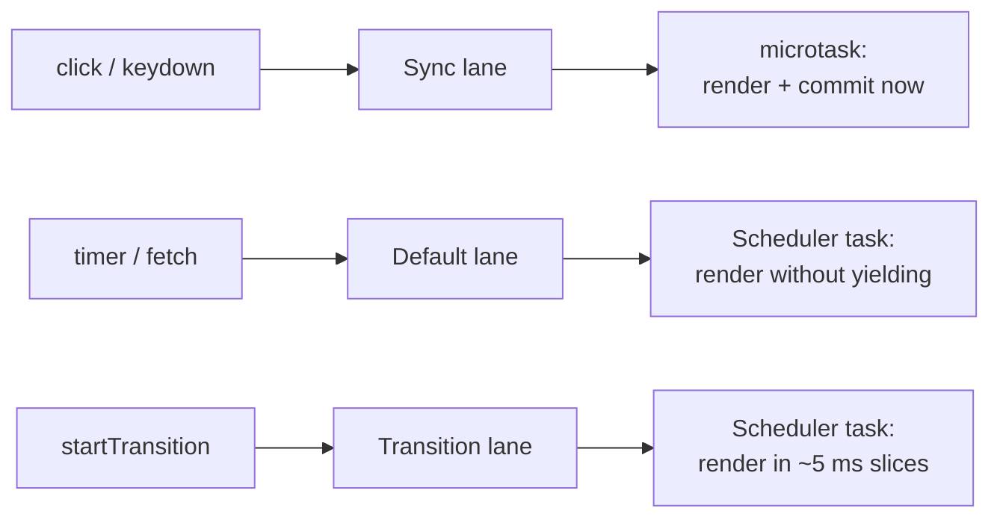
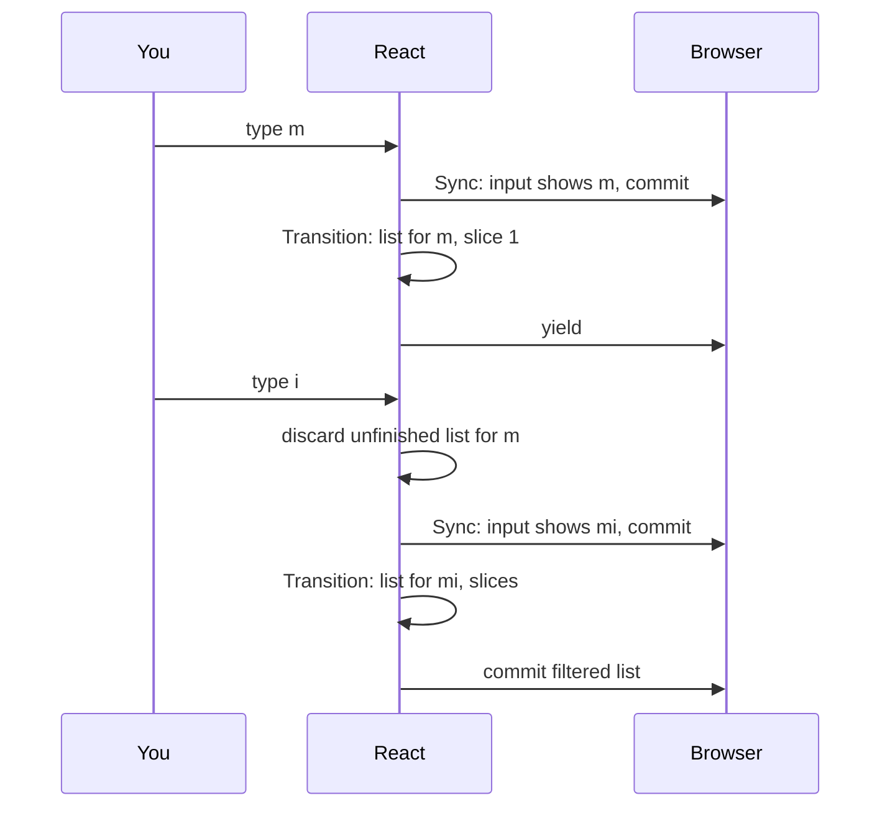

# 优先级、Transition 与并发渲染（Priorities, Transitions and Concurrency）

> [!summary] 核心速览（TL;DR）
> 在 React 中，每个状态更新都会被赋予一个优先级，在源码中被称为 **Lane（优先级赛道）**。用户的点击（Click）和键盘按键（Keydown）属于**紧急更新（Urgent updates）**，会立刻在微任务中执行渲染并提交，绝不向浏览器让出主线程；普通的异步更新虽然被调度在稍后执行，但一旦开始渲染同样会一口气跑完。**Transition（过渡更新）** 是唯一一种会被 React 拆分为微小切片并启用时间切片（Time-slicing）的日常更新——这让紧急任务能够随时“插队”，而等待过久的 Transition 最终也会触发过期机制被强制一口气执行完毕，防止任务饥饿。

给我们的购物清单加一个搜索过滤框。你在输入框里敲下 "mi"，`List` 组件随即重新渲染几千个条目以展示筛选结果。如果用户的每一次按键输入都必须死等这几千项渲染完毕，输入框就会显得非常“卡顿粘连”（Sticky）。你真正期望的体验是：敲击键盘的瞬间，字母立即在输入框中呈现；而下方的过滤列表则在稍后有空闲时跟进渲染即可。

React 完全能够做到这一点，但前提是你必须明确告诉它：究竟哪一个更新才是**必须立刻响应的紧急更新**。在这一篇中，我们将深入剖析 React 是如何为更新划分等级的、在 React 19 中“并发（Concurrent）”究竟意味着什么，以及并发机制的边界在哪里。

## 并非所有更新生而平等（Not all updates are equal）

当你调用一个 state setter（状态更新函数）时，React 会给该次更新打上一个 **Lane（赛道）** 标记，Lane 在底层就代表着该更新的优先级。从概念上看，最核心的 Lane 分类包括：

| Lane 类别 | 触发来源 | 渲染执行方式 |
|---|---|---|
| **Sync（同步）** | 离散用户输入：`click`、`keydown`、`input` 以及 `flushSync` | 立刻在微任务中执行，赶在浏览器绘制之前完成，绝不让出主线程 |
| **Continuous（连续）** | 连续交互事件：`mousemove`、`scroll`、`wheel`、`pointermove` | 极速触发，一旦进入渲染同样绝不让出主线程 |
| **Default（默认）** | 交互事件之外的更新：定时器、`fetch` 回调、首次 `root.render` | 在稍后的宏任务中调度，一旦进入渲染绝不让出主线程 |
| **Transition（过渡）** | `startTransition`、`useTransition`、`useDeferredValue` | 切片执行（Time-sliced），可随时被更高优先级任务打断 |
| **Retry（重试）** | Suspense 边界在异步数据返回后的重新尝试 | 切片执行（Time-sliced） |
| **Idle（闲置）** | 闲置优先级的后台任务 | 仅在系统毫无其他待处理工作时才执行 |

随后，React 会挑选当前待处理队列中**优先级最高（最紧急）**的 Lane，将它们打包合并在一起进行渲染。紧急 Lane 同样享有自动批处理：如果一个点击更新与一个定时器更新同时在等待处理，React 会在同一次渲染中合并处理这两者。

**上述表格的最后一列，正是绝大多数开发者容易产生误解的地方。** 在 `createRoot` 开启的现代 React 中，绝大多数常规更新依然是**一口气执行到底（In one go）**的。一个 Default 级别的更新固然会被*异步调度*启动，但它一旦开始渲染，就会马不停蹄地一口气跑完，中途绝不停顿。在 React 中，只有 Transition（以及 Suspense 重试、Idle 和 Offscreen 离屏渲染）才会真正启用时间切片（Time-slicing）机制。



## 紧急更新路径：同步更新（The urgent path: sync updates）

当你的点击事件处理函数调用 `setText` 或 `setItems` 时，该更新会被分配到 Sync Lane。React 甚至根本不会把这类任务交给调度器（Scheduler）。它会直接在当前事件循环中排入一个微任务（Microtask），并在这个微任务中一次性同步完成渲染（Render）与提交（Commit）。这一切都发生在浏览器从事件回调中收回主线程控制权之前，因此用户在随后的那一帧渲染中就能立刻看到最新画面。

对于需要直观即时反馈的交互而言，这无疑是最理想的行为：复选框在点击的瞬间就应当勾选，按键输入的字母在敲击的刹那必须出现在屏幕上。但这同时也意味着一件事：**只要这次渲染中存在一个耗时很长的慢组件，整个页面就会被硬生生卡住那么久。**

## Transition 过渡更新：“这个可以稍后做”（Transitions: "this can wait"）

`startTransition` 的核心职责，就是将其包裹的所有状态更新标记为**非紧急更新**：

```jsx
function App() {
  const [filter, setFilter] = useState("");
  const [query, setQuery] = useState("");
  const [isPending, startTransition] = useTransition();

  function onFilterChange(e) {
    setFilter(e.target.value);                         // 紧急更新：输入框输入内容
    startTransition(() => setQuery(e.target.value));   // 可以稍等：列表过滤计算
  }
  return (
    <main>
      <input value={filter} onChange={onFilterChange} />
      <List items={items} query={query} dimmed={isPending} />
    </main>
  );
}
```

现在，用户的每一次键盘敲击都会在两个不同的赛道中生成两次更新：`setFilter` 处于 Sync Lane，因此输入框会立刻无延迟刷新；而 `setQuery` 则处于 Transition Lane，因此耗时的列表过滤计算会在稍后以时间切片的方式逐步渲染。`useTransition` 还会提供一个 `isPending` 布尔标记，你可以利用它给列表添加半透明或加载指示器，向用户表明“列表正在拼命计算跟进中”。

在执行 Transition 渲染的过程中，React 会逐一遍历 Fiber 节点树（详见 [[06 Fiber - Work You Can Pause|第 06 篇 · Fiber：可暂停的工作单元]]），并在处理每个 Fiber 的间隙检查系统时钟。一旦累计执行耗时达到约 **5 毫秒**，React 就会主动踩下刹车暂停执行，将主线程控制权交还给浏览器，让浏览器有机会处理用户的其他输入以及屏幕重绘，随后在下一个宏任务时间切片中继续接着干。

> [!tip] 心智模型（Mental model）
> **紧急更新（Urgent updates）** 一旦到来，便会从头到尾一口气执行完毕。而 **Transition（过渡更新）** 则被拆解为细小的切片逐步推进；更关键的是，一旦在切片间歇发现有更紧急的工作到来，React 随时**愿意直接丢弃掉当前半成品**，并在稍后重新推倒重来。

## 中断意味着推倒重来（Interruption means restarting）

假设你敲下了字母 "m"，随后紧接着又敲下了 "i"，而此时针对 "m" 的过滤列表渲染才刚刚执行了一半切片。第二次敲击 "i" 触发的是一个 Sync 级别的紧急更新，其优先级明显高于正在切片渲染中的 Transition。此时 React 绝不会只是将 "m" 的 Transition 挂起暂存等以后再回来续接——它会**果断丢弃（Throw away）**那棵只构建了一半的 Transition 树，优先完成紧急更新的渲染与提交，随后在最新的 state 基础之上，**从头重新开始渲染（Restart from scratch）** Transition。



没有任何更新会在此过程中丢失。Transition 的更新对象自始至终保留在对应 Fiber 节点的更新队列（Update Queue）中，因此当重新启动渲染时，React 能够完整读取到所有的待处理更新，包括最新的 query。此外，**只有严格具有更高优先级的工作才能够打断 Transition**。例如，一个普通的 Default 级更新（如定时器回调）就无法插队，它会老老实实排队等待 Transition 渲染完成。

这同样是为什么 **Render 阶段必须保持纯净（Pure）** 的终极原因：你的组件函数很可能会在一次渲染中被调用执行，而这次渲染所产生的全部结果随后却可能被 React 毫无预警地直接丢弃。如果在组件执行过程中掺杂了网络请求、变量修改等副作用，这些“中途被废弃的幽灵渲染”就会引发不可预知的灾难性 Bug。

> [!warning] 时间切片检查发生在 Fiber 之间，而非组件内部（Slices are per fiber, not per component）
> React 是在**两个 Fiber 节点之间**检查时钟并决定是否让出主线程的。如果某**单个组件**自身的函数逻辑耗时就长达 50 毫秒，那么无论是否使用了 Transition，主线程依然会被结结实实地卡死 50 毫秒。Transition 的时间切片机制能够让工作被分散在**大量组件构成的组件树**中时保持页面流畅，但它无法拯救单个组件自身的超重计算。

## useDeferredValue：从数据消费端实现延迟（useDeferredValue: the same idea from the reading side）

很多时候，你并不直接持有触发更新的 state setter。你只是从上层接收到了一个属性值（比如一个由父组件透传下来的 `query` prop），而你希望组件内部耗时的 UI 渲染能够“稍慢半拍”跟进。`useDeferredValue` 正是为此而生的：

```jsx
function List({ items, query }) {
  const deferredQuery = useDeferredValue(query);
  const visible = items.filter(i => i.name.includes(deferredQuery));
  return <ul>{visible.map(i => <Item key={i.id} item={i} />)}</ul>;
}
```

其工作机制非常优雅：在紧急更新触发的首次渲染中，`deferredQuery` 会继续保留上一次的旧值，这使得耗时的列表能够直接复用旧结果，从而保证当次界面的紧急渲染极速完成。紧接着，React 会自动在 Transition 级别的优先级赛道中调度一次额外的后台更新，使用最新的值重新渲染该组件。这次后台更新具有与常规 Transition 完全相同的特性——可被时间切片，且可随时被更高优先级的用户操作打断。通过这种方式，即便你无法亲自使用 `startTransition` 包裹上游的 setter，也能轻松获得平滑的过渡效果。

## Suspense：“数据尚未就绪”（Suspense: "not ready yet"）

在组件渲染时，它可以向 React 表明自己“尚未就绪，暂时无法完成渲染”——最典型的例子就是它通过 `use(promise)` 读取的数据尚未返回。这时 React 必须在组件树中找到一个停靠点，而这正是 `<Suspense>` 边界（Boundary）的作用所在：

```jsx
<Suspense fallback={<p>正在加载列表…</p>}>
  <List items={items} query={query} />
</Suspense>
```

面对挂起（Suspend）的组件，React 采取的应对策略完全取决于当前的渲染类型：

- 在**不可中断让步的渲染**（Sync 同步渲染或 Default 默认渲染）中：React 别无选择，只能将调用栈回退（Unwind）到最近的外层 Suspense 边界，并立刻将界面切换为它的 `fallback`（占位加载骨架）。
- 在 **Transition 过渡渲染**中：React 拥有更大的回旋余地。它不会立刻放弃已有界面去展示突兀的 loading 占位，而是可以在后台默默等待 Promise 解决（Resolve）；当数据就绪时，它仅需重新渲染那个挂起等待的特定组件，而无需将整棵子树推倒重刷。

当数据最终到达时，React 会在一个专门的 **Retry Lane（重试赛道）** 中调度后续更新，而这个 Retry 同样是基于时间切片的。你可以把 Suspense 边界想象成一堵坚固的“安全防护网”：无论其包裹的内部子组件发生了怎样的挂起等待，“未就绪”的状态都会被牢牢拦在这个边界内，而页面上的其余部分依然可以正常稳定地渲染。

## Scheduler 调度器：与浏览器主线程协同轮换（The Scheduler: taking turns with the browser）

所有非同步的渲染任务都会统一交付给 React 的 **Scheduler（调度器）**。这是一个独立的微型底层包，它内部甚至完全不需要知道什么是“React 组件”。Scheduler 的核心职责非常纯粹：维护一个按照过期截止时间（Deadline）排序的任务队列，并将它们拆分成微小的切片交替执行。

- 每个时间切片的执行时长大约为 **5 毫秒**。一旦达到阈值，Scheduler 就会主动向浏览器让出主线程，以便浏览器能够从容处理用户的键盘鼠标事件以及屏幕像素绘制。
- 它利用 `MessageChannel` 宏任务机制来调度下一个切片。这种方式能在微任务执行完成后以极短的延迟唤醒主线程，彻底规避了浏览器在多层嵌套 `setTimeout` 时强制引入的 4 毫秒最小延迟钳制。
- 当渲染在组件树的中间某个节点主动让出时，React 会向 Scheduler 递交一个“续借函数（continuation function）”。下一个切片被激活时，便能直接从上一次暂停的那个 Fiber 节点无缝恢复执行。

这种调度模式本质上是**协作式（Cooperative）**的。Scheduler 并不能在操作系统层面强行掐断正在运行的 JavaScript 代码；它能够重新夺回控制权的唯一前提，是 React 在遍历 Fiber 节点的间隙主动检查系统时钟，并自觉做出了让步决定。

## 任务防饥饿保护：Lane 过期机制（Starvation protection: lanes expire）

如果用户手指飞快地持续打字，Sync 紧急更新就会源源不断地涌入。在理论上，这可能会导致低优先级的 Transition 渲染被无休止地打断和重启，从而陷入永久的“任务饥饿（Starvation）”。

React 从机制上杜绝了这种情况的发生。每一个入队的 Lane 在创建时都会被赋予一个计算出的过期时间戳（Expiration time）：对于 Sync 和 Continuous 类的高频交互工作，过期窗口大约在 250 毫秒左右；而对于 Default 和 Transition 类的常规工作，过期时间则通常约为 5 秒。任何处于待处理状态的 Lane，一旦等待耗时超过了这个期限，就会被直接标记为**已过期（Expired）**。对于已过期的 Lane，React 会瞬间将其优先级提升至最高，并且不再进行任何切片让步，直接**一口气执行到底（In one go）**，确保任务能够强制画上句号。（注：只有 Idle 闲置工作和 Offscreen 离屏渲染任务永远不会过期。）

因此，在 React 的哲学中，Transition 仅仅代表着“优先级更低，可以稍后做”，绝不意味着“无限期被搁置”。在高频紧急更新的持续轰炸下，Transition 最终依然能够跨越过期红线，强制完成自身的渲染并呈现在用户面前。

## 常见认知误区（Common misconceptions）

- **“使用 `createRoot` 会让应用中的所有渲染都变成并发模式”**：错误。首次挂载渲染以及绝大多数常规的状态更新，在开始后依然是一口气执行完毕、绝不中途让步的。可中断的时间切片并发渲染是一项**显式选择（Opt-in）**的能力，只有通过 `startTransition` 和 `useDeferredValue`（以及 Suspense）声明的更新才会真正启用并发调度。
- **“使用 Transition 会让运行缓慢的代码变快”**：错误。Transition 既不会降低算法复杂度，也不会凭空减少计算量。它所做的事情仅仅是将繁重的工作挪到紧急更新之后，并将其切碎分散在不同的微小时间片中。总的计算工作量完全没有减少；如果某单个组件自身存在耗时数十毫秒的笨重循环，它依然会毫无悬念地卡死浏览器。
- **“被打断的渲染在稍后会从刚才暂停的地方接着往下算”**：错误。当更高优先级的紧急更新插队时，React 会**彻底丢弃**之前渲染到一半的半成品 Fiber 树，并在稍后基于最新的 state 从根节点**重新推倒重来**。只有在没有新更新插队、仅仅是因为 5 毫秒切片用尽而主动向浏览器让出主线程时，React 才会从同一个 Fiber 节点平滑续接。
- **“低优先级的后台任务可能会被频繁输入无限期饥饿阻塞”**：错误。所有 Lane 赛道都拥有防饥饿过期时间限制。一旦 Transition 等待超时，它就会被标记为 Expired 并立刻提升为最高优先级，强制一口气跑完全程。

## 总结（Summary）

React 使用 **Lane（赛道模型）** 为每一次状态更新精确评定优先级：Sync 用于点击和按键等离散输入，Continuous 用于滚动等连续交互，Default 用于定时器和网络请求等常规异步更新，Transition 用于开发者显式标记的非紧急工作，此外还包括 Retry（重试）和 Idle（闲置）。在现代 React 19 中，**唯有 Transition、Suspense 重试、Idle 以及 Offscreen 任务会真正启用时间切片**；其余绝大多数更新一旦启动，依然是一口气执行到底。Transition 会在 Scheduler 的协同调度下以约 5 毫秒为单位切片推进；遭遇紧急工作插队时，半成品树会被果断丢弃并在最新状态下推倒重来；而一旦等待时间突破红线，过期机制则会强制其一口气执行完毕以彻底避免饥饿。Suspense 边界则为异步等待划定了安全防护网，让局部未就绪不至于殃及全局。在下一篇 [[08 The Commit Phase and Effects|第 08 篇 · Commit 阶段与副作用]] 中，我们将详细探讨当协调渲染终于尘埃落定后，React 是如何将变更真实落地到屏幕并触发各类生命周期副作用的。

### 核心要点归纳（Key takeaways）

- **Lane 优先级赛道**：每一次更新都被赋予优先级标记，React 始终优先挑选当前待处理队列中最紧急的赛道打包合并渲染。
- **Sync 同步更新**：点击与按键事件在微任务中完成渲染与提交，抢在浏览器下一次绘制前完成，中途绝不让出主线程。
- **Default 默认更新**：虽由 Scheduler 宏任务调度启动，但一旦进入渲染阶段，同样会一口气跑完，不启用时间切片。
- **`startTransition` 与 `useTransition`**：将指定更新标记为可中断的非紧急任务，同时允许同事件中的紧急操作立刻先行渲染。
- **中断与重启机制**：更紧急的工作插队时，会彻底丢弃未完成的 Transition 半成品树；待紧急更新提交后，基于最新状态重新从头计算。
- **`useDeferredValue`**：从数据消费端让耗时 UI“稍慢半拍”跟进，底层同样通过调度 Transition 级别的并发切片任务实现。
- **Suspense 边界**：设定“数据尚未就绪”的拦截防线与 Fallback 占位，数据到达后触发基于时间切片的 Retry 重试。
- **Scheduler 与任务过期**：工作以约 5 毫秒切片推进并穿插浏览器绘制；长时间等待的赛道会触发过期机制，强制一口气跑完以杜绝饥饿。

**深入探究源码实现：** [[04 Lanes and the Scheduler|Lane 模型与调度器 Scheduler]] · [[03 root.render - Scheduling the First Update|root.render：调度首次更新]]

---

← [[06 Fiber - Work You Can Pause|上一篇：第 06 篇 · Fiber：可暂停的工作单元]] · [[react-concepts|返回专栏目录]] · [[08 The Commit Phase and Effects|下一篇：第 08 篇 · Commit 阶段与副作用]] →
