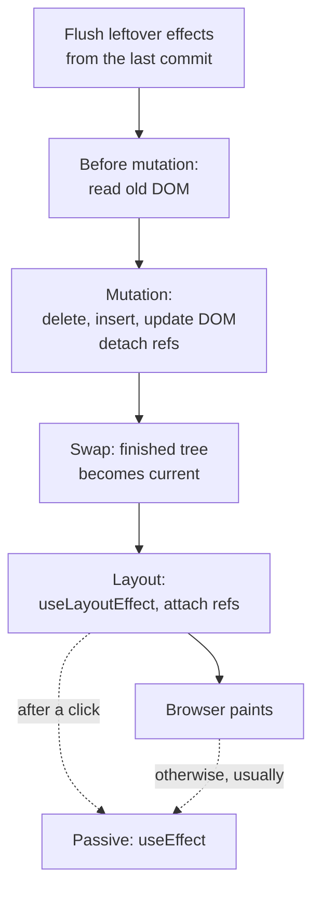

# Commit 阶段与副作用（The Commit Phase and Effects）

> [!summary] 核心速览（TL;DR）
> 一旦渲染（Render）阶段完成，React 就会在一个**不可中断的单一同步代码块**中执行提交（Commit）：它依次修改真实 DOM、将构建好的新树切换为当前树（current），随后在浏览器绘制屏幕之前，同步执行布局副作用（`useLayoutEffect`）并绑定 refs。而 `useEffect` 声明的被动副作用通常会在稍后、即浏览器完成像素绘制之后异步执行；但在点击等离散交互更新之后，React 会在 Commit 阶段末尾立即同步清空它们。此外，所有的清理函数（Cleanups）都严格在新一轮挂载函数（Setups）之前执行。

你在购物清单里勾选了“牛奶”（Milk）。在前几篇介绍的渲染流程之后，React 在内存中生成了一棵构建完毕的正在工作树（Work-in-progress 树），上面打满了标记各项变更的副作用标记（Flags）。此时，屏幕上的像素还纹丝未动。与此同时，你的 `Header` 组件希望把剩余待办数量同步更新到 `document.title` 中，而某个 `Item` 组件则想测量自身的 DOM 高度以呈现划线删除动画。

这些操作究竟谁先执行？高度测量能否拿到最新的 DOM 节点？用户有没有可能在屏幕上瞥见只更新了一半的残缺列表？本篇将深入 **Commit 阶段（提交阶段）**——也就是 React 将内存中的渲染结果真正应用到屏幕上的关键阶段，逐一解开这些疑问。

## Commit 是一个不可中断的同步执行块

渲染阶段（Render phase）可以暂停、废弃并重新开始（详见 [[06 Fiber - Work You Can Pause|第 06 篇 · Fiber：可被中断与恢复的工作单元]]）。但 Commit 阶段绝不能这么做。一旦 React 迈入 Commit 阶段，它就会一口气从第一个 DOM 变更一直同步执行到最后一个布局副作用，全程绝不出让主线程控制权。

这一设计深思熟虑。倘若 React 在修改 DOM 的中途停顿出让，浏览器就可能在这一瞬间完成绘制，导致用户在屏幕上看到“一部分元素已经更新、另一部分却还是旧数据”的撕裂残缺画面。将所有 DOM 操作集中在单一同步执行块中完成，确保了用户眼中要么是完整的旧界面，要么是完整的新界面，绝无中间状态。

这也意味着 Commit 阶段有着高度固定且值得信赖的**子阶段执行顺序（Sub-phases）**：



## 步骤 0：清空上一轮提交遗留的副作用

在将全新 Fiber 树真正应用到界面之前，React 必须首先把上一轮提交中尚未执行完毕的任何 `useEffect` 任务全部冲刷（Flush）执行掉。这里的规则极其纯粹：**第 N 次提交的 Effects 必须严格在第 N+1 次提交修改真实 DOM 之前执行完毕**。如此一来，任何副作用被唤醒时，绝不会面对一个“已经跨越了两个更新周期、物是人非”的超前 DOM 环境。

## Before Mutation 阶段：对旧 DOM 的最后凝视

这个短暂的子阶段会在任何 DOM 真正变更之前，对当前的 DOM 状态进行最后一次读取。React 会记录当前哪个元素拥有焦点（Focus），以及用户选中了哪段文本（Selection），以便在后续变更完成后精准恢复。同时，React 会在此处临时禁用内部事件系统——防止某些能够同步触发事件的 DOM 操作（比如移除一个带有焦点的输入框所同步触发的 `blur` 事件）在 Commit 阶段中途重入并打乱 React 的执行节奏。

对于类组件而言，著名的生命周期钩子 `getSnapshotBeforeUpdate` 正是在这个阶段触发的，这是在列表插入新节点导致高度激增前读取真实滚动位置的最后机会。

## Mutation 阶段：真正变更真实 DOM

此时，React 开始大刀阔斧地将协调阶段计算得出的副作用标记（Flags，详见 [[05 Reconciliation - Finding What Changed|第 05 篇 · 协调（Reconciliation）：探寻真正变化的部分]]）应用到真实 DOM 上：

- **删除节点（Deletions）**：对于被卸载的组件，React 会同步执行其布局副作用清理函数（Layout-effect cleanups）并解绑 refs（为 ref 传入 `null`，或调用 React 19 的 ref 清理函数）。随后，React 会一次性将该被删子树的最顶层 DOM 节点从文档中移除，其下所有的子孙 DOM 节点随之整体脱离。
- **插入与移动节点（Insertions and moves）**：新增或发生位置调整的 Fiber 节点，其对应的 DOM 节点会被插入到正确的目标位置。由于全新挂载的子树早在内存离屏状态下就构建完成了，React 仅需在子树顶层执行一次插入操作即可完整嵌入。
- **属性更新（Updates）**：发生变更的 DOM 属性（Attributes）和文本内容（Text）会被写入现有的 DOM 节点。

在这个阶段，还会伴随执行两类特殊的副作用逻辑：

- **`useInsertionEffect`**：其清理函数与挂载函数（Setup）均在 Mutation 阶段同步执行，早于任何布局副作用。它专为 CSS-in-JS 库（如 Styled-components、Emotion）量身设计，确保在任何代码尝试测量页面尺寸之前，将必要的 `<style>` 样式规则精准注入 DOM。在日常业务开发中你几乎用不到它。
- **`useLayoutEffect` 清理函数**：即将重新执行布局副作用的组件，其上一轮遗留的清理函数会在此刻率先被同步调用。

在 Mutation 阶段的末尾，React 会恢复先前保存的焦点和选区状态，并重新启用事件系统。

## 双缓冲树指针切换（The Swap）

紧随 Mutation 阶段之后，React 会将根节点的指针直接指向这棵刚刚构建完毕的 Fiber 树。此时，**正在工作树（Work-in-progress 树）正式蜕变升级为当前树（Current tree）**，而先前的旧树则降级为备用缓存空间，供下一次渲染时复用。

这个指针切换的时序至关重要且精密考究：在 Mutation 阶段运行的代码（例如正在被移除组件的清理逻辑）所看到的当前树依然是旧树；而即将步入下一阶段执行的代码，所看到的就已经是全新的 Current 树了。

## Layout 阶段：DOM 结构已就绪，屏幕像素尚未绘制

此时，React 开始执行 `useLayoutEffect` 的挂载函数并绑定 refs（例如执行 `ref.current = node`，或调用你的 ref 回调函数）。类组件的 `componentDidMount` 和 `componentDidUpdate` 也是在此处被调用的。

在这个时间节点上，DOM 树已经完全更新完毕并挂载在文档中，调用 `getBoundingClientRect()` 能够拿到百分之百真实的几何尺寸。但**浏览器尚未真正绘制像素**，因为当前的 JavaScript 宏任务仍在同步霸占主线程。这也正是布局副作用（Layout effects）成为“测量尺寸并同步校准界面”绝佳场所的原因所在：

```jsx
function Item({ item, onToggle }) {
  const ref = useRef(null);
  const [height, setHeight] = useState(0);
  useLayoutEffect(() => {
    setHeight(ref.current.getBoundingClientRect().height);
  }, [item.done]);
  return <li ref={ref} onClick={() => onToggle(item.id)}>{item.name}</li>;
}
```

这里在 `useLayoutEffect` 中调用的 `setHeight` 会被 React 视为同步紧急任务，React 会在当前同一个任务中立即完成重新渲染与提交，全部赶在浏览器把这一帧绘制到屏幕之前完成。因此，用户绝不会看到使用旧高度的中间帧，这就是经典的“测量尺寸后设置状态”能够彻底避免画面闪烁（Flicker）的底层原理。

布局副作用严格遵循**子组件优先（Children first）**的执行顺序：父组件的 layout effect 执行时，完全可以笃定子组件的 refs 已经完成设置。

> [!warning] 布局副作用会推迟首屏绘制
> `useLayoutEffect` 中的所有代码均在浏览器绘制屏幕之前同步执行，而且在此处读取布局属性会强制浏览器立即同步计算布局（Reflow）。因此，请仅将布局副作用用于“测量并同步调整样式”的操作。常规的数据拉取、事件订阅和埋点日志应归入 `useEffect`。

## 被动副作用：`useEffect`

`useEffect` 的挂载逻辑属于**被动副作用（Passive effects）**。React 绝不会在 Commit 同步执行块内运行它们。在 Commit 阶段开始时，React 会为它们在调度器中注册一个独立的异步任务，该任务通常会在**浏览器完成像素绘制之后**才执行：

```jsx
function Header({ count }) {
  useEffect(() => {
    document.title = `${count} 项待办`;
  }, [count]);
  return <h1>购物清单 ({count})</h1>;
}
```

更新网页标题完全不需要阻塞屏幕的绘制呈现，因此被动副作用是处理此类操作的最理想归宿。

然而，这里存在一个极其关键的例外情况。当本次提交源于**离散更新（Discrete update）**——例如用户的点击事件（click）、键盘按键（keydown）或者调用了 `flushSync` 时，React 会在 Commit 阶段的末尾，**在浏览器绘制之前同步执行所有的被动副作用**。这样能够保证用户的直接交互结果及其引发的全部副作用立即达成状态一致。在购物清单中勾选“牛奶”属于点击交互，因此 `Header` 的 effect 实际上在浏览器绘制该帧之前就已经执行完毕了。

> [!warning] “useEffect 在绘制后执行”仅是一项经验法则
> 对于非离散更新，React 会在独立的任务中调度 effects，并主动向浏览器出让主线程以便浏览器先行绘制。但浏览器是否真的一定能在两个宏任务交替的间隙完成像素绘制，完全取决于浏览器自身的调度策略。而在点击等交互之后，effects 更是按设计会在绘制前同步执行。如果你坚决要求代码必须在“绘制之前”执行，请使用 `useLayoutEffect`；如果你严格要求必须在“真实绘制之后”执行，切莫完全依赖 `useEffect` 的时机（可以结合 `requestAnimationFrame`）。

> [!tip] 核心心智模型（Mental Model）
> 从第一个 DOM 变更到最后一个布局副作用，全程是一个连贯不可分割的单一 JavaScript 任务，浏览器只有在该任务彻底结束后才能绘制屏幕。`useEffect` 的定位则是“Commit 结束之后尽快执行”：在常规场景下通常发生在绘制之后，但在由点击等离散交互触发的 Commit 中，则会在绘制之前同步清空。

## 清理函数（Cleanups）的执行时序

当某个 Effect 的依赖项发生变化时，React 会先用**上一次渲染保存的旧值**执行上一轮留下的清理函数，随后才运行新一轮的挂载函数（Setup）。而在整棵组件树的全局视角下，这一时序保证更加严密：

- **所有**布局副作用的清理函数（Layout cleanups）均在 Mutation 阶段集中执行，严格早于**任何**布局副作用挂载函数的执行；
- 在被动副作用阶段（Passive phase），整棵树中**所有** `useEffect` 的清理函数，都必须严格在**任何** `useEffect` 的挂载函数执行之前全部跑完。这其中也完整包含了本轮提交中刚刚被移除的组件的清理函数；
- 在上述每一轮遍历中，均严格遵循**子组件先于父组件（Children before parents）**的执行顺序。

这一铁律保证了任何新 Effect 在启动挂载时，绝不会撞见另一个 Effect 尚未清理干净的陈旧订阅。至于那些依赖项自始至终未曾变动的 Effects，则会被 React 完整跳过：既不跑清理函数，也不跑挂载逻辑。

## 开发模式下 StrictMode 会将 Effects 执行两次

在开发模式（Development）且开启了 `<StrictMode>` 的环境下，React 在挂载组件后，会紧接着执行一次该组件全部 Effect 的清理函数，随后再次执行它们的挂载函数（即：Setup → Cleanup → Setup）。

这是 React 的深意所在：如果你的 Effect 存在隐蔽的内存泄漏或清理遗漏（例如未解绑的事件监听器、未取消的定时器或未中断的 WebSocket 订阅），这一双重执行机制能立刻在你的本地开发机上暴露出问题。这种现象**仅存在于开发环境**；生产环境下的 React 对每一次挂载只会严格执行一次 setup。

如果你的 Effect 在执行两次时发生了崩溃或行为异常，正确的解决之道是**编写严谨完备的清理函数**，而不是用一个 `useRef` 去强行拦截第二次执行。

## 如何选择合适的 Effect？

| 业务场景 | 选用方案 |
|---|---|
| 在浏览器读取布局尺寸之前动态注入样式（通常仅供 CSS-in-JS 库作者使用） | `useInsertionEffect` |
| 测量 DOM 几何尺寸并在用户肉眼察觉前同步校准界面（杜绝闪烁） | `useLayoutEffect` |
| 订阅外部数据源、网络数据请求、埋点上报、与 React 外部系统同步 | `useEffect` |
| 基于已有的 props 或 state 派生计算某些值 | **无需使用任何 Effect**，直接在组件渲染期间纯计算即可 |

**黄金准则**：默认始终选用 `useEffect`。只有在确认如果不用就会导致用户肉眼瞥见一帧画面跳变或闪烁时，才选用 `useLayoutEffect`。

## 常见认知误区

- **“React 可能把更新了一半的 DOM 绘制到屏幕上”**：错误。DOM 的写入变更、树指针的原子切换以及所有布局副作用的执行，全部收敛在同一个不可分割的同步 JS 任务中，浏览器只有在这个任务彻底结束之后才有机会进行渲染绘制。
- **“`useEffect` 必定在浏览器绘制像素之后执行”**：不准确。在点击或按键等离散用户输入之后，React 为了保证状态一致性，会在 Commit 阶段末尾立即同步清空 passive effects，此时先于浏览器绘制。而在其他更新场景下，“绘制之后”也只是一种通常预期，并非硬性规范保障。
- **“Effect 跑了两次说明 React 出 bug 了”**：错误。这是开发环境下 `<StrictMode>` 的刻意机制，专门用来检验你的清理函数是否健全。在生产环境中，每次挂载依然只会严格执行一次 setup。
- **“Refs 是在渲染期间完成赋值的”**：错误。Refs 的解绑发生在 Mutation 阶段，而重新赋值绑定则发生在 Layout 阶段，二者均严格处于 Commit 阶段内部。在组件渲染（Render）期间直接读取 `ref.current`，拿到的仅仅是上一次提交留下的旧值。

## 总结

Commit 阶段通过一个**不可中断的单一同步执行块**，将内存中已经构建完毕的渲染成果可靠地应用到真实界面：它首先冲刷清空上一轮提交遗留的未决副作用，在 Mutation 前阶段读取旧 DOM 快照并保存焦点与选区状态，在 Mutation 阶段集中执行真实 DOM 的增删改与旧 refs 的解绑，随后通过原子指针切换将新树升级为 current 树，并在浏览器绘制之前同步执行所有的布局副作用与新 refs 挂载。被动副作用（`useEffect`）则通常在浏览器完成绘制后的独立任务中运行，但在点击等离散交互场景下会在 Commit 末尾同步清空。所有清理函数都严格先于新一轮挂载函数执行，而在开发环境的 StrictMode 下，Effects 会被执行双重调用以提前暴露出缺失的清理逻辑。

在接下来的 [[09 Hooks - Why Order Matters|第 09 篇 · Hooks：为什么调用顺序决定一切]] 中，我们将探究 React 是如何在多次渲染之间井然有序地追踪与维持所有这些 Effects 与组件状态的。

### 核心要点归纳

- **不可中断的 Commit**：真实 DOM 修改、树指针切换以及布局副作用均在同一个同步任务中完成，用户绝无可能看到只更新了一半的残缺画面。
- **Before Mutation**：读取旧 DOM 状态、妥善暂存焦点与文本选区，并触发类组件的 `getSnapshotBeforeUpdate`。
- **Mutation（DOM 变更）**：真实 DOM 的增删改落地执行，旧 refs 完成解绑，`useInsertionEffect` 与旧布局副作用清理函数在此阶段同步运行。
- **指针切换（The swap）**：Finished 树在 Mutation 与 Layout 之间被正式切换为 Current 树，确保卸载代码面向旧树、挂载代码面向新树。
- **Layout（布局副作用）**：`useLayoutEffect` 与 refs 绑定按子组件优先顺序执行，此时可读取真实几何尺寸且先于浏览器绘制；在此处触发的状态更新会在绘制前同步完成渲染与提交。
- **被动副作用（Passive effects）**：`useEffect` 通常在浏览器绘制后的后续任务中异步触发，但在点击等离散更新后会在 Commit 末尾同步清空。
- **严格的清理顺序**：整棵树中所有的清理函数（包含已卸载组件）必须在任何新挂载函数启动前彻底跑完；依赖未变的 Effects 整体跳过。
- **StrictMode 双重调用**：开发环境下挂载时依次执行 setup → cleanup → setup，以此验证清理逻辑的完备性。

**深入探究源码实现：** [[09 Commit Phase - Mutation, Layout, Passive Effects|Commit 阶段底层剖析：Mutation、Layout 与 Passive Effects]] · [[08 completeWork - Building DOM Nodes|completeWork：构建 DOM 节点与冒泡属性]]

---

← [[07 Priorities, Transitions and Concurrency|上一篇：第 07 篇 · 优先级、Transition 与并发机制]] · [[react-concepts|返回专栏目录]] · [[09 Hooks - Why Order Matters|下一篇：第 09 篇 · Hooks：为什么调用顺序决定一切]] →
