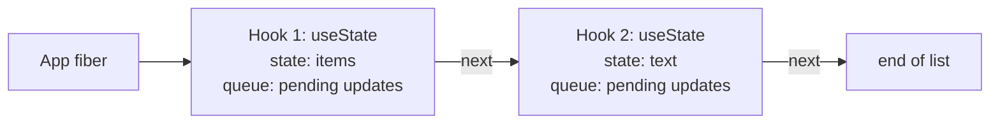

# Hooks：为什么调用顺序决定一切（Hooks: Why Order Matters）

> [!summary] 核心速览（TL;DR）
> 每一个组件实例都会在对应的 Fiber 节点上维护一个有序链表，严格按照你的调用顺序记录每一次 Hook 调用所对应的节点。在下一次渲染时，React 会亦步亦趋地重新遍历该链表：你第 3 次调用的 Hook，匹配的恰好就是上一次渲染中的第 3 个节点。**调用位置与顺序，是 Hook 拥有的唯一身份标识（Identity）**；而所谓的「Hooks 规则」，其全部意义就是为了保证这个调用位置绝对稳定不变。

看一下我们的购物清单应用：

```jsx
function App() {
  const [items, setItems] = useState([{ id: 1, name: "Milk", done: false }]);
  const [text, setText] = useState("");
  // ...
}
```

代码中调用了两次 `useState`，既没有传入标识名称，也没有指定任何 key。React 压根就没见过 `items` 或 `text` 这两个单词——那只不过是你自己声明的局部变量名而已。然而在每一次重新渲染时，第一次调用总能稳稳拿回商品列表，第二次调用也总能准确拿到输入框文本。React 究竟是如何分清谁是谁的？

答案简单到令人惊讶：**数数（It counts）。**

## Hook 的状态究竟保存在哪里（Where hook state actually lives）

你的函数组件归根结底只是一个普通的 JavaScript 函数。它被调用执行，返回 React 元素描述，随后其内部所有的局部变量便随着执行上下文一同灰飞烟灭。任何想要在多次渲染之间持久存活的数据，都必须寄宿在别处——而这个归宿正是组件的 **Fiber**：React 为组件树中的每个组件实例所长期持有的内部对象（参见 [[06 Fiber - Work You Can Pause|第 06 篇 · Fiber：可被中断与恢复的工作单元]]）。

函数组件对应的 Fiber 节点上有一个专有字段（`memoizedState` 指针），牢牢指向该组件的第一个 Hook 节点；而每个 Hook 节点又通过 `next` 指针指向下一个 Hook。在概念与底层实现上，它就是一个**单向链表（Linked list）**，完全按照你调用 Hook 的先后顺序动态构建而成：



这里既没有显式的索引下标变量，更没有任何基于名称映射的字典对象。React 在内部仅仅维护着一个轻量的“游标指针（Cursor）”，指向“当前正在处理的 Hook”；每当你调用一次 Hook，游标便顺着 `next` 指针向前推进一步。

因为整条链表挂载在对应的 Fiber 节点上，所以它严格归属于当前的**具体组件实例**。挂载在界面上的两个 `<Item>` 组件各自拥有独立的 Fiber 节点，自然也就各自拥有一条互不干扰的 Hook 链表。一旦某个组件被卸载，它的 Fiber 节点连同整条 Hook 链表就会被垃圾回收，彻底从内存中抹去。

## 两套 Dispatcher 分发器：挂载与更新（Two dispatchers: mount and update）

这里有一个极为精妙的底层设计细节，它能够解开许多令人困惑的谜团：你从 `react` 包中 `import { useState } from 'react'` 引入的 `useState`，本身几乎不做任何具体计算。它的唯一工作，就是将当前调用转交给渲染器此时此刻装载的 **Dispatcher（分发器）**。

在 React 正式调用你的组件函数之前，它会根据当前组件的生命周期阶段，切换装载两套截然不同的 Hook 实现：

- **挂载阶段（Mount / `HooksDispatcherOnMount`）**：该组件实例首次渲染。每一次 Hook 调用都会在内存中**新建一个节点**并追加到链表末尾。
- **更新阶段（Update / `HooksDispatcherOnUpdate`）**：该组件之前已经渲染过。每一次 Hook 调用都会**按顺序取出上一次渲染所建链表中的下一个节点**，并在其基础上继续处理。

当你的组件函数执行完毕并返回后，React 会立刻切入第三套 Dispatcher——它的所有 Hook 实现都会直接抛出异常。这就是为什么如果你在事件处理函数或 `setTimeout` 异步回调中错误地调用了 Hook，React 会毫不留情地抛出著名的 `"Invalid hook call"`（无效的 Hook 调用）错误，而不是任由数据在暗中被悄悄损坏。

```js
// 概念简化伪代码，非 React 真实源码
function renderComponent(fiber, Component, props) {
  // 1. 根据是否首次渲染，动态装载对应的分发器
  dispatcher = fiber.isFirstRender ? MountHooks : UpdateHooks;
  
  // 2. 你的组件函数在此执行，组件内的 Hook 调用均由上述 dispatcher 接管
  const children = Component(props);
  
  // 3. 执行完毕，立刻换上防呆分发器；此时在渲染流程之外调用 Hook 会直接抛错
  dispatcher = ThrowingHooks;
  
  return children;
}
```

因此，同一行代码 `useState("")`，在首次渲染（挂载阶段）时的真实语义是“在链表末尾新建一个槽位，并将初始值 `""` 存进去”；而在后续的所有重新渲染（更新阶段）中，它的语义则变成了“把链表游标指向下一个已有槽位，并将里面的最新状态拿给我”。这就是为什么**初始值只会在挂载阶段被读取一次**，在后续的更新阶段会被完全忽略的原因。

## 顺序即身份（Order is the identity）

把上述机制拼合在一起，核心原理便水落石出。当组件重新渲染时，React 压根没有办法也不可能去按图索骥查找“名为 `text` 的状态”。它唯一能做的，就是从上一轮渲染构建好的链表中抓取下一个节点，把里面的值塞给你。**当前渲染中的第 *n* 次 Hook 调用，永远只能与上次提交渲染保留下来的第 *n* 个链表节点配对。**

现在，让我们看看破坏这个调用顺序会发生什么惨剧：

```jsx
function Bad({ showFilter }) {
  if (showFilter) {
    // 只有在条件为真时才调用，时有时无
    const [filter, setFilter] = useState("all"); // 占用第 1 个槽位
  }
  const [text, setText] = useState("");          // 可能是第 1 个，也可能是第 2 个槽位！
  // ...
}
```

首次渲染时如果 `showFilter = true`，React 构建出的链表槽位依次为 `["all", ""]`。随后如果条件翻转为 `false`，`if` 分支被跳过，此时 `setText` 变成了组件执行时的**第 1 次** Hook 调用！React 的游标指向链表中的第 1 个节点，于是 `setText` 拿到的值居然变成了 `"all"`！程序不会报任何语法错误，但状态已经完全张冠李戴、陷入错乱。

更致命的是，如果前后两次调用的 Hook 类型不匹配——比如这一次的 `useState` 调用撞上了上一次属于 `useEffect` 的链表节点，React 就会因为找不到更新队列而当场崩溃报错（如 `"Should have a queue..."`）。如果当前渲染调用的 Hook 数量多于上一次，React 会抛出错误 `"Rendered more hooks than during the previous render"`；如果调用的数量变少了，React 同样会在遍历未尽时直接崩溃。

> [!tip] 心智模型（Mental model）
> 一个组件内的所有 Hook，就像是在该组件的 Fiber 节点上排成一排带有序号的储物格。每次渲染时，游标都会从左到右依次巡检，每调用一次 Hook 就打开下一个格子。**因此，Hook 的全部“身份”，就是它在这一排格子中的物理位置。**

由此，React 官方著名的「Hooks 规则」本质上就是将这套底层心智模型具象化为了开发规范：

- **只在最顶层调用 Hooks**：切勿在条件判断（`if`）、循环（`for`）或提前返回（`return`）之后调用，确保每一次渲染都能以完全相同的顺序发起相同次数的 Hook 调用。
- **只在 React 函数组件或自定义 Hook 中调用 Hooks**：因为只有在这两处执行期间，React 才会装配好工作用的 Dispatcher，并且当前拥有正在处理的 Fiber 节点。

许多人会问：为什么 React 不采用类似 `useState("text", "")` 这种显式传递 key 的方案呢？这是为了权衡与设计美学：**基于位置的机制让 API 保持了极致的简洁**，更重要的是，它允许自定义 Hook 在嵌套组合时完全不用担心命名冲突（Namespace collision）——你写你的 `useInput`，我写我的 `useInput`，彼此内部都有一个 `value` 状态却互不打架。这种灵活性所付出的唯一代价，就是一条需要通过 ESLint 插件在编译期强制保障的代码规则。

> [!warning] 提前返回（Early return）本质上也是条件判断
> 诸如 `if (!items.length) return <Empty />;` 这样的逻辑，如果写在某个 `useState` 或 `useEffect` 的**上方**，就会在数组为空时改变后续 Hook 的执行数量，从而破坏链表对齐。请务必将所有的 Hook 调用全部规整地放在组件函数的最顶部，确保它们抢在任何提前 `return` 之前全部执行完毕。

## 每个 Hook 的“储物格”里究竟存了什么（What each hook keeps in its box）

链表上的每一个 Hook 节点都遵循统一的数据结构模型：一个用于记录“该 Hook 需要记住的数据”的槽位（`memoizedState` 字段），外加一个主要供状态类 Hook 使用的更新队列（`queue` 字段）。具体往槽位里存什么，取决于调用的是哪种 Hook：

| Hook 种类 | 链表节点存储的核心内容 |
| --- | --- |
| `useState` / `useReducer` | 当前的状态快照，外加一个待处理更新队列（Queue）以及与该队列绑定的 dispatch/setter 函数 |
| `useEffect` / `useLayoutEffect` | 一个 Effect 副作用对象：包含副作用回调函数、依赖项数组，以及用于暂存清理函数（Cleanup）的容器 |
| `useRef` | 一个纯粹的引用对象 `{ current: initialValue }`，在组件的整个生命周期内永远保持同一对象引用 |
| `useMemo` | 上一次计算得出的返回值，以及计算它时所依赖的 deps 数组 |
| `useCallback` | 上一次传入的回调函数本身，以及声明它时所依赖的 deps 数组 |

### `useState`：状态快照 + 更新队列

`useState` 在底层本质上就是预设了内置 reducer 的 `useReducer`：如果你给 setter 传入一个更新函数，它会接收旧状态并计算出新状态；如果传入具体值，则直接替换旧值。它在 Hook 节点中维护着当前状态以及一个**更新队列（Queue）**。调用 `setItems(...)` 并不会当场在原地篡改该节点上的值，而是往更新队列中推入一条更新记录，并请求 React 安排重新渲染。直到下一次渲染开始、该 `useState` 再次被执行时，React 才会遍历该队列结算出最新状态并返回（关于批处理机制详见 [[04 State Updates - Snapshots and Batching|第 04 篇 · 状态更新：快照与批处理]]）。

而 setter 函数只在挂载阶段（首次渲染）被创建一次，在创建时就已经在闭包中牢牢绑定了当前的 Fiber 节点和该 Hook 的更新队列。这就是为什么当你在一个深层子组件的点击回调中调用 `setItems(...)` 时，React 无需沿着组件树自底向上层层搜索，就能以极高效率精准找到目标更新队列。这同样解释了为什么 setter 函数的引用具有**恒定稳定性（Stable）**：它在每次渲染中都是完全相同的同一个函数引用，因此在 `useEffect` 的依赖项数组中将它省去也绝对安全。

### `useEffect`：Effect 对象与其依赖项

`useEffect` 在槽位中存储的是一个 Effect 对象：包含你传入的回调函数、依赖项数组（deps），以及一个用于暂存副作用清理函数（Cleanup function）的小容器。在随后的每次重新渲染中，React 都会通过 `Object.is` 逐项比对新传入的依赖项与上次暂存的依赖项：

- **依赖项完全未变**：记录该 Effect，但打上“跳过（Passive/Nothing to do）”标记，Commit 阶段直接忽略它。
- **依赖项发生变化，或者未传依赖项数组**：标记该 Effect 需要在 Commit 阶段完成后执行；在执行新的副作用之前，会先调用并执行上一次留存的清理函数。

在组件函数体内直接内联创建的对象字面量或函数，每次渲染都会分配全新的内存引用，因此与上一次比对时永远判定为不相等——这就是导致“为什么我的 Effect 每次渲染都在反复执行”这一经典 Bug 的万恶之源。

### `useRef`：一个不变的容器盒

`useRef` 的实现极其单纯：它在首次挂载时创建一个普通对象 `{ current: initialValue }` 并存在槽位里，在后续的所有渲染中都原封不动地返回该对象的引用。修改 `ref.current = newValue` 完全不会向 React 调度任何更新：没有队列，没有状态通知，更不会触发重新渲染。这使得 Ref 成为了暂存那些“与界面视图渲染无关、但又需要在渲染间隙持久保存的数据”的绝佳场所；同时也决定了如果在渲染逻辑（JSX 返回）中直接依赖 `ref.current` 来做分支判断，代码将极其脆弱且不可靠。

### `useMemo` 与 `useCallback`：单次记忆化缓存

`useMemo` 在槽位中保存着上一次计算出的返回值以及当时的依赖项数组。如果新旧依赖项逐项比对完全相同，React 就直接把缓存的旧值拿给你；一旦依赖项发生改变，才会重新执行你的计算函数。`useCallback(fn, deps)` 则是 `useMemo(() => fn, deps)` 的语法糖，它缓存的“值”就是函数本身：当依赖项未变时，你本次渲染中新创建的 `fn` 会被随手丢弃，React 依旧返回上一次保留下来的函数引用，从而在组件树中保持函数引用的恒定。

需要格外注意的是：这个缓存槽位**仅能容纳恰好 1 份历史记录**，而且 React 官方在规范中明确保留了在内存紧张时主动清除该缓存的权利。因此，请务必将其视为一种“性能优化提示”，而绝不能将其作为代码必须依赖的硬性语义保证。在 [[11 Memoization and the React Compiler|第 11 篇 · 记忆化与 React 编译器]] 中，我们将详细探讨它们在哪些场景下才能真正发挥价值。

## 那些不在链表上占格子的特殊 Hooks（Hooks that don't take a box）

有两个 Hook 打破了常规的链表模式：

**`useContext`** 压根不会在 Hook 链表上创建任何节点。它直接从组件树上方距离最近的 Provider 中读取当前上下文值，并在这个 Fiber 节点上一个单独的依赖列表（`dependencies`）中登记：“本 Fiber 依赖于该 Context”——这样当 Context 的值更新时，React 就能精准定位并重新渲染该组件。从纯技术实现的底层角度来看，哪怕你把 `useContext` 写在条件语句中，其实也不会导致 Hook 链表指针错位。但 React 团队依然强制要求它必须严格遵守 Hooks 规则：这一方面是为了保持开发心智与规范的一致性，另一方面也为 React 未来随时重构其底层实现留出充裕的自由度。无论如何，请务必严格遵守规则。

**`use`** 则是官方文档中明确豁免的例外。当用来读取 Promise 或 Context 时，它并不走常规的 Hook 链表存储，而是依赖自身一套独立的计数器机制来跟踪“到目前为止已经读取了多少个 Promise”。正因如此，**`use` 是唯一一个可以在 `if` 条件分支和循环语句中合法调用的特例**。

（此外，React Compiler 编译器引入了名为 `useMemoCache` 的底层机制，它同样将状态独立存储在链表之外。关于这一点，我们将在 [[11 Memoization and the React Compiler|第 11 篇 · 记忆化与 React 编译器]] 中展开详述。）

## 自定义 Hook 本质上只是普通函数（Custom hooks are just functions）

在 React 内部，自定义 Hook（Custom Hook）没有任何高人一等的特殊地位。Fiber 节点上根本不存在所谓的“自定义 Hook 节点”。当 `App` 组件调用一个自定义 Hook 时，该 Hook 内部调用的所有原生 Hooks，都会作为 `App` 本次渲染的一部分平铺展开，并按先后顺序依次挂载到 `App` 自己的 Hook 链表上——其效果与你直接将那些代码内联写在 `App` 内部完全没有任何区别。

```jsx
function useItems() {
  const [items, setItems] = useState([]); // 挂入调用方组件的 Hook 链表
  const add = (name) => setItems([...items, { id: Date.now(), name, done: false }]);
  return { items, add };
}

function App() {
  const { items, add } = useItems(); // 占用 App Fiber 链表上的第 1 个槽位
  const [text, setText] = useState(""); // 占用 App Fiber 链表上的第 2 个槽位
  // ...
}
```

由此可以推导出三个至关重要的底层结论：

- **调用了同一个 `useItems` 的两个不同组件，各自拥有一份完全独立的状态列表。** 自定义 Hook 复用的是状态与副作用的处理**逻辑**，而不是共享状态本身。
- **Hooks 规则会具有穿透性地向下约束自定义 Hook。** 条件性地调用 `useItems()`，本质上就等同于条件性地调用了它内部包裹的 `useState`，同样会瞬间摧毁外层组件的 Hook 链表对齐。
- **`use` 前缀仅仅是给 Linter 静态检查器识别的约定。** 代码检查工具需要通过 `useXxx` 的命名规则来判定是否需要对其应用 Hooks 规则校验。React 运行时本身压根不会去关心函数名叫什么。

## 常见认知误区（Common misconceptions）

- **“React 是通过变量名来匹配 `useState` 的”**：React 运行时永远看不到你写在代码里的局部变量名。它在匹配状态时**只认调用顺序**，别无他物。
- **“Hook 是将状态保存在函数组件内部的”**：函数组件本身在两次调用之间是一穷二白的，任何局部变量都会在执行完毕后被销毁。所有的状态都保存在组件对应的 Fiber 节点上，而 Fiber 节点的生命周期贯穿于多次渲染之间。
- **“`useMemo` 能保证计算逻辑只执行一次”**：它每个组件实例仅缓存一份历史值，而且在未来高内存压力场景下，React 保留了主动丢弃缓存的权利。
- **“`useContext` 不占链表槽位，所以可以写在 `if` 里面”**：尽管它的确不在主 Hook 链表上占位，但官方的 Hooks 规则对它依然具有强制约束力，切勿抱有侥幸心理。

## 总结（Summary）

一个组件所使用的所有 Hooks，都以**有序单向链表**的形式持久保存在其对应的 Fiber 节点（`memoizedState`）上。首次渲染时由挂载阶段的分发器（`HooksDispatcherOnMount`）负责创建并链接各节点；后续每次重新渲染时，则由更新阶段的分发器（`HooksDispatcherOnUpdate`）亦步亦趋地顺着链表逐一读取复用。Hook 既没有名字，也没有 key：**在这一排链表格子中的物理位置与调用次序，就是 Hook 独一无二的身份标识**；而所谓的 Hooks 规则，其存在的唯一目的就是为了保证这个相对顺序在各次渲染之间永远坚如磐石。

链表上的每个节点各司其职，存放对应 Hook 所需的数据：`useState` 存放状态快照与待处理更新队列；`useEffect` 存放副作用回调、依赖项以及清理函数；`useRef` 提供一个在所有渲染中持久恒定的容器对象；`useMemo` / `useCallback` 则缓存单次计算结果与函数引用。`useContext` 与 `use` 突破了链表模式在别处暂存数据，而自定义 Hook 则直接将内部调用的 Hooks 顺次平铺到调用方组件的链表之中。

在理清了 Hooks 的持久化与状态更新机制之后，接下来在 [[10 Events - One Listener at the Root|第 10 篇 · 事件系统：根节点上的单一监听器]] 中，我们将探究 React 的事件合成系统：探寻用户在页面上的一次点击，是如何穿透 DOM 树准确触发你在组件中声明的那个 setter 函数的。

### 核心要点归纳（Key takeaways）

- **Fiber 节点上的 Hook 链表**：每个组件实例都在其 Fiber 节点上维护着一条有序单向链表，每次 Hook 调用对应链表中的一个节点。
- **Mount 与 Update 两套分发器（Dispatcher）**：首次挂载负责新建链表节点，后续更新负责按序步进复用已有节点；在渲染上下文之外调用则直接抛出异常。
- **顺序即身份**：当前渲染的第 *n* 次 Hook 调用严格与上次渲染留存的第 *n* 个节点配对；任何在条件分支中的调用都会导致链表错位，读错状态或引发程序崩溃。
- **`useState`**：包含当前状态快照与待处理更新队列；其 setter 函数在挂载时与 Fiber 及队列深度绑定，引用在各次渲染间保持恒定稳定。
- **`useEffect`**：存储包含依赖项数组的 Effect 对象；每次渲染时通过 `Object.is` 逐项比对依赖项，从而裁决是否在 Commit 阶段之后调度执行。
- **`useRef`**：一个单一的可变引用容器 `{ current }`；直接修改其属性不会调度任何更新或渲染。
- **`useMemo` / `useCallback`**：仅保存一份历史计算结果/函数引用及其依赖项；应视为性能优化提示，React 在极端情况下可能主动丢弃缓存。
- **`useContext`、`use` 与自定义 Hook**：前两者不占用常规链表槽位（但 `useContext` 仍须遵守顶层规则，`use` 是唯一获豁免者）；自定义 Hook 则直接将其内部的 Hooks 展开平铺到宿主组件的链表末端。

**深入探究源码实现：** [[10 Hooks on Mount|挂载阶段的 Hooks 实现（Hooks on Mount）]] · [[11 Hooks on Update|更新阶段的 Hooks 实现（Hooks on Update）]]

---

← [[08 The Commit Phase and Effects|上一篇：第 08 篇 · Commit 阶段与副作用（Effects）]] · [[react-concepts|返回专栏目录]] · [[10 Events - One Listener at the Root|下一篇：第 10 篇 · 事件系统：根节点上的单一监听器]] →
