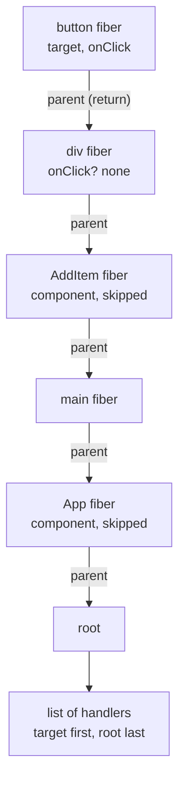
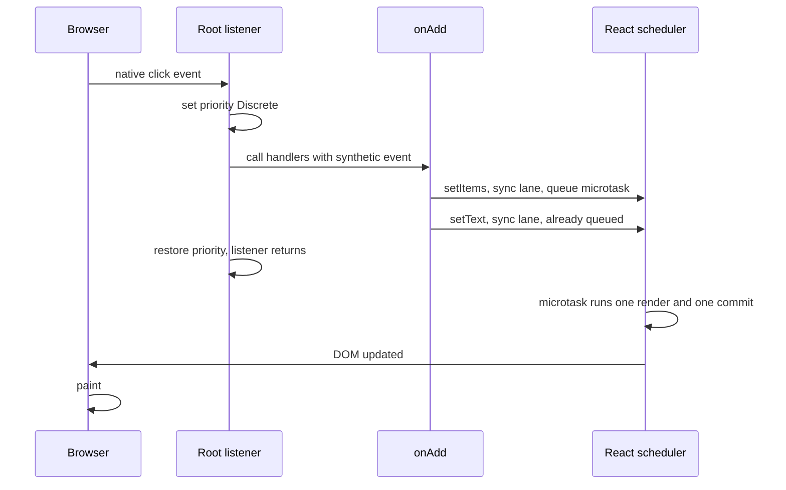

# 事件系统：根节点上的单一监听器（Events: One Listener at the Root）

> [!summary] 核心速览（TL;DR）
> 当你创建根应用（Root）时，React 会在**根容器（Root Container）**节点上，为内部支持的每种事件类型分别挂载一个捕获阶段监听器和一个冒泡阶段监听器，而**绝不会**把事件处理函数直接绑定到具体的 DOM 元素上。每当原生事件触发并冒泡至根节点时，React 会顺藤摸瓜定位到事件目标所对应的 Fiber 节点，随后沿着**组件树（Fiber 树）**向上回溯遍历，逐一收集沿途匹配的处理函数，并用同一个共享的**合成事件（SyntheticEvent）**实例按序调用它们。与此同时，根节点监听器还会为当前事件注入确定的更新优先级——这也正是为什么点击事件中的 `setState` 能够拥有最高优先级的同步车道（SyncLane）、享受自动批处理，并赶在浏览器下一次重绘（Paint）之前极速呈现在屏幕上的根本原因。

在我们的购物清单应用中，`AddItem` 组件的代码结构大致如下：

```jsx
function AddItem({ text, onChange, onAdd }) {
  return (
    <div className="add-item">
      <input value={text} onChange={(e) => onChange(e.target.value)} />
      <button onClick={onAdd}>Add</button>
    </div>
  );
}
```

直观上看起来，React 似乎是在 `<button>` 元素上调用了 `addEventListener("click", ...)`，并在 `<input>` 上调用了 `addEventListener("input", ...)`。但事实绝非如此——**你编写的任何处理函数，都从未被直接注册到浏览器的真实 DOM 节点上**。

那么问题来了：既然没有注册原生监听器，用户的一次点击究竟是如何精准触发你的回调函数的？而在 `onAdd` 内部先后调用 `setItems` 和 `setText` 时，页面又为何永远不会出现哪怕一帧的闪烁？

## 根容器上的集中监听：每种事件类型仅挂载一个监听器（One listener per event type, on the root）

当你调用 `createRoot(container)` 初始化应用时，React 会遍历内部支持的原生事件类型清单，并在**容器元素（Container DOM）本身**统一安装：

- 每种事件类型一个**捕获阶段（Capture-phase）**监听器；
- 每种事件类型一个**冒泡阶段（Bubble-phase）**监听器（仅针对支持冒泡的原生事件）。

仅此而已。你在 JSX 元素上书写 `onClick` 或 `onChange`，在底层仅仅是在该 Fiber 节点的 props 属性上存储了一个普通的函数引用。真实 DOM 上没有挂载任何东西；自然，当 prop 改变或者组件卸载时，也完全不需要执行繁琐的 `removeEventListener` 清理操作。

这项技术被称为**事件委托（Event Delegation）**。设想一个拥有 10,000 行的长列表，如果每行都配置一个 `onClick`，传统做法需要在浏览器底层注册 10,000 个原生监听器，并在每次挂载与卸载时反复进行繁重昂贵的绑定与解绑操作。而在事件委托机制下，处理函数的开销仅仅等同于一个普通的 JS 对象属性（prop），哪怕你每次渲染都重新生成一个内联箭头函数，也不会引发任何底层的 `addEventListener` / `removeEventListener` 抖动与内存损耗。唯一的微小代价，是在每次事件触发时沿着树向上进行一次回溯遍历。

> [!note] 为什么委托在根容器上，而不是 `document`？
> 在 React 16 及更早版本中，所有事件都是统一委托在 `document` 对象上的。React 17 将事件监听器下移到了应用的根容器（Root Container）。这一架构改造带来了关键收益：当同一个页面中并存多个独立的 React 根应用（甚至多个不同版本的 React 实例）时，它们各自内部的 `stopPropagation()` 不再会互相冲突干涉；同时，将 React 组件树作为微前端或局部模块嵌入到非 React 传统页面中时，事件行为也更加可控且符合直觉。

## 从 DOM 节点到 Fiber 节点（From DOM node to fiber）

当用户进行交互时，浏览器会捕获原生事件并最终传递给根容器上的监听器，此时事件对象上的 `event.target` 指向触发事件的真实 DOM 节点——比如那个“Add”按钮。但对 React 而言，它真正需要拿到的是该节点所对应的 **Fiber 节点**，因为你编写的所有组件逻辑与 props 处理函数都保存在 Fiber 上。

React 是如何跨越真实 DOM 与内部 Fiber 鸿沟的？答案非常巧妙：当 React 创建 DOM 节点时，会在该 DOM 实例上私下注入两个以特殊符号为键名的私有属性（形如 `__reactFiber$...` 与 `__reactProps$...`）：
1. 指向该 DOM 节点对应 Fiber 的指针；
2. 该节点在最近一次 Commit（提交）阶段生效的最新 props。

因此，查找过程本质上只是在 `event.target` 上进行了一次极速的属性读取。如果 `event.target` 本身并非由 React 直接创建管理的节点（例如通过 `innerHTML` 动态注入的内容、或第三方原生插件生成的 DOM），React 就会沿着该 DOM 节点的父级链条逐级向上回溯，直到找到第一个由 React 托管的祖先 DOM 节点为止。

## 回溯 Fiber 树收集处理函数（Collecting handlers by walking the fiber tree）

此时 React 已经锁定了目标 Fiber 节点，并获知了事件名称（例如 `onClick`）。接下来，它会**沿着 Fiber 树向上回溯**（从目标节点一路回溯至根节点），并在途经的每一个**宿主 Fiber（Host Fiber，即对应 `<button>` 或 `<div>` 等真实 DOM 元素的节点）**上，检查当前生效的 props 中是否存在匹配的事件处理函数。凡是匹配成功的处理函数，都会被依次记录到一个执行列表中。



随后 React 开始遍历执行该列表。对于冒泡阶段（`onClick`），它会像原生冒泡一样从目标节点向根节点正向遍历执行。对于捕获阶段（`onClickCapture`），它则逆向执行同一份收集列表，即从根节点向目标节点推进。在 React 中，**捕获与冒泡完全是由 React 内部自行模拟计算出来的，而非直接照搬浏览器的原生机制**。

“回溯 Fiber 树”这一机制衍生出了三个至关重要的技术特性：

- **只有真实 DOM 元素才会贡献处理函数**：在自定义组件上书写 `<MyButton onClick={...}>` 本质上只是传递了一个名为 `onClick` 的普通 prop。该回调只有在被组件内部的具体宿主 DOM 元素（如 `<button>`）接收后，才会被正式收集到事件链条中。
- **调用的永远是最新提交的函数版本**：React 直接从上一次 Commit 阶段固化在 DOM 节点上的 props 中读取处理函数，因此无论外部状态如何变动，都绝不会遇到需要重新解绑再绑定的“陈旧监听器”问题。
- **Portal 弹窗事件依循组件逻辑层级冒泡**：通过 `createPortal` 挂载到 `document.body` 的模态弹窗（Modal），在真实 DOM 结构中虽然独立于应用容器之外，但在 Fiber 树中，该弹窗 Fiber 的父节点依然是渲染它的那个外层组件。因此，在弹窗内部点击按钮，事件依然能够顺理成章地冒泡到外层组件的 `onClick` 中——因为 React 回溯的是 Fiber 树中的父子关系（`fiber.return`），而非真实 DOM 的父级链条！

> [!tip] 心智模型（Mental Model）
> React 在应用的根容器处为每种事件类型各自装了一枚门铃。当门铃被触发按响时，React 会先查验按门铃的是哪一个 Fiber 节点，然后顺着组件层级一路向上登门拜访，沿途只要经过哪个宿主节点配置了对应的处理函数，就立刻敲门执行。

## 合成事件：单次派发仅实例化一个对象（Synthetic events: one per dispatch）

你的事件处理函数接收到的并不是浏览器原生事件对象，而是一个**合成事件（SyntheticEvent）**实例。在每一次事件派发（Dispatch）过程中，React 只会创建**一个**合成事件实例，并将这同一个对象依次传递给收集列表中的每一个处理函数；在遍历流转到每个节点时，React 会动态更新对象上的 `currentTarget` 属性以匹配当前处理节点。合成事件不仅抹平了各浏览器的跨平台差异，还通过 `e.nativeEvent` 完整保留了底层原生事件的引用。

- **阻止默认行为与阻止冒泡**：调用 `e.preventDefault()` 和 `e.stopPropagation()` 时，React 不仅会调用底层原生事件的对应原生方法，还会在合成事件内部打上标记。一旦某个处理函数调用了 `e.stopPropagation()`，React 就会立刻终止后续队列的遍历执行。
- **异常隔离**：若某个处理函数在执行过程中抛出错误，React 会正常上报捕获该异常，但这并不会阻断列表中后续其他处理函数的继续执行。
- **`e.persist()` 成为空操作**：在 React 16 及更早版本中存在“事件池（Event Pooling）”机制，合成事件对象会在回调执行完毕后被重置并回收复用，迫使开发者在异步访问事件前必须显式调用 `e.persist()`。该机制在 React 17 中已被彻底废除，`e.persist()` 如今只是一个无害的空操作（No-op）。你完全可以在 `setTimeout` 或 Promise 异步回调中直接安全地读取 `e.target`。

## 优先级机制直接烙印在监听器中（Priority is baked into the listener）

这正是连接事件响应与 React 更新调度体系的核心纽带。当 React 在根容器上安装监听器时，会根据**事件的类型**对其进行针对性的分级包装：

| 事件优先级分类 | 典型事件示例 | `setState` 获取的车道分配 |
| --- | --- | --- |
| **离散交互事件（Discrete）** | `click`、`keydown`、`input`、`mousedown`、`pointerup`、`focusin` | **同步车道（SyncLane）**：最高紧急度 |
| **连续交互事件（Continuous）** | `mousemove`、`pointermove`、`scroll`、`wheel`、`drag` | **连续车道（ContinuousLane）**：高优先级 |
| **默认事件（Default）** | 其余所有原生事件 | **默认车道（DefaultLane）** |

包装函数会在调用你的事件处理函数**之前**，将全局环境的“当前更新优先级”设定为对应的级别，并在执行完毕后恢复原状。此外，离散事件的包装层还会显式清除任何外层残留的 Transition 上下文，确保用户的主动点击操作绝不会被意外降级为可中断的后台过渡更新。当你的事件函数调用 `setItems` 时，React 会在内部询问：“当前执行上下文的优先级是什么？”——发现此时正处于离散事件包装器中，于是便果断为该更新分配了最优先的**同步车道（SyncLane）**（有关车道模型 Lanes 的深度解析，详见 [[07 Priorities, Transitions and Concurrency|第 07 篇 · 优先级、Transition 与并发机制]]）。

因此，优先级绝不是更新本身凭空携带的某种神秘属性，它纯粹取决于**更新代码是在何种上下文中被调用的**：在点击事件中调用，它就是最紧急的同步更新；在 `startTransition` 中调用，它就会被打上过渡车道标签。这正是 React 调度器精准拿捏界面响应体验的核心绝招。

## 为什么点击事件中的多次更新会被自动批处理（Why updates in a click are batched）

来看 `onAdd` 中的两次状态设置：

```jsx
onAdd={() => {
  setItems([...items, { id: Date.now(), name: text, done: false }]);
  setText("");
}}
```

这两次调用中的任何一次都不会立即触发组件渲染。每一个 setter 都只是将一条更新记录推入对应 Hook 的更新队列，将该 Fiber 标记为存在待处理的同步工作，并请求 React 调度该根应用。这个调度请求具有去重机制：第一次调用会向浏览器的事件循环排入一个**微任务（Microtask）**，第二次调用检测到微任务已被调度，便直接跳过重复排队。



当根节点监听器执行完毕、当前 JavaScript 调用栈完全清空后，排在队首的微任务随即开始执行。同步车道（SyncLane）的工作无需等待任何宏任务调度器（Scheduler）：React 会在微任务内部一气呵成地执行 Render 与 Commit，将两次状态更新打包合并在**单次渲染**中统一处理。因为微任务会在浏览器获取绘制机会之前执行，所以用户绝对不会目睹“列表已经刷新、而输入框内容依然残留”的中间撕裂态。关于本次渲染过程的详细推演参见 [[04 State Updates - Snapshots and Batching|第 04 篇 · 状态更新：快照与批处理]]，而从事件触发到像素上屏的完整端到端旅程将在 [[12 A Click, Start to Finish|第 12 篇 · 完整穿透：一次点击从事件触发到像素绘制]] 中全景展开。

> [!warning] 原生监听器与 React 事件处理函数不可交叉混用（Native listeners and React handlers don't interleave）
> - **执行时序差异**：如果你在具体的 `<button>` 元素上通过原生 `addEventListener` 挂载了监听器，它**必然先于**任何 React 事件处理函数执行——因为 React 必须等待原生事件冒泡到达根容器后才能被感知并分发。
> - **阻止冒泡的作用域边界**：在 React 处理函数中调用 `e.stopPropagation()`，其实是在根容器这一层阻止了原生事件的进一步向上冒泡。它能成功阻止事件继续传递给挂载在 `document` 或 `window` 上的外层原生监听器，但**绝对无法**阻止那些挂载在根容器下方具体 DOM 元素上的原生监听器，因为那些监听器早在此前就已经执行完毕了。
> - **`stopImmediatePropagation` 的局限**：在合成事件中调用 `e.nativeEvent.stopImmediatePropagation()` 并不能阻断同级其他 React 处理函数的执行：因为所有 React 处理函数都是在同一个原生根节点监听器内部被集中遍历调用的。
> - **脚本主动调用 `el.click()` 的时序**：如果你在业务代码中同步调用 `el.click()`，事件将会在你的代码执行流内部同步派发，因此渲染微任务必须等待你的整段外部 JS 脚本执行完毕才会运行。如果你需要在两次点击操作之间强行同步获取最新 DOM 状态，请借助 `flushSync` 逃生通道。

## 无法使用委托机制的特殊事件（Events that aren't delegated）

在 DOM 规范中，有一部分原生事件在底层是**不支持冒泡机制**的：例如 `scroll`、`scrollend`、`load`、`invalid`、`toggle`、`cancel`、`close`，以及各类媒体控制事件（如 `play`、`ended`、`pause` 等）。对于这一类事件，React 不仅会在根容器上注册捕获阶段监听器，还会在创建对应 DOM 元素时，直接将监听器按需挂载到具体的元素节点本身之上。

此外，还有若干值得深入了解的经典边界细节与特殊行为：

- **`onScroll` 不再冒泡**（自 React 17 起生效）：以往 React 模拟的 scroll 冒泡行为容易引发混淆，自 React 17 起，`onScroll` 的处理函数只会从目标元素本身收集，严格契合原生事件行为。
- **`onMouseEnter` 与 `onMouseLeave`**：它们在底层并非直接使用原生的 `mouseenter`，而是 React 依据原生的 `mouseover` 与 `mouseout` 事件对（结合进入与离开的目标 DOM 层次）在内部精确计算模拟而成的，因此具备天然跨越组件树边界的良好行为。
- **`onFocus` 与 `onBlur` 支持冒泡**：尽管原生的 `focus` / `blur` 事件不冒泡，但 React 在底层巧妙地采用了支持冒泡的原生 `focusin` 与 `focusout` 事件来实现它们，使得开发者能够在父级容器组件上统一监听子输入框的聚焦与失焦。

## 常见认知误区（Common misconceptions）

- **误区一：“React 把我的 `onClick` 挂载到了 `<button>` 真实 DOM 元素上”**：真实情况是，React 仅在根容器上为每种事件类型挂载了一个集中监听器，并在事件触发后顺着 Fiber 树回溯收集你的处理函数。
- **误区二：“Portal 弹窗内的事件会沿着 DOM 树冒泡到弹窗的 DOM 父节点”**：React 的事件冒泡是沿着**组件树（Fiber 树）**向上回溯的，因此事件会精准冒泡到在 JSX 中渲染该 Portal 的父组件上，无论弹窗被传送门放置在 DOM 树的何处。
- **误区三：“在异步代码中访问事件对象前，必须先调用 `e.persist()`”**：事件池（Event Pooling）机制早就在 React 17 中被彻底移除，如今 `e.persist()` 是一个无害的空操作，你可以随时在异步上下文读取事件对象。
- **误区四：“事件处理函数里调用了多次 `setState`，就会引发多次重新渲染”**：所有更新都会被暂存推入队列，并在事件函数返回后的微任务中一次性合并渲染，全程在浏览器绘制下一帧像素前同步提交完毕。

## 总结（Summary）

React 从未将你编写的处理函数直接注册到浏览器底层。`createRoot` 会在根容器节点上为每种事件类型各安装一个捕获监听器和一个冒泡监听器；每当事件到达根节点时，React 通过挂载在 DOM 节点上的私有属性精准索引到目标节点的 Fiber 实例，随后沿着 Fiber 树回溯链条依次收集宿主元素上的对应处理函数，并借助单个共享的合成事件对象按序执行它们。正因为回溯遍历追随的是 Fiber 树中的父子关系，Portal 内部的事件才能完全按照组件的逻辑嵌套结构顺畅冒泡。与此同时，根监听器的包装函数会在处理函数执行期间严格注入更新优先级，确保点击事件中的 `setState` 能够获配最高的同步车道、触发微任务批处理，并在浏览器重绘前一气呵成完成渲染与提交。

在接下来的 [[11 Memoization and the React Compiler|第 11 篇 · 记忆化（Memoization）与 React 编译器]] 中，我们将继续探究：当这次渲染级联到那些输入参数（props/state）根本没有发生任何改变的子组件时，底层会发生什么，以及我们如何借助记忆化和全新的 React 编译器来精巧跳过不必要的重复计算。

### 核心要点归纳（Key takeaways）

- **根容器事件委托（Delegation at the root）**：`createRoot` 为每种事件类型在根容器上分别挂载捕获与冒泡监听器各一个，一劳永逸。
- **DOM 节点到 Fiber 映射（DOM node to fiber）**：React 创建的每个 DOM 节点上都隐藏着私有属性，直接持有指向自身 Fiber 节点及最新生效 props 的指针引用。
- **Fiber 树回溯收集（Fiber walk）**：React 从触发目标出发沿着 `fiber.return` 向上回溯，仅从宿主 DOM 元素收集处理函数；因此 Portal 事件完全依循 React 组件关系冒泡。
- **合成的捕获与冒泡（Capture and bubble）**：将收集到的处理函数列表正向执行模拟冒泡，逆向执行模拟捕获，彻底独立于浏览器原生冒泡机制。
- **单例派发合成事件（Synthetic event）**：单次派发全程共享单个合成事件实例，动态切换 `currentTarget`；自 React 17 废弃事件池后，`persist()` 已变为无害空操作。
- **由事件源决定优先级（Priority from the event）**：点击等离散交互事件为 `setState` 注入最高的同步车道（SyncLane），而滚动等连续交互事件则分配更低优先级的车道。
- **自动批处理合并（Batching）**：多次调用 setter 仅是向队列推入更新并调度单次微任务，所有更新统一合并在事件函数返回后的单次渲染中完成，赶在重绘之前呈现。
- **非委托特殊事件（Non-delegated events）**：对于 `scroll`、音视频等原生不冒泡的特殊事件，React 会在创建元素时将监听器直接按需绑定至具体 DOM 节点。

**深入探究源码实现：** [[13 The Event System|深入源码篇 · 第 13 篇：事件系统底层剖析]]

---

← [[09 Hooks - Why Order Matters|上一篇：第 09 篇 · Hooks：为什么调用顺序决定一切]] · [[react-concepts|返回专栏目录]] · [[11 Memoization and the React Compiler|下一篇：第 11 篇 · 记忆化（Memoization）与 React 编译器]] →
