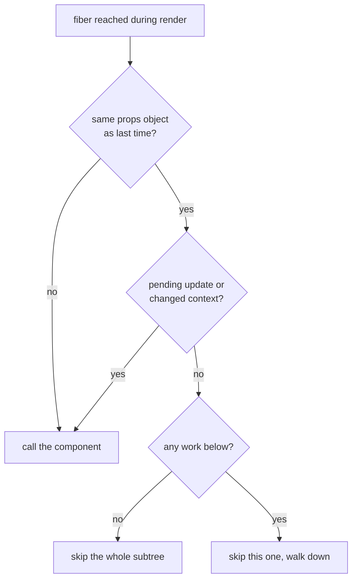

# 记忆化与 React 编译器（Memoization and the React Compiler）

> [!summary] 核心速览（TL;DR）
> 从设计之初，React 就具备一种优化机制：如果子组件本次接收到的 props 对象与上一次**完全是同一个引用**，就可以直接跳过该子组件的渲染。然而，普通的 JSX 语法每次执行都会凭空创建一个全新的 props 对象，导致这个内置的跳过机制在绝大多数场景下形同虚设。`React.memo`、`useMemo` 和 `useCallback` 本质上就是开发者手动将“相同的引用”再次递给 React 的手段。而 React 编译器（React Compiler / React Forget）则是在编译期自动替你完成这一脏活累活——它在组件实例级别缓存中间计算值与 JSX 元素对象，从而让未发生变化的子树能够自动跳过渲染（Bailout）。此时，React 依然会从持有状态的父组件开始自顶向下重新渲染，只是该组件下方的无效工作量被大幅削减了。

在购物清单应用的输入框里随意敲入一个字母。`text` 状态发生了变化，所以 `App` 重新渲染了——这完全在情理之中。但如果你在 `Header`、`List` 和 `Item` 组件里分别加一句 `console.log`，就会惊讶地发现它们全都被重新执行了一遍，哪怕列表里的数据根本没有任何变动。除了输入框里的文字，屏幕上的其他像素纹丝未动。

React 为什么要把这些组件函数挨个调用一遍？我们又有哪些工具可以制止这种无谓的重复执行？

## 为什么组件会重新渲染？

一个组件的函数体之所以会被再次执行，有且仅有以下三种触发原因：

- **自身状态发生变化**（调用了某个 Hook 对应的 `setState`）；
- **所读取的 Context 发生变化**；
- **父组件重新渲染**，并向其传递了新的 props。

第三点往往最让前端开发者感到困惑。当 `App` 执行时，它会返回一棵全新的元素树：每次执行 `<Header count={items.length} />`，都会生成一个全新的 React 元素对象，并挂载一个全新的 props 对象 `{ count: 1 }`。React 在比对 props 时用的是**引用相等性（Reference identity）**，而不是深度比对内容。本次渲染生成的 `{ count: 1 }` 和上一次渲染生成的 `{ count: 1 }` 在内存中根本不是同一个对象地址；因此，React 认为 `Header` 接收到了新的 props，于是理所当然地重新执行它（参见 [[03 What Rendering Really Means|第 03 篇 · 渲染（Rendering）的真正含义]]）。

其实，React 内部内置了一种开销极低的跳过渲染检查。当渲染流程推进到某个 Fiber 节点时，它会依次做如下判断：



第一道门槛就是：“这是否是字面意义上的同一个对象引用？”。然而，普通的 JSX 语法几乎不可能让父组件在重新渲染后将“同一个 props 对象引用”传递给子组件，因为每次渲染都会重新创建全新的元素对象。所以在默认机制下，**一次重新渲染会像瀑布一样级联穿透发生更新组件下方的整棵子树**。

这种级联重新渲染的开销通常没有大家想象的那么可怕：重新执行组件函数并不等于操作真实 DOM。协调机制（参见 [[05 Reconciliation - Finding What Changed|第 05 篇 · 协调（Reconciliation）：探寻真正变化的部分]]）在比对后，依然只会向真实 DOM 写入真正发生变化的部分。但是，对于体积庞大的子树或计算逻辑昂贵的组件，这些白白浪费的无谓函数调用叠加起来，便会造成肉眼可见的性能损耗。

## `React.memo`：如果 props 内容看起来相同，则跳过执行

用 `React.memo` 包裹组件相当于给它追加了第二道防线：即使外层的 props 对象本身是一个新引用的对象，但只要其内部的每一个属性值与上一次相比都满足 `Object.is` 浅比较相等，React 就会直接跳过该组件函数的调用。

```jsx
const Header = React.memo(function Header({ count }) {
  return <h1>购物清单 ({count})</h1>;
});
```

现在，当你在输入框中敲字时，`Header` 就不会被无故骚扰了：因为传递进来的 `count` 是一个相同的数值。这种优化之所以立竿见影，是因为 JavaScript 中的基础数字类型是按**值（Value）**比较的。然而，对象、数组和函数在 JavaScript 中是按**引用一致性（Identity）**进行比较的——而这正是麻烦的根源所在。

## 引用一致性是这场博弈的核心（Reference identity is the whole game）

我们尝试对 `List` 组件做同样的 `React.memo` 优化：

```jsx
const List = React.memo(function List({ items, onToggle }) { /* ... */ });

// 在 App 组件中
<List items={items} onToggle={(id) => setItems(items.map(/* ... */))} />
```

这里的 `items` 表现很正常：在输入框打字不会触碰状态列表，所以它依然指向同一个数组引用。然而，`onToggle` 是在 JSX 中就地以内联形式创建的箭头函数，这意味着**每次渲染都会生成一个全新的函数对象**。`memo` 在进行浅比较时发现该 prop 的引用发生了改变，依然会义无反顾地重新渲染 `List`。此时包裹 `memo` 不仅毫无效果，反而凭空多消耗了一次无意义的属性比对开销。

这正是 `useCallback` 和 `useMemo` 存在的意义：跨越多次渲染**锁定同一个对象/函数引用**，直到其依赖项真正发生变动为止。

```jsx
const onToggle = useCallback(
  (id) => setItems((prev) => prev.map((i) => (i.id === id ? { ...i, done: !i.done } : i))),
  [] // setItems 引用本身是稳定的，且更新器读取的是 prev 而非外部闭包中的 items
);
```

通过改用函数式更新（Functional updater），`onToggle` 不再需要闭包捕获外部的 `items` 状态，因此它的依赖项可以为空数组，该函数引用便能长久保持不变。（如果直接写成 `setItems(items.map(...))`，依赖数组就必须填入 `[items]`，导致只要列表一变，函数引用就会跟着失效）。

正如我们在 [[09 Hooks - Why Order Matters|第 09 篇 · Hooks：为什么调用顺序决定一切]] 中所揭示的，`useMemo` 和 `useCallback` 各自缓存了一个值以及生成该值所依据的依赖数组。它们真正能发挥作用的场景有且仅有两个：

1. **该值的计算开销极其昂贵**，且在输入参数未变时你不希望重新计算；
2. **该值的引用一致性对下游至关重要**：例如作为被 `React.memo` 包裹的子组件的 prop、作为某个 Effect 的依赖项，或是传给另一个自定义 Hook 的依赖项。

除此两种场景之外，随手添加它们通常毫无益处。

> [!warning] `children` 会彻底摧毁 `memo` 的防护
> `<Card>{<p>Hello</p>}</Card>` 在每次渲染时都会生成一个全新的 `<p>` 元素对象，导致传入的 `children` 属性在每次渲染时都是一个新引用。因此，即便给 `Card` 加上了 `React.memo`，它依然会在每次父组件渲染时被迫重新执行。

## 过度记忆化（Over-memoizing）的代价

记忆化并非零成本的免费午餐：

- 每一个 `useMemo` 和 `useCallback` 在每次渲染时都要分配一个依赖数组对象，并对其中的每一项执行比较操作；
- 被缓存的值会长期驻留在内存中阻碍垃圾回收；而且 React 在底层内存吃紧时随时可能主动释放缓存，因此业务逻辑的正确性绝不能寄托于“缓存永远命中”这一前提上；
- 如果一个组件包裹了 `React.memo`，但它的某些 props 每次渲染都在变，那么这个 `memo` 就成了纯粹的额外负担：每次都要先做一轮徒劳的比对，再照常执行渲染；
- 它的防护链条极其脆弱：调用链中只要出现一个漏掉的内联对象或内联回调，其下游所有的记忆化就会全部瞬间瓦解，而且没有任何工具会主动报错提醒你。

要想完全依靠纯手工把引用记忆化做到滴水不漏，开发者必须像人肉编译器一样，心惊胆战地追踪每个组件、每次渲染中每一个 prop 的引用一致性。这种繁琐且机械的簿记工作，恰恰是机器编译器最擅长的领域。

## React 编译器的运作机理（The React Compiler, conceptually）

React 编译器（React Compiler / 曾用代号 React Forget）本质上是一个在**构建期（Build-time）**运行的 Babel 插件。它深入静态分析每一个组件与 Hook 的语法树，精确推导出哪些中间值依赖于哪些外部输入，然后自动重写该函数的代码结构，使其能够就地缓存内部计算值和返回的 JSX 元素结构。你编写的源代码无需做任何妥协，编译产物则是标准的普通 JavaScript。

在运行时，经过编译的组件在执行之初会通过一个名为 `useMemoCache` 的内部 Hook 向 React 申请一段紧凑的缓存数组。该缓存数组直接挂载在组件当前的 Fiber 节点上，与常规的 Hook 单向链表彼此独立，因此它是严格**基于组件实例**隔离的：页面上渲染的两个 `<Item>` 组件各自拥有一份独立的缓存。每一组存在因果依赖的变量都会在数组中分配固定的若干槽位（Slot）：分别用于记录上次计算所依据的输入值，以及计算得出的最终结果。

```js
// 编译后 App 组件的概念简化示意代码（非真实底层输出）
function App() {
  const $ = useMemoCache(6);              // 当前组件实例专属的缓存槽位数组
  const [items, setItems] = useState(/* ... */);
  const [text, setText] = useState("");
  let header;
  if ($[0] !== items.length) {            // 依赖输入发生变化：重新构建
    header = <Header count={items.length} />;
    $[0] = items.length; $[1] = header;
  } else {
    header = $[1];                        // 输入未变：直接复用完全相同的元素对象引用
  }
  // ...对于 onToggle、List、AddItem 同样应用此缓存模式
}
```

最精妙的关键就在于那个 `else` 分支：当输入依赖项未发生任何变化时，组件返回的是与上次**完全相同的 React 元素对象**。完全相同的元素对象，意味着其附带的 `props` 对象引用也完全相同；而完全相同的 `props` 引用，便能完美通过 React 最开头的第 1 道跳过检查（Bailout check）！React 运行时内部不需要为编译器做出任何颠覆性改动，编译器所做的，只是巧妙地喂饱了 React 自诞生第一天起就内置在那里的跳过机制。

让我们回到在输入框中敲入一个字母的场景，看看经过编译器处理后会发生什么：

- `App` 依然执行重新渲染：因为它拥有 `text` 状态，这是避无可避的；
- `<Header>` 的元素对象直接从缓存槽位读取（因为 `items.length` 未变），因此 `Header` 被整棵跳过；
- `onToggle` 回调与 `<List>` 元素对象直接从缓存读取（因为 `items` 列表未变），因此 `List` 及其下属的每一个 `Item` 全部被直接跳过；
- `<AddItem>` 重新构建生成（因为 `text` 发生了变化），因此 `AddItem` 正常执行渲染。

最终写入真实 DOM 的操作与没有编译器时别无二致：依然仅仅是更新输入框里的文本值。但在幕后，那些海量无意义的子组件函数调用，以及对毫无变化子树的虚拟 DOM 协调比对过程，统统烟消云散了。

> [!tip] 心智模型（Mental Model）
> 重新渲染依然沿着持有状态的组件自顶向下流动。有了 React 编译器的加持，每个组件在子节点的输入未发生变化时，都会向子节点传递与上次完全相同的元素对象；因此，渲染级联的瀑布会在第一个“输入毫无变化”的层级戛然而止。

## React 编译器不是什么？

**它并不是细粒度响应式（Fine-grained reactivity）。** 类似 Solid 或 Signals 风格的框架，可以直接精准更新绑定在某个具体数据上的单一 DOM 节点。而在配合编译器的 React 中，当 `text` 发生变化时，`App` 组件依然会从头到尾重新执行一次，依然会对其返回的结构进行协调比对。发生改变的仅仅是：框架实际需要处理的无效工作量被极度压缩了。

**它并没有改变 React 核心的运作流程。** 无论是否启用编译器，React 的调度器（Scheduler）、Lane 优先级模型、Render 阶段工作循环、协调算法以及 Commit 提交阶段，运行的都是完全相同的代码。它在运行时唯一需要的支撑，就只有一个轻量的 `useMemoCache`。

**它不会在组件实例之间共享缓存。** 每一个组件实例都拥有专属于自己的独立缓存数组。两个功能相同、计算入参也相同的组件，依然会各自独立计算一次。

**它并不完全等同于 `React.memo`。** 如果一个经过编译的子组件接收到了一个新的元素对象，但其 props 浅比较相等，由于它没有包裹真正的 `React.memo`，该子组件函数依然会被调用，只是它会极其轻量地执行，并直接复用自身的内部缓存槽位；而 `React.memo` 则是连子组件函数的入口都不会踏入。

## 编译器无法解决的问题与边界

React 编译器有一个坚不可摧的底层假设：你的组件代码必须严格遵循 React 的基本法则（Rules of React），尤其是**渲染函数必须是纯函数（Render is pure）**。如果你的代码破坏了这条契约，编译后的行为就会出现严重偏离：

- **不纯的渲染代码会被“冻结”。** 如果在渲染函数体中直接写 `const now = Date.now()`，编译器可能会认为它的输入没有任何依赖，从而只在首次挂载时计算一次，之后便永远返回陈旧的时间戳。请务必将时间读取、随机数生成等逻辑挪至事件处理函数或 Effect 中；
- **读取 React 管理体系之外的可变外部变量。** 在渲染期间直接读取模块级别的全局可变对象，可能导致组件永远展示旧数据。请改用 state、Context 或 `useSyncExternalStore`；
- **编译器无法推断的原地变异（Mutation）。** 编译器能对明显违规的代码进行拦截并跳过优化，但像对某个 prop 悄悄执行 `items.push(x)` 这种隐藏较深的变异操作，可能会逃过编译器的检查，导致下游错误地缓存了过期的产物；
- **支持原地突变的第三方库。** 某些第三方库在内容变化时依然返回同一个对象实例。编译器内部维护了一份已知库的黑名单，会自动放弃编译相关组件；但对于不在名单上的库，编译器可能会误判。

在默认情况下，一旦编译器发现某个组件无法安全处理（比如在条件分支中错误地调用了 Hook），它会**静默地保持该组件的原样输出**，不做任何重写。你的应用依然能正常运行，只是无法享受到自动记忆化带来的性能加速。

> [!warning] 遇到“只有编译后才会复现”的 Bug 时如何排查？
> 可以在该组件顶部添加 `"use no memo"` 指令，让编译器完全忽略该组件。如果加入指令后 Bug 消失了，请首先在该组件内部反思并排查是否存在违反“纯函数渲染”原则的代码，而不是急于归咎于编译器本身的缺陷。

## 心智模型发生了哪些转变？

**发生改变的维度：**

- **绝大多数手写的 `useMemo`、`useCallback` 和 `React.memo` 变得毫无必要。** 现存的记忆化代码可以作为安全逃生舱（Escape hatches）予以保留（例如用于强制锚定某个 Effect 的依赖项引用）。官方文档也明确建议，不要在未经过充分测试前盲目全面删除既有代码；
- **渲染中创建的对象与函数在依赖不变时天然保持稳定。** 过去诸如“因为在 JSX 中随手写了个内联对象导致 Effect 每次渲染都反复触发”的经典噩梦，在编译器时代基本绝迹；
- **纯函数约束从“良好建议”升级为“不可动摇的承重墙”。** 过去不纯的代码或许能侥幸工作，但在编译器的强力缓存机制下会立即暴露 Bug。

**未曾改变的维度：**

- **重新渲染的起点：** 依然由拥有该状态的组件发起，自顶向下流动；
- **底层架构流程：** Render 阶段、Commit 阶段、Lane 优先级机制、自动批处理以及 Effect 的触发时机完全不变；
- **真实 DOM 操作：** 依然保持最小化写入，只更新真正发生变动的属性或节点。

## 常见认知误区

- **“组件只有在自身的 props 改变时才会重新渲染”**：完全错误。在默认情况下，只要父组件重新渲染，子组件必定会跟着重新渲染，因为 JSX 每次都会为子组件生成全新的 props 对象；
- **“给所有组件无脑套上 `React.memo` 能让应用变快”**：并非如此。它只在每一个 prop 都能严格保持引用一致性时才起效；一旦有任何一个 prop 每次都在生成新引用，它就变成了先白做一次浅比较、再照常渲染的纯负收益开销；
- **“有了编译器，父组件就不用重新渲染了”**：错误。持有状态的父组件函数必定会重新执行；编译器做的是将该组件向下传递给子组件的元素对象稳定下来；
- **“编译器让 React 变成了类似 Signals 的细粒度响应式”**：错误。React 依然遵循自顶向下的粗粒度渲染与树协调机制；编译器只是让未受影响的子树能够安全跳过渲染（Bailout）。

## 总结

一个组件之所以重新渲染，源于其自身状态更新、所读取的 Context 变动，或是其父组件重新渲染——而最后一种情况之所以会引发级联反应，是因为普通的 JSX 在每次执行时都会创建全新的 props 对象。React 内部的廉价跳过机制只有在遇到**完全相同的同一个 props 对象引用**时才会触发；因此，`React.memo`、`useMemo` 和 `useCallback` 本质上都是手动维持引用一致性的补救手段，并且只要链条中出现任何一个不稳定的引用，所有优化便会前功尽弃。React 编译器在构建期接管了这套繁重的簿记工作：通过 `useMemoCache` 为每个组件实例分配专属的槽位数组，并以输入项为依据缓存中间值和 React 元素对象；当下游输入未变时，它直接返回相同的元素对象，顺理成章地激活了 React 从最初就具备的跳过渲染能力。它并不是细粒度响应式，没有改变 React 的生命周期阶段，并且强依赖于严格的纯函数渲染。

在接下来的下一篇文章中，我们将把前面所学到的全部原理融会贯通，从头到尾完整回放一次点击事件触发后的整个端到端生命周期。

### 核心要点归纳

- **子组件重新渲染的根源**：父组件渲染会重新生成全新的元素与 props 对象，而 React 默认依据引用一致性来比对 props；
- **内置的跳过渲染机制（Bailout）**：当 props 对象引用不变且无待处理工作时，React 会跳过当前组件；若其下方子树亦无更新，则整棵子树直接跳过；
- **`React.memo` 的本质**：当每一个 prop 的浅比较结果（`Object.is`）都相等时跳过组件函数调用，因此极度依赖稳定的引用；
- **`useMemo` 与 `useCallback`**：在依赖项改变前锁定值或函数的内存引用；仅在面对重度计算或消费方对引用一致性极度敏感时才真正有价值；
- **过度记忆化的代价**：依赖数组的创建、元素比对和内存占用均有成本，链条中只要有一个 prop 失去稳定性，其余的记忆化便全盘失效；
- **React 编译器（React Compiler）**：基于 Babel 的构建期插件，通过 `useMemoCache` 在组件实例内部自动缓存值与元素对象，让 React 原生的跳过机制自动生效；
- **并非细粒度响应式**：持有状态的父组件依然会完整重新渲染，React 的 Render 和 Commit 两大阶段机制毫发未改；
- **纯函数是核心支柱**：不纯的渲染逻辑、外部全局变异和原地修改数据的库会导致渲染被“冻结”出现陈旧数据；`"use no memo"` 是排查此类问题的第一步排查利器。

**深入探究源码实现：** [[14 React Compiler - How It Works|React 编译器底层工作原理]] · [[15 Rendering With vs Without the Compiler|启用与未启用编译器的渲染对比]]

---

← [[10 Events - One Listener at the Root|上一篇：第 10 篇 · 事件系统：根节点上的单一监听器]] · [[react-concepts|返回专栏目录]] · [[12 A Click, Start to Finish|下一篇：第 12 篇 · 完整穿透：一次点击从事件触发到像素绘制]] →
