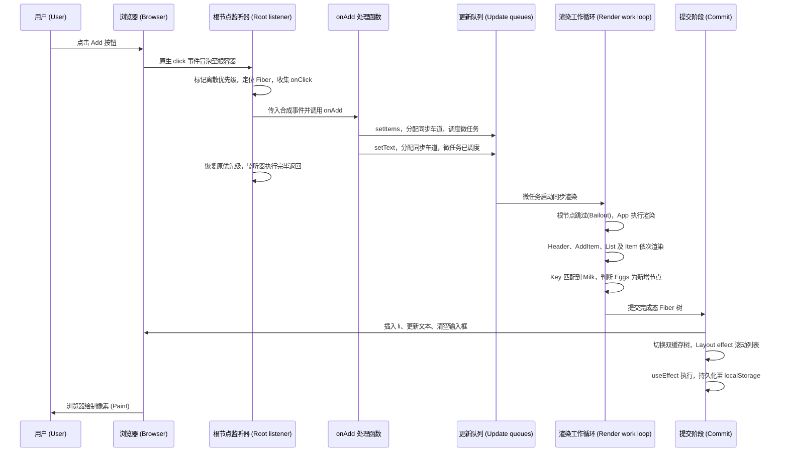
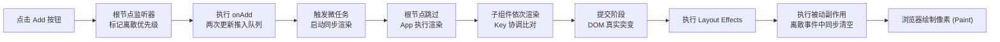

# 完整穿透：一次点击从事件触发到像素绘制（A Click, Start to Finish）

> [!summary] 核心速览（TL;DR）
> 点击事件首先冒泡至 React 挂载在根容器上的监听器，React 找到你绑定的事件处理函数并将该更新标记为紧急更新（离散优先级）。你在函数中调用的两次 `setState` 此时仅仅是将更新推入队列；待事件处理函数执行完毕后，一个微任务（Microtask）会立即发起同步渲染：它从根节点起步，跳过所有无待处理工作的无关子树，重新执行 `App` 及其子组件，根据 `key` 智能匹配列表项，并一次性将所有 DOM 变更提交到页面。紧接着执行 Layout Effect；由于本次更新源于点击事件，`useEffect` 也会赶在浏览器绘制屏幕之前同步清空并执行完毕。

在本专栏之前的每一个篇章中，我们都专注于拆解 React 内部机器的某一个特定齿轮。而在这篇收官之作中，我们将启动整台机器，让它完整运转一次。

场景设定：用户在购物清单的输入框中输入了 "Eggs"，随后按下了 **Add（添加）** 按钮。从鼠标轻点的那一瞬间，到 "Eggs" 最终呈现在屏幕像素中，本专栏前面讲到的几乎每一个核心概念都将被调动起来。下面是我们本次全程追踪的演示应用代码——为了在生命周期的最后阶段展示更完整的内部行为，我们在代码中特意加入了两个 Effect：

```jsx
function App() {
  const [items, setItems] = useState([{ id: 1, name: "Milk", done: false }]);
  const [text, setText] = useState(""); // 用户此时已在输入框键入了 "Eggs"
  useEffect(() => {
    localStorage.setItem("items", JSON.stringify(items));
  }, [items]);
  return (
    <main>
      <Header count={items.length} />
      <AddItem text={text} onChange={setText} onAdd={() => { setItems([...items, { id: Date.now(), name: text, done: false }]); setText(""); }} />
      <List items={items} onToggle={(id) => setItems(items.map(i => i.id === id ? { ...i, done: !i.done } : i))} />
    </main>
  );
}

function List({ items, onToggle }) {
  const ulRef = useRef(null);
  useLayoutEffect(() => {
    ulRef.current.scrollTop = ulRef.current.scrollHeight; // 始终使最新添加的项目保持在可视区域
  }, [items.length]);
  return <ul ref={ulRef}>{items.map(item => <Item key={item.id} item={item} onToggle={onToggle} />)}</ul>;
}
```

`AddItem` 组件内部渲染一个 `<input>` 输入框和一个 `<button onClick={onAdd}>Add</button>` 按钮。

## 全流程全景一览（The whole trip at a glance）



## 点击发生前：已就绪的运行环境（Before the click: what's already in place）

这次点击触发的任何流程，都不是从零凭空开始的。当应用首次挂载（Mount）时，底层的基础设施早已搭建就绪：

- `createRoot` 已经在根容器 DOM 节点上为每一种原生事件类型安装了一个统一监听器（参见 [[10 Events - One Listener at the Root|第 10 篇 · 事件系统：根节点上的单一监听器]]）。
- 每一个组件都在内存中分配到了对应的 Fiber 节点；其中 `App` 的 Fiber 节点维护着一条 Hooks 链表：槽位 1 存储 `items` 状态，槽位 2 存储 `text` 状态，槽位 3 存储副作用 Effect（参见 [[09 Hooks - Why Order Matters|第 09 篇 · Hooks：为什么调用顺序决定一切]]）。
- 由 React 创建的每一个真实 DOM 节点，其内部都携带着一个隐藏的属性指针，分别指向它对应的 Fiber 节点以及上一次提交时的最新 props。
- `setItems` 和 `setText` 这两个状态更新函数在初次渲染时被创建一次，并永久绑定到了 `App` 的 Fiber 节点及其对应 Hook 的更新队列上。

## 1. 点击事件冒泡至根节点（1. The click reaches the root）

用户按下鼠标，浏览器在按钮 `<button>` 元素上触发原生 `click` 事件。因为 React 并没有把事件监听器直接绑定到按钮本身，所以该事件会顺着真实 DOM 树一路向上冒泡，直到抵达应用挂载的根容器（Root Container）——React 注册在根节点上的 `click` 冒泡监听器正静候于此。

当这个监听器在应用初始化时被注册时，它就已经被包裹上了优先级属性：`click` 属于典型的**离散事件（Discrete Event）**。在执行任何具体业务代码之前，React 会首先将当前的更新优先级全局设置为「离散优先级（Discrete Priority）」。紧接着，React 从原生 `event.target` 节点上读取隐藏的 Fiber 指针，获取按钮对应的 Fiber；随后沿着 Fiber 树自底向上回溯，收集沿途 DOM 元素上声明的所有 `onClick` 处理函数。React 找到了唯一定义的那一个（即你编写的 `onAdd`），将原生浏览器事件包装为 React 合成事件（SyntheticEvent），并调用你的 `onAdd`。

## 2. 事件处理函数将两次更新推入队列（2. The handler queues two updates）

你的 `onAdd` 函数开始执行：

```jsx
setItems([...items, { id: Date.now(), name: "Eggs", done: false }]);
setText("");
```

这两行调用中的任何一行都不会立即触发渲染。每一个状态更新函数（setter）在执行时，都会按部就班地完成以下四步：

1. **挑选更新车道（Lane）**：它会查询“当前上下文的事件优先级是什么？”，获知当前为离散优先级（Discrete），由此分配到最高优先级的**同步车道（SyncLane）**（参见 [[07 Priorities, Transitions and Concurrency|第 07 篇 · 优先级、Transition 与并发机制]]）。
2. **将更新推入 Hook 的队列**：（在特定条件下，setter 可以在触发时就地预先计算新状态；若通过 `Object.is` 判断发现状态并无任何实质改变，则会提前退出并放弃后续调度。但在这里，两个新状态值均与当前值截然不同，因此两次更新都会如实驻留在队列中。）
3. **在 Fiber 节点树上标记工作路径**：将 `App` 的 Fiber 节点标记为存在待处理的同步工作，并从 `App` 向上遍历每一个祖先节点直达根节点，为它们依次打上“存在包含同步工作的子孙节点”的掩码标记。正是这条自下而上连贯的标记路径（Trail of marks），让后续渲染工作能够神速定位到目标组件 `App`，无需盲目遍历其他无关子树。
4. **请求 React 调度根节点**：第一次调用 `setItems` 时，React 会向浏览器微任务队列中压入一个**微任务（Microtask）**；当第二行 `setText` 紧接着调用时，React 发现调度微任务已经就绪，便不会重复创建。

在事件处理函数执行期间，`items` 与 `text` 读取到的依然是旧值：它们只是创建当前函数闭包的那次渲染中所固化的常量。这正是我们在 [[04 State Updates - Snapshots and Batching|第 04 篇 · 状态更新：快照与批处理]] 中详尽剖析的**快照模型（Snapshot Model）**。

`onAdd` 执行完毕并返回。React 将全局优先级恢复为触发前的原始状态，根监听器执行完毕并将控制权交还给浏览器。

## 3. 微任务调度：立即发起同步渲染（3. The microtask: render right now）

此时 JavaScript 调用栈已经完全清空，根据浏览器事件循环机制，在进入下一阶段（包括执行重排与屏幕绘制）之前，**必须优先清空所有微任务队列**。

React 注册的微任务开始执行：它检查根节点，发现存在属于同步车道（SyncLane）的工作，便**立即同步开启渲染**，而无需将任务再次抛入基于 MessageChannel 或 setTimeout 的宏任务调度器（Scheduler）中等待。由于刚才的两次状态更新处于完全相同的车道中，因此单次渲染就会将它们同时消费合并处理。这就是**自动批处理（Batching）**——也是为什么用户绝不会看到“列表中已经出现了 Eggs，但输入框里却还残留着 Eggs”这种半成品中间状态。

同步渲染一旦启动，就会从头到尾一气呵成执行完毕，**中途绝不会让出主线程**。此时的 Fiber 工作循环（Work loop）所执行的最小工作单元与 Transition 并发渲染本质上并无二致：取出当前 Fiber、执行其工作、转移到下一个 Fiber。唯一的关键区别在于：同步循环绝不会在循环间隙停下来检测浏览器是否需要主线程响应，它始终保持不可中断的同步执行（参见 [[06 Fiber - Work You Can Pause|第 06 篇 · Fiber：可被中断与恢复的工作单元]]）。

## 4. 渲染阶段：自根节点向下穿透至 App（4. Render: from the root down to App）

渲染的执行流程永远从根节点 `Root` 起步，但这绝不意味着所有组件都会被重新执行一遍。根节点本身并没有挂载任何新的状态更新，它的 props 也没有发生改变，因此它会直接**跳过自身计算（Bail out）**。然而，它清晰地感知到了子孙节点留下的标记掩码（指出下方存在同步更新任务），所以它不会直接终止渲染，而是顺着标记路径继续向下巡检。

当工作循环抵达 `App` 时，虽然从根节点传过来的 props 对象引用与上一次完全一致，但由于 `App` 本身挂载着待处理的同步更新，React 必须执行 `App()`。这一次，React 为组件切换并安装了负责更新阶段的 Hooks 派发器（Update Dispatcher），Hooks 链表依序遍历 `App` 的 Hook 槽位：

- **槽位 1（`useState`）**：消费并处理其更新队列，计算出包含 "Milk" 和 "Eggs" 的全新数组并返回。
- **槽位 2（`useState`）**：消费并处理其更新队列，计算并返回空字符串 `""`。
- **槽位 3（`useEffect`）**：将当前依赖数组 `[items]` 与上一次渲染留存的快照进行比对。由于 `items` 是一个全新生成的数组引用，依赖判定改变，该 Effect 被打上标记（Effect Tag），等待在提交阶段之后执行。

组件状态已经改变，因此 `App` 的计算输出必然生效。它执行完毕，返回了一棵全新的 React 元素树（参见 [[03 What Rendering Really Means|第 03 篇 · 渲染（Rendering）的真正含义]]）。

## 5. 渲染阶段：递归处理子组件（5. Render: the children）

`<main>` 在相同层级拥有完全相同的元素标签类型，因此其对应的 Fiber 节点被直接复用，仅更新了 props。接下来，React 依次处理它的三个子组件：

- **`Header`**：接收到了 `count={2}`，由于生成了全新的 props 对象且内容发生改变，它执行渲染。
- **`AddItem`**：接收到了 `text=""` 以及全新生成的内联回调函数 `onAdd`，因此它执行渲染。
- **`List`**：接收到了全新的 `items` 数组以及全新生成的 `onToggle` 函数，因此它执行渲染。在其内部，`useLayoutEffect` 的依赖项 `[items.length]` 从 `[1]` 变为了 `[2]`，该 Layout Effect 同样被打上了“需在提交阶段执行”的标记。

值得深入留意的是：**在当前场景下，哪怕你预先使用了 `React.memo` 或者开启了 React Compiler，这三个子组件中的任何一个都不会被跳过**——因为它们三者确实都接收到了崭新的输入数据。记忆化技术的用武之地，是在输入框打字改变 `text` 时跳过无关的 `Header` 和 `List`；而一旦用户点击添加按钮，清单数据整体发生变更，所有直接或间接依赖该清单的组件都必须如实重新计算。

## 6. 带 Key 的列表协调（6. Reconciling the list by key）

`List` 组件执行完毕后返回一个由 `<Item>` 元素组成的数组，这正是 `key` 属性展现真正威力的时刻（参见 [[05 Reconciliation - Finding What Changed|第 05 篇 · 协调（Reconciliation）：探寻真正变化的部分]]）。React 将新生成的子元素列表与现存的旧 Fiber 链表进行比对：

| 新元素（New element） | Key | 是否匹配？ | 协调决策与处理结果 |
| --- | --- | --- | --- |
| `<Item item={Milk}>` | `1` | 是（Key 与元素类型完全一致） | 复用原有 Fiber 节点，更新其传入的 props |
| `<Item item={Eggs}>` | 新生成的 `Date.now()` ID | 否（未找到具有该 Key 的旧 Fiber） | 创建全新的 Fiber 节点，打上**新增插入（Placement）**标记 |

名为 "Milk" 的 `Item` 依然会重新执行渲染：虽然其 `item` 对象的引用未变，但由于父级传入的 `onToggle` 是一个新创建的函数，导致其 props 引用发生了改变。不过，它这次返回的元素树结构和内容与上一次完全一致，因此后续并不会引起任何真实 DOM 的改动。
而名为 "Eggs" 的新 `Item` 则是生命周期中的首次渲染：React 为其挂载了初次挂载派发器（Mount Dispatcher），以干净的状态初始化其内部所有的 Hooks。

## 7. 完成工作循环：自底向上组装树（7. Completing the tree）

当工作循环处理完叶子节点的 Fiber 开始沿树自底向上回溯时，会进入“完成工作（completeWork）”阶段。
对于新创建的 Eggs `<li>`，这意味着 **React 此时就会在内存中直接创建其真实的 DOM 节点**——不过它此时完全离屏存在，并未挂载到页面的 DOM 树上。
对于那些 props 发生改变的既有 DOM 节点，React 仅仅是在其 Fiber 上打上“提交阶段需更新”的标记。
截至目前，屏幕上的 DOM 还没有发生任何一丝一毫的可见变化，用户看不到任何中间过程。整个渲染阶段的产物，仅仅是一棵代表最新 UI 期望状态的**完成态 Fiber 树（Finished Work）**，以及一组精确标注了“哪些节点需要执行真实 DOM 操作”的副作用标记集合。

## 8. 提交阶段：一气呵成应用 DOM 变更（8. Commit: change the DOM, in one go）

提交阶段（Commit Phase）完全以同步方式执行，中途绝不让出主线程（参见 [[08 The Commit Phase and Effects|第 08 篇 · Commit 阶段与副作用（Effects）]]）：

1. **DOM 突变（Mutation）**：React 极其精准地仅遍历带有副作用标记的 Fiber 节点。它将新创建的 `<li>` 实际插入到 `<ul>` 的子节点列表中，将 Header 中的文字从 "1" 更新为 "2"，将 input 输入框的 value 重置为 `""`，并且更新相关 DOM 节点上隐藏的内部属性指针，以确保*下一次*点击事件触发时能够正确索引到全新的 `onAdd` 处理函数。至于那些 props 并未实质变化的 DOM 元素，React 根本不会产生任何 DOM 写操作。
2. **双缓存树切换（Swap）**：将刚刚完成的 Fiber 树（`workInProgress`）切换提升为当前屏幕树（`current`）。从这一刻起，React 内部正式认定该结构即为“屏幕当前的真实呈现”。
3. **执行 Layout Effects（布局副作用）**：执行 `List` 组件内部声明的 `useLayoutEffect`。此时真实 DOM 树中已经确凿包含了新插入的 Eggs 元素，因此测量到的 `scrollHeight` 是百分之百精准的真实物理高度；滚动操作紧随其后发生——**这一切全部发生在浏览器将像素绘制到屏幕之前**，彻底杜绝了任何视觉闪烁（No flicker）。

## 9. 被动副作用：破例在绘制前同步执行（9. Passive effects: before paint, this time）

在前端开发者的普遍认知中，`useEffect` 会等待一个独立的调度宏任务，通常在浏览器完成绘制（Paint）之后才异步执行。

**然而，由于本次提交源于一次「离散事件（Discrete Event）」，React 会破例在当前微任务中、提交阶段结束的尾声立即同步清空并执行被动副作用（Passive Effects）！**

因此，`App` 中声明的 `useEffect` 会在当前时刻立即将包含两项物品的清单序列化存入 `localStorage`。React 采用这种策略的深层考量，是为了保证一次离散点击的全部连锁反应在用户的下一次输入事件到达之前**彻底尘埃落定**。

如果此时某个 Effect 内部又再次调用了 `setState`，那么该同步更新也会立刻在同一个微任务中被连带渲染并提交，同样抢在浏览器最终绘制之前完成。

> [!warning] “useEffect 一定在浏览器绘制后执行”其实是个误区
> 对于由离散事件（如本次点击）引发的状态更新，`useEffect` 实际上会在浏览器绘制像素**之前**就被同步清空执行。只有在首屏首次挂载以及 Transition 并发更新时，它通常才会在绘制完成后异步触发。因此：当你**切实需要**保证代码在绘制前执行时，请务必使用 `useLayoutEffect`；切勿基于某种偶然的时序假设去依赖 `useEffect` 的执行时机。

## 10. 浏览器绘制：像素最终呈现在屏幕上（10. Paint）

微任务执行完毕，浏览器处理本次点击的原生事件任务也正式告一段落，主线程控制权终于重新交还给浏览器引擎。浏览器随即开始重新计算样式（Style）、执行页面排版（Layout），并在屏幕上绘制（Paint）出最新帧。

用户瞬间看到了完整更新后的画面：滚动列表的最底部多出了 "Eggs" 项、清单计数更新为 2、输入框恢复为空白——所有变更分毫不差地同时呈现。从最初的鼠标点击，到最终写入 `localStorage`，整整十个环节全部在同一个不可中断的浏览器任务周期内同步完成。



> [!tip] 核心心智模型（Mental Model）
> 事件处理函数的核心职责仅仅是**将工作加入队列**；随后，React 会严格分两个阶段执行该工作：**渲染阶段**在纯内存中计算究竟发生了什么变化，其计算过程可被随时重试或废弃；**提交阶段**则将最终结果一次性应用到 DOM 并依序执行各类副作用。而对于一次点击事件而言，从事件派发到更新入队、渲染计算、DOM 提交乃至 Effect 执行，全部被紧凑地收敛在浏览器的同一个任务单元中，赶在下一帧屏幕绘制前完整闭环。

## 常见认知误区（Common misconceptions）

- **“调用 `setItems` 会立即修改 `items` 变量的值”**：错误。Setter 仅仅是创建了一个更新对象并推入队列。事件处理函数内部的 `items` 依然是固化在当前闭包中的旧快照，崭新的值只有在下一次渲染执行时才会生成并返回。
- **“连续调用两次 `setState` 会引发两次渲染”**：错误。两次更新均被分配到了相同的同步车道（SyncLane），并在随后触发的单个微任务中被合并自动批处理，仅执行一次统一渲染。
- **“每次点击都会重新渲染整棵应用树”**：错误。渲染流程虽然从根节点启动，但由于根节点本身无更新标记，它会直接触发 Bailout（跳过），顺着标记路径直奔有更新任务的 `App`，只有 `App` 及其下方的组件才会重新参与计算。
- **“只要组件重新渲染了，就一定会操作 DOM”**：错误。Milk 对应的 `Item` 组件虽然因为接收到了新的 `onToggle` 函数而重新执行了组件函数，但其返回的元素描述与之前完全一致；提交阶段极度智能，绝不会对其实施任何无意义的 DOM 写操作。

## 总结（Summary）

一次看似寻常的点击，调动了整台 React 引擎的精密运转。根节点监听器捕获事件并标定离散优先级，精准定位目标按钮的 Fiber 节点并调用你的事件处理函数；函数中的两个 setter 依次将同步车道更新推入队列，在整条祖先链路上打下指示标记，并调度了一个微任务。该微任务立即启动同步渲染：从根节点起跳，跳过一切未改动的无关子树，直达 `App` 依序重新执行其 Hooks 链表；递归渲染其子组件并通过 Key 高效协调列表项差异；随后在提交阶段一次性执行 DOM 突变、完成双缓存树指针切换、同步触发 Layout Effect；并最终由于点击属于离散事件，赶在浏览器绘制前同步清空了 `useEffect`。

牢记这个坚如磐石的心智模型：**事件只负责入队（Queue），渲染负责纯内存计算（Compute），提交负责实际应用变更（Apply），而浏览器绘制（Paint）则在这一整套同步流程全部落幕后，将完美的像素呈现在用户眼前。**

### 核心要点归纳（Key Takeaways）

- **根节点监听器（Root listener）**：点击事件冒泡至根节点被捕获，React 定位触发目标的 Fiber 节点，自底向上收集 `onClick` 冒泡链并全局标记离散优先级（Discrete）。
- **Setter 仅负责入队（Setters queue）**：`setItems` 和 `setText` 分别将同步车道（Sync lane）更新推入各自 Hook 的队列，并在回溯至根节点的整条路径上打上标记。
- **快照不可变性（Snapshot）**：在处理函数闭包内部，`items` 和 `text` 始终严格锁定为创建当前处理函数时所固化的旧快照常量。
- **自动批处理（Batching）**：事件处理函数返回后，由单个微任务将队列中的两次更新合并打包，发起单次统一渲染。
- **同步渲染（Sync render）**：同步车道的工作在微任务中立即执行到底，绝不会在半途中让出主线程。
- **沿标记路径跳过（Bail out to the work）**：根节点自身无更新直接跳过，顺着标记掩码直奔目标 `App`，按严格顺序重新执行其 Hooks 链表。
- **子组件重新渲染（Children re-render）**：`Header`、`AddItem` 和 `List` 均接收到了全新的输入数据，因此即便引入记忆化优化也绝不会跳过计算。
- **带 Key 协调（Keys）**：Milk 的旧 Fiber 被成功匹配并复用；Eggs 识别为全新元素，创建新 Fiber 并标记为新增插入（Placement）。
- **提交阶段（Commit）**：以完全同步且不可中断的方式依次完成：真实 DOM 突变、双缓存树指针切换，以及 Layout Effect 的执行。
- **副作用与屏幕绘制（Effects and paint）**：对于点击等离散事件，`useEffect` 会在提交阶段末尾直接同步执行完毕，抢在浏览器最终绘制像素之前彻底闭环。

**深入探究源码实现：** [[21 Walkthrough - setState to Pixels|全流程穿透：从 setState 到像素呈现]] · [[20 Walkthrough - First Render End to End|全流程穿透：首屏渲染端到端]]

---

← [[11 Memoization and the React Compiler|上一篇：第 11 篇 · 记忆化与 React 编译器]] · [[react-concepts|返回专栏目录]] · [[react-concepts|专栏完结]] →
