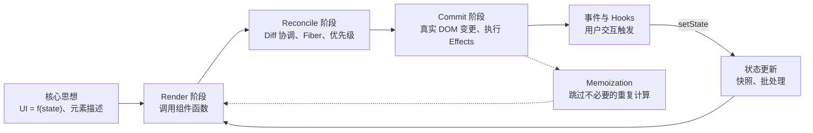

# React 运行原理（How React Works）

你每天都在使用 React。你大概知道 `setState` 会“触发重新渲染”，`key` 能“辅助 React diff”，`useEffect` 会在“渲染后执行”。但这门课程的目的，是用一个**真正能指导推理的心智模型**来替代这些一知半解的口诀：到底什么是渲染？为什么刚调用 setState 后状态看起来还是旧的？React 如何判断发生了什么变化？为什么 React 能够暂停工作？Commit 阶段到底做了什么？以及 Hooks 的使用限制究竟因何而来？

本课程专门为**每天都在写 React、却从未深入探究过内部机制的一线开发者**打造。你完全不需要预先阅读任何 React 源码。每一章节都用最朴素、清晰的语言讲透一个核心概念，并且全程以一个极简的「购物清单应用」作为贯穿案例——每一个新概念都能在你已熟悉的代码中落地。文中配有精美的流程图，且每篇结尾都附有核心要点速览。

本专栏是 [[react-explain|React Internals (源码深度剖析)]] 的概念篇。那一套课程是对 React 19.3.1 源码的逐行拆解，每个论点都严密契合源码实现；而本篇则始终保持在「心智模型与核心思想」的层面上，不强求你直接阅读 React 源码。两者珠联璧合：先阅读本篇建立清晰的心智模型，遇到感兴趣的机制时，顺着文末的 **「深入探究（Go deeper）」** 链接跳转到源码篇，探寻该模型在代码层面的确切实现。

> [!tip] 阅读建议
> 首次阅读时，强烈建议按章节顺序浏览：后文的每一个术语都建立在前面的基础之上。
> - **第 1 至 4 篇**：剖析你写的代码到底意味着什么，以及「渲染」的真正内涵；
> - **第 5 至 8 篇**：深入 React 如何发现变化并将其应用到真实 DOM；
> - **第 9 至 11 篇**：揭秘 Hooks 底层逻辑、事件委托机制与记忆化（Memoization）优化；
> - **第 12 篇**：从头到尾完整回放一次点击事件触发的全生命周期，将所有知识点融会贯通。
> 
> 如果你当前只有 20 分钟碎片时间，可以先读 [[01 The Big Idea - UI Is a Function of State|第 1 篇：核心思想]] 和 [[12 A Click, Start to Finish|第 12 篇：一次点击的全流程回放]]。

## 目录索引

1. [[01 The Big Idea - UI Is a Function of State|第 01 篇 · 核心思想：UI 是状态的函数]]
2. [[02 Elements, Components and the Tree|第 02 篇 · 元素、组件与树模型]]
3. [[03 What Rendering Really Means|第 03 篇 · 渲染（Rendering）的真正含义]]
4. [[04 State Updates - Snapshots and Batching|第 04 篇 · 状态更新：快照与批处理]]
5. [[05 Reconciliation - Finding What Changed|第 05 篇 · 协调（Reconciliation）：探寻真正变化的部分]]
6. [[06 Fiber - Work You Can Pause|第 06 篇 · Fiber：可被中断与恢复的工作单元]]
7. [[07 Priorities, Transitions and Concurrency|第 07 篇 · 优先级、Transition 与并发机制]]
8. [[08 The Commit Phase and Effects|第 08 篇 · Commit 阶段与副作用（Effects）]]
9. [[09 Hooks - Why Order Matters|第 09 篇 · Hooks：为什么调用顺序决定一切]]
10. [[10 Events - One Listener at the Root|第 10 篇 · 事件系统：根节点上的单一监听器]]
11. [[11 Memoization and the React Compiler|第 11 篇 · 记忆化（Memoization）与 React 编译器]]
12. [[12 A Click, Start to Finish|第 12 篇 · 完整穿透：一次点击从事件触发到像素绘制]]

## 学习路径图

