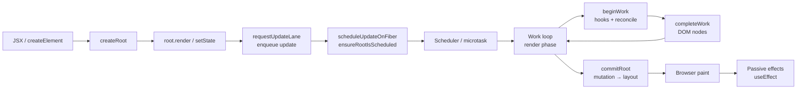

# React 源码深度剖析：从 `createRoot` 到像素呈现

> [!summary] 核心速览（TL;DR）
> React 的工作严格拆分为两大阶段。**Render 渲染阶段**是纯粹的无副作用计算，且*可以*被中断（在实际运行中，只有 Transition 过渡更新、Suspense 重试和 Idle 空闲任务会触发时间切片中断，因为首次挂载和用户点击等离散交互都是同步运行的）：该阶段会调用你的组件函数，并将旧 Fiber 树与新元素树进行深度 Diff 比对。**Commit 提交阶段**则是不可中断的同步执行块：它将差异写入真实 DOM 并执行各种副作用（Effects）。除这两大阶段之外的所有内部机制，本质上都服务于两大目标：决定**何时**运行这些阶段（Lanes 优先级模型 + Scheduler 调度器），以及推导**尽可能少**的工作量（Bailout 跳过机制）。React 编译器（React Compiler）并没有另起炉灶改动这套底层底座，而是通过在编译期改写你的组件代码，使得在输入未变时直接向 React 递交**完全相同的内存对象引用**，从而顺水推舟地触发 React 原本就内置的 Bailout 跳过机制。

本专栏的所有篇章均基于 **React v19.3.1** 源码进行对照。文末的脚注链接均精确锚定到 GitHub 官方仓库 v19.3.1 标签下的确切代码行范围。React 编译器的演示代码则均由真实的 `babel-plugin-react-compiler@1.0.0` 构建生成。

## 推荐起点：两大端到端全流程故事

1. [[20 Walkthrough - First Render End to End|首次渲染端到端源码追踪]]：从 `createRoot(el).render(<App/>)` 顺藤摸瓜，一直追踪到屏幕首次像素绘制的每一个细节。
2. [[21 Walkthrough - setState to Pixels|从 setState 到屏幕呈现]]：以一次点击触发 `setCount(c => c + 1)` 为例，步步紧跟直到用户肉眼看到新数值的全过程。

这两篇全流程篇提供了宏观完整的叙事链路；后文列出的各个章节则是它们在各个关键节点上分流深入的专业主题剖析。

## 架构全局总览图

## 深度剖析专题分类

### 初始化引导（Setup）
- [[01 Bootstrap - Packages, JSX and the Dispatcher|01 · 初始化引导]]：`react`、`react-dom`、协调器（Reconciler）与调度器（Scheduler）如何协同装配，JSX 转译产物解析，以及 `useState` 是如何精准路由到当前渲染器的分发器（Dispatcher）的。
- [[02 createRoot - FiberRoot and HostRoot|02 · createRoot]]：深入剖析 `FiberRootNode` 数据结构、宿主根节点 `HostRoot` Fiber 以及根容器事件监听器的挂载。
- [[03 root.render - Scheduling the First Update|03 · root.render]]：首个更新对象（Update Object）的构造过程及其如何被推入调度循环。

### 核心运行时架构（Core Machinery）
- [[04 Lanes and the Scheduler|04 · Lanes 赛道模型与 Scheduler]]：以 31 位二进制掩码形式表达的优先级赛道（Lanes），以及借助 MessageChannel 宏任务实现的时间切片机制。
- [[05 The Fiber Data Structure|05 · Fiber 数据结构]]：可暂停与恢复的工作单元，以及由 `current` 与 `alternate` 构成的双缓存（Double Buffering）机制。

### 渲染阶段（Render Phase）
- [[06 The Work Loop - Render Phase|06 · 工作循环]]：`performUnitOfWork` 核心循环、自顶向下的深度优先遍历与 `workInProgress` 指针推进。
- [[07 beginWork and Reconciliation|07 · beginWork 与协调]]：组件跳过机制（Bailout）、子节点 Diff 协调算法与 `key` 的底层匹配逻辑。
- [[10 Hooks on Mount|10 · Hooks 挂载阶段]]：组件在首轮执行时，其内部 Hook 单向环形链表是如何一步步搭建起来的。
- [[11 Hooks on Update|11 · Hooks 更新阶段]]：更新队列（Update Queue）的环形链表消费计算，以及依赖项数组（Deps）的比较算法。
- [[08 completeWork - Building DOM Nodes|08 · completeWork]]：自底向上在内存中离屏构建真实 DOM 节点，以及副作用标记（SubtreeFlags）向根部的层层冒泡收集。

### 提交阶段（Commit Phase）
- [[09 Commit Phase - Mutation, Layout, Passive Effects|09 · Commit 阶段]]：DOM 突变（Mutation 子阶段）、Fiber 树双缓存指针秒级切换、Layout 副作用同步执行、屏幕像素绘制，以及随后由微任务/宏任务调度的 Passive 被动副作用。

### 状态变迁与事件系统（Updates）
- [[13 The Event System|13 · 事件系统]]：根容器全局事件委托、合成事件（SyntheticEvent）封装，以及用户操作如何映射为优先级车道。
- [[12 setState - dispatchSetState and Batching|12 · setState 底层实现]]：`dispatchSetState` 调用链路、急切计算跳过（Eager Bailout）以及基于微任务的自动批处理。

### React 编译器（React Compiler）
- [[14 React Compiler - How It Works|14 · 编译器工作原理]]：基于 Babel 抽象语法树（AST）的分析流水线、真实转译产物拆解与 `useMemoCache` 运行时机制。
- [[15 Rendering With vs Without the Compiler|15 · 启用与未启用编译器的对比]]：在完全相同的示例应用下，逐行追踪两种模式在运行时执行轨迹的巨大差异。

## 推荐阅读路径指南
- **极速尝鲜**：按照 20 → 21 → 15 的顺序阅读，快速串联起端到端全局视野；
- **硬核通读**：按 01 至 15 顺序扎实推进，随后重读 20 和 21 进行闭环巩固；
- **只关心编译器**：建议先读 07（Bailout 跳过章节）打底，再深入阅读 14 和 15。
