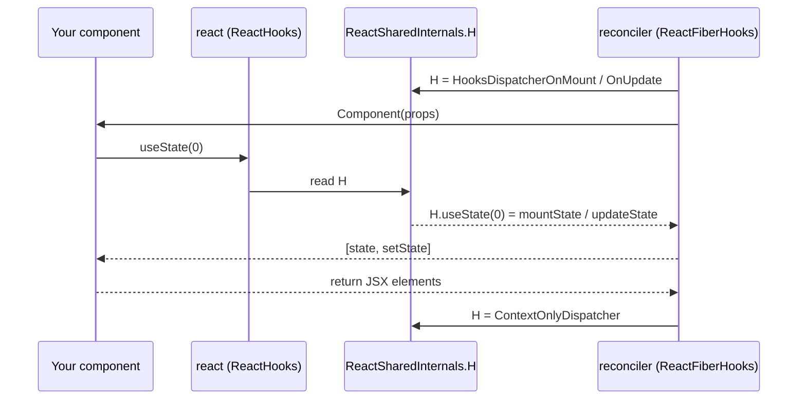

# 启动机制：包结构划分、JSX 运行时与 Dispatcher 调度分发器

> [!summary] 核心速览
> `react` 本质上是一个极其精简轻量的核心包。它的主要职责仅是构造纯粹的 Element 描述对象（通过 `jsx()`），并维护一个共享的可变全局对象——`ReactSharedInternals`（其中包含了挂载 Hooks Dispatcher 的 `H` 以及当前 Transition 状态的 `T` 等核心插槽）。`react` 自身对 Fiber 架构以及真实 DOM 浑然不知。
> 实际负责调度与比对工作的协调器（`react-reconciler`）被打包内联到了 `react-dom` 中，并在构建阶段与 DOM 的「宿主配置（Host Config）」深度绑定。在调用开发者编写的组件函数之前的一瞬间，协调器会将自身实现的 Dispatcher 注入到 `ReactSharedInternals.H`。这就是为什么从 `react` 导入的 `useState`，最终能够准确调用协调器底层逻辑的根本原因。

## 包架构划分及其设计初衷

深入 React 源码的第一个认知冲击往往是：**你在业务代码中 import 的包，并不是真正执行工作的包。**

| 包名 | 包含核心内容 | 是否感知 Fiber？ | 是否感知 DOM？ |
|---|---|---|---|
| `react` | `jsx`/`createElement`、`Component`、Hook 转发桩（`useState` 等存根函数）、`startTransition`、`memo`、`lazy`、Context 对象、`ReactSharedInternals`（React 共享内部状态） | 否 | 否 |
| `react-reconciler` | Fiber 工作循环（Work Loop）、`beginWork`/`completeWork`/Commit 阶段、Hooks 具体实现、Lanes 优先级模型 | 是 | 否（仅面向 Host Config 接口抽象编程） |
| `react-dom` | `createRoot`、`hydrateRoot`、`flushSync`、Portal，以及**内联打包的协调器副本**（基于 `ReactFiberConfigDOM` 编译生成），外加合成事件系统 | 是（已内联打包） | 是 |
| `scheduler` | 基于 `MessageChannel` 构建的优先级任务队列（详见 [[04 Lanes and the Scheduler|Lanes 与调度器]]） | 否 | 否 |

查阅 `react-dom` 的 `package.json` 可以发现，其生产依赖项仅列出了 `scheduler`，而将 `react` 作为对等依赖（peerDependencies）声明[^domdeps]。协调器（`react-reconciler`）在运行时甚至根本不是一个独立的 npm 依赖项，而是在构建时被直接内联（inlined）进了 `react-dom` 的产物中。
Rollup 构建 `react-dom/client` 时，会将 `react` 和 `react-dom` 标记为外部依赖（external）[^bundle]，并且构建脚本会将当前包的所有 `dependencies` 与 `peerDependencies` 一并视为外部模块[^getdeps]。因此，最终输出的 `react-dom-client.production.js` 内部完整私有化打包了一整份协调器代码。同理，`react-native` 以及 `react-three-fiber`（通过公开发布的 `react-reconciler` npm 包）也是各自附带了一套专属于自身宿主环境的协调器构建副本。

为什么要进行这样看似绕弯的拆包设计？

- **单一组件模型，适配多元渲染器（One component model, many renderers）：** 只要基于 `react` 编写组件，就能无缝运行于浏览器 DOM、React Native、ART 或是任何自定义渲染器中。在整套架构里，唯有底层宿主配置（Host Config）会因平台而异。
- **第三方库仅需依赖 `react`：** 通用 UI 组件库绝不应该强行绑定 `react-dom`。因此，`react` 必须具备在脱离任何具体渲染器时依然能够被独立导入解析的能力。
- **确立“当前渲染上下文由谁掌管”的单一事实来源（Single source of truth）：** 这正是下文将要展开的共享内部状态（`ReactSharedInternals`）所扮演的核心总线角色。

> [!warning] 常见误区：“React 维护了一个虚拟 DOM 并与真实 DOM 进行 Diff”
> React 从未在运行时将虚拟节点与真实 DOM 进行比对。它的实际机制是将**全新生成的 Element 元素**（由 `jsx()` 创建的廉价、随用随抛的对象）与**当前已有的 Fiber 树**（长期驻留内存、具备可变状态的工作单元，详见 [[05 The Fiber Data Structure|Fiber 数据结构]]）进行比对协调。
> React 仅在 Commit 阶段才会通过宿主配置调用真正操作 DOM。把 Element 称为“虚拟 DOM”更像是一个面向大众的概念普及词，而在 React 底层真正运转并承载所有工作核心的，从始至终都是 **Fiber 树**。

## JSX 转译机制

自 React 17 引入“全新的自动运行时（Automatic Runtime）”以来，编译器会将 JSX 语法编译为对 `react/jsx-runtime` 的函数调用，而不再转译为历史包袱厚重的 `React.createElement`。到了 React 19，这一编译模式已成为强制要求，因为无论是原生支持 Ref 作为 Prop（ref-as-prop）还是更极致的 Element 创建性能，都深度依赖这一运行时规范[^upgrade]。

```jsx
// 源代码
<Button kind="primary" key={id} ref={btnRef}>Save</Button>

// 编译产物（自动运行时，生产环境）
import { jsx as _jsx } from "react/jsx-runtime";
_jsx(Button, { kind: "primary", ref: btnRef, children: "Save" }, id);
```

对比早期的 `createElement(type, props, ...children)`，可以观察到几个极其关键的架构变化：

- `children` 直接合入 `props` 对象中，不再作为不定参数（varargs）动态收集。
- `key` 被剥离为**独立的第三个实参**。编译器在静态分析阶段就将其提取出来，从而彻底免去了运行时反复遍历 `props` 提取 key 的性能开销。
- `ref` 则**原原本本地保留在 `props` 中**。这正是 React 19 彻底废弃 `forwardRef`、将 “ref 视为普通 prop” 的底层支撑。

在模块导出层面，`react/jsx-runtime` 导出了 `jsx` 与 `jsxs`（后者用于静态子节点；两者唯一的区别仅在于开发环境下的 key 规则校验）。在生产环境中，二者均指向同一个精简函数 `jsxProd`。而在开发环境中（DEV），`jsx`/`jsxs` 会附带额外的验证包装逻辑，且开发专用的 `jsxDEV` 则由 `react/jsx-dev-runtime` 单独导出[^jsxexports]。

### `jsxProd` 与 Element 对象结构

`jsxProd` 的内部实现异常精简克制，这种极简是有意为之的：因为在组件树的每一次渲染中，每一个 JSX 节点都会执行它[^jsxprod]。

```js
// packages/react/src/jsx/ReactJSXElement.js (精简版)
export function jsxProd(type, config, maybeKey) {
  let key = null;
  if (maybeKey !== undefined) key = '' + maybeKey;
  if (hasValidKey(config)) key = '' + config.key;   // 针对 <div {...props} /> 这类通过属性展开传入 key 的场景

  let props;
  if (!('key' in config)) {
    props = config;               // 直接复用编译器创建的对象作为 props：零拷贝极致优化
  } else {
    props = {};
    for (const propName in config) if (propName !== 'key') props[propName] = config[propName];
  }
  return ReactElement(type, key, props, getOwner(), undefined, undefined);
}
```

这里“直接复用 `config` 作为 `props`”的快速路径（Fast Path）之所以安全，是因为 `jsx` 是**专为编译器设计的调用目标**：现代编译器在生成代码时，传入的一定是一个全新的临时对象字面量。早期的 `createElement` 无法做出这种静态保证（调用者可能传入已有的外部可变对象），因此每次都不得不强制浅拷贝一份 `props`。源码注释中也明确指出了这一点[^jsxprod]。

随后，`ReactElement` 函数负责构建真正的 Element 结构[^reactelement]：

```js
// 生产环境 Element 结构
{
  $$typeof: REACT_ELEMENT_TYPE,   // Symbol.for('react.transitional.element')
  type,                            // 'div' | 函数组件 | 类组件 | memo/lazy/context 对象...
  key,                             // string | null
  ref,                             // 映射 props.ref（已废弃的 getter 访问器）
  props,                           // 包含 children 与 ref 的完整属性对象
}
```

值得深入探究的架构细节：

- **`$$typeof` 采用 Symbol 的安全考量：** JSON 格式天然不支持序列化 Symbol 类型。因此，即便恶意攻击者试图诱导服务端返回类似 `{type: 'div', props: {dangerouslySetInnerHTML: ...}}` 这样的伪造对象，React 也能因其缺失合法的 Symbol 标识而拒绝将其当作 Element 渲染。这就是 React 经典的 XSS 防护机制。
  需要特别注意的是，React 19 将此 Symbol 升级为了 `react.transitional.element`，而非旧版的 `react.element`[^symbols]。因此，如果同个页面中意外混入了 React 18 打包生成的 Element，React 19 会直接**报错拒绝**（抛出 "Objects are not valid as a React child"）。这通常是排查项目中存在多版本 React 依赖冲突的最直接标志。
- **`element.ref` 已沦为废弃镜像：** 源码注释明确指出，当前架构下 `props.ref` 才是真实凭据（Source of Truth）。在开发环境中，`element.ref` 被实现为一个不可枚举的 Getter，一旦被读取就会触发告警[^reactelement]。在 React 19 中，对于不再使用 `forwardRef` 的普通函数组件，`ref` 会像其他常规 prop 一样直接注入组件的第一个实参 `props` 中。
- **开发环境下 Element 会被深度冻结：** 在 DEV 环境中，React 会执行 `Object.freeze(element.props)` 和 `Object.freeze(element)`，并挂载额外的不可枚举调试字段（`_store`、`_debugInfo`、`_debugStack`、`_debugTask`）[^reactelement]。这意味着在生产环境中直接篡改 props 或许“侥幸不报错”，但在开发环境中会立即抛出异常。切勿在业务逻辑中对 props 进行就地突变。
- **`_owner` 追溯调用者：** （本版本仅在开发环境存在）用于记录到底是哪个父级组件创建了当前 Element，它为 React 错误堆栈中的 Owner Stack 提示提供了底层支撑。

必须牢记：**Element 本质上只是轻量、不可变且在每次渲染时重新创建的 UI 描述快照。** 它们跨渲染周期之间并不存在持久的身份标识（Identity），唯有 Fiber 才具备跨渲染周期的持久身份。而协调（Reconciliation，详见 [[07 beginWork and Reconciliation|beginWork 与协调流程]]）的核心使命，正是将“当前特定位置/特定 key 下的这批新 Element”，映射并复用至“内存中长期驻留的既有 Fiber 节点”。

## `ReactSharedInternals`：跨包通信的总线调度台

在 `react` 的内部导出中，存在一个命名极其醒目的对象：

```js
// packages/react/src/ReactClient.js
export { ReactSharedInternals as __CLIENT_INTERNALS_DO_NOT_USE_OR_WARN_USERS_THEY_CANNOT_UPGRADE, ... }
```

[^clientexport] 渲染器（如 `react-dom`）会通过内部的 `shared/ReactSharedInternals` 模块将其导入，而这个模块在底层直接映射到了 `React.__CLIENT_INTERNALS_DO_NOT_USE_OR_WARN_USERS_THEY_CANNOT_UPGRADE`[^sharedshim]。
因为渲染器在运行时读取的正是宿主环境中*被加载的那个 `react` 模块实例*，这就确保了渲染器与核心包在运行时所访问的是同一个内存引用。其核心字段如下[^internals]：

| 字段名 | 历史名称 | 职责意义 |
|---|---|---|
| `H` | `ReactCurrentDispatcher` | **Hooks Dispatcher（分发器）**：挂载了 `useState`、`useEffect` 等 Hook 的具体实现对象；在组件渲染期间由具体的渲染器动态注入 |
| `A` | `ReactCurrentCache` | 异步缓存调度器（管理 Cache 与 `getOwner`），在工作循环执行期间挂载 |
| `T` | `ReactCurrentBatchConfig` | **当前 Transition 状态**上下文对象；由 `startTransition` 写入，并在 `requestUpdateLane` 计算更新通道时被读取 |
| `S` | | 当 Transition 启动时执行的回调（供协调器处理异步 Action） |
| `G` | | 手势 Transition 钩子（实验性功能，受 `enableGestureTransition` 特性开关控制） |
| DEV 专用: `actQueue`, `thrownErrors`, `getCurrentStack`, ... | | 测试工具（`act`）及调试调用栈支持 |

之所以采用 `H`、`A`、`T` 这类极端的单字母命名，是因为这些属性会在每一次 Hook 调用时以极高频率被密集读取，且单字母属性能在生产代码经过代码混淆（Minification）后依然保留最短标识符。相比历史版本中像 `ReactCurrentDispatcher.current` 这样冗长且存在深层对象寻址开销的命名，单字母属性既压缩了产物体积，又省去了一层属性查找跳转。

与此对应，`react-dom` 也有自己的内部共享总线：`ReactDOMSharedInternals.p` 记录了**当前的更新优先级**（由 [[13 The Event System|事件系统]] 与 `requestUpdateLane` 协同读写），而 `.d` 则承载了处理诸如 `preload` 等 DOM 资源预加载的 Resource Dispatcher[^domint]。

### `useState` 从 `react` 路由至协调器的完整链路

在 `react` 包中，开发者调用的各个 Hook 函数在底层不过是一个负责转发调用的存根函数（Stub）[^reacthooks]：

```js
// packages/react/src/ReactHooks.js (精简版)
function resolveDispatcher() {
  const dispatcher = ReactSharedInternals.H;
  // DEV 环境：若 dispatcher 为 null，则提示 console.error('Invalid hook call...')
  return dispatcher;
}
export function useState(initialState) {
  const dispatcher = resolveDispatcher();
  return dispatcher.useState(initialState);
}
```

真正的 Hook 逻辑实现由协调器提供。在执行 `renderWithHooks` 调度组件函数之前的一瞬间，协调器才会动态挂载真正的 Dispatcher 实现[^renderwithhooks]：

```js
// packages/react-reconciler/src/ReactFiberHooks.js (生产环境分支，精简版)
ReactSharedInternals.H =
  current === null || current.memoizedState === null
    ? HooksDispatcherOnMount     // 首次挂载：useState -> mountState
    : HooksDispatcherOnUpdate;   // 状态更新：useState -> updateState
let children = Component(props, secondArg);
// ...
finishRenderingHooks(current, workInProgress, Component); // 重置 H = ContextOnlyDispatcher
```

在组件首次挂载时，`HooksDispatcherOnMount.useState` 对应的是 `mountState` 实现[^mountdispatcher]。当组件函数执行完毕并返回后，`finishRenderingHooks` 会立即将 `H` 重置为 `ContextOnlyDispatcher`。在这个受限的 Dispatcher 下，除了 `readContext` / `use` 允许继续访问上下文外，调用其他任何 Hook 均会触发 `throwInvalidHookError`[^finishhooks][^contextonly]。
此外，Fiber 的工作循环还会通过 `pushDispatcher` / `popDispatcher` 在整个渲染周期外层做保护，确保在执行 `renderRootSync` 或 `renderRootConcurrent` 期间将 `H` 正确设置为 `ContextOnlyDispatcher`[^pushdispatcher][^pushcalls]。



这就从架构机制上彻底解释了官方著名的“Hooks 规则无效调用（Invalid hook call）”报错的三种典型根因[^throwinvalid]：

1. **在组件渲染上下文之外调用了 Hook：** 此时 `H` 要么是 `null`（尚未进入任何渲染阶段），要么是 `ContextOnlyDispatcher`（处于两个组件渲染的间隙期）。这会在开发环境下触发 `console.error` 或直接抛出异常。
2. **React 与渲染器版本不匹配：** 渲染器注入的 Dispatcher 缺失了 `react` 桩函数所期望调用的某些新方法。
3. **项目中存在多份 React 副本（Duplicate React）：** 你的组件代码从副本 B 中导入了 `react`，但 `react-dom` 却将 Dispatcher 挂载到了副本 A 的共享内部状态上。副本 B 中的 `H` 从未被赋值，依旧保持为 `null`。此时 Hook 的写法本身没有任何问题，纯粹是因为两套独立的通信总线在内存中互不相交、彼此失联所致。

> [!tip] 区分 Mount 与 Update Dispatcher 的深层意义
> 这个 Dispatcher 的动态切换是**基于当前组件当前的渲染阶段、在函数执行前逐一做出决策的**。判断依据是当前 Fiber 是否存在已挂载 Hook 状态的 `current` 对应树。
> Mount 阶段的 Hook 负责**在 `fiber.memoizedState` 的单向链表上开辟并初始化 Hook 节点**；而 Update 阶段的 Hook 则负责**按顺序顺次遍历该单向链表**。这就是为什么 React 严格要求“不得在条件分支或循环语句中调用 Hook”的物理本质：条件判断一旦导致调用顺序失衡，就会直接使整个链表遍历的游标错位脱轨。详见 [[10 Hooks on Mount|Mount 阶段的 Hooks]] 与 [[11 Hooks on Update|Update 阶段的 Hooks]]。

### StrictMode 双重渲染也在此处落脚

在开发环境中，若当前 Fiber 标记了 `StrictLegacyMode`，`renderWithHooks` 会在第一次调用组件函数后紧接着调用 `renderWithHooksAgain` 进行二次渲染验证[^strictdouble]。
源码注释揭示了一个鲜为人知但至关重要的细节：**第二次渲染会直接复用第一次渲染所生成的 Hook 状态**，因此 `useMemo` 在第二轮执行中不会重新计算结果。为了依然能够有效检测出存在副作用的不纯函数，React 的策略是：*在第一轮渲染过程中针对用户传入的计算函数主动双重调用*。
在 React 19 的升级指南中也专门记录了这一开发者可感知的行为变化：`useMemo` 与 `useCallback` 在第二轮渲染期间会复用第一轮的缓存结果[^upgrade]。需要强调的是，双重渲染机制纯属开发环境（DEV）特供。生产环境绝对不会发生二次调用，因此“我的 useEffect 为什么触发了两次”这类困惑，完全是 React 为提升代码质量而特意在本地研发阶段施加的设计预期。

## 宿主配置（Host Config）：协调器如何实现对具体 DOM 的解耦

如果查看协调器源码，会发现它尝试导入 `./ReactFiberConfig`，但该文件内部仅仅只有一行抛错代码[^configshim]：

```js
// packages/react-reconciler/src/ReactFiberConfig.js
throw new Error('This module must be shimmed by a specific renderer.');
```

而在工程构建阶段，Rollup 会借助其 Fork 替换机制，自动将其重定向为对应渲染器的实现文件，例如 `forks/ReactFiberConfig.<renderer>.js`[^forks]。针对 DOM 渲染环境，该 Fork 文件会将请求重新导出至 `react-dom-bindings/src/client/ReactFiberConfigDOM`[^domfork]。
宿主配置本质上是协调器在执行工作循环期间所调用的一组扁平化函数与常量集合。以下是后续章节中会反复接触的几个核心接口：

| 宿主配置导出接口 | 消费方 | 对应章节 |
|---|---|---|
| `createInstance`, `createTextInstance`, `appendInitialChild`, `finalizeInitialChildren`, `shouldSetTextContent` | `completeWork` 阶段在内存中构建离屏 DOM 节点树 | [[08 completeWork - Building DOM Nodes|completeWork - 构建 DOM 节点]] |
| `prepareForCommit`, `resetAfterCommit`, `appendChildToContainer`, `commitUpdate`, `commitMount`, `removeChild` | Commit 阶段执行真实的宿主变更操作 | [[09 Commit Phase - Mutation, Layout, Passive Effects|Commit 阶段]] |
| `scheduleMicrotask`, `scheduleTimeout` | Root 调度器管理任务时序 | [[03 root.render - Scheduling the First Update|root.render - 调度首次更新]] |
| `resolveUpdatePriority` | `requestUpdateLane` 计算通道优先级 | [[04 Lanes and the Scheduler|Lanes 与调度器]] |
| `supportsMutation = true`, `isPrimaryRenderer = true` | 引导协调器走入可变操作（Mutation）的代码分支路径 | |

这些接口的具体源码行号已在文末附注列出[^hostfns]。由于宿主配置是在**构建阶段（Build Time）完成静态绑定的**，而非在运行时通过接口注入，这就赋予了编译器极高的优化空间——所有对宿主环境的调用均是直截了当的普通函数调用，甚至能被代码压缩工具直接 Inline 内联展开。如果将其设计为运行时的动态“渲染器接口对象”，则每一次微小的 DOM 操作都会凭空增加一次动态方法寻址（Dynamic Dispatch）的性能损耗。

> [!note] DOM 专用逻辑并不等同于“存在于协调器中”
> 诸如 `className` 与 `class` 的映射、`style` 样式对象解析、受控输入组件处理以及合成事件委托体系，全部被收拢封装在 `react-dom-bindings` 之中。在协调器的世界里，它仅仅知道“用给定的 `props` 为某种 `type` 创建宿主实例”以及“将一次更新提交至该宿主实例”，丝毫不关心具体的 HTML 规范细节。

## 执行时序全景：在首屏渲染之前都发生了什么

理清各模块在首屏挂载前的执行顺序，有助于建立起清晰的系统大局观：

1. **`import React from 'react'` 执行求值：** 初始化 `ReactSharedInternalsClient` 总线对象，其初始状态为 `{H: null, A: null, T: null, S: null}`（外加部分 DEV 调试支持字段）[^internals]。
2. **`import { createRoot } from 'react-dom/client'` 执行求值：** 加载并求值内联打包的协调器以及 DOM 宿主配置。合成事件系统在此阶段初始化，构建全量的 `allNativeEvents` 原生事件注册表；Scheduler 则根据宿主环境能力，挑选出基于 `MessageChannel`（浏览器环境）或 `setImmediate`（Node 环境）的宿主调度回调策略（详见 [[04 Lanes and the Scheduler|Lanes 与调度器]]）。
3. **应用自身模块图谱完成求值：** 如果模块顶级作用域中写有 JSX 表达式（极少见），它们会在此刻立即触发 `jsx()` 构建 Element。此时各组件函数本体均尚未被执行。
4. **调用 `createRoot(container)`：** 在内存中构建起整个应用的根基——`FiberRoot` 实例以及 `HostRoot` 类型的根 Fiber 节点，并在根容器 DOM 上注册全局事件监听。详见 [[02 createRoot - FiberRoot and HostRoot|createRoot - FiberRoot 与 HostRoot]]。
5. **调用 `root.render(<App />)`：** 创建根节点 Element 对象（`<App />`），将其封装为一个更新请求（Update）压入 `HostRoot` 的更新队列，并正式发起任务调度。详见 [[03 root.render - Scheduling the First Update|root.render - 调度首次更新]]。
   值得注意的是：至此步骤，`<App />` 组件函数本身**依然未被调用**。真正的函数调用将被推迟到接下来的 [[06 The Work Loop - Render Phase|工作循环（Work Loop）]] 渲染阶段才正式触发。

## 面对 React Compiler：启动流程与编译期产物

React Compiler 的引入并没有颠覆上述任何启动与分发机制。编译器所做的重构聚焦于**组件函数本体的内部逻辑改写**。在应用启动层面，唯一体现其存在的痕迹，仅仅是编译后模块头部多出的一行运行时导入声明：

```js
import { c as _c } from "react/compiler-runtime";
function Greeting(props) {
  const $ = _c(2);          // 为当前 Fiber 分配/读取包含 2 个槽位的记忆化缓存（Memo Cache）
  // ...
}
```

在 React 19 中，`react/compiler-runtime` 本质上是将 `useMemoCache` 重命名为 `c` 并重新导出[^compilerruntime]。
而在 `react` 包内，`useMemoCache` 与其他常规 Hook 并无二致——它同样是一个简单的桩函数，负责直接转发给当前活跃的 Dispatcher[^usememocachestub]。
因此，`_c(n)` 在运行时的底层调用完全复用了前文所述的 **`ReactSharedInternals.H` 链路**，最终无缝接入协调器实现的 `useMemoCache` 方法，将用于缓存计算结果的数组挂载并持久化在 Fiber 的更新队列（Update Queue）上[^usememocacheimpl]。
在框架层面，React 自身将该运行时机制通过 `__COMPILER_RUNTIME` 暴露出去[^compilerexport]。而独立的 `react-compiler-runtime` npm 辅助包则在检测到 `React.__COMPILER_RUNTIME.c` 存在时直接复用它；若是在 React 17/18 等未内置该支持的旧版本中，则会自动降级为基于预填 Sentinel 哨兵值的 `useMemo` polyfill 实现[^polyfill]。
关于编译器如何静态推断哪些值需要存入这些槽位，将在 [[14 React Compiler - How It Works|React Compiler 工作原理]] 中展开；而其对运行时性能的实际影响，则详见 [[15 Rendering With vs Without the Compiler|使用与不使用 Compiler 的渲染对比]]。

## 总结

你从 `react` 导入的模块，并不是具体干活的代码。
- `react` 负责以极低成本生产即抛型的 Element 描述对象，并维持着唯一的跨包通信调度总线——`ReactSharedInternals`。
- `react-dom` 则私有化打包了一整份针对 DOM 宿主配置编译而成的协调器代码，并在真正调用开发者编写的组件函数之前，将专属于当前渲染上下文的 Dispatcher 注入到该总线的 `H` 槽位中。
- 这意味着，我们日常调用的 Hook 在核心库中仅是一层转发存根，其实际运行时表现完全取决于渲染器在 `H` 中装载了什么。

在启动阶段的这一时刻，组件实际上尚未开始渲染：在下一章节中，我们将深入剖析 [[02 createRoot - FiberRoot and HostRoot|createRoot - FiberRoot 与 HostRoot]] 是如何在内存中奠定 Fiber 架构的第一块基石。

### 核心要点回顾

- **包拆分设计**：`react` 对 Fiber 架构与 DOM 彻底解耦，使得同一套组件编程范式能够跨端投射到多种渲染宿主中。
- **`jsxProd` 优化**：`key` 作为独立的第三参数解耦传入，`ref` 归入普通 props，在未展开 key 的情况下直接复用编译器构造的对象作为 props，实现内存零拷贝。
- **React Element 特性**：轻量不可变、每轮渲染重新创建、利用 JSON 无法承载的 Symbol（`react.transitional.element`）做 XSS 免疫与版本隔离；真正具备生命周期持久身份标识的是 Fiber 而非 Element。
- **`ReactSharedInternals` 总线**：两端共享的唯一运行时可变对象，集中管理 `H`（Hooks 分发器）与 `T`（当前 Transition）等核心调度插槽。
- **Hook 存根机制**：`react` 导出的 `useState` 等接口仅通过 `ReactSharedInternals.H` 寻址并转发调用。
- **`renderWithHooks` 拦截**：在执行组件前按挂载状态动态注入 `HooksDispatcherOnMount` 或 `HooksDispatcherOnUpdate`，执行结束后重置为受限的 `ContextOnlyDispatcher`。
- **“Invalid hook call” 根因**：脱离渲染上下文调用、核心包与渲染器版本错配、或存在多份相互失联的 React 实例。
- **宿主配置（Host Config）**：在构建打包阶段完成静态置换与内联优化，消除运行时抽象层的动态方法寻址开销。
- **React Compiler 协同**：编译器注入的 `_c(n)` 对应 `useMemoCache`，底层同样严格走 `H` 调度分发体系。

← [[00 React Internals Index|上一篇]] · [[00 React Internals Index|目录]] · [[02 createRoot - FiberRoot and HostRoot|下一篇]] →

[^domdeps]: `react-dom` 依赖项清单 — [packages/react-dom/package.json#L19-L24](https://github.com/facebook/react/blob/v19.3.1/packages/react-dom/package.json#L19-L24)
[^bundle]: `react-dom/client` 构建产物打包定义 — [scripts/rollup/bundles.js#L193-L200](https://github.com/facebook/react/blob/v19.3.1/scripts/rollup/bundles.js#L193-L200)
[^getdeps]: `getDependencies` 将 deps 与 peerDeps 标记为外部依赖 — [scripts/rollup/modules.js#L49-L60](https://github.com/facebook/react/blob/v19.3.1/scripts/rollup/modules.js#L49-L60)
[^upgrade]: React 19 升级指南（强制要求全新 JSX 运行时、移除 `ReactDOM.render`、废弃 `element.ref`、StrictMode 记忆化复用） — https://react.dev/blog/2024/04/25/react-19-upgrade-guide
[^jsxexports]: `jsx`/`jsxs`/`jsxDEV` 导出定义 — [packages/react/src/jsx/ReactJSX.js#L17-L28](https://github.com/facebook/react/blob/v19.3.1/packages/react/src/jsx/ReactJSX.js#L17-L28)
[^jsxprod]: `jsxProd` 运行时精简实现 — [packages/react/src/jsx/ReactJSXElement.js#L291-L348](https://github.com/facebook/react/blob/v19.3.1/packages/react/src/jsx/ReactJSXElement.js#L291-L348)
[^reactelement]: `ReactElement`（Element 数据结构、ref 废弃访问器与 DEV 冻结） — [packages/react/src/jsx/ReactJSXElement.js#L170-L283](https://github.com/facebook/react/blob/v19.3.1/packages/react/src/jsx/ReactJSXElement.js#L170-L283)
[^symbols]: `REACT_ELEMENT_TYPE = Symbol.for('react.transitional.element')` — [packages/shared/ReactSymbols.js#L14-L18](https://github.com/facebook/react/blob/v19.3.1/packages/shared/ReactSymbols.js#L14-L18)
[^clientexport]: `react` 包暴露的内部全局状态 — [packages/react/src/ReactClient.js#L110](https://github.com/facebook/react/blob/v19.3.1/packages/react/src/ReactClient.js#L110)
[^sharedshim]: `shared/ReactSharedInternals` 映射读取 React 导出 — [packages/shared/ReactSharedInternals.js#L10-L15](https://github.com/facebook/react/blob/v19.3.1/packages/shared/ReactSharedInternals.js#L10-L15)
[^internals]: `SharedStateClient` 类型定义与初始对象 — [packages/react/src/ReactSharedInternalsClient.js#L24-L80](https://github.com/facebook/react/blob/v19.3.1/packages/react/src/ReactSharedInternalsClient.js#L24-L80)
[^domint]: `ReactDOMSharedInternals`（`d`, `p` 属性） — [packages/react-dom/src/ReactDOMSharedInternals.js#L46-L50](https://github.com/facebook/react/blob/v19.3.1/packages/react-dom/src/ReactDOMSharedInternals.js#L46-L50)
[^reacthooks]: `resolveDispatcher` 与 `useState` 存根转发函数 — [packages/react/src/ReactHooks.js#L24-L71](https://github.com/facebook/react/blob/v19.3.1/packages/react/src/ReactHooks.js#L24-L71)
[^renderwithhooks]: `renderWithHooks` 中的 Dispatcher 选择逻辑 — [packages/react-reconciler/src/ReactFiberHooks.js#L505-L634](https://github.com/facebook/react/blob/v19.3.1/packages/react-reconciler/src/ReactFiberHooks.js#L505-L634)
[^mountdispatcher]: `HooksDispatcherOnMount`（`useState: mountState`） — [packages/react-reconciler/src/ReactFiberHooks.js#L3926-L3952](https://github.com/facebook/react/blob/v19.3.1/packages/react-reconciler/src/ReactFiberHooks.js#L3926-L3952)
[^finishhooks]: `finishRenderingHooks` 重置 `H` — [packages/react-reconciler/src/ReactFiberHooks.js#L636-L660](https://github.com/facebook/react/blob/v19.3.1/packages/react-reconciler/src/ReactFiberHooks.js#L636-L660)
[^contextonly]: `ContextOnlyDispatcher` 受限分发器 — [packages/react-reconciler/src/ReactFiberHooks.js#L3898-L3924](https://github.com/facebook/react/blob/v19.3.1/packages/react-reconciler/src/ReactFiberHooks.js#L3898-L3924)
[^throwinvalid]: `throwInvalidHookError` 异常抛出 — [packages/react-reconciler/src/ReactFiberHooks.js#L445-L454](https://github.com/facebook/react/blob/v19.3.1/packages/react-reconciler/src/ReactFiberHooks.js#L445-L454)
[^pushdispatcher]: `pushDispatcher` / `popDispatcher` 上下文保护 — [packages/react-reconciler/src/ReactFiberWorkLoop.js#L2489-L2504](https://github.com/facebook/react/blob/v19.3.1/packages/react-reconciler/src/ReactFiberWorkLoop.js#L2489-L2504)
[^pushcalls]: `renderRootSync` 与 `renderRootConcurrent` 中的 `pushDispatcher` 调用处 — [packages/react-reconciler/src/ReactFiberWorkLoop.js#L2630](https://github.com/facebook/react/blob/v19.3.1/packages/react-reconciler/src/ReactFiberWorkLoop.js#L2630) 与 [#L2782](https://github.com/facebook/react/blob/v19.3.1/packages/react-reconciler/src/ReactFiberWorkLoop.js#L2782)
[^strictdouble]: StrictMode 借助 `renderWithHooksAgain` 实现双重渲染 — [packages/react-reconciler/src/ReactFiberHooks.js#L565-L629](https://github.com/facebook/react/blob/v19.3.1/packages/react-reconciler/src/ReactFiberHooks.js#L565-L629)
[^configshim]: 宿主配置未绑定占位文件 — [packages/react-reconciler/src/ReactFiberConfig.js#L12-L20](https://github.com/facebook/react/blob/v19.3.1/packages/react-reconciler/src/ReactFiberConfig.js#L12-L20)
[^forks]: Rollup 针对 `ReactFiberConfig.js` 的 Fork 替换规则 — [scripts/rollup/forks.js#L235-L263](https://github.com/facebook/react/blob/v19.3.1/scripts/rollup/forks.js#L235-L263)
[^domfork]: DOM Fork 模块重新导出 `ReactFiberConfigDOM` — [packages/react-reconciler/src/forks/ReactFiberConfig.dom.js](https://github.com/facebook/react/blob/v19.3.1/packages/react-reconciler/src/forks/ReactFiberConfig.dom.js)
[^hostfns]: DOM 宿主配置函数清单：`prepareForCommit` L424, `resetAfterCommit` L457, `createInstance` L534, `appendInitialChild` L695, `finalizeInitialChildren` L703, `shouldSetTextContent` L744, `createTextInstance` L757, `isPrimaryRenderer` L827, `scheduleTimeout` L832, `scheduleMicrotask` L871, `supportsMutation` L889, `commitMount` L891, `commitUpdate` L999, `appendChildToContainer` L1082, `removeChild` L1213 — [packages/react-dom-bindings/src/client/ReactFiberConfigDOM.js](https://github.com/facebook/react/blob/v19.3.1/packages/react-dom-bindings/src/client/ReactFiberConfigDOM.js#L424-L1220)
[^compilerruntime]: `react/compiler-runtime` 重导出 `useMemoCache as c` — [packages/react/src/ReactCompilerRuntime.js#L10](https://github.com/facebook/react/blob/v19.3.1/packages/react/src/ReactCompilerRuntime.js#L10)
[^usememocachestub]: `react` 包中的 `useMemoCache` 存根实现 — [packages/react/src/ReactHooks.js#L212-L216](https://github.com/facebook/react/blob/v19.3.1/packages/react/src/ReactHooks.js#L212-L216)
[^usememocacheimpl]: 协调器内部 `useMemoCache` 完整实现 — [packages/react-reconciler/src/ReactFiberHooks.js#L1181-L1263](https://github.com/facebook/react/blob/v19.3.1/packages/react-reconciler/src/ReactFiberHooks.js#L1181-L1263)
[^compilerexport]: `__COMPILER_RUNTIME` 运行时导出 — [packages/react/src/ReactClient.js#L66](https://github.com/facebook/react/blob/v19.3.1/packages/react/src/ReactClient.js#L66) 与 [#L111](https://github.com/facebook/react/blob/v19.3.1/packages/react/src/ReactClient.js#L111)
[^polyfill]: `react-compiler-runtime` 对 `c` 的重导出与 Polyfill 兼容 — [compiler/packages/react-compiler-runtime/src/index.ts#L19-L40](https://github.com/facebook/react/blob/v19.3.1/compiler/packages/react-compiler-runtime/src/index.ts#L19-L40)
