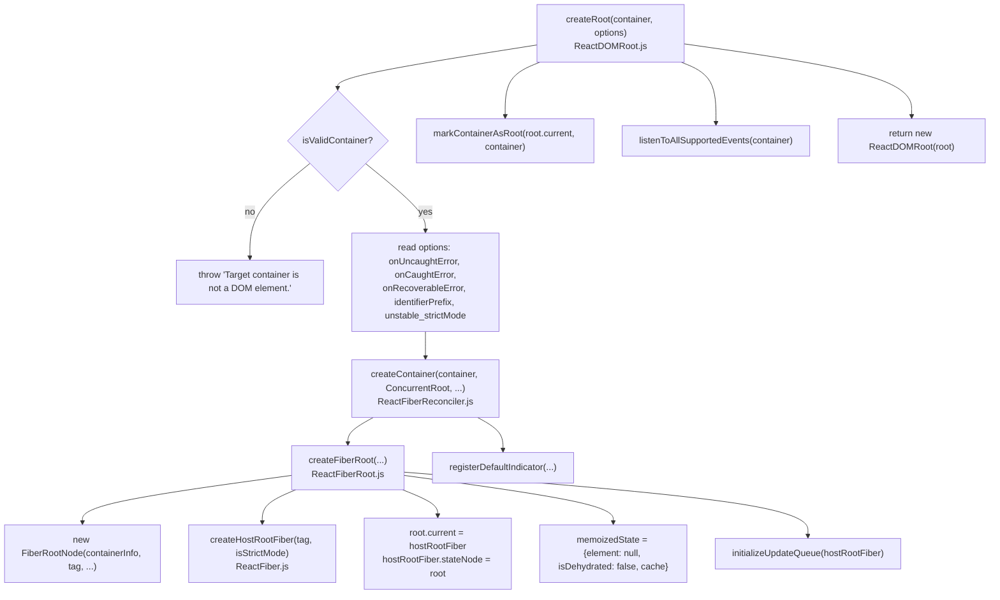
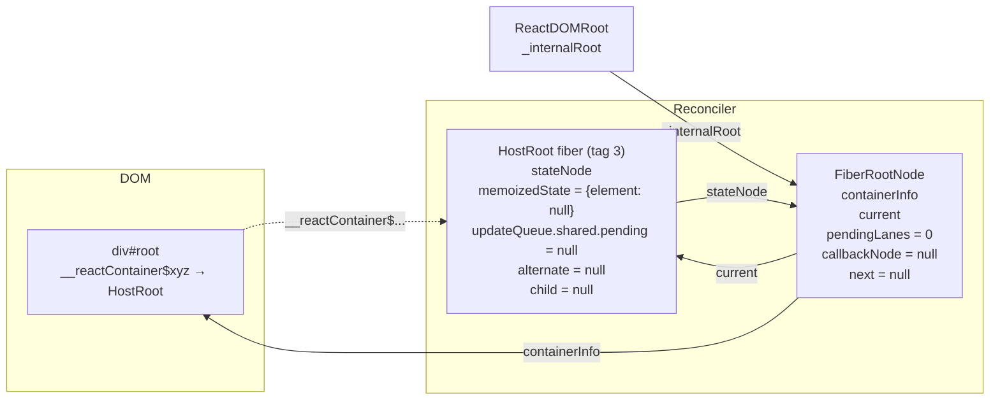

# createRoot：FiberRootNode 与 HostRoot Fiber

> [!summary] 核心速览（TL;DR）
> 调用 `createRoot(container)` 时，并不会立即渲染任何 UI。它所做的核心工作是：校验挂载容器合法性、构建两个互为引用的核心对象，并向容器节点挂载 React 运行所需的全部事件监听器。这两个核心对象分别是：**FiberRootNode**（整棵应用的根节点管理器，它并非 Fiber 节点，而是负责管理整棵树全局状态的普通对象，存储诸如待处理的 `pendingLanes`、调度回调任务、DOM 挂载容器等）和 **HostRoot Fiber**（整棵 Fiber 树的最顶层根节点）。最后，它返回一个极薄的封装对象 `ReactDOMRoot`。而两者之间 `root.current.stateNode === root` 的循环引用闭环，构成了后续所有 Fiber 架构运行与双缓存树切换的顶层脊梁。

## 核心调用链路



## 第一步：容器校验与配置解析

`createRoot` 的实现源码位于 `react-dom/src/client/ReactDOMRoot.js`，并通过 `react-dom/client` 入口导出。[^createroot][^clientexports] 函数执行的第一行是 `isValidContainer` 校验，它只允许三类 DOM 节点：普通 DOM 元素（Element）、文档根节点（Document）或文档片段（DocumentFragment）。此外，除非开启了特性开关 `disableCommentsAsDOMContainers`，它还兼容内容严格为 `' react-mount-point-unstable '` 的注释节点（Comment Node）。[^isvalid] 传入任何其他内容都会直接抛出异常 `Target container is not a DOM element.`。在日常开发中，这种情况通常是因为脚本在 DOM 尚未解析完成时便提前执行，导致 `document.getElementById('root')` 返回了 `null`。

紧接着，在 DEV 模式下，`warnIfReactDOMContainerInDEV` 会检查该容器是否已经被标记为根节点——例如对同一个 DOM 容器重复调用了两次 `createRoot`（或者该容器曾被传给过旧版 `ReactDOM.render`）。[^warncontainer] 随后，传入的配置项（options）被解构到局部变量中。[^createroot] 这里有两个非常实用的 DEV 专属校验：

- 如果错误地传入了 `{hydrate: true}`，React 会发出警告，提示你改用 `hydrateRoot`；
- 如果第二个参数误传了 JSX 元素（如 `createRoot(el, <App/>)`，这往往是习惯了旧版 `ReactDOM.render(element, container)` 参数顺序所致），React 会打印出一条非常友好的针对性纠错提示。

变量 `concurrentUpdatesByDefaultOverride` 在源码中被硬编码为 `false`，协调器中的注释指出该参数已被完全忽略。[^createcontainer] 由于在当前构建版本中特性开关 `disableLegacyMode` 默认为 `true`，因此所有创建的应用根节点都是 `ConcurrentRoot`（并发模式根节点）。[^flags]

> [!warning] React 19 中彻底移除 `ReactDOM.render`
> `react-dom` 的主入口现在仅导出：`createPortal`、`flushSync`、资源加载提示方法（`preload`、`preinit` 等）、`requestFormReset`、`unstable_batchedUpdates`、`useFormState`、`useFormStatus` 以及 `version`。曾经的 `render`、`hydrate`、`unmountComponentAtNode` 以及 `findDOMNode` 已被彻底拔除。[^domindex] 官方升级指南详细记录了如何迁移至 `createRoot(...).render(...)`。[^upgrade] 在曾经的 Legacy 传统模式下，所有脱离事件批处理上下文的更新都会以同步方式立即执行刷新；而在全面废弃 Legacy 模式、只保留并发根节点的 React 19 中，每一个更新都必须经过 Lanes 赛道模型和微任务调度器（详见 [[03 root.render - Scheduling the First Update|03 · root.render：调度首轮更新]]）。这也是为什么在 React 19 中，“自动批处理（Automatic Batching）”变成了无需任何前提的无条件标配。

## 第二步：从 `createContainer` 到 `createFiberRoot`

`createContainer` 是一个轻量的适配函数。它将 `hydrate` 固定设为 `false`，将 `initialChildren` 固定设为 `null`，随后调用 `createFiberRoot`，并注册默认的 Transition 指示器（indicator）。[^createcontainer] 相比之下，服务端注水方法 `hydrateRoot` 则调用了它的孪生兄弟 `createHydrationContainer`——它**会立即**向更新队列中推入一个初始更新，因为注水阶段必须争分夺秒地与服务端渲染好的 HTML 内容进行比对。[^createhydration]

而核心数据结构的搭建，正是在 `createFiberRoot` 中完成的：[^createfiberroot]

```js
// packages/react-reconciler/src/ReactFiberRoot.js (精简版)
const root = new FiberRootNode(containerInfo, tag, hydrate, identifierPrefix,
                               onUncaughtError, onCaughtError, onRecoverableError, ...);

// 循环引用绑定。目前在类型系统上通过将 stateNode 设为 any 绕过类型检查。
const uninitializedFiber = createHostRootFiber(tag, isStrictMode);
root.current = uninitializedFiber;
uninitializedFiber.stateNode = root;

const initialCache = createCache();
retainCache(initialCache);
root.pooledCache = initialCache;
retainCache(initialCache);

uninitializedFiber.memoizedState = { element: initialChildren, isDehydrated: hydrate, cache: initialCache };
initializeUpdateQueue(uninitializedFiber);
return root;
```

### FiberRootNode：核心字段深度解析

特别需要强调的是：FiberRootNode（整棵应用的根节点管理器）**本身并不是一个 Fiber 节点**。它是一个数据结构截然不同的普通 JavaScript 对象，专门用于保存“属于整棵树全局级别”的状态。如果将这些状态存放在每个 Fiber 节点上，无疑会造成巨大的内存浪费。[^fiberrootnode]

| 字段 | 含义 | 读写方 / 消费场景 |
|---|---|---|
| `tag` | 根节点类型，在 `disableLegacyMode` 为 true 时恒为 `ConcurrentRoot` | |
| `containerInfo` | 传入的挂载容器 DOM 节点 | 宿主配置环境（Host Config）、Commit 提交阶段（`appendChildToContainer`） |
| `current` | 当前屏幕呈现对应的 **current** HostRoot Fiber。在每次 Commit 阶段完成后指向构建完成的 WIP 树 | 工作循环（Work Loop）、Commit 阶段（`root.current = finishedWork`）[^swap] |
| `pendingLanes` | 包含待处理更新的赛道优先级二进制掩码（Bitmask） | `markRootUpdated` 标记置位，`markRootFinished` 清除复位 |
| `suspendedLanes`, `pingedLanes`, `warmLanes`, `expiredLanes` | Suspense 挂起与更新防饥饿（Starvation）状态账本 | `getNextLanes`、`markStarvedLanesAsExpired` |
| `expirationTimes` | 用于防饥饿倒计时的赛道时间戳数组（包含 31 个槽位的 `LaneMap`） | `markStarvedLanesAsExpired` |
| `entangledLanes`, `entanglements` | 必须捆绑合并渲染的赛道（如 Transition 过渡、`useSyncExternalStore`） | 赛道计算与纠缠标记 |
| `callbackNode`, `callbackPriority` | 当前为此根节点排队的 Scheduler 调度任务实例及其优先级赛道 | [[03 root.render - Scheduling the First Update|03 · 根调度器调度流程]] |
| `next` | 调度器在调度存在待处理任务的多个根节点时所用的**单向链表指针** | `ensureRootIsScheduled` |
| `timeoutHandle`, `cancelPendingCommit` | 延迟/挂起提交的定时器句柄 | 提交调度与取消 |
| `context`, `pendingContext` | 根节点的旧版 Context 上下文（在 `createRoot` 下恒为空） | `updateContainerImpl` |
| `pooledCache`, `pooledCacheLanes` | 供新建边界挂载使用的 `<Cache>` / `use` 缓存池 | 缓存池管理 |
| `identifierPrefix` | 生成 `useId` 唯一标识符时的前缀字符串 | ID 生成 |
| `onUncaughtError`, `onCaughtError`, `onRecoverableError` | options 中配置的错误捕获与恢复回调函数 | Commit 阶段 / 异常处理边界 |
| `hiddenUpdates` | 在隐藏的 Offscreen 子树中被推迟延后的更新列表 | Offscreen 隐藏渲染 |
| `incompleteTransitions`, `formState` | Transition 状态追踪、Form Actions 表单状态管理 | 表单与过渡生命周期 |

初始化时，所有与 Lanes 赛道相关的字段都会默认设为 `NoLanes`（即 0），而 `callbackNode` 则初始化为 `null`。[^fiberrootnode] 其中部分字段仅在特定特性开关开启时才存在（如 `indicatorLanes`、`transitionTypes`、`pendingGestures` 等）。构造函数通过在内部统一完成全部属性的有条件赋值，从而确保了 V8 等 JS 引擎底层 Hidden Class（隐藏类 / Shape）的稳定，避免在后续运行阶段动态追加属性引发的去优化惩罚。

> [!tip] 为什么需要一个独立的根对象？
> 在应用的运行过程中，Fiber 节点的分配是以数千计的，并且在每次渲染时都会通过 `createWorkInProgress` 进行克隆复制。如果把 `pendingLanes`、`callbackNode` 这类树级全局字段挂在每个普通 Fiber 节点上，会导致所有节点的内存占用极度膨胀；而如果挂在 HostRoot Fiber 上，它们又会被迫参与双缓存机制（Double Buffering）——但这在逻辑上是完全错误的：一个已调度的任务回调属于**整棵树**，而非只属于 current 或 workInProgress 其中某一个版本。因此，FiberRootNode 作为全局唯一的、稳定的、**不参与双缓存轮换**的实体，是承载这些树级全局状态的最完美归宿。

### 创建 HostRoot Fiber（createHostRootFiber）

```js
// packages/react-reconciler/src/ReactFiber.js (精简版)
export function createHostRootFiber(tag, isStrictMode) {
  let mode = ConcurrentMode;              // disableLegacyMode || tag === ConcurrentRoot
  if (isStrictMode === true) mode |= StrictLegacyMode | StrictEffectsMode;
  if (__DEV__ || (enableProfilerTimer && isDevToolsPresent)) mode |= ProfileMode;
  return createFiber(HostRoot, null, null, mode);
}
```

[^hostrootfiber] HostRoot Fiber 的类型标记为 `tag = HostRoot`（枚举值为 3），其 `type = null`、`pendingProps = null` 且 `key = null`。[^worktags] 它的 **`mode`** 二进制位会被其下方创建的每一个子代 Fiber 节点所继承——子 Fiber 在被实例化时，都会直接继承父级的 `returnFiber.mode`，并发模式（`ConcurrentMode`）正是通过这种方式蔓延渗透到整棵 Fiber 树的每一个节点的。如果我们在 `createRoot` 的配置项中指定了 `unstable_strictMode: true`，那么**整棵应用树**都会开启严格模式；而在 JSX 中放置的 `<StrictMode>` 组件，则只会对其子树生效（`createFiberFromTypeAndProps` 会在检测到 `REACT_STRICT_MODE_TYPE` 时追加 `StrictLegacyMode | StrictEffectsMode` 标志位）。[^strictmodetype]

特别需要注意：在 `createRoot` 执行期间，**尚未创建任何 alternate 替身节点**。HostRoot 的 WorkInProgress（WIP）副本是在首轮渲染真正打响时，才由 `prepareFreshStack` 函数中的 `createWorkInProgress(root.current, null)` 进行惰性初始化的。[^preparefresh] 关于双缓存机制的更多设计内幕，可参阅 [[05 The Fiber Data Structure|05 · Fiber 数据结构]]。

### HostRoot Fiber 的状态与更新队列

HostRoot Fiber 具有非常特殊的行为特征：它的“state”本质上是 `{element, isDehydrated, cache}` 对象，而所谓的“渲染根节点”，在底层正是**通过处理其挂载的更新队列（Update Queue），进而推导计算出最新的 `element`**。函数 `initializeUpdateQueue` 会为其装配一个类组件风格的更新队列：[^initqueue]

```js
fiber.updateQueue = {
  baseState: fiber.memoizedState,      // {element: null, isDehydrated: false, cache}
  firstBaseUpdate: null, lastBaseUpdate: null,
  shared: { pending: null, lanes: NoLanes, hiddenCallbacks: null },
  callbacks: null,
};
```

这种更新队列的数据结构，与 Class 组件调用 `this.setState` 时所用的结构完全一致。正因如此，当随后调用 `root.render` 时，底层其实就是向该队列推入了一个载荷为 `payload: {element}` 的 `Update` 更新对象（详见 [[03 root.render - Scheduling the First Update|03 · root.render：调度首轮更新]]）。在渲染阶段的 `beginWork` 中，`updateHostRoot` 函数会调用 `processUpdateQueue` 消费该队列，并提取出 `nextState.element` 作为子节点展开后续的 Diff 协调比对。[^updatehostroot] 而函数组件中的 Hooks 则采用了一套**截然不同**的更新队列结构（详见 [[10 Hooks on Mount|10 · Hooks 挂载阶段]]）。

## 核心拓扑：循环引用模型图解



当完成首轮 Commit 提交之后，`HR.child` 会指向根组件 `<App/>` 对应的 Fiber 节点，而 `HR.alternate` 则指向另一棵 HostRoot Fiber（即此前作为 WIP 构建树的那个节点）。在后续的每一次 Commit 阶段中，`FR.current` 指针都会在两个交替的 HostRoot Fiber 之间来回翻转，但这两个 HostRoot Fiber 的 `stateNode` 指针始终牢固地指向同一个全局的 `FR`（FiberRootNode）。

## 第三步：标记挂载容器（markContainerAsRoot）

在 DOM 容器上挂载内部属性：

```js
node['__reactContainer$' + randomKey] = hostRoot;
```

其中 `randomKey` 是在每个 `react-dom` 副本加载时，通过 `Math.random().toString(36).slice(2)` 动态生成的一次性随机串。[^componenttree][^markcontainer] 该属性在整个运行时中有三大核心职责：

- **开发期告警检测（Dev warnings）**：`warnIfReactDOMContainerInDEV` 会借助该属性（调用 `isContainerMarkedAsRoot`）来侦测开发者是否对同一个 DOM 容器重复调用了 `createRoot`。[^warncontainer]
- **事件精准派发（Event dispatch）**：当浏览器触发原生事件时，`getClosestInstanceFromNode` 会顺着 DOM 树祖先节点向上回溯，探查 DOM 节点上挂载的 `__reactFiber$` 或 `__reactContainer$` 属性，从而精准锚定触发事件的目标 Fiber 节点（详见 [[13 The Event System|13 · 事件系统]]）。[^closest]
- **多实例运行隔离（Isolation between copies）**：随机后缀的存在，使得即便同一页面上运行着多个独立的 React DOM 副本（例如在微前端架构或多版本共存场景下），它们也不会错误地相互读取或污染彼此的内部节点标记。

值得细品的是：这里挂载的是初始化时刻的 `root.current`。由于后续随着页面渲染更新，`FiberRootNode.current` 指针会在 current 树与 WIP 树之间反复切换，因此系统内部如果需要获取最新的 current Fiber 树，永远是通过 `hostRoot.stateNode.current` 动态读取，而不是直接依赖这个挂载在 DOM 上的旧引用。

## 第四步：挂载支持的所有全局事件（listenToAllSupportedEvents）

函数 `listenToAllSupportedEvents(rootContainerElement)` 会在每个挂载容器上仅执行一次，其执行状态由容器上的 `listeningMarker` 属性提供防重保护。[^listen] 它会遍历 `allNativeEvents` 集合中的所有原生事件，向挂载容器节点分别注册**捕获阶段（Capture Phase）**的监听器；并且只要该事件不在 `nonDelegatedEvents` 列表中（即诸如 `scroll`、`load` 以及媒体事件等不冒泡的原生事件），还会额外在容器上注册**冒泡阶段（Bubble Phase）**的监听器。另外，`selectionchange` 事件由于浏览器特异性会被单独挂载到 `document` 上。

为什么要在任何组件尚未渲染之前，就急切地（eagerly）完成所有事件的全量绑定？

- **委托在 Root 根容器，而非 `document` 顶级文档**：自 React 17 起，事件监听被下放到每个根容器上。这种设计允许同一个页面共存多个 React 根应用或不同版本的 React 微应用；同时，当在 React 事件中调用 `e.stopPropagation()` 时，能如开发者预期那样精确拦截，而不会波及或干扰在 `document` 上绑定的非 React 原生逻辑。
- **免去逐个 DOM 节点的监听开销（零 DOM 绑定成本）**：后续在组件 JSX 中添加 `onClick` 等事件处理属性时，在真实 DOM 层面不会产生任何新的 `addEventListener` 调用开销。事件发生时，React 只需通过 DOM 上挂载的 `__reactProps$` 属性在内存中实时读取事件回调即可。
- **从首个事件起即保障正确的调度优先级**：事件监听的包装函数（`createEventListenerWrapperWithPriority`）会在真正触发 React 逻辑之前，根据触发的原生事件类型预先设置 `ReactDOMSharedInternals.p`（当前事件优先级）。例如，正是通过这一机制，用户在 `click` 离散点击回调中调用的 `setState` 才能被精准标记并路由到最高优先级的 `SyncLane`（详见 [[04 Lanes and the Scheduler|04 · Lanes 赛道模型与 Scheduler]]、[[12 setState - dispatchSetState and Batching|12 · setState 底层实现]]）。

关于事件系统的深层运行架构，我们将在 [[13 The Event System|13 · 事件系统]] 中进行全景拆解。

## 第五步：返回 ReactDOMRoot 实例

```js
function ReactDOMRoot(internalRoot) { this._internalRoot = internalRoot; }
ReactDOMRoot.prototype.render = function (children) { /* ... */ updateContainer(children, root, null, null); };
ReactDOMRoot.prototype.unmount = function () { /* ... */ updateContainerSync(null, root, null, null); flushSyncWork(); unmarkContainerAsRoot(container); };
```

[^reactdomroot] 最终暴露给开发者的公共对象设计得极其精简：仅包含一个内部属性与两个原型方法（`ReactDOMHydrationRoot` 也共享同一套结构）。这里有几个特别值得关注的技术细节：

- `render` **不再接受第二个回调参数**：在 DEV 模式下，如果传入了回调函数，控制台会明确警告“不再支持第二个回调参数，请改用 useEffect()”；如果误把 container 容器再次传给 `render`，也会触发类似的纠错提示。
- `unmount` 是**完全同步执行的**：它内部通过 `updateContainerSync`（以 `SyncLane` 同步赛道执行）随后立即调用 `flushSyncWork()` 强制同步清空任务，在 DEV 模式下如果尝试在渲染阶段调用它会抛出警告。此外，它在销毁前会首先执行 `_internalRoot = null`，因此在卸载后再调用 `render` 便会直接抛出致命错误 `Cannot update an unmounted root.`。

> [!note] createRoot 的执行成本考量
> 在 `createRoot` 执行完毕的那一刻，你的业务应用中还没有任何一个 Fiber 节点诞生，没有任何组件函数被执行，也没有创建任何业务 DOM 元素。此时唯一的真实工作负载，仅仅是挂载事件监听器（由几百次原生 `addEventListener` 调用组成）以及创建三个极小的 JavaScript 内存对象。因此，即便在微前端或微型组件挂件场景下创建大量独立 Root，本身的开销也是极轻量的。然而需要注意的是：每一个独立的 Root 都会在调度器的 Root 调度链表上占有一席之地，并拥有独立且互不合并的 Commit 提交阶段。

## 遇上 React 编译器（React Compiler）时的表现

在这一层面上，React 编译器没有带来任何运行机制的改变。`createRoot`、`FiberRootNode` 以及 `HostRoot Fiber` 均属于协调器与渲染器的底层系统架构，而编译器的工作重心仅在于重写组件函数体内部的逻辑，绝不会触碰 `react-dom` 核心运行时。在初次挂载时唯一能观察到的微小差异在于：经过编译器处理的组件会在首轮执行时调用 `_c(n)` 方法——但该操作仅仅是在**组件自身的 Fiber 节点**的 `updateQueue` 上分配记忆化缓存槽位（Memo Cache），与顶部的 Root 根节点毫无瓜葛（详见 [[14 React Compiler - How It Works|14 · 编译器工作原理]]）。

## 总结与全景回顾

`createRoot` 完成了整棵应用树全部舞台的搭建，但自身并未进行任何实际渲染。它依次校验 DOM 容器、构建互为循环引用的 `FiberRootNode` 与 `HostRoot Fiber`、在 DOM 容器上植入随机内部标记、全量绑定全局捕获/冒泡事件监听，并最终返回一个极薄的 `ReactDOMRoot` 包装句柄。`FiberRootNode` 是全局唯一的、非双缓存的整树状态管理者（统辖优先级赛道、当前调度任务、挂载容器等）；而 `HostRoot Fiber` 则伫立在 Fiber 树的最顶峰，其所搭载的 Class 风格更新队列，正是接下来在 [[03 root.render - Scheduling the First Update|03 · root.render：调度首轮更新]] 中承接首个 `{element}` 更新对象的起点。

### 核心要点清单

- **`isValidContainer` 容器校验**：除 Element、Document 或 DocumentFragment 之外的任何参数均会抛出 `Target container is not a DOM element.` 异常，最常见的诱因是 `getElementById` 返回了 `null`。
- **纯并发根节点（`ConcurrentRoot` only）**：在全面废弃 Legacy 模式（`disableLegacyMode = true`）的 React 19 中，所有根节点均以并发模式启动，传统 `ReactDOM.render` 被彻底移除，因此自动批处理（Automatic Batching）成为无条件的全量默认行为。
- **`createFiberRoot` 核心构造**：构建顶层循环引用闭环，`root.current` 指向 `HostRoot Fiber`，而 `hostRootFiber.stateNode` 牢固回指 `root`。
- **`FiberRootNode` 数据结构**：它不是 Fiber 节点，而是一个用于存储整棵树全局状态（如 `pendingLanes`、`callbackNode` 等）的普通 JavaScript 对象。
- **`createHostRootFiber` 继承机制**：注入根级 `mode` 二进制标志位，整棵子树下的所有后续子代节点均会级联继承此模式；在首轮调用 `prepareFreshStack` 之前，尚不存在任何 alternate 替身节点。
- **`initializeUpdateQueue` 初始化队列**：采用 Class 组件风格的更新队列结构，渲染根节点在底层正是消费该队列以计算出最新的 `element`。
- **`markContainerAsRoot` 容器标记**：借助带随机哈希后缀的 `__reactContainer$` 属性，为开发环境告警检测、全局事件派发回溯以及多 React 实例安全隔离提供坚实支撑。
- **`listenToAllSupportedEvents` 全局事件委托**：在挂载容器上急切挂载全量原生事件的捕获与冒泡监听器，使得后续在组件 JSX 中添加 `onClick` 等属性无需付出任何 DOM 原生绑定的额外开销。
- **`ReactDOMRoot` 极简句柄**：仅包含一个内部引用与两个原型方法；`render` 彻底不再接收第二个回调参数，而 `unmount` 则以完全同步的方式销毁整棵树。

← [[01 Bootstrap - Packages, JSX and the Dispatcher|上一篇：01 · 初始化引导]] · [[00 React Internals Index|专栏目录]] · [[03 root.render - Scheduling the First Update|下一篇：03 · root.render：调度首轮更新]] →

[^createroot]: `createRoot` — [packages/react-dom/src/client/ReactDOMRoot.js#L171-L262](https://github.com/facebook/react/blob/v19.3.1/packages/react-dom/src/client/ReactDOMRoot.js#L171-L262)
[^clientexports]: `react-dom/client` exports — [packages/react-dom/src/client/ReactDOMClient.js#L52](https://github.com/facebook/react/blob/v19.3.1/packages/react-dom/src/client/ReactDOMClient.js#L52)
[^isvalid]: `isValidContainer` — [packages/react-dom-bindings/src/client/ReactDOMContainer.js#L19-L29](https://github.com/facebook/react/blob/v19.3.1/packages/react-dom-bindings/src/client/ReactDOMContainer.js#L19-L29)
[^createcontainer]: `createContainer` — [packages/react-reconciler/src/ReactFiberReconciler.js#L235-L280](https://github.com/facebook/react/blob/v19.3.1/packages/react-reconciler/src/ReactFiberReconciler.js#L235-L280)
[^flags]: `disableLegacyMode = true` — [packages/shared/ReactFeatureFlags.js#L205](https://github.com/facebook/react/blob/v19.3.1/packages/shared/ReactFeatureFlags.js#L205)
[^domindex]: `react-dom` main exports — [packages/react-dom/index.js#L10-L26](https://github.com/facebook/react/blob/v19.3.1/packages/react-dom/index.js#L10-L26)
[^upgrade]: React 19 Upgrade Guide, "Removed: ReactDOM.render" — https://react.dev/blog/2024/04/25/react-19-upgrade-guide
[^createhydration]: `createHydrationContainer` — [packages/react-reconciler/src/ReactFiberReconciler.js#L282-L351](https://github.com/facebook/react/blob/v19.3.1/packages/react-reconciler/src/ReactFiberReconciler.js#L282-L351)
[^createfiberroot]: `createFiberRoot` — [packages/react-reconciler/src/ReactFiberRoot.js#L157-L236](https://github.com/facebook/react/blob/v19.3.1/packages/react-reconciler/src/ReactFiberRoot.js#L157-L236)
[^fiberrootnode]: `FiberRootNode` constructor — [packages/react-reconciler/src/ReactFiberRoot.js#L50-L155](https://github.com/facebook/react/blob/v19.3.1/packages/react-reconciler/src/ReactFiberRoot.js#L50-L155)
[^swap]: `root.current = finishedWork` in commit — [packages/react-reconciler/src/ReactFiberWorkLoop.js#L4047-L4051](https://github.com/facebook/react/blob/v19.3.1/packages/react-reconciler/src/ReactFiberWorkLoop.js#L4047-L4051)
[^hostrootfiber]: `createHostRootFiber` — [packages/react-reconciler/src/ReactFiber.js#L529-L551](https://github.com/facebook/react/blob/v19.3.1/packages/react-reconciler/src/ReactFiber.js#L529-L551)
[^worktags]: `HostRoot = 3` — [packages/react-reconciler/src/ReactWorkTags.js#L46](https://github.com/facebook/react/blob/v19.3.1/packages/react-reconciler/src/ReactWorkTags.js#L46)
[^strictmodetype]: `<StrictMode>` sets mode bits — [packages/react-reconciler/src/ReactFiber.js#L602-L608](https://github.com/facebook/react/blob/v19.3.1/packages/react-reconciler/src/ReactFiber.js#L602-L608)
[^preparefresh]: `prepareFreshStack` creates the root WIP — [packages/react-reconciler/src/ReactFiberWorkLoop.js#L2254-L2258](https://github.com/facebook/react/blob/v19.3.1/packages/react-reconciler/src/ReactFiberWorkLoop.js#L2254-L2258)
[^initqueue]: `initializeUpdateQueue` — [packages/react-reconciler/src/ReactFiberClassUpdateQueue.js#L176-L189](https://github.com/facebook/react/blob/v19.3.1/packages/react-reconciler/src/ReactFiberClassUpdateQueue.js#L176-L189)
[^updatehostroot]: `updateHostRoot` — [packages/react-reconciler/src/ReactFiberBeginWork.js#L1831](https://github.com/facebook/react/blob/v19.3.1/packages/react-reconciler/src/ReactFiberBeginWork.js#L1831)
[^componenttree]: internal DOM keys (`__reactFiber$`, `__reactContainer$`, ...) — [packages/react-dom-bindings/src/client/ReactDOMComponentTree.js#L43-L49](https://github.com/facebook/react/blob/v19.3.1/packages/react-dom-bindings/src/client/ReactDOMComponentTree.js#L43-L49)
[^markcontainer]: `markContainerAsRoot` — [packages/react-dom-bindings/src/client/ReactDOMComponentTree.js#L113-L116](https://github.com/facebook/react/blob/v19.3.1/packages/react-dom-bindings/src/client/ReactDOMComponentTree.js#L113-L116)
[^listen]: `listenToAllSupportedEvents` — [packages/react-dom-bindings/src/events/DOMPluginEventSystem.js#L432-L459](https://github.com/facebook/react/blob/v19.3.1/packages/react-dom-bindings/src/events/DOMPluginEventSystem.js#L432-L459)
[^reactdomroot]: `ReactDOMRoot`, `render`, `unmount` — [packages/react-dom/src/client/ReactDOMRoot.js#L102-L169](https://github.com/facebook/react/blob/v19.3.1/packages/react-dom/src/client/ReactDOMRoot.js#L102-L169)
[^warncontainer]: `warnIfReactDOMContainerInDEV` — [packages/react-dom/src/client/ReactDOMRoot.js#L363-L380](https://github.com/facebook/react/blob/v19.3.1/packages/react-dom/src/client/ReactDOMRoot.js#L363-L380)
[^closest]: `getClosestInstanceFromNode` — [packages/react-dom-bindings/src/client/ReactDOMComponentTree.js#L136](https://github.com/facebook/react/blob/v19.3.1/packages/react-dom-bindings/src/client/ReactDOMComponentTree.js#L136)
