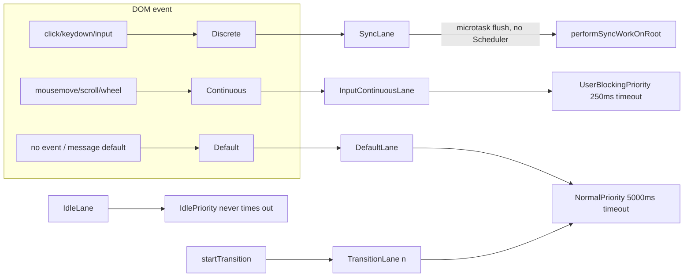

# Lanes 赛道模型与 Scheduler 调度器

> [!summary] 核心速览（TL;DR）
> **Lane（赛道）** 本质上是一个 31 位二进制整数中的特定二进制位（Bit）。在 React 中，每一次状态更新都会被赋予一个 Lane，而一次渲染过程则负责处理一个 **Lanes 集合（即 31 位二进制位掩码 bitmask）**。这意味着批处理（Batching）、优先级仲裁、赛道纠缠（Entanglement）以及“当前渲染包含了哪些更新？”等复杂逻辑，全部转化为了极高执行效率的按位运算。协调器（Reconciler）会将 Lanes 映射为 **Scheduler 调度器优先级**。**Scheduler** 是一个独立的外部 npm 包：其底层基于任务队列与定时器队列（最小堆 min-heap 实现），并通过 `MessageChannel` 宏任务分发机制，以约 5ms 的工作片（Time slice）为步长周期性消费任务。在 React 19 中，同步赛道（Sync lanes）完全绕过了 Scheduler 调度器，直接在微任务中同步冲刷；只有过渡（Transition）、重试（Retry）、空闲（Idle）及离屏（Offscreen）工作才会真正进入时间切片。

## 为什么采用位掩码（Bitmask）？

在引入 Lanes 赛道模型之前（React ≤ 16），React 为每一次更新维护一个单一的数值型时间戳 `expirationTime`，其渲染调度规则极为简单粗暴：“渲染优先级高于或等于优先级阈值 X 的所有更新”。这种单维度的数值标量根本无法表达细粒度的控制场景，例如：“只渲染点击事件 A 触发的 Transition 过渡更新，而*不*渲染点击事件 B 触发的过渡更新”，或者“这两个独立的赛道必须被原子性地绑定在一起同时提交（Entangled）”。

改用二进制位掩码（Bitmask）后，复杂的集合调度逻辑被全部降维为硬件级的高效位运算：

```js
mergeLanes(a, b)        = a | b
removeLanes(set, sub)   = set & ~sub
includesSomeLane(a, b)  = (a & b) !== 0
isSubsetOfLanes(set, s) = (set & s) === s
getHighestPriorityLane  = lanes & -lanes      // 最低有效位（Lowest set bit）= 最高优先级
```

[^laneops] 二进制位越低（靠近最低位），代表的优先级越高。利用二进制补码特性，`lanes & -lanes` 仅需一条 CPU 指令即可分离出最低的有效置位（Lowest set bit），这使得推导“当前待处理的最紧急赛道”这一关键操作的时间复杂度直接降为 O(1)。而 `LaneMap<T>` 在底层只是一个包含 31 个元素的普通固定长度数组，通过 `laneToIndex`（即 `31 - Math.clz32(lane)`，计算前导零个数）进行 O(1) 索引定位，在 `FiberRoot` 上用于记录每个赛道的独立过期时间以及赛道间的纠缠拓扑关系（详见 [[02 createRoot - FiberRoot and HostRoot|02 · createRoot 架构剖析]]）。

## Lane 赛道分配表（v19.3.1）

[^lanes]

| 赛道（Lane） | 二进制位（Bit） | 产生来源 | 是否启用时间切片？ |
|---|---|---|---|
| `SyncHydrationLane` | 0 | 离散交互事件触发的选择性水合（Selective Hydration） | 否 |
| `SyncLane` | 1 | 离散用户交互事件（`click`、`keydown`、`input`）、`flushSync`、`root.unmount` | 否，在微任务中立即冲刷执行 |
| `InputContinuousHydrationLane` / `InputContinuousLane` | 2 / 3 | 连续交互事件（`mousemove`、`scroll`、`pointermove`、`wheel`） | 否 |
| `DefaultHydrationLane` / `DefaultLane` | 4 / 5 | 处于任何事件上下文之外的更新（定时器、fetch 回调、顶层 `root.render`） | **否**（阻塞式同步执行） |
| `GestureLane` | 6 | `startGestureTransition`（实验性特性） | 否 |
| `TransitionHydrationLane` | 7 | 过渡水合工作 | 是 |
| `TransitionLane1..14` | 8–21 | `startTransition`、`useTransition`、`useDeferredValue`（其中赛道 11–14 专门用作“Deferred”延迟赛道） | **是** |
| `RetryLane1..4` | 22–25 | Promise resolve 后的 Suspense 重试更新 | 是 |
| `SelectiveHydrationLane` | 26 | 选择性水合工作 | 是 |
| `IdleHydrationLane` / `IdleLane` | 27 / 28 | 空闲优先级工作（Idle-priority work） | 是 |
| `OffscreenLane` | 29 | 预渲染隐藏的 `<Activity>` / Offscreen 离屏树 | 是 |
| `DeferredLane` | 30 | 由 `useDeferredValue` 衍生的工作占位符 | |

Transition 赛道是按轮询机制（Round-robin）分发的（`claimNextTransitionUpdateLane`），因此相互独立的 Transition 过渡更新通常会落入不同的赛道中，从而能够彼此独立计算并提交。但由于可用的 Transition 更新赛道仅有 10 条，在大量并发过渡下最终会发生环绕回卷（Wrap around）并共享赛道。[^claimtransition]

> [!note] `SyncUpdateLanes`：Sync、InputContinuous 与 Default 自动合并批处理
> `SyncUpdateLanes` 的位掩码定义为 `SyncLane | InputContinuousLane | DefaultLane`。在 `getHighestPriorityLanes` 挑选待渲染赛道时，执行的第一条逻辑便是 `if (lanes & SyncUpdateLanes) return lanes & SyncUpdateLanes`。[^gethighest] 这意味着，如果此时一个点击事件（Sync）和一个定时器回调更新（Default）同时处于挂起待处理状态，**单个渲染阶段就会将它们合并一并处理**。React 19 的更新日志将此改进总结为“合并同步、默认与连续更新赛道（#25700）”。[^upgrade] 尽管合并渲染，这些赛道在调度层面依然保留了各自独立的身份标记：调度系统是否触发微任务微冲刷，完全取决于 `includesSyncLane`。

## 事件优先级 ↔ Lane 赛道 ↔ Scheduler 调度器优先级

协调器（Reconciler）内部维护着第三套术语体系——**事件优先级（Event priorities）**，但它们本质上就是对应的 Lane 赛道：[^eventpri]

```js
export const DiscreteEventPriority   = SyncLane;
export const ContinuousEventPriority = InputContinuousLane;
export const DefaultEventPriority    = DefaultLane;
export const IdleEventPriority       = IdleLane;
export function eventPriorityToLane(p) { return p; }
```

将这套机制映射为 Scheduler 调度器的 5 个优先级层级（Priority levels：Immediate, UserBlocking, Normal, Low, Idle），仅在向根节点登记调度任务时发生，即在 `scheduleTaskForRootDuringMicrotask` 函数内部：[^mapping]



`lanesToEventPriority` 会将一个赛道掩码集合折叠收敛为上述 4 种事件优先级之一。Transition 过渡更新、Retry 重试以及 Offscreen 离屏渲染都归类于“非空闲 → Default”，因此它们最终都会生成 `NormalPriority` 优先级的 Scheduler 调度任务。[^lanestoevent] DOM 事件名称到优先级的映射规则定义在 `getEventPriority` 中。[^geteventpriority] 值得特别注意的是，Scheduler 调度器中的 `ImmediatePriority` 优先级已不再用于驱动渲染。官方源码注释明确写道：“既然我们已经使用微任务来处理同步工作，就不再需要使用该优先级了”。它目前仅在 Safari 浏览器的微任务降级兜底方案中保留使用。[^mapping]

## getNextLanes：决策下一步渲染哪些赛道

`getNextLanes(root, wipLanes, rootHasPendingCommit)` 会在微任务检查点执行，并且在每个 Scheduler 调度任务启动时再次运行，以精准决定本轮应该渲染的赛道集合：[^getnextlanes]

1. `pendingLanes === 0` → 无工作待处理，直接返回。
2. **优先考虑非空闲（Non-idle）赛道**。只要系统中有任何其他非空闲任务待处理，空闲任务就绝对不会被启动。
3. 优先选择全新的未挂起赛道（`pending & ~suspendedLanes`）。其次是**已被唤醒（Pinged）**的挂起赛道（意味着挂起的数据已成功到达）。再次是需要**预热（Prewarm）**的赛道（`~warmLanes`，这是 React 19 新增的机制，会在后台对挂起节点的同级兄弟分支进行重渲染以提前构建 Fiber 树）。
4. `getHighestPriorityLanes` 挑选出最紧急的**赛道分组**（例如将整个 `SyncUpdateLanes` 打包返回，或者将所有挂起的过渡赛道打包返回……）。
5. **中断规则（Interruption rule）**。如果当前已有一个渲染任务正在进行（`wipLanes`），只有当新到来的赛道优先级**严格更高**时，才会中断当前渲染进行切换。此外，`DefaultLane` 绝不会中断正在进行的 Transition 过渡渲染（源码注释中明确强调：默认更新“不应中断过渡更新”）。

最后，`getEntangledLanes` 会拉入所有与当前入选赛道存在“纠缠绑定（Entangled）”关系的关联赛道。

### 饥饿机制：赛道老化与过期

每当根节点被触发调度时，`markStarvedLanesAsExpired` 都会执行检查。对于尚未分配过期时间的挂起赛道，会按当前时间赋予其 `now + computeExpirationTime(lane)` 的截止时间。一旦某个赛道超过了它的预期截止时间，它就会被移入 `root.expiredLanes`。[^starved] 内部设定的老化配额为：针对 Sync / InputContinuous / Gesture 的 `syncLaneExpirationMs = 250ms`，而针对 Default 与 Transition 的 `transitionLaneExpirationMs = 5000ms`。Retry 赛道仅在开启特定特性标记时才会过期，而 Idle 和 Offscreen 赛道则永远不会老化过期。[^expiration][^expflags] 

一旦赛道过期，`performWorkOnRoot` 就会强制选用**同步工作循环（Sync work loop）**。这意味着，即使一个 Transition 渲染被用户连续不断的高频打字不断打断、甚至陷入饥饿，一旦 5 秒超时耗尽，React 就会强制在一次同步执行中一口气将它渲染完毕。

## React 究竟在何时才会真正启用时间切片？

```js
const shouldTimeSlice =
  (!forceSync && !includesBlockingLane(lanes) && !includesExpiredLane(root, lanes))
  || checkIfRootIsPrerendering(root, lanes);
```

[^shouldtimeslice] 源码中 `includesBlockingLane` 涵盖了：Sync、InputContinuous、Default、Gesture（以及它们对应的水合变体）。[^blocking] 由此梳理出的完整执行链路矩阵如下：

| 渲染赛道（Render lanes） | 入口函数 | 执行循环 | 是否会让出主线程（Yield）？ |
|---|---|---|---|
| `Sync` | 微任务 → `performSyncWorkOnRoot` | `workLoopSync` | **从不** |
| `InputContinuous` / `Default` | Scheduler 宏任务（`UserBlocking` / `Normal`） | `workLoopSync` | 渲染阶段**内部绝不让出** |
| `Transition` / `Retry` / `Idle` / `Offscreen` | Scheduler 宏任务（`Normal` / `Idle`） | `workLoopConcurrentByScheduler` | 每次 `shouldYield()` 判定超时即让出 |
| 预渲染（即使针对同步赛道） | Scheduler 宏任务 | 并发工作循环 | **是** |

```js
function workLoopConcurrentByScheduler() {
  while (workInProgress !== null && !shouldYield()) performUnitOfWork(workInProgress);
}
```

[^workloops] 此外，源码中还存在一套备选的 `workLoopConcurrent` 机制（针对非空闲任务每 25ms 让出一次，针对空闲任务每 5ms 让出一次，刻意将动画节流至约 30 fps），但这被包裹在特性开关 `enableThrottledScheduling` 之后，在当前 React 构建版本中该开关默认为 `false`。[^throttle]

> [!warning] 常见技术误区：“并发渲染意味着 React 会把所有渲染都放到后台切片执行”
> 在 React 19 中，只有 **Transition 过渡任务**（以及重试、空闲、离屏任务）才是可中断的。你在 `fetch().then` 回调中触发的 `setState` 属于 `DefaultLane` 赛道：虽然它会被异步调度，但一旦其渲染任务开始执行，它就会一鼓作气同步运行直至完成。如果你希望某个耗时的大型组件更新主动给用户的打字输入让路，必须显式调用 `startTransition` 作为触发开关，仅靠 `createRoot` 是远远不够的。

### 同步赛道完全绕过 Scheduler 调度器

当 `scheduleTaskForRootDuringMicrotask` 判定 `includesSyncLane(nextLanes)` 为真时，它会果断取消任何已有的调度任务，设置 `callbackPriority = SyncLane`、`callbackNode = null`，然后直接返回。源码注释对此写得非常直白：“同步工作总是会在微任务结束时被立即冲刷完毕”。紧接着，`processRootScheduleInMicrotask` 会调用 `flushSyncWorkAcrossRoots_impl`，遍历并对每一个包含同步工作的根节点执行 `performSyncWorkOnRoot`。[^synclane][^flushsync] 

因此，在一个点击事件处理函数中调用的 `setState`，其渲染和提交过程会在**浏览器从该事件派发的微任务检查点（Microtask Checkpoint）拿回控制权之前**就已经全盘搞定，也就是抢在浏览器的下一次屏幕重绘（Paint）之前完成。而如果使用 `flushSync`，甚至能在该函数调用返回之前就将整棵树同步刷新完毕。

## 深入剖析 Scheduler 调度器内部架构

Scheduler 包（`packages/scheduler/src/forks/Scheduler.js`）是一个完全独立于框架的协作式多任务调度队列，它对 React 本身的存在一无所知。其核心状态包括：[^schedstate]

- `taskQueue`：就绪任务的**二叉最小堆（Binary Min-Heap）**，以 `sortIndex = expirationTime` 作为比较权重，若过期时间相同则按任务创建递增的 `id`（FIFO，先进先出）决胜。[^heap]
- `timerQueue`：**延时任务**（通过 `options.delay` 指定）的最小堆，以 `startTime` 排序。当时间到达后，`advanceTimers` 会将到期的任务自动移入 `taskQueue`。不过 React 自身在调度渲染时从不传递延时参数。

### `unstable_scheduleCallback`

```js
// 简化实现
var timeout = { Immediate: -1, UserBlocking: 250, Normal: 5000, Low: 10000, Idle: maxSigned31BitInt }[priority];
var expirationTime = startTime + timeout;
var newTask = { id: taskIdCounter++, callback, priorityLevel, startTime, expirationTime, sortIndex: -1 };
newTask.sortIndex = expirationTime;
push(taskQueue, newTask);
if (!isHostCallbackScheduled && !isPerformingWork) { isHostCallbackScheduled = true; requestHostCallback(); }
return newTask;     // React 将其存储为 root.callbackNode
```

[^schedulecallback][^schedflags] 在 Scheduler 调度器中，优先级被巧妙地抽象为了**截止时间（Deadline）**。一个刚刚被调度的 `UserBlocking` 任务（超时时间 250ms），其排序会排在一个 4 秒前调度的 `Normal` 任务（超时时间 5000ms）前面；但它的排序绝不会排在一个 6 秒前调度的 `Normal` 任务前面——因为后者已经彻底逾期（Overdue）了。

任务的取消机制（`unstable_cancelCallback`）极为轻量，它仅仅是将 `task.callback` 赋值为 `null`。这是因为在二叉堆中删除任意指定节点的成本为 O(log n) 外加一次全堆搜索，因此死任务采用惰性弹出（Lazy Pop）策略：唯有当它自然浮动到堆顶时才会被真正剔除。[^cancel]

### 宿主调度循环：为什么选择 MessageChannel，而非 setTimeout 或 requestIdleCallback？

```js
// 简化实现
if (typeof setImmediate === 'function') schedule = () => setImmediate(performWorkUntilDeadline); // Node/jsdom 环境
else if (typeof MessageChannel !== 'undefined') {
  const channel = new MessageChannel();
  channel.port1.onmessage = performWorkUntilDeadline;
  schedule = () => channel.port2.postMessage(null);
} else schedule = () => setTimeout(performWorkUntilDeadline, 0);
```

[^hostloop] 这一技术选型背后有着深度的工程权衡（源码注释中清晰地阐述了前两点）：

- **为什么不用 `setTimeout(0)`？** 现代浏览器规范规定，嵌套层级超过 5 层的定时器会被强制截断钳制为至少 4ms 延迟。如果采用 5ms 的工作片，大约 45% 的宝贵 CPU 时间就会在空闲等待中白白浪费。
- **只要存在就优先使用 `setImmediate`**（如 Node.js、jsdom 环境）。它不仅触发时机早于宏任务，而且不会像处于开启状态的 `MessageChannel` 那样阻止 Node 进程自然退出。
- **为什么不用 `requestIdleCallback`？** 该 API 仅在浏览器自认为空闲时才会触发，在后台标签页中可能会被节流延迟长达数秒（单次最长 deadline 仅 50ms），并且在 Safari 浏览器中长期存在缺失或行为不稳定的问题。React 需要的是对高优先级但可中断的任务进行**持续且稳定推进的工作节拍**，而不是消极等待宿主环境的空闲施舍。
- **为什么不用 `requestAnimationFrame`？** rAF 严格对齐屏幕重绘之前触发，且在后台标签页中会彻底暂停运行。React 希望在单一帧（约 16.6ms）内能够执行多次工作切片，并且其时间切片机制不需要刻意与屏幕刷新边缘强对齐（源码注释：“It does not attempt to align with frame boundaries”）。

MessageChannel 宏任务分发的消息属于标准宏任务（Macrotask）。在两个连续的消息宏任务之间，浏览器引擎得以穿插执行用户的输入事件派发和屏幕重绘布局，而这正是主动让出主线程（Yielding）的核心目的所在。

### `performWorkUntilDeadline` → `flushWork` → `workLoop` 调度执行流

每次收到 MessageChannel 消息回调时，调度器会记录 `startTime = now()` 并执行 `flushWork`。如果任务尚未全部跑完，它会再次发起一条消息。[^pwud] `workLoop` 会查看堆顶任务，并对队列中的每个任务执行以下流转：[^workloop]

1. 如果任务**尚未过期**且 `shouldYieldToHost()` 返回真，则跳出循环（将主线程控制权归还给浏览器）。
2. 调用 `callback(didUserCallbackTimeout)`。React 的 `performWorkOnRootViaSchedulerTask` 正是在这里接收到 `didTimeout` 超时标记。
3. 如果回调函数**返回了一个新函数**，调度器会将其暂存为该任务新的 callback 并**立即退出执行（Yield）**。这正是 React 为被打断的渲染阶段所设计的“延续闭包（Continuation）”，该机制确保了中断恢复后依旧保留原本的任务节点、在堆中的排序以及最初设定的截止时间。
4. 否则，将该任务从堆顶弹出，并在当前工作切片内继续执行下一个任务。

```js
function shouldYieldToHost() {
  if (!enableAlwaysYieldScheduler && enableRequestPaint && needsPaint) return true;
  const timeElapsed = getCurrentTime() - startTime;
  return timeElapsed >= frameInterval;    // frameInterval = frameYieldMs = 5
}
```

[^shouldyield] 协调器将此方法导入命名为 `shouldYield`（在 Scheduler 中作为 `unstable_shouldYield` 导出）。[^exports] 其中 `frameInterval` 默认为 5ms。这一数值完全独立于显示器的刷新率，因此在 60Hz 屏幕下，React 在一帧之内大约会主动让出主线程三次。开发者可以通过 `forceFrameRate(fps)` 调整该节奏。[^forceframerate] 当 React 完成提交并执行 `flushSpawnedWork` 时，会调用 `requestPaint()`[^requestpaint]，将 `needsPaint` 置为 `true`，从而通知 Scheduler 立即让出主线程以便浏览器尽快执行重绘。

> [!tip] 过期任务不会在单个任务内部被中途抢占
> 即使当前 5ms 的时间切片已经耗尽，堆顶的过期任务依然会被允许执行，但 Scheduler 根本无法从外部强行中断正在运行的 JavaScript 函数。在渲染阶段内部的主动让出，完全依赖 React 在组件 Fiber 节点遍历间隙主动检查 `shouldYield()`。如果用户编写了一个极其沉重、单个 render 执行长达 50ms 的组件，该组件在运行期间依然会生硬地阻塞主线程 50ms。时间切片是**协作式（Cooperative）**的，且其让出粒度严格以单个 Fiber 节点为边界。

## 端到端实战串联：以一次 Transition 过渡更新为例

1. 调用 `startTransition(() => setTab('b'))`：全局标记 `ReactSharedInternals.T` 被置位，因此 `requestUpdateLane` 为本次更新分配 `TransitionLane1`。
2. 微任务检查点：`getNextLanes` 决策得出本次渲染赛道为 `TransitionLane1`，通过 `lanesToEventPriority` 折叠为 Default 优先级，进而调用 `scheduleCallback(NormalPriority, ...)`，并设定截止时间为 `now + 5000ms`。
3. Scheduler 宏任务触发：进入 `performWorkOnRoot`。由于该赛道既非阻塞赛道（Non-blocking）亦未过期，因此分支进入 `renderRootConcurrent` → `workLoopConcurrentByScheduler` 并发工作循环。
4. 经过 5ms 工作切片执行后，`shouldYield()` 返回 `true` → 工作循环主动退出，此时 Fiber 树尚未遍历完毕。任务返回一个 Continuation 延续函数，Scheduler 暂停调度并让出主线程，浏览器趁机响应并处理了用户的键盘按键事件。
5. 键盘按键触发 `setState` → 分配得到 `SyncLane` 赛道 → 触发微任务检查点 → `getNextLanes` 检测到 `SyncLane` 的存在，其优先级严格高于正在进行的 Transition 渲染 → 触发 `performSyncWorkOnRoot`。调用 `prepareFreshStack` **直接丢弃**之前渲染到一半的 Transition Fiber 树草稿，转而全力同步渲染这一紧急更新。
6. 紧急同步更新渲染并提交完毕后，先前的 Transition 任务在后续的宏任务中被重新唤醒。此时它发现根节点已被改写，于是基于最新的 Current 树从头重新启动 Transition 渲染。

第 5 步正是为什么组件的 Render 阶段必须保持纯净（Pure）且无副作用的核心原因：进行中的计算草稿随时可能被无情丢弃。这也解释了为什么在 DEV 开发模式下，StrictMode 会刻意执行两次组件渲染以帮助开发者提前暴露潜在的副作用（详见 [[01 Bootstrap - Packages, JSX and the Dispatcher|01 · 初始化引导]]）。

## 引入 React 编译器后的影响与协同

Lanes 赛道模型与 Scheduler 调度器在引入 React 编译器后没有任何架构上的变动：编译器本身完全不会生成任何调度相关的运行时代码。

然而，它所带来的间接性能增益却极其显著。时间切片的让出判定是以单个 Fiber 节点为最小粒度的，而经过编译器优化的组件在未发生变更的子树上会跳过重渲染（基于缓存的 JSX 命中 `bailoutOnAlreadyFinishedWork` 机制）。因此，在一次 Transition 渲染过程中，遍历访问的 Fiber 节点数量大幅缩减，每个 5ms 工作切片内所能完成的实质性工作更多，触发让出主线程的次数也显著减少。同时，编译产物让原本沉重的单次 render 执行变得轻盈，有效缩短了不可抢占的单节点耗时硬块。详见 [[15 Rendering With vs Without the Compiler|15 · 启用与未启用编译器的对比]]。

## 总结

React 的优先级调度机制是由两套系统拼接而成的精密整体：在 React 内部，**Lanes 赛道模型**是 31 位二进制位掩码中的独立二进制位，使得批处理与优先级合并简化为极高效的位运算，协调器仅在向根节点登记工作时才将其映射为 Scheduler 的优先级层级；而在外部，**Scheduler 调度器**是一个与 React 彻底解耦的最小堆任务队列，它基于任务的截止时间进行排序，并通过 MessageChannel 宏任务分发以约 5ms 的切片节奏周期性消费任务。在 React 19 中，同步更新直接绕过 Scheduler 在微任务中秒级清空，Default 和连续交互在渲染开始后不会在内部让出，只有 Transition 过渡、Retry 重试、Idle 空闲及 Offscreen 离屏任务才会真正享受时间切片的红利。下一篇我们将深入剖析整个工作循环所遍历的核心工作单元——[[05 The Fiber Data Structure|05 · Fiber 数据结构]]。

### 核心要点速查

- **基于位掩码的 Lanes 赛道模型**：二进制位越低优先级越高，通过 `lanes & -lanes` 即可在 O(1) 复杂度内提取出最紧急的待处理赛道。
- **`SyncUpdateLanes` 自动合并批处理**：Sync、InputContinuous 与 Default 赛道合并处理，单个渲染过程即可一并消化点击与定时器更新。
- **事件优先级直通车**：`DiscreteEventPriority` 及其同伴在本质上就是对应的 Lane 赛道常数。
- **`getNextLanes` 仲裁准则**：优先处理非空闲、未挂起的赛道，并且仅在遇到严格更高优先级的赛道时才会中断当前进行中的渲染。
- **`markStarvedLanesAsExpired` 防止饥饿**：过期的赛道会被强制提升并走同步工作循环，确保被高频交互饥饿挤压的过渡更新最终能够一口气完成。
- **`shouldTimeSlice` 时间切片条件**：阻塞型或已过期赛道强制走 `workLoopSync`；其余并发赛道则走 `workLoopConcurrentByScheduler`，在处理每个 Fiber 节点间隙通过 `shouldYield()` 决定是否让出。
- **`unstable_scheduleCallback` 任务调度**：在任务队列与定时器队列（最小堆 min-heap 实现）中将优先级具体化为绝对截止时间，任务取消仅做置空回调的惰性标记。
- **基于 `MessageChannel` 宏任务分发的宿主循环**：舍弃 `setTimeout`、`requestIdleCallback` 与 `requestAnimationFrame`，追求稳定可控的 5ms 工作片并在两次切片间交出重绘控制权。
- **延续闭包（Continuation）**：中断的渲染任务通过返回延续函数得以保留其在堆中的原有席位与截止时间；调度让出是协作式的，粒度精确到单个 Fiber 节点。

← [[03 root.render - Scheduling the First Update|上一篇：03 · root.render]] · [[00 React Internals Index|专栏目录]] · [[05 The Fiber Data Structure|下一篇：05 · Fiber 数据结构]] →

[^laneops]: 赛道辅助函数（`getHighestPriorityLane`、`includesSomeLane`、`isSubsetOfLanes`、`mergeLanes`、`removeLanes`、`laneToIndex`、`createLaneMap`）— [packages/react-reconciler/src/ReactFiberLane.js#L756-L823](https://github.com/facebook/react/blob/v19.3.1/packages/react-reconciler/src/ReactFiberLane.js#L756-L823)
[^lanes]: Lane 赛道常量定义 — [packages/react-reconciler/src/ReactFiberLane.js#L41-L110](https://github.com/facebook/react/blob/v19.3.1/packages/react-reconciler/src/ReactFiberLane.js#L41-L110)
[^claimtransition]: `claimNextTransitionUpdateLane` — [packages/react-reconciler/src/ReactFiberLane.js#L726-L737](https://github.com/facebook/react/blob/v19.3.1/packages/react-reconciler/src/ReactFiberLane.js#L726-L736)
[^gethighest]: `SyncUpdateLanes` 与 `getHighestPriorityLanes` — [packages/react-reconciler/src/ReactFiberLane.js#L56-L57](https://github.com/facebook/react/blob/v19.3.1/packages/react-reconciler/src/ReactFiberLane.js#L56-L57), [#L180-L184](https://github.com/facebook/react/blob/v19.3.1/packages/react-reconciler/src/ReactFiberLane.js#L180-L184)
[^upgrade]: React 19 升级指南更新日志："Batch sync, default and continuous lanes" — https://react.dev/blog/2024/04/25/react-19-upgrade-guide
[^eventpri]: 事件优先级常数定义 — [packages/react-reconciler/src/ReactEventPriorities.js#L22-L53](https://github.com/facebook/react/blob/v19.3.1/packages/react-reconciler/src/ReactEventPriorities.js#L22-L53)
[^lanestoevent]: `lanesToEventPriority` — [packages/react-reconciler/src/ReactEventPriorities.js#L55-L67](https://github.com/facebook/react/blob/v19.3.1/packages/react-reconciler/src/ReactEventPriorities.js#L55-L67)
[^mapping]: Lane 到 Scheduler 优先级的映射转换分支 — [packages/react-reconciler/src/ReactFiberRootScheduler.js#L480-L503](https://github.com/facebook/react/blob/v19.3.1/packages/react-reconciler/src/ReactFiberRootScheduler.js#L480-L503)
[^geteventpriority]: `getEventPriority` — [packages/react-dom-bindings/src/events/ReactDOMEventListener.js#L312-L416](https://github.com/facebook/react/blob/v19.3.1/packages/react-dom-bindings/src/events/ReactDOMEventListener.js#L312-L416)
[^getnextlanes]: `getNextLanes` — [packages/react-reconciler/src/ReactFiberLane.js#L249-L361](https://github.com/facebook/react/blob/v19.3.1/packages/react-reconciler/src/ReactFiberLane.js#L249-L361)
[^starved]: `markStarvedLanesAsExpired` — [packages/react-reconciler/src/ReactFiberLane.js#L541-L588](https://github.com/facebook/react/blob/v19.3.1/packages/react-reconciler/src/ReactFiberLane.js#L541-L588)
[^expiration]: `computeExpirationTime` — [packages/react-reconciler/src/ReactFiberLane.js#L477-L539](https://github.com/facebook/react/blob/v19.3.1/packages/react-reconciler/src/ReactFiberLane.js#L477-L539)
[^expflags]: 过期时间常量 — [packages/shared/ReactFeatureFlags.js#L147-L149](https://github.com/facebook/react/blob/v19.3.1/packages/shared/ReactFeatureFlags.js#L147-L149)
[^shouldtimeslice]: `performWorkOnRoot` 中的 `shouldTimeSlice` — [packages/react-reconciler/src/ReactFiberWorkLoop.js#L1165-L1181](https://github.com/facebook/react/blob/v19.3.1/packages/react-reconciler/src/ReactFiberWorkLoop.js#L1165-L1181)
[^blocking]: `includesBlockingLane` — [packages/react-reconciler/src/ReactFiberLane.js#L684-L694](https://github.com/facebook/react/blob/v19.3.1/packages/react-reconciler/src/ReactFiberLane.js#L684-L694)
[^workloops]: `workLoopSync`, `workLoopConcurrent`, `workLoopConcurrentByScheduler` — [packages/react-reconciler/src/ReactFiberWorkLoop.js#L2772-L2777](https://github.com/facebook/react/blob/v19.3.1/packages/react-reconciler/src/ReactFiberWorkLoop.js#L2772-L2777), [#L3056-L3079](https://github.com/facebook/react/blob/v19.3.1/packages/react-reconciler/src/ReactFiberWorkLoop.js#L3056-L3079)
[^throttle]: `enableThrottledScheduling = false` — [packages/shared/ReactFeatureFlags.js#L76](https://github.com/facebook/react/blob/v19.3.1/packages/shared/ReactFeatureFlags.js#L76)；分支选择见 [ReactFiberWorkLoop.js#L3014-L3017](https://github.com/facebook/react/blob/v19.3.1/packages/react-reconciler/src/ReactFiberWorkLoop.js#L3014-L3017)
[^synclane]: `scheduleTaskForRootDuringMicrotask` 中的同步分支 — [packages/react-reconciler/src/ReactFiberRootScheduler.js#L442-L456](https://github.com/facebook/react/blob/v19.3.1/packages/react-reconciler/src/ReactFiberRootScheduler.js#L442-L456)
[^flushsync]: `flushSyncWorkAcrossRoots_impl` — [packages/react-reconciler/src/ReactFiberRootScheduler.js#L185-L247](https://github.com/facebook/react/blob/v19.3.1/packages/react-reconciler/src/ReactFiberRootScheduler.js#L185-L247)
[^schedstate]: Scheduler 模块内部状态 — [packages/scheduler/src/forks/Scheduler.js#L76-L101](https://github.com/facebook/react/blob/v19.3.1/packages/scheduler/src/forks/Scheduler.js#L76-L101)
[^heap]: 最小堆比较函数 `compare` — [packages/scheduler/src/SchedulerMinHeap.js#L91-L95](https://github.com/facebook/react/blob/v19.3.1/packages/scheduler/src/SchedulerMinHeap.js#L91-L95)
[^schedulecallback]: `unstable_scheduleCallback` — [packages/scheduler/src/forks/Scheduler.js#L335-L427](https://github.com/facebook/react/blob/v19.3.1/packages/scheduler/src/forks/Scheduler.js#L335-L427)
[^schedflags]: Scheduler 超时常数与 `frameYieldMs` — [packages/scheduler/src/SchedulerFeatureFlags.js#L10-L18](https://github.com/facebook/react/blob/v19.3.1/packages/scheduler/src/SchedulerFeatureFlags.js#L10-L18)
[^hostloop]: 宿主回调选型实现（setImmediate / MessageChannel / setTimeout）— [packages/scheduler/src/forks/Scheduler.js#L530-L568](https://github.com/facebook/react/blob/v19.3.1/packages/scheduler/src/forks/Scheduler.js#L530-L568)
[^pwud]: `performWorkUntilDeadline` — [packages/scheduler/src/forks/Scheduler.js#L498-L528](https://github.com/facebook/react/blob/v19.3.1/packages/scheduler/src/forks/Scheduler.js#L498-L528)
[^workloop]: Scheduler 的 `workLoop` 实现 — [packages/scheduler/src/forks/Scheduler.js#L193-L266](https://github.com/facebook/react/blob/v19.3.1/packages/scheduler/src/forks/Scheduler.js#L193-L266)
[^shouldyield]: `shouldYieldToHost` / `requestPaint` — [packages/scheduler/src/forks/Scheduler.js#L452-L479](https://github.com/facebook/react/blob/v19.3.1/packages/scheduler/src/forks/Scheduler.js#L452-L479)
[^exports]: Scheduler 导出接口（`shouldYieldToHost` 别名为 `unstable_shouldYield`）— [packages/scheduler/src/forks/Scheduler.js#L586-L602](https://github.com/facebook/react/blob/v19.3.1/packages/scheduler/src/forks/Scheduler.js#L586-L602)
[^forceframerate]: `forceFrameRate` — [packages/scheduler/src/forks/Scheduler.js#L481-L496](https://github.com/facebook/react/blob/v19.3.1/packages/scheduler/src/forks/Scheduler.js#L481-L496)
[^cancel]: `unstable_cancelCallback` — [packages/scheduler/src/forks/Scheduler.js#L429-L443](https://github.com/facebook/react/blob/v19.3.1/packages/scheduler/src/forks/Scheduler.js#L429-L443)
[^requestpaint]: `flushSpawnedWork` 中的 `requestPaint()` 调用 — [packages/react-reconciler/src/ReactFiberWorkLoop.js#L4189](https://github.com/facebook/react/blob/v19.3.1/packages/react-reconciler/src/ReactFiberWorkLoop.js#L4189)
