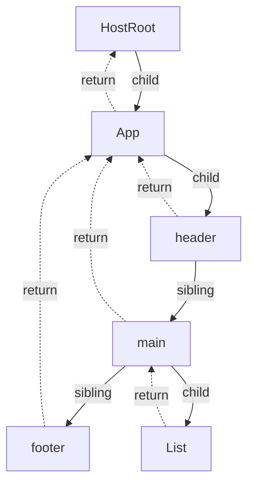
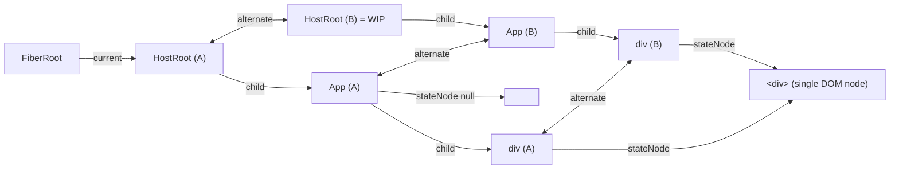

# Fiber 核心数据结构

> [!summary] 核心速览（TL;DR）
> Fiber 是一个长生命周期的可变对象（Mutable Object），与组件实例、宿主 DOM 元素或文本节点一一对应。它既是**一个最小工作单元**，也是**树状结构中的一个节点**。Fiber 之间并非通过数组相连，而是由 `child`（首个子节点）、`sibling`（下一个兄弟节点）和 `return`（父节点）指针串联成单向链表树，这使得 React 能够用一个普通循环来遍历整棵树，并在任意节点随时暂停与恢复。每个 Fiber 都拥有一个 `alternate` 镜像指针。屏幕当前呈现的 `current` 树与后台正在构建的 `workInProgress` 树相互复用彼此的对象——这便是**双缓存机制（Double Buffering）**，它让最后的 Commit 阶段只需做一次极轻量的指针切换。

## React 元素 vs Fiber vs 真实 DOM

| 维度 | React 元素（Element） | Fiber 节点 | 真实 DOM 节点 |
|---|---|---|---|
| 创建时机 | 每次渲染由 `jsx()` 运行时调用创建 | 由协调器（Reconciler）创建，挂载实例仅创建一次（额外伴随 1 个 alternate 镜像） | 由 `completeWork` 阶段中的 `createInstance` 创建 |
| 生命周期 | 仅存活于单次渲染（随后被垃圾回收） | 只要组件处于挂载状态就持续存活 | 与关联的 Fiber 节点同生共死 |
| 可变性 | 不可变（DEV 模式下被 `Object.freeze` 冻结） | 高度可变（内部字段随运行时频繁读写） | 可变 |
| 承载数据 | `type`、`key`、`props` | 全部运行时数据：状态、Hooks 链表、副作用标记、优先级 Lanes、树级链表指针 | 浏览器呈现的最终真实像素 |

大众口中常说的“虚拟 DOM（Virtual DOM）”，本质上最接近轻量的 **React 元素**。然而，React 真正用来执行 Diff 协调算法、保存内部状态以及调度优先级工作的核心载体，实则是 **Fiber 树**。许多在屏幕上并不渲染真实 DOM 的抽象组件（如函数组件、Context Provider、Suspense、Fragment 等），在内存中都有对应的 Fiber 节点；而真实 DOM 节点只属于部分特定类型的 Fiber（如 `HostComponent`、`HostText` 等）。

## 核心字段剖析

`FiberNode` 构造函数以严格固定的顺序初始化所有属性字段，从而让 V8 等 JavaScript 引擎将其视作单一固定的“隐藏类（Hidden Class / Shape）”，实现高效的内联缓存优化。在 DEV 开发环境下，它随后会调用 `Object.preventExtensions(this)` 严禁后续任意追加属性，防止破坏底层形状优化。[^fibernode] 官方 Flow 类型声明详尽描述了每个字段的语义。[^fibertype]

```js
// packages/react-reconciler/src/ReactFiber.js (精简版)
function FiberNode(tag, pendingProps, key, mode) {
  // 实例标识（Instance）
  this.tag = tag; this.key = key; this.elementType = null; this.type = null; this.stateNode = null;
  // 树状链表关联（Fiber tree links）
  this.return = null; this.child = null; this.sibling = null; this.index = 0;
  this.ref = null; this.refCleanup = null;
  // 输入 / 输出 / 状态（Inputs / outputs）
  this.pendingProps = pendingProps; this.memoizedProps = null;
  this.updateQueue = null; this.memoizedState = null; this.dependencies = null;
  this.mode = mode;
  // 副作用标记掩码（Effects）
  this.flags = NoFlags; this.subtreeFlags = NoFlags; this.deletions = null;
  // 调度与优先级（Scheduling）
  this.lanes = NoLanes; this.childLanes = NoLanes;
  this.alternate = null;
  // Profiler 耗时字段在此初始化为 -0 / -1.1（浮点数 double），避免引起 V8 对象的 Shape 突变
}
```

### 节点身份标识（Identity）

- **`tag`**：节点工作标签（`WorkTag` 数值枚举），用于标明当前 Fiber 属于*何种节点类型*。`beginWork` 和 `completeWork` 阶段正是依据此字段进行 `switch` 分支路由（详见后文 WorkTag 完整映射表）。
- **`type`**：经过解析后真正用于执行渲染的主体：可以是函数组件的函数引用、类组件的类引用、宿主 DOM 标签名字符串（如 `'div'`），抑或是 Context 对象。**`elementType`** 则是未经解析前、来自 `element.type` 的初始引用。两者在遇到 `lazy()`（`elementType` 为 Lazy 包装器对象，`type` 为真正加载完成的组件）、`memo()` 包装器以及热重载（Fast Refresh）代理时会表现出差异。
- **`key`**：直接透传自 React 元素的 `key` 属性。仅在子节点协调阶段（Reconciliation）用于跨渲染的唯一性匹配（详见 [[07 beginWork and Reconciliation|07 · beginWork 与协调]]）。
- **`stateNode`**：指向底层的“真实实例”。对于 `HostComponent`，它指向对应的真实 DOM 元素；对于 `HostText`，指向 Text 文本节点；对于 `ClassComponent`，指向类组件实例化后的 `this` 实例；对于根节点 `HostRoot`，指向顶层的 **FiberRootNode**（详见 [[02 createRoot - FiberRoot and HostRoot|02 · createRoot]]）；而对于函数组件，该字段始终为 `null`（函数组件没有自身实例，其所有状态均挂载在 `memoizedState` 的 Hook 链表上）。

### 树状链表关联（Tree links）

- **`return`**：指向父节点。之所以命名为 `return` 而非 `parent`，是因为它代表着工作循环在完成当前节点的所有工作后*返回的目标位置*，其语义非常契合程序调用栈中的“返回地址（Return Address）”。
- **`child`**：仅指向**第一个子节点**。
- **`sibling`**：指向**下一个兄弟节点**。Fiber 节点的所有子节点被组织成一条单向链表：`parent.child → a.sibling → b.sibling → c`。
- **`index`**：当前节点在兄弟节点链表中的下标索引。在带 `key` 的子节点协调算法中，React 依赖该字段检测节点是否发生了跨位置移动。

### 输入、输出与内部状态（Inputs, outputs, state）

- **`pendingProps`**：本次渲染的输入 Props（源自新生成的 React 元素）。**`memoizedProps`**：上一轮成功完成渲染并提交时的历史 Props。如果 `oldProps === newProps`（满足严格全等引用），且当前节点没有待处理的优先级车道（Lanes），同时关联的 Context 也未发生改变，`beginWork` 就会直接**命中 Bailout 跳过机制**。这也是为什么保持 Props 对象引用不变如此关键——而这正是 React Compiler 在编译期全力优化的核心突破口。
- **`memoizedState`**：当前已经提交生效的内部状态。其内部结构随 `tag` 的不同而有所差异：在函数组件中，它指向 **Hook 单向链表的表头**（详见 [[10 Hooks on Mount|10 · Hooks 挂载阶段]]）；在类组件中，它保存 `this.state`；而在 `HostRoot` 根节点上，它则保存 `{element, isDehydrated, cache}` 对象。
- **`updateQueue`**：待消费的更新队列，同样取决于 `tag` 类型。类组件和 `HostRoot` 使用环形更新链表（`shared.pending`）。函数组件使用 `FunctionComponentUpdateQueue`（包含副作用 Effect 链表、事件、外部 Store 订阅以及编译器专用的 `memoCache` 缓存数组）。[^fcqueue] Suspense 边界则在此存储其唤醒重试队列（Retry Queue）。在 React 19 中，`HostComponent` 的该字段已基本废弃，因为 DOM 属性的 Diff 计算被移到了 Commit 提交阶段（`commitUpdate` 直接接收新旧两份 Props 对比）。
- **`dependencies`**：当前 Fiber 所读取的 Context 依赖项链表（`firstContext` 链表）及其优先级车道，专用于 Context 状态变更时的自顶向下精准传播。
- **`mode`**：二进制位掩码（包含 `ConcurrentMode`、`StrictLegacyMode`、`StrictEffectsMode`、`ProfileMode` 等），在创建节点时直接继承自父节点。[^modes]

### 副作用标记掩码（Effects）

- **`flags`**：当前 Fiber 节点在后续 Commit 阶段所需执行的副作用位掩码（Bitmask），例如：`Placement`（插入 DOM）、`Update`（更新属性）、`ChildDeletion`（删除子节点）、`Ref`（挂载/卸载 ref）、`Passive`（存在 `useEffect` 副作用）、`Callback`（回调触发）等。[^flags]
- **`subtreeFlags`**：所有后代子孙节点 `flags` 的按位或（Bitwise OR）聚合值，由 `completeWork` 阶段自底向上层层冒泡收集。在 Commit 提交阶段，如果某个子树根节点的 `subtreeFlags` 不包含当前子阶段所关心的副作用标记位，React 就可以在 $O(1)$ 复杂度内直接整棵跳过。这一机制在 React 18 中彻底取代了以往依靠 `nextEffect` 单向链表串联的“副作用链表（Effect List）”。
- **`deletions`**：待删除的子 Fiber 节点数组。由于被删除的子节点已被移出新的子节点单向链表，因此必须显式暂存在父节点的 `deletions` 数组中，以便 Commit 阶段执行对应的 DOM 节点卸载与销毁逻辑。

### 调度与优先级（Scheduling）

- **`lanes`**：当前 Fiber 节点*自身*挂起的待处理任务优先级车道位掩码（例如该节点自身调用了 `setState` 所产生的更新车道）。
- **`childLanes`**：当前节点*所有后代子树*中挂起的待处理车道位掩码的按位或聚合。当某个节点触发状态更新时，`markUpdateLaneFromFiberToRoot` 会沿着父节点链自底向上一路向上标记赋值。[^childlanes] 它让 `beginWork` 能够以 $O(1)$ 的时间复杂度快速跳过完全没有更新的子树分支：只要 `(childLanes & renderLanes) === 0`，就意味着其下层任何子节点均无活可干，整棵子树均可安全跳过。

### 双缓存机制（Double buffering）

- **`alternate`**：指向当前 Fiber 在另一棵镜像树中的对应版本。满足双向互指关系：`current.alternate === wip` 且 `wip.alternate === current`。

## WorkTag 完整映射表

[^worktags]

| 数值 | WorkTag 标识 | 对应语法实体 | `stateNode` 存储内容 |
|---|---|---|---|
| 0 | `FunctionComponent` | 普通函数组件 `function App()` | `null` |
| 1 | `ClassComponent` | 类组件 `class X extends Component` | 类组件的 `this` 实例 |
| 3 | `HostRoot` | 整个 Fiber 树的宿主根节点 | `FiberRootNode` 全局根对象 |
| 4 | `HostPortal` | 传送门组件 `createPortal(...)` | Portal 容器信息（containerInfo） |
| 5 | `HostComponent` | 原生 DOM 标签 `'div'`、`'span'` 等 | 真实 DOM 元素实例 |
| 6 | `HostText` | 文本子节点（字符串或数字） | 真实 Text 文本节点 |
| 7 | `Fragment` | 片段组件 `<>...</>` 或数组 | `null` |
| 8 | `Mode` | 模式容器（如 `<StrictMode>` 等） | `null` |
| 9 / 10 | `ContextConsumer` / `ContextProvider` | `<Ctx.Consumer>` / `<Ctx>` | `null` |
| 11 | `ForwardRef` | `forwardRef(...)` 包装组件 | `null` |
| 12 | `Profiler` | 性能分析器 `<Profiler>` | `null` |
| 13 | `SuspenseComponent` | 异步等待边界 `<Suspense>` | `null` |
| 14 / 15 | `MemoComponent` / `SimpleMemoComponent` | `memo(...)` 包装组件；“Simple”表示不带自定义比较函数的普通函数组件 | `null` |
| 16 | `LazyComponent` | `lazy(...)` 包装器（尚未完成异步加载解析前） | `null` |
| 17 / 28 | `IncompleteClassComponent` / `IncompleteFunctionComponent` | 在初次挂载时抛出异常未完成渲染的类组件/函数组件 | `null` |
| 18 | `DehydratedFragment` | SSR 水合注水过渡片段 | 脱水节点信息 |
| 19 | `SuspenseListComponent` | 多个 Suspense 的协调编排器 `<SuspenseList>` | `null` |
| 22 | `OffscreenComponent` | 离屏隐藏子树（如 `<Activity>`、Suspense 后台内容） | `OffscreenInstance` 状态对象 |
| 23 | `LegacyHiddenComponent` | 旧版隐藏模式节点 | `null` |
| 24 | `CacheComponent` | 缓存边界组件 `<Cache>` | `null` |
| 25 | `TracingMarkerComponent` | 追踪标记节点 | `null` |
| 26 | `HostHoistable` | 提升至 `<head>` 的静态资源节点（`<link>`、`<meta>`、`<title>`） | 资源实例（Resource） |
| 27 | `HostSingleton` | 全局单例宿主节点（`<html>`、`<head>`、`<body>`） | 已存在的真实 DOM 根元素 |
| 29 | `Throw` | 渲染期抛出异常时的占位子节点 | `null` |
| 30 | `ViewTransitionComponent` | 视图过渡组件 `<ViewTransition>` | `null` |
| 31 | `ActivityComponent` | 活跃状态管理组件 `<Activity>` | `null` |

（注：标签 2 与 20 当前保留未用；21 为实验性的 `ScopeComponent`。）

> [!tip] 纯函数组件极其轻量
> 一个没有声明 `defaultProps` 且使用默认全等浅比较的 `memo(FunctionComponent)`，在挂载时会被 React 通过 `isSimpleFunctionComponent` 检测，自动将其 WorkTag 从 `MemoComponent` 重打标（Retag）升级为 `SimpleMemoComponent`。升级后，它直接在**单一 Fiber 节点**上完成渲染，无需额外套一层 Memo Fiber 包装节点加内部子 Fiber，从而享受极致轻量的更新快速路径。[^simplefn][^simplememo] 另外，React 判断一个组件是类组件还是函数组件，是通过检查其 `prototype.isReactComponent` 属性标记，而非根据 ES6 的 `class` 语法。

## 彻底告别递归：基于链表的手工树遍历



React 的工作循环（Work Loop）本质上是一个手工维护的深度优先遍历（DFS）：

```js
// 概念模拟代码；真实实现在 performUnitOfWork / completeUnitOfWork 中
let node = root;
while (node) {
  const next = beginWork(node);          // 返回 node.child 或 null
  if (next) { node = next; continue; }
  while (node) {                          // 已无子节点：完成当前节点并转向兄弟节点，否则向上回溯
    completeWork(node);
    if (node.sibling) { node = node.sibling; break; }
    node = node.return;
  }
}
```

整个遍历过程严格按照如下时序推进：`begin App` → `begin header` → `complete header` → `begin main` → `begin List` → `complete List` → `complete main` → `begin footer` → `complete footer` → `complete App`。关于真实的 `performUnitOfWork` 源码实现，详见 [[06 The Work Loop - Render Phase|06 · 工作循环]]。[^performunit]

**为什么不直接使用函数递归？**
在 React 16 之前，旧版协调器被称为“栈协调器（Stack Reconciler）”，它通过函数调用栈递归调用组件的 `render()`。对于层级较深的组件树，这意味着长达数十毫秒甚至更久且**不可被打断的连续同步阻塞**，因为 JavaScript 引擎在执行深层函数调用栈时根本无法中途挂起并在稍后恢复。Fiber 架构的核心革命，正是**将原先由 JavaScript 引擎管理的函数调用栈转移到了堆内存（Heap）中的链表数据结构上**：

- **随时暂停与恢复（Pause/Resume）**：工作循环遍历过程中唯一的运行时状态，就是模块级变量指针 `workInProgress`。当时间切片耗尽需要让出主线程控制权时，直接退出 `while` 循环即可；当稍后调度器唤醒时，只需再次调用工作循环并从 `workInProgress` 指针指向的节点继续往下执行（详见 [[04 Lanes and the Scheduler|04 · Lanes 赛道模型与 Scheduler]]）。
- **随时废弃渲染进度（Abort）**：若高优先级任务插队需要推翻当前正在执行的低优先级渲染，只需直接丢弃 WIP 指针，没有任何调用栈状态需要撤回或清理。
- **灵活的优先级调度（Prioritise）**：通过 `childLanes` 掩码，工作循环在深入遍历前就能以 $O(1)$ 判定整个子树是否存在更新，毫无更新的整棵分支可以直接被完全跳过。
- **彻底杜绝栈溢出（No Stack Overflow）**：无论组件树层级多深，扁平的 `while` 循环都不会引发 JavaScript 堆栈溢出（Maximum call stack size exceeded）。
- **优雅的异常展开与 Suspense 捕获（Unwinding）**：当遇到未捕获错误或 Promise 挂起时，向上寻找最近的错误边界或 Suspense 容器，变成了单纯沿着 `return` 指针向上回溯遍历（`unwindWork`），完全摆脱了跨越任意未受控调用栈帧的脆弱 JS 异常处理机制。

这一设计的代价是额外的**内存开销**：每个 Fiber 节点都是一个相对庞大的对象（包含 20 多个属性字段，在开发模式下更多），并且在组件挂载后，每个组件实例都会在内存中保留两个这样的 Fiber 节点。

## 双缓存机制：`current` 与 `workInProgress`

对于任何一个已挂载的组件实例，在内存中至多同时存在**两个**与之对应的 Fiber 节点对象：

- **`current`**：当前已完成 Commit 并在屏幕上实际呈现的 Fiber 树。全局对象 `FiberRootNode.current` 始终指向当前屏幕对应的 `HostRoot` 根节点。
- **`workInProgress`（WIP）**：后台正在进行构建与计算的候选树。它是基于 `current` 树节点并结合最新的 State/Props 变更在内存中离屏推导出来的。

在 Commit 阶段的最后，只需执行一行原子级赋值：`root.current = finishedWork`。整棵 WIP 树便在瞬间**成为**最新的 `current` 树，而原先被淘汰的旧 `current` 树则自动退居幕后，成为下一次渲染构建 WIP 时的对象复用池。[^commitswap] 源码中的注释精确阐述了这行指针切换的时机选择：它发生在 DOM 突变（Mutation 子阶段）之后、布局副作用（Layout 子阶段）执行之前——这样一来，旧组件的 `componentWillUnmount` 销毁逻辑看到的是突变前的旧树状态，而新组件的 `componentDidMount` / `useLayoutEffect` 看到的就是全新的 DOM 状态。

### `createWorkInProgress` 源码拆解

```js
// packages/react-reconciler/src/ReactFiber.js (精简版)
export function createWorkInProgress(current, pendingProps) {
  let workInProgress = current.alternate;
  if (workInProgress === null) {
    // “我们采用双缓存对象池技术，因为我们确信对于任意一棵树，在任何时刻最多只需要两个版本……
    //  这里采用惰性创建，避免为那些从不触发更新的纯静态节点分配额外的无用对象。”
    workInProgress = createFiber(current.tag, pendingProps, current.key, current.mode);
    workInProgress.elementType = current.elementType;
    workInProgress.type = current.type;
    workInProgress.stateNode = current.stateNode;
    workInProgress.alternate = current;
    current.alternate = workInProgress;
  } else {
    workInProgress.pendingProps = pendingProps;
    workInProgress.type = current.type;
    workInProgress.flags = NoFlags;          // 重置上次该对象充当 WIP 时遗留的副作用标记
    workInProgress.subtreeFlags = NoFlags;
    workInProgress.deletions = null;
  }
  workInProgress.flags = current.flags & StaticMask;   // 仅保留“静态”副作用标记（如该节点包含 passive 类型的 useEffect）
  workInProgress.childLanes = current.childLanes;
  workInProgress.lanes = current.lanes;
  workInProgress.child = current.child;                // 在进行子节点协调前，优先共享 current 的子节点引用
  workInProgress.memoizedProps = current.memoizedProps;
  workInProgress.memoizedState = current.memoizedState;
  workInProgress.updateQueue = current.updateQueue;
  workInProgress.dependencies = clone(current.dependencies); // 渲染期会被动态修改，无法直接共享对象引用，必须浅拷贝
  workInProgress.sibling = current.sibling; workInProgress.index = current.index;
  workInProgress.ref = current.ref; workInProgress.refCleanup = current.refCleanup;
  return workInProgress;
}
```

[^cwip] **核心设计要点解析：**

- **惰性分配（Lazy Allocation）**：在初次挂载（Mount）首轮渲染时，根本不存在任何 `alternate` 镜像。挂载流程直接创建全新的 Fiber 节点，唯独 `HostRoot` 根节点会在 `prepareFreshStack` 中立即创建其镜像节点。[^preparefresh] 只有当组件树触发**第二轮渲染**时，各个节点才会按需分配其 `alternate` 镜像。而从**第三轮渲染**开始，所有的 Fiber 对象便完全进入对象池复用状态，不再创建新对象。
- **WIP 深度共享 current 数据**：在渲染未将其覆盖之前，WIP 会直接复用 `current` 的 `memoizedState`、`updateQueue` 以及 `child` 指针。Hooks 在执行过程中会按需克隆自己的 Hook 结构。更新队列的设计尤为精妙：两棵树的版本同时指向同一个 `shared.pending` 环形链表，这也是为什么即使某次低优先级渲染中途被废弃，其挂载的状态更新也不会丢失。
- **`StaticMask` 静态标记的跨轮继承**：诸如 `LayoutStatic` 和 `PassiveStatic` 这类标记（代表“该 Fiber 节点无论本次更新与否，其底层都挂载了相应的副作用监听”）能够穿透副作用重置逻辑得以保留，这样当该组件未来被卸载（Unmount）时，React 即使在本次渲染没有触发更新的情况下，依然能够清晰地知道必须执行其对应的清理（Cleanup）函数。[^staticmask]
- **`stateNode` 引用完全共享**：无论处于 `current` 还是 WIP，两者内部的 `stateNode` 属性始终指向同一个真实 DOM 节点或类组件实例。因为无论上层虚拟树如何轮替，真实的 DOM 只有一份。



在 Commit 阶段结束后，`FiberRootNode.current` 指针将直接拨向 `HostRoot (B)`，而节点 `(A)` 则顺理成章地退居幕后，成为下一次渲染构建时的草稿暂存空间。

> [!warning] 避坑指南：一个组件在内存中其实是“两个对象”
> React DevTools、DOM 节点上挂载的 `__reactFiber$` 私有属性，以及某些外部闭包，在不同时刻所持有的可能分别是这两者中的*任意一个* Fiber 节点，并且随着每次 Commit 提交，哪个节点代表“当前生效节点”都在来回交替切换。React 内部代码对此做了严密的双向兼容：例如在更新入队时会同时将更新标记同步至 `fiber.lanes` 和 `alternate.lanes`（详见 [[03 root.render - Scheduling the First Update|03 · root.render 初次渲染调度]]）；而组件内部的 `setState` 闭包即便绑定的是挂载初期的 Fiber 节点，在运行时也能通过指针穿透正确作用于任一镜像。如果你在排查问题或编写底层探测工具时需要读取内部对象，切记**绝不能草率假设手头的 Fiber 对象必定是屏幕当前生效的 current 实例**。

## 经典认知误区与真相

- **误区一：“React 每次渲染都会重新创建整棵树。”**
  真相：每次重新渲染被重新创建的仅仅是轻量的 React 元素对象。底层的 Fiber 节点不仅通过 `alternate` 机制在两棵镜像树之间循环往复地直接复用，而且未发生变更的子树还会被*浅拷贝复用*，甚至凭借 `bailoutOnAlreadyFinishedWork` 机制直接完整跳过，其后代的 WIP 节点根本无需构建。
- **误区二：“每次触发渲染都必须全量遍历访问每一个 Fiber 节点。”**
  真相：得益于 `childLanes` 优先级掩码机制，哪怕树深千尺，某处深层节点触发的 `setState` 也只会沿着从全局根节点（Root）直达该更新节点的单一精确链路自顶向下访问，其余无关分支被一概忽略，随后仅自该更新节点向下重新协调其受影响的范围。
- **误区三：“严格模式（StrictMode）会让内存中的 Fiber 节点数量翻倍。”**
  真相：完全不会。DEV 环境下的 StrictMode 是在**同一个** WIP Fiber 节点上连续调用两次组件函数（详见 [[01 Bootstrap - Packages, JSX and the Dispatcher|01 · 初始化引导]]），并在初次挂载时在同一个 Fiber 上成对触发副作用的挂载与卸载。整棵 Fiber 树的节点结构和数量没有任何改变。
- **误区四：“Fiber 是 React 18 才引入的并发特性。”**
  真相：早在 2017 年的 React 16 版本中，Fiber 架构就已经作为全套底层基础设施完整落地并全面接管了协调机制。React 18 与 19 所做的，是在 Fiber 数据结构的基础上引入了 Lanes 赛道模型与调度器系统，使其真正释放出了并发与时间切片的全部威力。

## React 编译器对 Fiber 的影响

React Compiler（React 编译器）并没有对 Fiber 的底层数据结构做任何修改。它改变的仅仅是**流入 Fiber 内部的数据形态**：

- 经由编译器编译优化后的组件，会将 `useMemoCache` 运行时缓存数组挂载在 `fiber.updateQueue.memoCache` 上（详见 [[14 React Compiler - How It Works|14 · 编译器工作原理]]）。每个被编译优化的组件仅增加这一个轻量的数组引用，并且由于双缓存切换时 `updateQueue` 是默认共享引用的，该缓存能够在 `current` ↔ WIP 轮替间完美留存。
- 当组件的输入属性未发生变化时，经编译器转译的代码能够直接返回**具有完全相同内存引用的 React 元素对象**。这就直接使得子 Fiber 的 `pendingProps === memoizedProps` 全等条件恒成立，让 `beginWork` 在抵达该 Fiber 时顺水推舟地直接命中 Bailout 跳过机制，连该组件函数本身都无需调用。**在 Fiber Props 上触发的这种全等引用比对跳过，正是 React 编译器性能飞跃的核心秘密所在**（详见 [[15 Rendering With vs Without the Compiler|15 · 启用与未启用编译器的对比]]）。

## 全篇总结

React 元素是转瞬即逝的快照描述，而 Fiber 才是 React 真正长期维护的核心实体。每一个挂载在页面上的组件、原生 DOM 元素或文本节点，在底层都对应着一个可变的 Fiber 节点——它既是执行计算的最小工作单元，也是树状结构的基本构成节点。通过 `child`、`sibling` 和 `return` 指针串联起来的单向链表，让工作循环能够以普通循环自如地遍历整棵树，并在任意时刻安全暂停、恢复或终止，彻底摆脱了语言原生函数调用栈的束缚。每个 Fiber 节点都配备一个 `alternate` 镜像指针，正在屏幕呈现的 `current` 树与后台正在计算的 `workInProgress` 树通过双缓存机制相互循环复用彼此的对象，让最终的 Commit 提交阶段精简为一次瞬时的指针原子切换。下一篇我们将深入剖析：[[06 The Work Loop - Render Phase|06 · 工作循环]]。

### 核心要点速查清单

- **React 元素 vs Fiber**：元素在每次渲染时频繁创建并丢弃；Fiber 节点长驻内存，承载着组件的持久身份、状态机和优先级调度信息。
- **`tag`、`type` 与 `stateNode`**：分别定义了 Fiber 的节点类型标签（WorkTag）、渲染主体引用以及关联的底层宿主实例（函数组件此项恒为 `null`）。
- **`child` / `sibling` / `return`**：仅记录首个子节点与下一个兄弟节点的单向链表结构，辅以指向父级的回溯指针，使工作循环在脱离调用栈的前提下实现自由暂停、中断与恢复。
- **`pendingProps` 与 `memoizedProps`**：新旧 Props 之间的严格全等引用对比，结合空闲的挂起车道与未变的 Context，构成了 `beginWork` 触发 Bailout 跳过渲染的基石。
- **`memoizedState` 与 `updateQueue`**：结构高度依赖于 WorkTag；在函数组件中是 Hook 链表表头，在宿主根节点 `HostRoot` 上是 `{element, isDehydrated, cache}`。
- **`flags` 与 `subtreeFlags`**：用于指导 Commit 阶段执行 DOM 突变和副作用的位掩码，自底向上冒泡收集，使 Commit 阶段能够跳过毫无副作用的子树。
- **`lanes` 与 `childLanes`**：标记本节点及全部下层子节点挂起的优先级工作，使工作循环得以在 $O(1)$ 时间复杂度内整树跳过无更新子树。
- **`createWorkInProgress`**：惰性创建 `alternate` 镜像，后续循环复用；在被渲染覆盖之前，深度共享 `current` 的数据结构。
- **单实例双对象池**：每个已挂载组件在内存中轮流对应两个 Fiber 节点，每次 Commit 都会颠倒交替，切忌假设某一个变量永远指向屏幕当前生效的实例。

← [[04 Lanes and the Scheduler|04 · Lanes 赛道模型与 Scheduler]] · [[00 React Internals Index|专栏目录]] · [[06 The Work Loop - Render Phase|06 · 工作循环]] →

[^fibernode]: `FiberNode` 构造函数 — [packages/react-reconciler/src/ReactFiber.js#L134-L207](https://github.com/facebook/react/blob/v19.3.1/packages/react-reconciler/src/ReactFiber.js#L134-L207)
[^fibertype]: `Fiber` 类型定义 — [packages/react-reconciler/src/ReactInternalTypes.js#L89-L210](https://github.com/facebook/react/blob/v19.3.1/packages/react-reconciler/src/ReactInternalTypes.js#L89-L210)
[^modes]: `TypeOfMode` 模式位定义 — [packages/react-reconciler/src/ReactTypeOfMode.js#L10-L21](https://github.com/facebook/react/blob/v19.3.1/packages/react-reconciler/src/ReactTypeOfMode.js#L10-L21)
[^flags]: Fiber 副作用标记掩码（`Placement`, `Update`, `ChildDeletion`, `Callback`, `Ref`, `Passive`）— [packages/react-reconciler/src/ReactFiberFlags.js#L18-L36](https://github.com/facebook/react/blob/v19.3.1/packages/react-reconciler/src/ReactFiberFlags.js#L18-L36)
[^childlanes]: `markUpdateLaneFromFiberToRoot` 向上标记 `childLanes` — [packages/react-reconciler/src/ReactFiberConcurrentUpdates.js#L189-L208](https://github.com/facebook/react/blob/v19.3.1/packages/react-reconciler/src/ReactFiberConcurrentUpdates.js#L189-L209)
[^worktags]: 节点工作标签 WorkTags 完整定义 — [packages/react-reconciler/src/ReactWorkTags.js#L44-L73](https://github.com/facebook/react/blob/v19.3.1/packages/react-reconciler/src/ReactWorkTags.js#L44-L73)
[^simplefn]: `shouldConstruct` / `isSimpleFunctionComponent` 检测 — [packages/react-reconciler/src/ReactFiber.js#L303-L314](https://github.com/facebook/react/blob/v19.3.1/packages/react-reconciler/src/ReactFiber.js#L303-L314)
[^performunit]: `performUnitOfWork` 调度实现 — [packages/react-reconciler/src/ReactFiberWorkLoop.js#L3081](https://github.com/facebook/react/blob/v19.3.1/packages/react-reconciler/src/ReactFiberWorkLoop.js#L3081)
[^commitswap]: `root.current = finishedWork` 双缓存指针切换 — [packages/react-reconciler/src/ReactFiberWorkLoop.js#L4047-L4051](https://github.com/facebook/react/blob/v19.3.1/packages/react-reconciler/src/ReactFiberWorkLoop.js#L4047-L4051)
[^cwip]: `createWorkInProgress` 实现 — [packages/react-reconciler/src/ReactFiber.js#L322-L437](https://github.com/facebook/react/blob/v19.3.1/packages/react-reconciler/src/ReactFiber.js#L322-L437)
[^preparefresh]: `prepareFreshStack` 调用 `createWorkInProgress(root.current, null)` — [packages/react-reconciler/src/ReactFiberWorkLoop.js#L2254-L2258](https://github.com/facebook/react/blob/v19.3.1/packages/react-reconciler/src/ReactFiberWorkLoop.js#L2254-L2258)
[^staticmask]: `LayoutStatic` 与 `StaticMask` 静态标记掩码 — [packages/react-reconciler/src/ReactFiberFlags.js#L73](https://github.com/facebook/react/blob/v19.3.1/packages/react-reconciler/src/ReactFiberFlags.js#L73), [#L141](https://github.com/facebook/react/blob/v19.3.1/packages/react-reconciler/src/ReactFiberFlags.js#L141)
[^simplememo]: `updateMemoComponent` 自动升级为 `SimpleMemoComponent` — [packages/react-reconciler/src/ReactFiberBeginWork.js#L486-L497](https://github.com/facebook/react/blob/v19.3.1/packages/react-reconciler/src/ReactFiberBeginWork.js#L486-L497)
[^fcqueue]: `FunctionComponentUpdateQueue.memoCache` 结构 — [packages/react-reconciler/src/ReactFiberHooks.js#L249-L254](https://github.com/facebook/react/blob/v19.3.1/packages/react-reconciler/src/ReactFiberHooks.js#L249-L254)
