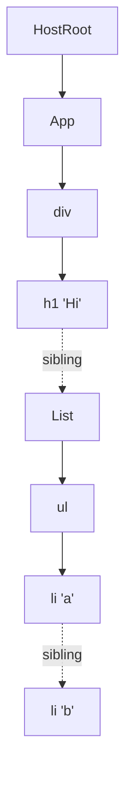

# 工作循环：Render 阶段 (The Work Loop - Render Phase)

> [!summary] 核心速览（TL;DR）
> `performWorkOnRoot` 首先判定本次渲染是否可以开启时间切片（Time Slicing），接着调用 `renderRootSync` 或 `renderRootConcurrent`。两者都会将宿主根节点 `HostRoot` 克隆为一个代表“正在进行中的工作”的 Fiber 节点（WIP Fiber，链路为 `prepareFreshStack` → `createWorkInProgress`），随后围绕全局唯一的单例指针 `workInProgress` 运转 `while` 循环，不断调用 `performUnitOfWork`（自顶向下下潜时执行 `beginWork`，自底向上回溯时执行 `completeUnitOfWork` → `completeWork`）。在此阶段中，没有任何操作会触碰真实屏幕像素，因此 React 可以随心所欲地暂停它、直接丢弃它或从头重新启动它。当整个工作循环彻底执行完毕后，构建完成的 Fiber 树会被交由 `commitRoot` 处理（参见 [[09 Commit Phase - Mutation, Layout, Passive Effects|09 · Commit 阶段：Mutation、Layout 与被动副作用]]）。

## 渲染流程的入口

当执行流到达这里时，更新已经被推入了某个 Fiber 的更新队列中，并分配了相应的优先级车道（参见 [[03 root.render - Scheduling the First Update|03 · root.render：调度首个更新]] 与 [[12 setState - dispatchSetState and Batching|12 · setState：dispatchSetState 与批处理机制]]）。随后，根调度器（Root Scheduler）会通过以下两条截然不同的路径之一调用进入工作循环（参见 [[04 Lanes and the Scheduler|04 · Lanes 赛道模型与 Scheduler]]）：

- **同步车道（Sync lanes）**（例如用户点击产生的 `SyncLane`）：`scheduleTaskForRootDuringMicrotask` **不会**创建任何 Scheduler 任务。它直接设置 `root.callbackPriority = SyncLane`，随后在清空微任务队列（Microtask Flush）时调用 `performSyncWorkOnRoot`，紧接着调用 `performWorkOnRoot(root, lanes, forceSync = true)`。[^sched-sync][^perf-sync]
- **除此以外的所有情况**：向 Scheduler 派发一个调度任务，执行回调绑定为 `performWorkOnRootViaSchedulerTask.bind(null, root)`。该任务首先会清空任何待处理的被动副作用（Passive Effects，即 `useEffect`），重新通过 `getNextLanes` 计算本次要处理的车道集合，调用 `performWorkOnRoot`；如果当前 Root 在该优先级下仍有未完成的剩余工作，它会返回**自身函数**作为延续函数（Continuation）。[^sched-task]

返回延续函数（Continuation return），正是时间切片渲染能够在下一个宏任务中“原地复工、继续推进”的核心机制。这绝不是递归调用，Scheduler 只要看到任务函数返回了一个新的函数引用，就会在调度循环中将它作为同一任务继续保留并排队等待下一帧执行。

## performWorkOnRoot：shouldTimeSlice 判定逻辑

```js
// ReactFiberWorkLoop.js (simplified)
export function performWorkOnRoot(root, lanes, forceSync) {
  if ((executionContext & (RenderContext | CommitContext)) !== NoContext) {
    throw new Error('Should not already be working.');
  }
  const shouldTimeSlice =
    (!forceSync &&
      !includesBlockingLane(lanes) &&
      !includesExpiredLane(root, lanes)) ||
    checkIfRootIsPrerendering(root, lanes);

  let exitStatus = shouldTimeSlice
    ? renderRootConcurrent(root, lanes)
    : renderRootSync(root, lanes, true);
  // ... loop handling RootInProgress / errors / store tearing ...
  finishConcurrentRender(root, exitStatus, finishedWork, lanes, renderEndTime);
  // ...
  ensureRootIsScheduled(root);
}
```
[^pwor]

真正起决定性作用的是 `includesBlockingLane` 判定。“阻塞性（Blocking）”车道集合包括 `SyncLane`、`InputContinuousLane`、**`DefaultLane`**、它们对应的注水（Hydration）变体，以及 `GestureLane`。[^blocking] 这带来了一个很多人常常忽视的关键事实：

> [!warning] 常见认知误区：“只要用了 createRoot，所有的渲染就都是并发/时间切片的”
> 在任何事件之外直接调用的首次 `root.render(<App/>)`，分配到的都是 `DefaultLane`，而 `DefaultLane` 恰恰属于阻塞性车道！因此，即便在 `createRoot` 下，应用的初次挂载（Initial Mount）也是通过 **`renderRootSync`** 一气呵成、不间断地同步执行完成的。在实际运行时中，只有 Transition（过渡）、Retry（重试）、Idle（空闲）和 Offscreen 车道才会在渲染途中真正向浏览器让出主线程控制权。并发渲染并非默认开启，而是必须通过 `startTransition` / `useDeferredValue` 主动声明式启用的能力。光靠 `createRoot` 本身，根本不会让常规更新变成时间切片。

其余两个输入条件：
- `includesExpiredLane`：如果某个车道在等待队列中滞留太久导致过期，就会被标记为已过期（Expired）。从这一刻起，它将被强制转为同步渲染，以防止更新被无限期饿死（Starvation）。
- `checkIfRootIsPrerendering`：如果当前 Root 仅仅是在进行**预渲染（Prerendering）**（即挂起的子树尚无法提交，React 预先热身计算其兄弟节点），那么 React 即使面对同步车道也会始终采用并发循环，以确保这种推测性质的工作绝对不会阻塞主线程。[^pwor]

当渲染函数返回后，`performWorkOnRoot` 会统一处理以下几种退出分支（Exit Cases）：
- **`RootInProgress`**：并发循环主动让出了主线程。直接跳出循环，Scheduler 任务将返回一个延续函数。
- **外部 Store 数据撕裂检查（Store tearing check）**：如果刚才进行的是并发渲染，`isRenderConsistentWithExternalStores(finishedWork)` 会遍历整棵树，逐一核验每个 `useSyncExternalStore` 的快照（Snapshot）是否依然最新。如果某个快照在 React 让出控制权期间被外部静默篡改了，React 会立刻退回到**同步模式**，调用 `renderRootSync(root, lanes, false)` 重新渲染整棵树，确保这次没有任何其它代码能够穿插执行。[^tearing]
- **错误处理（Errors）**：`RootErrored` 会通过 `recoverFromConcurrentError` 获得一次同步重试的机会；而严重的 `RootFatalErrored` 则会彻底重置调用栈。[^pwor]
- **进入后续流程**：若无上述异常，则调用 `finishConcurrentRender`。对于普通渲染，它会直接推进到 Commit 提交；而对于挂起的 Transition 或 Retry，它会将 Root 标记为挂起状态，并可能通过 `scheduleTimeout` 调度一个带节流的 `completeRootWhenReady`。[^finish] 此外，`completeRootWhenReady` 甚至可以**挂起提交动作（Suspend the commit）**（例如等待外部样式表、图片加载完毕，或等待活跃的 View Transition 原生视图过渡就绪），之后再调用 `completeRoot` → `commitRoot`。[^ready]

## renderRootSync 与 renderRootConcurrent

这两个函数拥有完全相同的骨架结构：

1. 设置执行上下文标记 `executionContext |= RenderContext`，并推入对应的 Hooks 分发器（Dispatcher，参见 [[01 Bootstrap - Packages, JSX and the Dispatcher|01 · 初始化引导：包结构、JSX 与分发器]]）。
2. **检查当前 Root 或车道（Lanes）是否发生变化**：如果与上一次执行相比发生了变更，则调用 `prepareFreshStack` 搭建全新的栈帧；如果未变，则**无缝延续现有的工作中 Fiber（workInProgress）**。[^rrs-fresh][^rrc-fresh]
3. 进入外层大循环：`outer: do { try { ... workLoopX() } catch (thrownValue) { handleThrow(...) } } while (true)`。
4. 恢复上下文环境。若 `workInProgress === null`，说明整棵树的工作已全部完成，此时清空 `workInProgressRoot` 并返回对应的退出状态码；否则返回 `RootInProgress`。[^rrs][^rrc-end]

两者的核心差异在于如何处理抛出的 Promise（即组件挂起），以及内部运转的具体工作循环：

| 维度 | `renderRootSync` | `renderRootConcurrent` |
|---|---|---|
| 内部工作循环 | `workLoopSync`（从不检查执行耗时） | `workLoopConcurrentByScheduler`（或受实验性开关 `enableThrottledScheduling` 控制的 `workLoopConcurrent`，在 19.3.1 中默认为 `false`）[^flags] |
| 因等待数据而挂起 | 立即回溯展开至最近的 Suspense 边界 / Fallback 视图（`throwAndUnwindWorkLoop`） | 若 thenable 已经就绪（Resolved），直接**重新重放（Replay）**当前 Fiber；否则挂载 `onResolution` 监听，`break outer` 让出主线程，并在 ping 通知到达后精准唤醒恢复[^rrc-suspend] |
| 能否中途中断并返回 | 仅当主动切换为预渲染（Prerendering）时可以 | 随时可以，只要 Scheduler 要求让出控制权即可中途返回 |

```js
function workLoopSync() {
  while (workInProgress !== null) {
    performUnitOfWork(workInProgress);
  }
}

function workLoopConcurrentByScheduler() {
  // Perform work until Scheduler asks us to yield
  while (workInProgress !== null && !shouldYield()) {
    performUnitOfWork(workInProgress);
  }
}
```
[^loops]

这里的 `shouldYield` 实质上是 Scheduler 导出的 `shouldYieldToHost`。当当前 Scheduler 任务已连续执行约 `frameYieldMs = 5`ms 时，或者在页面显式触发了 `requestPaint()` 时，它就会返回 `true`。[^yield] 因此在工程实践中，“时间切片”的本质是在 **Fiber 与 Fiber 之间的交接点**检查系统时钟，而**绝不会在单个组件执行中途中断**。如果单个组件自身的渲染耗时达到了 200ms，那么它依然会毫无保留地卡顿主线程 200ms。

> [!note] 实验性变体：workLoopConcurrent(nonIdle)
> 在特性开关 `enableThrottledScheduling` 背后，存在一个针对非空闲工作将让出间隔由 5ms 放宽至 25ms 的特殊循环。源码注释指出，这一设计的初衷是刻意将动画帧率限制在约 30fps，避免高频动画将过渡渲染（Transition Rendering）彻底饿死。[^loops] 虽然该功能在 19.3.1 中处于关闭状态，但它清晰地揭示了未来的演进方向：让出间隔实质上是一项 React 可以在运行时动态微调的调度策略。

## prepareFreshStack 与根节点的 createWorkInProgress

`prepareFreshStack` 是渲染从零开始（Start over from scratch）的核心步骤：

```js
// simplified
function prepareFreshStack(root, lanes) {
  // cancel a pending timeout-commit or suspended commit, if any
  // ...
  resetWorkInProgressStack();          // unwind any half-finished WIP
  workInProgressRoot = root;
  const rootWorkInProgress = createWorkInProgress(root.current, null);
  workInProgress = rootWorkInProgress;
  workInProgressRootRenderLanes = lanes;
  workInProgressRootExitStatus = RootInProgress;
  // ... reset ~15 other module-level "workInProgressRoot*" variables ...
  entangledRenderLanes = getEntangledLanes(root, lanes);
  finishQueueingConcurrentUpdates();   // move interleaved updates onto fibers
  return rootWorkInProgress;
}
```
[^pfs]

`createWorkInProgress(current, pendingProps)` 则是**双缓存（Double Buffering）机制**的基础原语（参见 [[05 The Fiber Data Structure|05 · Fiber 数据结构]]）：

- 若 `current.alternate === null`（首次渲染时的 HostRoot 即为此状态），它会分配一个全新的 Fiber 对象，并将二者互相关联：`wip.alternate = current; current.alternate = wip`。
- 否则，它会**直接复用既有的 alternate 备用对象**：重置其副作用标记 `flags`（仅保留 `StaticMask`）、`subtreeFlags` 与 `deletions`，并从 `current` 身上忠实复制 `child`、`memoizedProps`、`memoizedState`、`updateQueue`、`lanes`、`childLanes`、`sibling`、`index` 以及 `ref` 等属性。[^cwip]

工作中的根节点（WIP Root）初始时其 `child` 会直接赋值为 `current.child`。换句话说，它在起点处是直接**指向现有的子节点**的。子节点并不会一次性全量克隆，而是采取**惰性克隆（Lazy cloning）**：只有当 `beginWork` 在遍历中实际触达它们时，才会通过 Diff 协调，或者在触发跳过机制（Bailout）时经由 `cloneChildFibers` 进行克隆（参见 [[07 beginWork and Reconciliation|07 · beginWork 与协调]]）。

> [!tip] 为什么要复用 alternate 对象？
> 经过首次更新后，树中的每个节点在内存中都恰好对应且仅对应两个对象：`current` 与 `alternate`。每当一次提交完成，二者的角色便互换一次。通过持续复用这两个对象，React 避免了每次渲染都要重新在堆内存中开辟一整棵新树的巨大内存分配与垃圾回收开销。这也深刻解释了为什么 Render 阶段必须保持纯粹（Pure）：你正在写入属性的这个“全新”工作中 Fiber，本质上是一个**在上一次提交中曾被视作稳定视图的对象**；在本次渲染通过 Commit 阶段将其正式扶正为 `current` 之前，你写入的任何半成品状态在逻辑上都如同未生效的草稿。

`(workInProgressRoot !== root || workInProgressRootRenderLanes !== lanes)` 的判定条件正是让**渲染打断（Interruption）**得以运作的秘密。如果一个过渡渲染（Transition Render）在时间切片中让出了控制权，此时用户点击产生了一个高优先级的同步交互，下一次 `performWorkOnRoot` 就会拿到 `SyncLane`。由于车道不匹配，`prepareFreshStack` 会坚决执行 `resetWorkInProgressStack()`（沿 `return` 链向上调用 `unwindInterruptedWork` 弹出各类上下文栈），并从 `root.current` 重新开始构建全新的 WIP 树。[^reset] 刚才只建了一半的过渡渲染树被干脆利落地直接丢弃。而该过渡任务对应的更新对象依然完好无损地保存在各个 Fiber 的更新队列中（从未被弹出移除，参见 [[11 Hooks on Update|11 · Hooks 更新阶段]]），因此后续它会在更高优先级更新带来的全新状态基底上，从容地从头重算并渲染。

## performUnitOfWork → beginWork / completeUnitOfWork

```js
function performUnitOfWork(unitOfWork) {
  const current = unitOfWork.alternate;     // null => this fiber is mounting
  let next = beginWork(current, unitOfWork, entangledRenderLanes);
  unitOfWork.memoizedProps = unitOfWork.pendingProps;
  if (next === null) {
    completeUnitOfWork(unitOfWork);         // no child: go back up
  } else {
    workInProgress = next;                  // descend into the child
  }
}
```
[^puow]

深度解析核心要点：
- **`current` 是贯穿整个 Render 阶段的“挂载（Mount）/ 更新（Update）”总开关。** `current === null` 意味着“该 Fiber 从未被提交到屏幕上”，`beginWork` 和 `completeWork` 中的所有分支逻辑几乎都会判断它。在首屏渲染时，`HostRoot` **确实**存在一个 `current`（由 `createRoot` 创建，参见 [[02 createRoot - FiberRoot and HostRoot|02 · createRoot：FiberRoot 与 HostRoot]]），但其下方的所有子孙 Fiber 都是初次分配的，因此整棵树自上而下都是 `current === null`。这就是为什么除了根节点之外，首次渲染在所有节点上都被视作“挂载（Mount）”。第 07 篇将进一步剖析为什么在这一机制下，只有根节点的直接子节点会被打上 `Placement` 插入标记。
- `memoizedProps = pendingProps` 在 `beginWork` 执行完毕后立即赋值。到了下一次渲染时，`beginWork` 就会通过严格引用比对（Identity Comparison）将 `current.memoizedProps` 与新的 `pendingProps` 进行对比，以此作为跳过机制（Bailout）的重要判定依据。
- `beginWork` 会返回接下来要处理的**第一个子节点（First Child）**；若已无子节点，则返回 `null`。

`completeUnitOfWork` 则负责“自底向上回溯”的后半程：

```js
function completeUnitOfWork(unitOfWork) {
  let completedWork = unitOfWork;
  do {
    if ((completedWork.flags & Incomplete) !== NoFlags) {
      unwindUnitOfWork(completedWork, workInProgressRootDidSkipSuspendedSiblings);
      return;                                   // something threw below
    }
    const next = completeWork(completedWork.alternate, completedWork, entangledRenderLanes);
    if (next !== null) { workInProgress = next; return; } // rare: spawned work
    const siblingFiber = completedWork.sibling;
    if (siblingFiber !== null) { workInProgress = siblingFiber; return; }
    completedWork = completedWork.return;       // no sibling: complete parent
    workInProgress = completedWork;
  } while (completedWork !== null);
  if (workInProgressRootExitStatus === RootInProgress) {
    workInProgressRootExitStatus = RootCompleted;
  }
}
```
[^cuow]

因此，整棵树的遍历过程是一个**基于迭代的深度优先遍历（Iterative Depth-First Walk）**：它依靠每个 Fiber 上的三个指针（`child`、`sibling`、`return`）取代了 JavaScript 原生调用栈。在 Fiber 架构诞生之前，React 采用的是递归模式（即 React 16 之前的“Stack 栈协调器”）。而这一三指针链表设计，正是使渲染中途“让出与暂停”成为可能的关键所在：整个执行“调用栈”被具象化为一个纯粹的堆变量 `workInProgress`，引擎可以在处理完任意一个 Fiber 后随时戛然而止，并在后续安全地重返现场继续执行。

## 小型组件树的深度优先遍历全解

```jsx
function App() {
  return (
    <div>
      <h1>Hi</h1>
      <List />
    </div>
  );
}
function List() { return <ul><li>a</li><li>b</li></ul>; }
```



函数调用顺序详解（B 代表 `beginWork`，C 代表 `completeWork`）：

| 序号 | 调用链路 | 底层原因 |
|---|---|---|
| 1 | B(HostRoot) | 处理更新队列（Update Queue）→ 生成 `{element: <App/>}` |
| 2 | B(App) | 通过 `renderWithHooks` 执行组件函数 `App()` |
| 3 | B(div) | 协调子节点列表 `[h1, List]` |
| 4 | B(h1) | 纯文本子节点 `"Hi"` 通过 `textContent` 直接设置，不生成独立 Fiber → 返回 `null` |
| 5 | **C(h1)** | 创建 `<h1>` 真实 DOM 节点；存在兄弟节点 → 转向 List |
| 6 | B(List) | 执行组件函数 `List()` |
| 7 | B(ul) | 协调子节点列表 `[li, li]` |
| 8 | B(li a) → **C(li a)** | 到达叶子节点；转向兄弟节点 li b |
| 9 | B(li b) → **C(li b)** | 无兄弟节点 → 沿 `return` 指针回溯至 ul |
| 10 | **C(ul)** | 创建 `<ul>` 真实 DOM 节点，并将两个 `<li>` 挂载追加到其中 |
| 11 | **C(List)** | 无兄弟节点 → 向上回溯至父节点 |
| 12 | **C(div)** | 创建 `<div>` 真实 DOM 节点，并将 `<h1>` 与 `<ul>` 挂载追加到其中 |
| 13 | **C(App)**, **C(HostRoot)** | 仅冒泡副作用标记；当 `workInProgress = null` 时状态标记为 `RootCompleted` |

每个父节点必然在其所有子节点都彻底完成（Complete）之后才执行自身的完成逻辑，这也正是真实 DOM 能够在内存中自底向上（Bottom-up）、离屏组装拼接的根本原因（参见 [[08 completeWork - Building DOM Nodes|08 · completeWork：构建真实 DOM 节点]]）。

## 工作循环中：首次渲染 vs 更新渲染

| 维度 | 首次渲染（Mount 挂载） | 更新渲染（例如在 `List` 中触发 setState） |
|---|---|---|
| HostRoot WIP | 由 `createWorkInProgress` 全新分配一个 alternate 备用对象 | 直接复用既有的 alternate 备用对象 |
| 根节点以下的 Fiber | 全部全新创建（`current === null`） | 大部分继承克隆；未受影响的子树直接跳过 |
| 实际访问遍历的 Fiber | 每一个 Fiber 节点逐一遍历 | 仅遍历 root → `List` 这条祖先路径以及 `List` 本身的子树。`App`、`div` 与 `h1` 会直接触发 Bailout 跳过，因为它们的 `lanes` 并不包含本次渲染车道，而父级上的 `childLanes` 会精确指引 React 应当向哪个子分支深入[^bail] |
| 宿主组件上的 `completeWork` | 在内存中创建真实 DOM 节点 | 若 props 对象发生变更，则打上 `Update` 副作用标记 |

更新场景体现了 React 最关键的性能特性：在树的深层触发一次 `setState`，**绝不会**自根节点向下对所有组件进行无差别重渲染。`beginWork` 沿途访问祖先节点时，会发现它们自身没有任何待处理的工作（`checkScheduledUpdateOrContext` 返回 false），此时 `bailoutOnAlreadyFinishedWork` 会顺着 `childLanes` 开辟的轨迹直接克隆子节点指针并快速下潜。详细实现机制请参见 [[07 beginWork and Reconciliation|07 · beginWork 与协调]]。

## 渲染的中断、恢复与挂起机制（概览）

- **让出（Yield）**：`workLoopConcurrentByScheduler` 退出时仍有剩余工作（`workInProgress !== null`）→ `renderRootConcurrent` 返回退出状态码 `RootInProgress` → 当前 Scheduler 任务返回自身作为延续函数。在下一个宏任务调度中，由于 `workInProgressRoot === root` 且车道集完全一致，因此**无需**调用 `prepareFreshStack`，工作循环直接从上次中断的 `workInProgress` 指针处无缝继续推进。[^rrc-fresh]
- **打断（Interrupt）**：更高优先级的车道中途插入 → 车道不一致 → 触发 `prepareFreshStack` → 先前半途而废的 WIP 树被整体抛弃（如前文所述）。
- **挂起（Suspend）**：组件内部调用了 `use(promise)` 或直接抛出了一个 Promise。该行为会表现为从 `beginWork` 中向外抛出异常，被渲染执行函数内部的 `try/catch` 捕获并移交给 `handleThrow`，记录挂起原因 `workInProgressSuspendedReason`（例如 `SuspendedOnImmediate` 或 `SuspendedOnData`）。[^throw] 在并发渲染中，React 可以做到**原地等待** Promise 兑现，而无需立即展开回溯调用栈（通过 `thenable.then(onResolution, onResolution); break outer`），并在后续**仅精准重放（Replay）这单个 Fiber**（调用 `replaySuspendedUnitOfWork`），无须将整个子树全部推倒重来。[^rrc-suspend] 而在同步渲染中，它会立即展开回溯至最近的 Suspense 边界，并展示 Fallback 占位视图。

> [!warning] Render 阶段可能会被反复执行多次，且甚至可能永远不会提交
> 综合考虑高优先级任务打断、外部 Store 撕裂导致的同步重算、错误捕获后的重试、Suspense 局部重放以及严格模式（StrictMode）的双重渲染，在用户肉眼看到一次屏幕更新之前，组件函数完全有可能被调用执行许多次，甚至整个渲染树可能会被中途彻底抛弃。这也正是为什么 Render 阶段必须严格保持纯粹（Pure）：严禁产生任何副作用订阅、严禁直接修改外部对象引用、严禁读取真实 DOM 布局信息。任何对于每次**真实提交生效**的结果必须且仅能执行一次的逻辑，都必须统一放置在 Effect 副作用中（参见 [[09 Commit Phase - Mutation, Layout, Passive Effects|09 · Commit 阶段：Mutation、Layout 与被动副作用]]）。

## 渲染收尾与迈向 Commit 提交

当 `completeUnitOfWork` 最终向上回溯跨越过 `HostRoot` 时，`workInProgress` 指针正式变更为 `null`，退出状态被置为 `RootCompleted`。`performWorkOnRoot` 读取 `finishedWork = root.current.alternate`，这便是已经彻底构建完成的 WIP 根节点。接着它沿着链路调用 `finishConcurrentRender` → `completeRootWhenReady` → `completeRoot` → `commitRoot`。[^pwor][^finish][^ready] 顺便一提，尽管该函数名为 `finishConcurrentRender`（完成并发渲染），但同步渲染也同样是由它统一收口处理的。

此时此刻，这棵正在构建中的 WIP 树已经万事俱备：所有新增的宿主 Fiber 都已在内存中生成好了真实的 DOM 节点，每个需要执行副作用的 Fiber 上都被打上了精确的 `flags` 标记，并且所有标记都通过 `subtreeFlags` 向上冒泡汇总完毕，以便 Commit 阶段能够极速跳过那些“洁净无暇”的子树。但请牢记：**此时整棵新树还没有向真实 DOM 文档中插入任何一个节点**。所有真实界面的生根落地，都将完整发生在 [[09 Commit Phase - Mutation, Layout, Passive Effects|09 · Commit 阶段：Mutation、Layout 与被动副作用]] 中。

## 与 React 编译器的协同配合

在 React 编译器介入后，核心的工作循环机制**完全保持不变**。编译器仅仅改写你的组件函数体内部代码，完全不会改动 `react-reconciler` 的任何底层逻辑（参见 [[14 React Compiler - How It Works|14 · 编译器工作原理]]）。它所深刻改变的，是**工作循环在实际运行时到底需要遍历处理多少个 Fiber**。经由编译器转译后的组件，当输入 props 和依赖未变时，会直接返回带缓存的既有 JSX 元素引用。正如第 07 篇中所详述，当 `beginWork` 看到子节点的 `oldProps === newProps` 引用全等时，便能直接触发整棵子树的 Bailout 跳过机制。因此在前文“访问遍历的 Fiber”这一环节中，更新组件下方的整棵子树往往会被极速裁减，仅留下输入真正发生改变的极少数节点。`performUnitOfWork` 调用次数的大幅减少，直接带来了渲染执行总耗时的下降以及向主线程让出次数的锐减。详情参见 [[15 Rendering With vs Without the Compiler|15 · 启用与未启用编译器的对比]]。

## 总结

Render 阶段本质上是围绕一个全局单一指针 `workInProgress` 旋转的 `while` 循环。`performWorkOnRoot` 决定本次渲染是否开启时间切片，`prepareFreshStack` 将 `HostRoot` 克隆为最初的工作中 Fiber，而 `performUnitOfWork` 则以深度优先遍历的方式巡检整棵树：下潜时执行 `beginWork`，回溯上浮时执行 `completeWork`。正是因为整棵执行栈都被浓缩在单个变量之中，且期间完全不直接操作真实 DOM，React 才能自如地暂停让出、从容恢复、乃至直接丢弃构建了一半的草稿树。Render 阶段完全可能被调用多次却最终并不提交，因此代码必须绝对保持纯粹（Pure）。下一篇：[[07 beginWork and Reconciliation|07 · beginWork 与协调]]。

### 核心要点回顾

- **`shouldTimeSlice` 判定**：`DefaultLane` 被归为阻塞性车道，因此组件的初次挂载必然运行在 `renderRootSync` 中；只有 Transition（过渡）、Retry（重试）、Idle（空闲）和 Offscreen 车道才会真正向浏览器让出控制权。
- **退出状态处理**：`performWorkOnRoot` 负责统一调度主线程让出、在检测到外部 Store 发生篡改（数据撕裂）时退回至同步重渲、对报错提供一次同步重试机会，或者最终交由 `finishConcurrentRender` 收口。
- **`workLoopSync` vs `workLoopConcurrentByScheduler`**：并发循环在 **Fiber 与 Fiber 之间的切换空隙**调用 `shouldYield()` 判定是否让出，而绝不会在单个组件执行中途强行打断。
- **`prepareFreshStack` 重置栈帧**：清空上一轮渲染的残留状态，构建根节点的 WIP 对象，并将插队进来的并发更新批量分配至各个 Fiber。
- **渲染打断机制**：当 Root 或渲染车道发生变更时，旧的半成品 WIP 树将被直接丢弃；其未消化的更新依然安全保留在更新队列中等待重算。
- **`performUnitOfWork` 执行单元**：`current === null` 充当了全流程的“挂载/更新”状态开关，并在子节点深入前令 `memoizedProps = pendingProps` 为下一次渲染的 Bailout 跳过判定做好准备。
- **`completeUnitOfWork` 回溯机制**：完成当前节点的工作，随后转向其兄弟节点或回溯至父节点，确保所有父节点的完成逻辑必然落后于子节点。
- **更新跳过冗余工作**：深层节点发起的 `setState` 借助祖先链路上的 `childLanes` 标记，将渲染范围严格限定在通往该节点的路径与其自身子树中，大面积跳过无关分支。
- **组件挂起处理**：并发渲染具备“原地暂停等待并仅重新重放单个 Fiber”的能力；而同步渲染则会立即展开回溯至最近的 Suspense 边界展示 Fallback。

← [[05 The Fiber Data Structure|05 · Fiber 数据结构]] · [[00 React Internals Index|目录导航]] · [[07 beginWork and Reconciliation|07 · beginWork 与协调]] →

[^sched-sync]: `scheduleTaskForRootDuringMicrotask` sync branch — [packages/react-reconciler/src/ReactFiberRootScheduler.js#L442-L456](https://github.com/facebook/react/blob/v19.3.1/packages/react-reconciler/src/ReactFiberRootScheduler.js#L442-L456)
[^perf-sync]: `performSyncWorkOnRoot` — [packages/react-reconciler/src/ReactFiberRootScheduler.js#L608-L622](https://github.com/facebook/react/blob/v19.3.1/packages/react-reconciler/src/ReactFiberRootScheduler.js#L608-L622)
[^sched-task]: `performWorkOnRootViaSchedulerTask` — [packages/react-reconciler/src/ReactFiberRootScheduler.js#L513-L606](https://github.com/facebook/react/blob/v19.3.1/packages/react-reconciler/src/ReactFiberRootScheduler.js#L513-L606)
[^pwor]: `performWorkOnRoot` (shouldTimeSlice at L1168-L1181) — [packages/react-reconciler/src/ReactFiberWorkLoop.js#L1137-L1325](https://github.com/facebook/react/blob/v19.3.1/packages/react-reconciler/src/ReactFiberWorkLoop.js#L1137-L1325)
[^blocking]: `includesBlockingLane` — [packages/react-reconciler/src/ReactFiberLane.js#L684-L694](https://github.com/facebook/react/blob/v19.3.1/packages/react-reconciler/src/ReactFiberLane.js#L684-L694)
[^tearing]: store-consistency check and sync re-render — [packages/react-reconciler/src/ReactFiberWorkLoop.js#L1222-L1243](https://github.com/facebook/react/blob/v19.3.1/packages/react-reconciler/src/ReactFiberWorkLoop.js#L1222-L1243)
[^finish]: `finishConcurrentRender` — [packages/react-reconciler/src/ReactFiberWorkLoop.js#L1420-L1576](https://github.com/facebook/react/blob/v19.3.1/packages/react-reconciler/src/ReactFiberWorkLoop.js#L1420-L1576)
[^ready]: `completeRootWhenReady` — [packages/react-reconciler/src/ReactFiberWorkLoop.js#L1578-L1701](https://github.com/facebook/react/blob/v19.3.1/packages/react-reconciler/src/ReactFiberWorkLoop.js#L1578-L1701)
[^rrs-fresh]: `renderRootSync` fresh-stack check — [packages/react-reconciler/src/ReactFiberWorkLoop.js#L2635-L2654](https://github.com/facebook/react/blob/v19.3.1/packages/react-reconciler/src/ReactFiberWorkLoop.js#L2635-L2654)
[^rrc-fresh]: `renderRootConcurrent` fresh-stack check / resume — [packages/react-reconciler/src/ReactFiberWorkLoop.js#L2787-L2814](https://github.com/facebook/react/blob/v19.3.1/packages/react-reconciler/src/ReactFiberWorkLoop.js#L2787-L2814)
[^rrs]: `renderRootSync` — [packages/react-reconciler/src/ReactFiberWorkLoop.js#L2623-L2768](https://github.com/facebook/react/blob/v19.3.1/packages/react-reconciler/src/ReactFiberWorkLoop.js#L2623-L2768)
[^rrc-end]: `renderRootConcurrent` loop selection and exit — [packages/react-reconciler/src/ReactFiberWorkLoop.js#L3007-L3053](https://github.com/facebook/react/blob/v19.3.1/packages/react-reconciler/src/ReactFiberWorkLoop.js#L3007-L3053)
[^flags]: `enableThrottledScheduling = false`, `enableViewTransition = true` — [packages/shared/ReactFeatureFlags.js#L76-L90](https://github.com/facebook/react/blob/v19.3.1/packages/shared/ReactFeatureFlags.js#L76-L90)
[^rrc-suspend]: `renderRootConcurrent` suspended-reason switch (replay / wait on thenable) — [packages/react-reconciler/src/ReactFiberWorkLoop.js#L2820-L3005](https://github.com/facebook/react/blob/v19.3.1/packages/react-reconciler/src/ReactFiberWorkLoop.js#L2820-L3005)
[^loops]: `workLoopSync`, `workLoopConcurrent`, `workLoopConcurrentByScheduler` — [packages/react-reconciler/src/ReactFiberWorkLoop.js#L2772-L2777](https://github.com/facebook/react/blob/v19.3.1/packages/react-reconciler/src/ReactFiberWorkLoop.js#L2772-L2777) and [#L3056-L3079](https://github.com/facebook/react/blob/v19.3.1/packages/react-reconciler/src/ReactFiberWorkLoop.js#L3056-L3079)
[^yield]: `shouldYieldToHost` / `frameInterval` — [packages/scheduler/src/forks/Scheduler.js#L456-L472](https://github.com/facebook/react/blob/v19.3.1/packages/scheduler/src/forks/Scheduler.js#L456-L472); `frameYieldMs = 5` — [packages/scheduler/src/SchedulerFeatureFlags.js#L11](https://github.com/facebook/react/blob/v19.3.1/packages/scheduler/src/SchedulerFeatureFlags.js#L11)
[^pfs]: `prepareFreshStack` (state reset at L2254-L2284) — [packages/react-reconciler/src/ReactFiberWorkLoop.js#L2023-L2293](https://github.com/facebook/react/blob/v19.3.1/packages/react-reconciler/src/ReactFiberWorkLoop.js#L2023-L2293)
[^cwip]: `createWorkInProgress` — [packages/react-reconciler/src/ReactFiber.js#L323-L437](https://github.com/facebook/react/blob/v19.3.1/packages/react-reconciler/src/ReactFiber.js#L323-L437)
[^reset]: `resetWorkInProgressStack` — [packages/react-reconciler/src/ReactFiberWorkLoop.js#L1979-L2002](https://github.com/facebook/react/blob/v19.3.1/packages/react-reconciler/src/ReactFiberWorkLoop.js#L1979-L2002)
[^puow]: `performUnitOfWork` — [packages/react-reconciler/src/ReactFiberWorkLoop.js#L3081-L3123](https://github.com/facebook/react/blob/v19.3.1/packages/react-reconciler/src/ReactFiberWorkLoop.js#L3081-L3123)
[^cuow]: `completeUnitOfWork` — [packages/react-reconciler/src/ReactFiberWorkLoop.js#L3368-L3431](https://github.com/facebook/react/blob/v19.3.1/packages/react-reconciler/src/ReactFiberWorkLoop.js#L3368-L3431)
[^bail]: `bailoutOnAlreadyFinishedWork` — [packages/react-reconciler/src/ReactFiberBeginWork.js#L3826-L3865](https://github.com/facebook/react/blob/v19.3.1/packages/react-reconciler/src/ReactFiberBeginWork.js#L3826-L3865)
[^throw]: `handleThrow` — [packages/react-reconciler/src/ReactFiberWorkLoop.js#L2302-L2430](https://github.com/facebook/react/blob/v19.3.1/packages/react-reconciler/src/ReactFiberWorkLoop.js#L2302-L2430)
