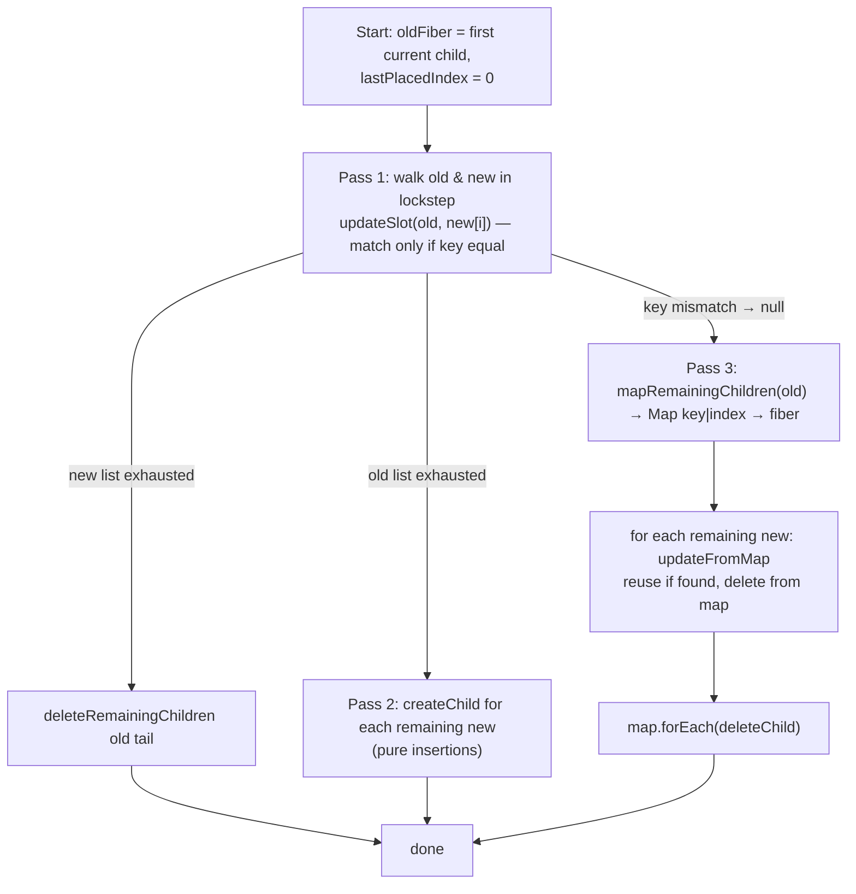

# beginWork 与协调（Reconciliation）

> [!summary] 核心速览（TL;DR）
> 在工作循环（Work Loop）中，`beginWork(current, wip, renderLanes)` 对遍历到的每一个 Fiber 节点所做的事情无外乎两者之一：要么**跳过渲染（Bailout）**（当新旧 props 对象引用完全一致，且既无待处理更新也无 Context 变更时，直接复用子节点，或者借助 `childLanes` 彻底跳过整棵子树）；要么**执行渲染**（调用你的组件函数，或针对宿主节点读取 `props.children`），并将产出的结果递交给**子节点协调器（Child Reconciler）**。协调器（`reconcileChildFibers`，即协调子 Fiber 的 Diff 核心实现，位于 `ReactChildFiber.js`）会基于 `key` 和 `type` 将新返回的 ReactElement 与当前的旧子 Fiber 进行比对，决定是复用现有 Fiber（`useFiber`）还是创建全新 Fiber（`createFiberFromElement`），并打上 `Placement`、`ChildDeletion` 等副作用标记。在所有的跳过机制中，开销最低的莫过于**新旧 props 的内存对象引用完全相等（`oldProps === newProps`）**——而这，恰恰就是 React 编译器（React Compiler）通过自动缓存 JSX 元素所达成的核心效果。

## 入口决策守卫：didReceiveUpdate

在工作循环遍历 Fiber 树的过程中，每个被访问到的 Fiber 节点都会由 `performUnitOfWork` 调用一次 `beginWork`（参见 [[06 The Work Loop - Render Phase|工作循环：渲染阶段]]）。该函数前约 90 行代码构成了一道极为严格的准入守卫门禁：

```js
// ReactFiberBeginWork.js (simplified)
function beginWork(current, workInProgress, renderLanes) {
  if (current !== null) {
    const oldProps = current.memoizedProps;
    const newProps = workInProgress.pendingProps;
    if (oldProps !== newProps || hasLegacyContextChanged()) {
      didReceiveUpdate = true;
    } else {
      const hasScheduledUpdateOrContext =
        checkScheduledUpdateOrContext(current, renderLanes);
      if (!hasScheduledUpdateOrContext &&
          (workInProgress.flags & DidCapture) === NoFlags) {
        didReceiveUpdate = false;
        return attemptEarlyBailoutIfNoScheduledUpdate(current, workInProgress, renderLanes);
      }
      didReceiveUpdate = false;   // (legacy-suspense special case omitted)
    }
  } else {
    didReceiveUpdate = false;     // mount
  }
  workInProgress.lanes = NoLanes;
  switch (workInProgress.tag) { /* ... */ }
}
```
[^bw-gate]

这里有三个核心输入条件，务必烂熟于心：

1. **`oldProps !== newProps`**：整个 props 对象的**引用（Reference）比较**。这既不是浅比较，也不是深比较。`pendingProps` 是父节点在协调阶段调用 `useFiber` 传入的 `element.props`（见后文），而 `memoizedProps` 则是上一次渲染成功后保存在当前 Fiber 上的 props 对象。
2. **`current.lanes` 包含 `renderLanes`**：表示当前 Fiber 自身在本次渲染优先级下存在待处理的状态更新（例如组件自身触发了 `setState`）。此项检查在 `checkScheduledUpdateOrContext` 中完成。[^check]
3. **Context 是否发生变化**：在 React 19.x 中，Context 的向下传播是**惰性（Lazy）**的，因此 `checkScheduledUpdateOrContext` 还会进一步调用 `checkIfContextChanged(current.dependencies)`，检查该 Fiber 所消费的任意 Context 当前是否产生了新值。[^check]

如果条件（1）为 false（即 props 引用未变），且条件（2）和（3）亦为 false（既无待处理更新，所依赖的 Context 也未变），React 就**完全不会调用你的组件函数**。代码会直接跳转至 `attemptEarlyBailoutIfNoScheduledUpdate`。该函数会负责补齐当前 Fiber 类型本该压入上下文栈的全部数据（如宿主上下文、Provider、Suspense 记账状态等），因为后续的 `completeWork` 无论如何都会对称地执行出栈（Pop）操作；随后，它便调用 `bailoutOnAlreadyFinishedWork`。[^early]

> [!note] `didReceiveUpdate` 是一个模块级全局变量，而非函数返回值
> 在“props 引用未变，但节点自身*确实*挂有调度更新”的分支中，`beginWork` 同样会先将 `didReceiveUpdate` 置为 `false`。随后组件函数开始执行；如果某个 Hook 确实算出了全新状态，`updateReducerImpl` 会在检测到 `!Object.is(newState, hook.memoizedState)` 时调用 `markWorkInProgressReceivedUpdate()`，重新将该标志置为 `true`。[^mark][^reducer] 因此，“组件触发了 setState”与“该组件本次计算出的产物必须被协调”是两码事。React 只有在组件渲染执行完毕之后，才能最终回答第二个问题。

## bailoutOnAlreadyFinishedWork 与 childLanes 子树剪枝

```js
function bailoutOnAlreadyFinishedWork(current, workInProgress, renderLanes) {
  if (current !== null) workInProgress.dependencies = current.dependencies;
  markSkippedUpdateLanes(workInProgress.lanes);
  if (!includesSomeLane(renderLanes, workInProgress.childLanes)) {
    // ... lazily propagate context changes, re-check ...
    return null;              // entire subtree is clean: skip it
  }
  cloneChildFibers(current, workInProgress);
  return workInProgress.child; // clean here, but something below has work
}
```
[^bailout]

函数返回 `null` 意味着彻底跳过整棵子树。由于 `workInProgress.child` 依然指向 **current** 树上的已有子节点（此前在 `createWorkInProgress` 时浅拷贝复制），因此最终完成的 Fiber 树只需直接共享这批已提交（Committed）的旧 Fiber 节点。无论该子树体量多么庞大，这一操作的耗时恒为 $O(1)$。

而 `childLanes` 正是让这一优化万无一失的核心基石。当位于子树深处的某个组件调用 `setState` 时，`markUpdateLaneFromFiberToRoot` 会自底向上沿路径回溯，将对应的 Lane 以按位或（OR）的形式合入沿途每一个祖先节点的 `childLanes` 中（参见 [[12 setState - dispatchSetState and Batching|setState 底层实现：dispatchSetState 与批处理]]）；随后在归阶段的 `completeWork` 中，`bubbleProperties` 又会在回溯时重新向上冒泡并刷新该属性（参见 [[08 completeWork - Building DOM Nodes|completeWork：构建宿主 DOM 节点]]）。正因如此，祖先节点能够明确知晓：“我自身没有任何工作要做，但我的子树深处有节点需要更新，必须继续向下遍历”。

`cloneChildFibers` 会借助 `createWorkInProgress(currentChild, currentChild.pendingProps)` 为当前节点的直属子节点创建 WIP 镜像副本。[^clone] 请务必留意这一细节：传入的是子节点的**旧** `pendingProps`，也就是上一轮渲染中 `performUnitOfWork` 最终同步写入 `memoizedProps` 的那个对象。这意味着，当工作循环推进到该子节点时，其内部的 `oldProps === newProps` 在物理机制上天然成立！于是，跳过渲染（Bailout）的判定便顺理成章地沿着树形链路一路向下击穿传导，全链路中唯有真正持有更新任务的那个 Fiber 节点才会真正重新执行。

## 按 Tag 标签分发处理流程

穿过入口守卫后，`beginWork` 内部会通过 `switch (workInProgress.tag)` 将任务路由给特定类型的专用处理函数。[^bw-switch] 在首次渲染与常规 `setState` 触发的更新链路中，最关键的处理分支如下：

### updateHostRoot

```js
function updateHostRoot(current, workInProgress, renderLanes) {
  pushHostRootContext(workInProgress);
  const prevChildren = workInProgress.memoizedState.element;
  cloneUpdateQueue(current, workInProgress);
  processUpdateQueue(workInProgress, nextProps, null, renderLanes);
  const nextState = workInProgress.memoizedState;   // { element, isDehydrated, cache }
  // ... cache provider, transitions ...
  const nextChildren = nextState.element;
  // (hydration branch omitted)
  if (nextChildren === prevChildren) {
    return bailoutOnAlreadyFinishedWork(current, workInProgress, renderLanes);
  }
  reconcileChildren(current, workInProgress, nextChildren, renderLanes);
  return workInProgress.child;
}
```
[^hostroot]

`root.render(<App/>)` 会入队一个 payload 为 `{element}` 的更新对象（参见 [[03 root.render - Scheduling the First Update|root.render：调度首次状态更新]]）。`processUpdateQueue`（位于 `ReactFiberClassUpdateQueue.js` 中的类式更新队列）会将其计算并合入 `memoizedState` 中，此时传入的 `<App/>` 元素便成为了 `HostRoot` 的“子节点”。代码中若 `current === null` 则会直接抛出异常，这一硬约束证实了 `HostRoot` 在任何时候（即便在首次渲染时）都**绝对拥有** `current` 镜像。这个关键细节对于下文的理解至关重要。

### updateFunctionComponent

```js
function updateFunctionComponent(current, workInProgress, Component, nextProps, renderLanes) {
  prepareToReadContext(workInProgress, renderLanes);
  let nextChildren = renderWithHooks(current, workInProgress, Component,
                                     nextProps, context, renderLanes);
  if (current !== null && !didReceiveUpdate) {
    bailoutHooks(current, workInProgress, renderLanes);
    return bailoutOnAlreadyFinishedWork(current, workInProgress, renderLanes);
  }
  workInProgress.flags |= PerformedWork;
  reconcileChildren(current, workInProgress, nextChildren, renderLanes);
  return workInProgress.child;
}
```
[^fc]

`renderWithHooks` 会根据 `current === null` 判定并挂载对应的挂载期（Mount）或更新期（Update）Dispatcher 分发器，随后执行组件函数 `Component(props)`（参见 [[10 Hooks on Mount|Hooks 挂载阶段原理]]，[[11 Hooks on Update|Hooks 更新阶段原理]]）。

这里包含一处精妙的**渲染后跳过（Post-Render Bailout）**机制：即便组件此前已被调度入队并确实执行了函数体，但如果其内部所有的状态更新最终结算出的新值均未发生变化（例如在急切求值 Eager State 命中遗漏后触发了 `setCount(c => c)`），且 props 对象引用完全一致，React 便会触发后置跳过。`bailoutHooks` 会从 current 节点恢复 `updateQueue`，从 WIP 节点的 flags 中抹去 `Passive | Update` 副作用标记（确保任何副作用钩子都不会被触发），并清除对应的 lanes。[^bailouthooks] 至于组件刚刚执行生成并返回的 JSX 元素树，则会被**直接丢弃**，根本不会进入后续的协调流程。官方文档中常说的“React 在某些情况下仍可能调用你的组件函数，但随后会放弃处理（Bail out）”，指的就是这个机制。

### updateHostComponent

```js
function updateHostComponent(current, workInProgress, renderLanes) {
  pushHostContext(workInProgress);
  const nextProps = workInProgress.pendingProps;
  const prevProps = current !== null ? current.memoizedProps : null;
  let nextChildren = nextProps.children;
  if (shouldSetTextContent(type, nextProps)) {
    nextChildren = null;                 // <h1>Hi</h1>: no HostText fiber
  } else if (prevProps !== null && shouldSetTextContent(type, prevProps)) {
    workInProgress.flags |= ContentReset;
  }
  // (form-action "transition-aware host component" hooks omitted)
  markRef(current, workInProgress);
  reconcileChildren(current, workInProgress, nextChildren, renderLanes);
  return workInProgress.child;
}
```
[^hc]

在这个阶段，**没有任何与真实 DOM 创建相关的操作**。像 `<div>` 这样的宿主 DOM 节点是在后续归阶段的 `completeWork` 中自底向上创建的。`shouldSetTextContent` 是 DOM 宿主配置（Host Config）中的判定函数，专门用于检测当前节点是否仅包含“单一字符串/数字子节点”或是设置了 `dangerouslySetInnerHTML`。[^sstc] 针对这两种情况，React 会避免为文本额外分配单独的 `HostText` Fiber 节点，而是直接将其作为属性赋给宿主 DOM 的 `textContent`。

### memo 与 SimpleMemoComponent

当使用 `React.memo(Fn)` 包裹一个常规函数且未提供自定义 `compare` 比较函数时，React 会在挂载时将其直接“升级”为 `SimpleMemoComponent`：这是一种高度精简的复合节点，单个 Fiber 同时充当了 memo 边界与函数组件本身。[^memo] 其在更新阶段的逻辑如下：

```js
function updateSimpleMemoComponent(current, workInProgress, Component, nextProps, renderLanes) {
  if (current !== null) {
    const prevProps = current.memoizedProps;
    if (shallowEqual(prevProps, nextProps) && current.ref === workInProgress.ref) {
      didReceiveUpdate = false;
      workInProgress.pendingProps = nextProps = prevProps;  // reuse the old object!
      if (!checkScheduledUpdateOrContext(current, renderLanes)) {
        workInProgress.lanes = current.lanes;
        return bailoutOnAlreadyFinishedWork(current, workInProgress, renderLanes);
      }
    }
  }
  return updateFunctionComponent(current, workInProgress, Component, nextProps, renderLanes);
}
```
[^simplememo]

`shallowEqual` 会使用 `Object.is` 对属性键值逐一进行浅比较。[^shallow] 请特别注意这行代码：`workInProgress.pendingProps = nextProps = prevProps;`——一旦 memo 判定新旧 props 浅层相等，它会直接将**旧对象的引用赋值给新对象的引用**！这样一来，下游节点在比较对象身份（Identity Invariant）时便能顺利命中引用相等。而更为通用的 `MemoComponent` 路径（包含自定义 `compare` 函数，或是包裹了 `forwardRef`/lazy 的组件）则会额外保留一个内部 Fiber 节点，并将其与 `currentChild.memoizedProps` 进行比对。[^memo]

> [!warning] 经典陷阱：如果任何 prop 传入了新创建的对象或匿名函数，`memo` 将彻底失效
> 类似 `<Row onClick={() => select(id)} style={{color}} />` 这样的写法，在父组件每次重新渲染时都会生成全新的箭头函数与字面量对象。这会导致 `shallowEqual` 判定失败，此时 memo 边界不仅没能阻止子组件重渲染，反而平白无故多搭进了一次昂贵的键值浅比较开销。这正是过去开发者不得不手动维护 `useCallback` / `useMemo` 的心智负担所在，而 React 编译器从根本上消除了这层烦恼。

## reconcileChildren：为何首次渲染仅在根子节点打上 Placement 副作用标记

```js
export function reconcileChildren(current, workInProgress, nextChildren, renderLanes) {
  if (current === null) {
    workInProgress.child = mountChildFibers(workInProgress, null, nextChildren, renderLanes);
  } else {
    workInProgress.child = reconcileChildFibers(workInProgress, current.child, nextChildren, renderLanes);
  }
}
// ReactChildFiber.js
export const reconcileChildFibers = createChildReconciler(true);
export const mountChildFibers   = createChildReconciler(false);
```
[^rc][^exports]

`createChildReconciler(shouldTrackSideEffects)` 是一个闭包工厂函数。其内部的所有辅助函数都会先检查 `shouldTrackSideEffects` 这一布尔开关。当该标志为 `false` 时，`deleteChild` 会退化为一个空操作（No-op），`placeChild` 仅设置 `Forked` 标记（供 `useId` 内部记账使用），而 `placeSingleChild` 则什么标记都不设置。[^delete][^place]

现在，让我们推演一遍**首次挂载（First Render）**的全流程细节：

- **HostRoot** 节点拥有 `current` 镜像（源于 `createRoot` 初始化时构造的空 Fiber），因此它走的是 `reconcileChildFibers` 分支（即副作用跟踪开关为 **开（true）**）。此时 `<App/>` 节点在当前树上找不到任何匹配的子 Fiber，因而会调用 `createFiberFromElement` 创建新节点；由于 `placeSingleChild` 检测到 `alternate === null`，它会为这个新生成的 App Fiber 赋予 **`Placement`** 副作用标记。
- 然而，紧随其后的 **App**、内部的 **div** 以及整棵树下方的所有子孙节点，在首次渲染时其 `current` 均满足 `current === null`！因此它们统一进入 `mountChildFibers` 分支（即副作用跟踪开关为 **关（false）**）。整棵子树下方的所有后续节点**一律不会打上任何 Placement 标记**。

这种设计是极为考究的工程抉择。在后续的归阶段（`completeWork`）中，每一个全新构建的宿主 DOM 节点都会在内存中直接通过 `appendAllChildren` 将其子 DOM 节点拼接组装完毕。这就使得整棵真实的 DOM 树完全是在**离屏内存（Off-document）**中完成装配的。当流程最终进入 Commit 提交阶段时，整个界面只需要在最顶层执行**唯一一次**插入操作：依靠挂载在 App 上的那枚 `Placement` 标记，将其下方最接近的宿主 DOM 根节点一次性挂入容器（Container）中（参见 [[08 completeWork - Building DOM Nodes|completeWork：构建宿主 DOM 节点]]，[[09 Commit Phase - Mutation, Layout, Passive Effects|Commit 阶段：Mutation、Layout 与被动副作用]]）。在活动文档（Live Document）中执行一次原生的 `appendChild`，而非连续触发 N 次插入，彻底杜绝了频繁引起浏览器回流重排（Layout Invalidation）的灾难性开销。

更新场景下的原理亦然：对于任何整块全新挂载的子树，只有该子树的根部 Fiber 才会带有标记，因为它是唯一由开启了副作用追踪的协调器创建的，而其内部的所有子孙节点均由挂载期协调器生成。

## 单节点协调：reconcileSingleElement

当新生成的子节点是单一元素（Single Element）时：

```js
function reconcileSingleElement(returnFiber, currentFirstChild, element, lanes) {
  const key = element.key;
  let child = currentFirstChild;
  while (child !== null) {
    if (child.key === key) {
      if (child.elementType === element.type /* or fragment / lazy / HMR */) {
        deleteRemainingChildren(returnFiber, child.sibling);
        const existing = useFiber(child, element.props);  // reuse
        coerceRef(existing, element);
        existing.return = returnFiber;
        return existing;
      }
      deleteRemainingChildren(returnFiber, child);         // same key, other type
      break;
    } else {
      deleteChild(returnFiber, child);
    }
    child = child.sibling;
  }
  const created = createFiberFromElement(element, returnFiber.mode, lanes);
  coerceRef(created, element);
  created.return = returnFiber;
  return created;
}
```
[^rse]

节点身份认同法则（Identity Rule）：**相同 key + 相同 type ⇒ 复用原有 Fiber ⇒ 组件状态完整保留**。一旦元素类型发生改变（如 `<Foo/>` 变为 `<Bar/>`，或 `<div>` 变为 `<span>`），React 将会彻底销毁旧子树及其内部的所有组件状态与真实 DOM，并从零构建一棵全新子树。这就是官方文档中强调的[“同一位置，相同类型”保持状态](https://react.dev/learn/preserving-and-resetting-state)原则在底层源码中的严谨落实。这也从机制上解释了为什么在组件**内部**动态声明另一个组件是严重的逻辑反模式（Bug）：父组件每次重渲染都会在内存中生成一个全新的函数引用（Type），导致子树在每次父级渲染时被迫无休止地卸载与重新挂载。

`useFiber(fiber, pendingProps)` 的底层本质就是调用 `createWorkInProgress(fiber, pendingProps)`，并将 `index = 0; sibling = null` 重置归零。[^usefiber] 请牢牢记住：这里的 **`pendingProps = element.props`**——正是这行简单的赋值，让外层 ReactElement 的引用身份在内部无缝转嫁为了 Fiber 节点的 props 引用身份。

## 数组节点协调：reconcileChildrenArray 列表 Diff 算法

React 并没有采用通用的树形 Diff 算法（那将带来 $O(n^3)$ 的灾难级时间复杂度）。它基于两条核心启发式假设：不同类型的元素会产生不同的树；`key` 可以作为同级兄弟节点的唯一身份凭据。由于 Fiber 架构本质上是一个没有反向指针的**单向链表（Singly-linked list）**，因此该 Diff 算法只能单向向前推进：[^rca]



**第一轮遍历（Pass 1，`updateSlot`）**：专门针对最常见的高频场景——“列表顺序基本未变，仅有部分项的 props 发生更新”。算法按索引同步遍历新旧两组节点，逐一比对 key。如果 key 匹配，则调用 `updateElement`（若类型相同则复用，类型不同则新建并将旧节点标记待删）。一旦遇到第一个 key 不匹配的位置，遍历立刻中断并退出。[^slot][^ue]

**第三轮遍历（Pass 3）**：专门处理节点插入、删除与重新排序。所有尚未匹配的旧 Fiber 节点会被统一收集至一个**基于 key 建立的 Map 映射表（`Map<key | index, Fiber>`）**中；随后遍历剩余的每一个新子节点，逐一在 Map 中尝试查找匹配。[^map]

**`placeChild` 与 `lastPlacedIndex`**：负责判定被复用的 Fiber 是否在视觉上发生了**位置移动（Move）**：

```js
function placeChild(newFiber, lastPlacedIndex, newIndex) {
  newFiber.index = newIndex;
  if (!shouldTrackSideEffects) { newFiber.flags |= Forked; return lastPlacedIndex; }
  const current = newFiber.alternate;
  if (current !== null) {
    const oldIndex = current.index;
    if (oldIndex < lastPlacedIndex) {
      newFiber.flags |= Placement;   // move
      return lastPlacedIndex;
    }
    return oldIndex;                 // stays
  }
  newFiber.flags |= Placement | PlacementDEV;  // insertion
  return lastPlacedIndex;
}
```
[^place]

`lastPlacedIndex` 记录的是**当前已成功复用并保持原位的 Fiber 节点中所出现过的最大旧索引值（Old Index）**。若某个被复用的节点在旧列表中的索引 `oldIndex` 小于 `lastPlacedIndex`，说明该节点相对于前面的兄弟节点发生了“向左移动”，因此它必须被打上 `Placement` 副作用标记（在后续 Commit 阶段中会通过原生的 `insertBefore` 将其移动到新位置）。

举一个极具启发性的经典案例：对于 `[A, B, C, D] → [D, A, B, C]` 的排序变更：D（旧索引为 3）首先被处理并留守原位，此时 `lastPlacedIndex` 被推高至 3；紧接着，A（0）、B（1）和 C（2）的旧索引由于全部小于 3，因此它们三者全部被迫打上 `Placement` 移动标记！换言之，在你直觉中以为“只需把 D 挪到最前面那 1 次操作”，在 React 底层却转化为了 **3 次真实 DOM 移动**。这套 Diff 算法专门针对“列表尾部追加（Append）”与“就地属性更新”进行了极致优化；而“将末尾元素挪至开头”，恰恰是该算法表现最差的极端用例。React 源码注释中也坦陈了这一点：由于单向 Fiber 链表无法像双端比较算法那样从两头向中间收拢比对，这是不得不做出的工程权衡。[^rca]

> [!warning] 使用 index 作为 key 的严重隐患
> 当你使用 `key={index}`（或完全不传 key）时，key 绑定的仅仅是**槽位索引（Position）**，而不是具体的数据实体本身。如果在列表头部前插（Prepend）一项数据，将会导致每一个槽位都与“错误”的旧 Fiber 强行配对。每一个旧节点都会被强行复用并换上新的 props，导致**组件内部的状态（State）以及非受控 DOM 状态（如 input 输入值、焦点等）被死死锁定在原本的位置上**，而不是跟随对应的数据项一起位移。这绝非什么性能优化捷径，而是一个严重的业务正确性 Bug。

### 协调器产生的副作用标记（Flags）

| 副作用标记（Flag） | 触发设置位置 | 对 Commit 提交阶段的意义 |
|---|---|---|
| `Placement` | `placeSingleChild`, `placeChild` | 插入或移动该 Fiber 对应的宿主 DOM 节点 |
| `ChildDeletion`（附加至 `returnFiber.deletions[]`） | `deleteChild` | 卸载并从 DOM 中移除列表记录的待删 Fiber 节点 [^delete] |
| `ContentReset` | `updateHostComponent` | 在插入子节点前清空宿主容器的原有文本内容 |
| `Ref` | `markRef`（宿主组件或发生变更的 Ref） | 解绑旧 Ref 并绑定新 Ref |
| `Update` | 宿主节点**不在此处**设置。在 `completeWork`（`markUpdate`）中设置，或由产生副作用的 Hooks 设置 | 参见第 08 篇与第 09 篇 |

`useFiber` 与 `createFiberFromElement` 的核心差异：前者会**直接回收并复用现有的 alternate 对象**，完好保留其 `memoizedState`（Hooks 链表状态）、`stateNode`（真实 DOM 节点实例）以及 `child` 结构；而后者则通过 `createFiberFromTypeAndProps` 重新分配一个全新的空白 Fiber 内存块，并根据 type 重新推导 tag 标识（函数 → `FunctionComponent`，字符串 → `HostComponent` 等）。[^cffe] 保留既有 DOM 实例与内部运行状态，正是整个协调阶段存在的根本价值。

## 元素对象身份（Element Identity）：终极跳过秘诀

现在让我们把所有的拼图拼在一起：

1. 父组件执行渲染并返回 JSX。代码中的每一个 `<Child a={1}/>` 在编译后都会化为 `jsx(Child, {a: 1})`。在底层，`jsxProd` 会直接将该字面量配置对象作为 `props`（或者在存在 `key` 时进行浅拷贝），因此**每一次函数调用都会在堆内存中分配一个全新的 props 对象**。[^jsx]
2. 子节点协调器在执行 `useFiber(child, element.props)` 时，会将 `pendingProps` 赋值为这个全新创建的 props 内存对象。
3. 当工作循环推进到该子节点的 `beginWork` 时：条件判断 `oldProps !== newProps` 的结果**必然为 true**（哪怕对象内部的每个属性值都完全一样），因而子节点被迫重新执行渲染。

由此可见，**在没有进行显式记忆化（Memoization）的情况下，一次状态更新引起的重新渲染将会像瀑布一样级联席卷整个子树。** 前文介绍的 `childLanes` 跳过机制仅仅保护了触发更新节点的**兄弟节点与祖先节点**，对于其下方的子孙节点则完全无能为力。这是 React 默认的运行时行为，而外界往往对这一机制产生两个维度的认知误区：有人误以为“只要触发一次 setState，React 就会全量重新渲染整个应用”（并非如此，它只会殃及更新节点下方的子树）；也有人天真地认为“React 只会重新渲染真正发生变动的部分”（大错特错，只要没有阻断机制，整棵子树都会无脑重渲染）。

究竟什么能够阻断这场级联重渲染风暴？
- **相同元素对象引用（Same Element Object）**：若父组件返回的是与上次渲染**完全相同的同一个 Element 对象引用**（例如从上层透传进来的 `children`、被提升至模块作用域的静态 JSX 元素，或是由 `useMemo` 缓存的元素），那么 `element.props` 就会保持为同一个物理对象引用。此时 `oldProps === newProps` 判定成立，子组件无需任何繁琐的比较即可直接触发跳过渲染（Bailout）。这就是经典性能优化秘籍——“将内容提升（Lift Content Up）/ 传递 children”背后的底层原理。
- **`memo` 包装**：将引用全等检查替换为 `shallowEqual` 浅比较。虽然阻断了级联，但代价是每次渲染都必须承担一轮逐键浅比较的 CPU 开销，且一旦遇到不稳定的回调函数或内联对象字面量便前功尽弃。

## 引入 React 编译器（React Compiler）之后的变革

React 编译器（React Compiler）根本不需要改动上述 React 运行时的任何一行底层源码。它所改变的，仅仅是**你的组件函数的返回值**。编译器会在组件内部注入细粒度的组件级缓存数组（通过 `const $ = _c(n)`，其底层由 `useMemoCache` Hook 提供支持 [^umc]），对组件内部的计算中间值与 JSX 结构进行智能记忆化。因此，当某个 JSX 表达式的入参依赖未发生变化时，它会直接返回**与上一轮渲染完全相同的同一个 Element 对象引用**：

```js
// Illustrative output shape (cf. compiler fixtures)
function Parent({ items }) {
  const $ = _c(2);
  let t0;
  if ($[0] !== items) {
    t0 = <List items={items} />;
    $[0] = items;
    $[1] = t0;
  } else {
    t0 = $[1];         // same ReactElement object as last render
  }
  return t0;
}
```
[^fixture]

把这个输出注入到 React 内部的处理管线中走一遍：
完全相同的 Element 对象 ⇒ `useFiber(child, element.props)` 拿到**完全相同**的 props 对象引用 ⇒ 子节点的 `beginWork` 命中 `oldProps === newProps` 分支 ⇒ `checkScheduledUpdateOrContext` 检查为 false ⇒ 触发 `attemptEarlyBailoutIfNoScheduledUpdate` ⇒ 整个子树被瞬间跳过！

你无需编写任何 `React.memo`，无需承担 `shallowEqual` 的逐键浅比较损耗，也再也不用写到处充斥的 `useCallback`（因为内联函数也同样被缓存了，props 引用恒定保持一致），就能在所有的子节点上自动收获媲美 `React.memo` 的精准跳过效果。**React 编译器巧妙地将开销最低的跳过方式——对象引用全等（Reference Equality），从过去可遇不可求的手工偶发产物，变成了系统默认的工程标配。**

两条非常值得深刻理解的推论：
- 若编译后组件**自身**的 state 发生变化，该组件函数依然会重新执行。编译器缓存仅仅是帮它跳过那些依赖未变的局部运算；协调器也仅仅是跳过那些从缓存槽位中直接返回的子元素。
- 跳过渲染依然严密依赖于子节点没有待处理的 Lanes 且没有 Context 变更。无论是否使用编译器，当下游的 Context 消费者订阅的值发生改变时，它们依然会精准地触发重新渲染。

全面对比解析请参阅：[[15 Rendering With vs Without the Compiler|启用与未启用编译器的渲染对比]]；关于缓存的具体构建细节请参阅：[[14 React Compiler - How It Works|React 编译器底层工作原理]]。

## 全篇总结

在工作循环遍历到的每一个 Fiber 节点上，`beginWork` 要么判定跳过渲染（Bailout），要么执行渲染并将产出物移交给子节点协调器。其入口守卫由 props 对象引用比较、待处理 Lanes 优先级以及 Context 变更共同构成；而 `childLanes` 则决定了一个无更新任务的节点是否可以直接跳过其整棵子树。协调器根据 `key` 和 `type` 将新元素与现有 Fiber 进行精确匹配，通过复用 Fiber 来完好保留内部状态与 DOM 实例，并在必要时标记 `Placement`、`ChildDeletion` 等副作用以供 Commit 阶段执行。请建立起这样一个坚固的心智模型：重新渲染之所以会默认在子树中级联蔓延，是因为每次 JSX 调用都会在内存中创建全新的 props 对象字面量；唯有元素对象本身被复用时级联才会被阻断——而这正是 React 编译器的拿手好戏。在自顶向下的深度遍历结束之后，接下来将进入 [[08 completeWork - Building DOM Nodes|completeWork：构建宿主 DOM 节点]]，开启在回溯归阶段构建真实 DOM 的旅程。

### 核心要点梳理（Key Takeaways）

- **`oldProps !== newProps`**：入口守卫严格执行 props 对象的**引用（Reference）比较**而非浅比较，并与 `checkScheduledUpdateOrContext` 共同决定是否准入。
- **`didReceiveUpdate`**：这是一个模块级全局变量。因此，即便被调度的组件已经开始执行，如果在计算后发现 state 并未改变，依然可以通过 `bailoutHooks` 实施渲染后跳过。
- **`bailoutOnAlreadyFinishedWork`**：返回 `null` 直接共享已提交的子树；或通过复用旧 props 克隆直接子节点，使跳过效果沿着链路层层击穿传导。
- **`updateSimpleMemoComponent`**：`memo` 会改用 `shallowEqual` 进行逐键浅比较，匹配成功后会巧妙复用旧 props 对象引用；但内联声明的新对象或回调函数会让其彻底防线失守。
- **`mountChildFibers`**：首次挂载期副作用追踪处于关闭状态，因此整棵树中只有 HostRoot 的子节点被打上了 `Placement` 标记，使得最终的真实 DOM 只需在容器根部执行唯一一次挂载。
- **`reconcileSingleElement`**：相同 key 配合相同 type 才能复用既有 Fiber 并保留组件状态；一旦类型变更，整棵旧子树将被直接销毁重建。
- **`lastPlacedIndex`**：单向列表 Diff 算法天然青睐末尾追加（Append）与原地更新；将末尾元素挪到开头是性能最差的极端情形；将数组索引作为 key 会导致组件状态错位，是严重的逻辑 Bug。
- **相同元素对象引用**：复用元素对象能保持 `element.props` 引用严格一致，让开销最低的引用级跳过成为了自动化标配。

← [[06 The Work Loop - Render Phase|第 06 篇 · 工作循环：渲染阶段]] · [[00 React Internals Index|专栏目录索引]] · [[08 completeWork - Building DOM Nodes|第 08 篇 · completeWork：构建宿主 DOM 节点]] →

[^bw-gate]: `beginWork` 的 props/lanes 准入门禁 — [packages/react-reconciler/src/ReactFiberBeginWork.js#L4250-L4320](https://github.com/facebook/react/blob/v19.3.1/packages/react-reconciler/src/ReactFiberBeginWork.js#L4250-L4320)
[^bw-switch]: `beginWork` 中的 tag switch 路由分发 — [packages/react-reconciler/src/ReactFiberBeginWork.js#L4322-L4512](https://github.com/facebook/react/blob/v19.3.1/packages/react-reconciler/src/ReactFiberBeginWork.js#L4322-L4512)
[^check]: `checkScheduledUpdateOrContext` 检查更新与 Context — [packages/react-reconciler/src/ReactFiberBeginWork.js#L3939-L3956](https://github.com/facebook/react/blob/v19.3.1/packages/react-reconciler/src/ReactFiberBeginWork.js#L3939-L3956)
[^early]: `attemptEarlyBailoutIfNoScheduledUpdate` 尝试提前跳过 — [packages/react-reconciler/src/ReactFiberBeginWork.js#L3958-L4224](https://github.com/facebook/react/blob/v19.3.1/packages/react-reconciler/src/ReactFiberBeginWork.js#L3958-L4224)
[^mark]: `markWorkInProgressReceivedUpdate` 标记收到更新 — [packages/react-reconciler/src/ReactFiberBeginWork.js#L3800-L3802](https://github.com/facebook/react/blob/v19.3.1/packages/react-reconciler/src/ReactFiberBeginWork.js#L3800-L3802)
[^reducer]: `updateReducerImpl` 仅在 state 变更时才标记更新 — [packages/react-reconciler/src/ReactFiberHooks.js#L1553-L1555](https://github.com/facebook/react/blob/v19.3.1/packages/react-reconciler/src/ReactFiberHooks.js#L1553-L1555)
[^bailout]: `bailoutOnAlreadyFinishedWork` 子树跳过与克隆 — [packages/react-reconciler/src/ReactFiberBeginWork.js#L3826-L3865](https://github.com/facebook/react/blob/v19.3.1/packages/react-reconciler/src/ReactFiberBeginWork.js#L3826-L3865)
[^clone]: `cloneChildFibers` 克隆子节点 — [packages/react-reconciler/src/ReactChildFiber.js#L2120-L2146](https://github.com/facebook/react/blob/v19.3.1/packages/react-reconciler/src/ReactChildFiber.js#L2120-L2146)
[^hostroot]: `updateHostRoot` 根节点更新 — [packages/react-reconciler/src/ReactFiberBeginWork.js#L1831-L1949](https://github.com/facebook/react/blob/v19.3.1/packages/react-reconciler/src/ReactFiberBeginWork.js#L1831-L1949)
[^fc]: `updateFunctionComponent` 函数组件更新（后置跳过见 L1549-L1552）— [packages/react-reconciler/src/ReactFiberBeginWork.js#L1453-L1562](https://github.com/facebook/react/blob/v19.3.1/packages/react-reconciler/src/ReactFiberBeginWork.js#L1453-L1562)
[^bailouthooks]: `bailoutHooks` 清理 Hook 副作用标记与 lanes — [packages/react-reconciler/src/ReactFiberHooks.js#L908-L927](https://github.com/facebook/react/blob/v19.3.1/packages/react-reconciler/src/ReactFiberHooks.js#L908-L927)
[^hc]: `updateHostComponent` 宿主组件更新（递阶段）— [packages/react-reconciler/src/ReactFiberBeginWork.js#L1966-L2033](https://github.com/facebook/react/blob/v19.3.1/packages/react-reconciler/src/ReactFiberBeginWork.js#L1966-L2033)
[^sstc]: `shouldSetTextContent` 单一文本子节点优化判断 — [packages/react-dom-bindings/src/client/ReactFiberConfigDOM.js#L744-L755](https://github.com/facebook/react/blob/v19.3.1/packages/react-dom-bindings/src/client/ReactFiberConfigDOM.js#L744-L755)
[^memo]: `updateMemoComponent`（SimpleMemo 升级逻辑见 L486-L508）— [packages/react-reconciler/src/ReactFiberBeginWork.js#L479-L545](https://github.com/facebook/react/blob/v19.3.1/packages/react-reconciler/src/ReactFiberBeginWork.js#L479-L545)
[^simplememo]: `updateSimpleMemoComponent` 简版 memo 组件更新 — [packages/react-reconciler/src/ReactFiberBeginWork.js#L547-L618](https://github.com/facebook/react/blob/v19.3.1/packages/react-reconciler/src/ReactFiberBeginWork.js#L547-L618)
[^shallow]: `shallowEqual` 属性浅比较实现 — [packages/shared/shallowEqual.js#L18-L52](https://github.com/facebook/react/blob/v19.3.1/packages/shared/shallowEqual.js#L18-L52)
[^rc]: `reconcileChildren` 子节点协调入口 — [packages/react-reconciler/src/ReactFiberBeginWork.js#L339-L370](https://github.com/facebook/react/blob/v19.3.1/packages/react-reconciler/src/ReactFiberBeginWork.js#L339-L370)
[^exports]: `reconcileChildFibers` / `mountChildFibers` 工厂导出 — [packages/react-reconciler/src/ReactChildFiber.js#L2110-L2112](https://github.com/facebook/react/blob/v19.3.1/packages/react-reconciler/src/ReactChildFiber.js#L2110-L2112)
[^delete]: `deleteChild` / `deleteRemainingChildren` 标记子节点删除 — [packages/react-reconciler/src/ReactChildFiber.js#L434-L465](https://github.com/facebook/react/blob/v19.3.1/packages/react-reconciler/src/ReactChildFiber.js#L434-L465)
[^place]: `placeChild` / `placeSingleChild` 标记节点插入与移动 — [packages/react-reconciler/src/ReactChildFiber.js#L511-L550](https://github.com/facebook/react/blob/v19.3.1/packages/react-reconciler/src/ReactChildFiber.js#L511-L550)
[^rse]: `reconcileSingleElement` 单节点协调 — [packages/react-reconciler/src/ReactChildFiber.js#L1703-L1806]；配合 `placeSingleChild` 分发见 [#L1887-L1899](https://github.com/facebook/react/blob/v19.3.1/packages/react-reconciler/src/ReactChildFiber.js#L1887-L1899)
[^usefiber]: `useFiber` 复用已有 Fiber — [packages/react-reconciler/src/ReactChildFiber.js#L502-L509](https://github.com/facebook/react/blob/v19.3.1/packages/react-reconciler/src/ReactChildFiber.js#L502-L509)
[^rca]: `reconcileChildrenArray` 多节点数组协调核心算法 — [packages/react-reconciler/src/ReactChildFiber.js#L1177-L1369](https://github.com/facebook/react/blob/v19.3.1/packages/react-reconciler/src/ReactChildFiber.js#L1177-L1369)
[^slot]: `updateSlot` 第一轮遍历插槽更新 — [packages/react-reconciler/src/ReactChildFiber.js#L842-L983](https://github.com/facebook/react/blob/v19.3.1/packages/react-reconciler/src/ReactChildFiber.js#L842-L983)
[^ue]: `updateElement` 更新元素并尝试复用 — [packages/react-reconciler/src/ReactChildFiber.js#L580-L636](https://github.com/facebook/react/blob/v19.3.1/packages/react-reconciler/src/ReactChildFiber.js#L580-L636)
[^map]: `mapRemainingChildren` 将剩余旧子节点转为 Map — [packages/react-reconciler/src/ReactChildFiber.js#L467-L500](https://github.com/facebook/react/blob/v19.3.1/packages/react-reconciler/src/ReactChildFiber.js#L467-L500)
[^cffe]: `createFiberFromElement` 根据元素创建全新 Fiber — [packages/react-reconciler/src/ReactFiber.js#L739-L765]；底层 `createFiberFromTypeAndProps` 见 [#L554](https://github.com/facebook/react/blob/v19.3.1/packages/react-reconciler/src/ReactFiber.js#L554)
[^jsx]: `jsxProd` 生产环境 JSX 构造器 — [packages/react/src/jsx/ReactJSXElement.js#L291-L348](https://github.com/facebook/react/blob/v19.3.1/packages/react/src/jsx/ReactJSXElement.js#L291-L348)
[^umc]: `useMemoCache` 编译器缓存 Hook — [packages/react-reconciler/src/ReactFiberHooks.js#L1181](https://github.com/facebook/react/blob/v19.3.1/packages/react-reconciler/src/ReactFiberHooks.js#L1181)
[^fixture]: 编译器测试用例中缓存 JSX 元素的产物结构（`$[0]`/`t0`）— [compiler/packages/babel-plugin-react-compiler/src/__tests__/fixtures/compiler/jsx-member-expression-tag-grouping.expect.md#L14-L27](https://github.com/facebook/react/blob/v19.3.1/compiler/packages/babel-plugin-react-compiler/src/__tests__/fixtures/compiler/jsx-member-expression-tag-grouping.expect.md#L14-L27)；官方文档：[React 编译器 – react.dev](https://react.dev/learn/react-compiler)
