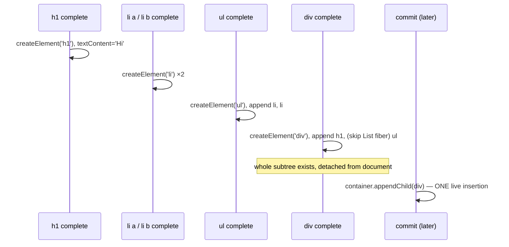

# completeWork：构建真实 DOM 节点

> [!summary] 核心速览（TL;DR）
> `completeWork` 在工作循环沿 Fiber 树**自底向上回溯**（the way *up*）时执行——只有当某个 Fiber 的所有子节点全部处理完毕后，才会轮到它。对于首次挂载（mount）的新宿主 Fiber，它会创建真实的 DOM 节点（`createInstance` → `document.createElement`），将已构建完成的子级 DOM 节点追加挂载到自己名下（`appendAllChildren`），并设置其初始属性（`finalizeInitialChildren` → `setInitialProperties`）。这一步的产物是一棵**完全脱离文档流（detached from document）**的离屏 DOM 子树。在更新（update）时，React 19 **绝不会**在此处进行属性 Diff：它仅仅检查引用 `oldProps !== newProps` 并打上 `Update` 标记（`markUpdate`）。真正的 DOM 属性 Diff 操作被彻底推迟到了 Commit 阶段（`commitUpdate` → `updateProperties`）。最后，每个 Fiber 节点都以 `bubbleProperties` 结尾收官，通过按位或（OR）操作将子级的 `flags`/`lanes` 汇总冒泡到父级的 `subtreeFlags`/`childLanes` 中。

## 调用时机与执行路径

当 `beginWork` 返回 `null`（即当前节点已无子节点）时，`completeUnitOfWork` 便会针对当前 Fiber 调用 `completeWork(current, workInProgress, renderLanes)`，随后转向处理兄弟节点（sibling），或沿 `return` 链向父节点回溯（详见 [[06 The Work Loop - Render Phase|工作循环]]）。[^cuow] 因此，整个遍历顺序是标准的后序遍历（post-order）：**子节点必然先于父节点完成（complete）**。正是这种严格的后序遍历保证，使得 React 能够以「自底向上」的方式层层组装真实 DOM。

从实现上看，`completeWork` 本质上是一个以 `tag` 为分支依据的庞大 `switch` 结构。[^cw] 对于绝大多数非宿主 Fiber（例如函数组件、Fragment、Memo 组件、Context 消费者等），它除了执行 `bubbleProperties` 冒泡副作用以外，几乎什么都不做：

```js
case LazyComponent: case SimpleMemoComponent: case FunctionComponent:
case ForwardRef: case Fragment: case Mode: case Profiler:
case ContextConsumer: case MemoComponent:
  bubbleProperties(workInProgress);
  return null;
```
[^cw-simple]

真正核心且繁重的工作主要集中在 `HostComponent`（宿主 DOM 元素）、`HostText`（宿主文本节点）以及 `HostRoot`（根容器节点）上。虽然 Suspense、Offscreen/Activity 以及 SuspenseList 也有大量复杂的分支逻辑（用于可见性切换、重试机制编排等），但它们并不在常规的首次渲染（first-render）或 `setState` 主干路径上。

## HostComponent 首次挂载流程

```js
case HostComponent: {
  popHostContext(workInProgress);
  const type = workInProgress.type;
  if (current !== null && workInProgress.stateNode != null) {
    updateHostComponent(current, workInProgress, type, newProps, renderLanes);  // 更新分支
  } else {
    const currentHostContext = getHostContext();
    const wasHydrated = popHydrationState(workInProgress);
    if (wasHydrated) {
      prepareToHydrateHostInstance(workInProgress, currentHostContext);
    } else {
      const rootContainerInstance = getRootHostContainer();
      const instance = createInstance(type, newProps, rootContainerInstance,
                                      currentHostContext, workInProgress);
      markCloned(workInProgress);
      appendAllChildren(instance, workInProgress, false, false);
      workInProgress.stateNode = instance;
      if (finalizeInitialChildren(instance, type, newProps, currentHostContext)) {
        markUpdate(workInProgress);
      }
    }
  }
  bubbleProperties(workInProgress);
  // ...
  preloadInstanceAndSuspendIfNeeded(workInProgress, /* ... */);  // 处理 Suspense 相关的图片/样式预加载
  return null;
}
```
[^cw-hc]

在此过程中涉及三个核心的宿主配置（Host Config）方法调用，它们全部由 `react-dom-bindings` 包中的 `ReactFiberConfigDOM.js` 实现（关于 Reconciler 如何通过 Host Config 抹平平台差异，请参见 [[01 Bootstrap - Packages, JSX and the Dispatcher|初始化引导]]）。

### 1. createInstance：创建真实 DOM 与绑定内部指针

```js
// ReactFiberConfigDOM.js（精简版）
export function createInstance(type, props, rootContainerInstance, hostContext, internalInstanceHandle) {
  const ownerDocument = getOwnerDocumentFromRootContainer(rootContainerInstance);
  let domElement;
  switch (hostContext) {
    case HostContextNamespaceSvg:  domElement = ownerDocument.createElementNS(SVG_NAMESPACE, type); break;
    case HostContextNamespaceMath: domElement = ownerDocument.createElementNS(MATH_NAMESPACE, type); break;
    default:
      switch (type) {
        case 'svg':    /* createElementNS */ break;
        case 'script': /* 利用 innerHTML 技巧，确保 script 标签绝不会意外执行 */ break;
        case 'select': /* 在追加子节点前优先设置 multiple/size */ break;
        default:       domElement = ownerDocument.createElement(type); // 或携带 {is: props.is}
      }
  }
  precacheFiberNode(internalInstanceHandle, domElement);
  updateFiberProps(domElement, props);
  return domElement;
}
```
[^ci]

- **宿主上下文（Host Context）**：维护在一个调用栈中，在 `beginWork` 阶段入栈（`pushHostContext`），并在当前 `completeWork` 出栈（`popHostContext`）。这正是嵌套在 `<svg>` 内部的 `<path>` 标签之所以能准确识别命名空间并调用 `createElementNS` 的秘密所在。命名空间必须从祖先节点自顶向下继承，你只有在自顶向下遍历时才能获知这一点——这也是为什么尽管 DOM 元素是在 `completeWork` 阶段才真正创建，但宿主上下文栈必须提早在 `beginWork` 阶段入栈的原因。
- **`<script>` 标签的安全创建**：它是通过在一个一次性临时 `div` 上设置 `innerHTML` 来创建的。通过这种方式生成的脚本元素处于惰性失活状态（inert），不会触发浏览器执行，从而与服务端渲染（SSR）的行为严格保持一致。
- **`precacheFiberNode` 与 `updateFiberProps`**：
  `precacheFiberNode` 会将当前 Fiber 的引用以一个带随机密钥的属性名（`'__reactFiber$' + randomKey`）直接写到真实 DOM 节点上；而 `updateFiberProps` 则会将当前 props 以 `'__reactProps$' + randomKey` 挂载到该节点上。[^keys][^precache][^ufp] 
  React 统一事件系统完全依赖这两个属性：当捕获到 `event.target` 时，React 通过 `__reactFiber$` 瞬间反查到对应的 Fiber 节点，并通过 `__reactProps$` 读取到*最新*的 `onClick` 等事件处理函数（详见 [[13 The Event System|事件系统]]）。这也是为什么在每次更新时，`commitUpdate` 都会再次调用 `updateFiberProps`——哪怕用户仅仅修改了一个内联回调函数，也仅仅是一次极其轻量的 JavaScript 对象属性赋值，完全不需要对真实 DOM 反复进行 `addEventListener`/`removeEventListener` 的繁重注销与重新绑定，因为 React 早已在根容器上完成了全局事件委托。

### 2. appendAllChildren：离屏拼装整棵 DOM 子树

```js
function appendAllChildren(parent, workInProgress, needsVisibilityToggle, isHidden) {
  // supportsMutation 分支（针对 DOM 环境）
  let node = workInProgress.child;
  while (node !== null) {
    if (node.tag === HostComponent || node.tag === HostText) {
      appendInitialChild(parent, node.stateNode);   // 底层调用 parent.appendChild(child)
    } else if (node.tag === HostPortal || node.tag === HostSingleton) {
      // 停止向下遍历：Portal 和 Singleton 会在 Commit 阶段单独定位与插入
    } else if (node.child !== null) {
      node.child.return = node;
      node = node.child;                             // 穿透自定义组件层级，继续向下寻找
      continue;
    }
    if (node === workInProgress) return;
    while (node.sibling === null) {
      if (node.return === null || node.return === workInProgress) return;
      node = node.return;
    }
    node.sibling.return = node.return;
    node = node.sibling;
  }
}
```
[^aac][^aic]

该遍历函数会层层穿透所有的*非宿主* Fiber（例如你编写的自定义业务组件、Fragment 等），但一旦在某一分支上遇到首个宿主 Fiber（`HostComponent` 或 `HostText`），便会立即停止向下深挖。它只需要寻找**最近的一层子代宿主节点**（nearest host descendants）——因为这些子代宿主节点在它们各自的 `completeWork` 阶段早已执行过 `appendAllChildren`，其内部的整棵 DOM 子树早已组装完毕！

因此，以第 06 篇中的组件树为例，其组装流程如下：



为什么 React 选择在脱离文档流的内存环境中「自底向上」构建 DOM？
- **对真实文档仅产生一次性插入操作（One insertion into the live document）**：在脱离文档流的离屏节点上执行 `appendChild`，绝对不会触发浏览器的重排（Reflow/Layout）与重绘（Repaint）。只有在最后的 Commit 阶段，将顶层根容器节点一次性插入真实页面时，才会触发唯一一次真正的浏览器重排重绘。这也正是为什么在首次渲染中，只有最顶层的 App 节点才会携带 `Placement` 标记（详见 [[07 beginWork and Reconciliation|beginWork 与协调]]）。
- **可中断与可随意丢弃（Interruptible and discardable）**：在并发渲染（Concurrent Render）模式下，正在进行的渲染过程随时可能被更高优先级的任务打断，甚至彻底废弃。从未插入文档流的游离 DOM 节点一旦被丢弃，便会像普通 JavaScript 对象一样被垃圾回收器（GC）静默回收，用户在屏幕上绝对看不到任何半成品的残缺 UI。设想如果 React 在 Render 阶段就自顶向下直接操作真实 DOM，那么一旦渲染被切片中断，用户页面上就会尴尬地悬着半截界面。
- **架构设计上的极致简约（Simplicity）**：在后序遍历中，当父节点完成时，其所有的子节点必然已经全部处理完毕，因此在 `completeWork` 中只需一次极简的单趟扫描即可完成拼接。React 源码注释中的 `TODO` 甚至曾提到过将 `createInstance` 挪到 `beginWork` 中并在渲染期自顶向下追加的备选设想（"Top->down is faster in IE11"），但在现代并发架构下，自底向上的离屏组装显然更胜一筹。[^cw-hc]

> [!note] Portal 与 Singleton 节点会被刻意跳过
> Portal（传送门）的子节点从归属上属于另一个完全不同的外部 DOM 容器，而 `HostSingleton`（如 `<html>`、`<head>`、`<body>`）则是直接复用页面中已存在的单例原生节点。这两者都会在 Commit 阶段通过专用逻辑进行独立定位与挂载，因此 `appendAllChildren` 在遍历时会直接跳过它们，绝不会将其作为普通子节点追加进来。

### 3. finalizeInitialChildren → setInitialProperties：初始化属性与提交期副作用

```js
export function finalizeInitialChildren(domElement, type, props, hostContext) {
  setInitialProperties(domElement, type, props);
  switch (type) {
    case 'button': case 'input': case 'select': case 'textarea':
      return !!props.autoFocus;
    case 'img':
      return true;
    default:
      return false;
  }
}
```
[^fic]

`setInitialProperties` 会遍历组件的所有 props，并对每一项调用 `setProp` 进行处理：包括普通 HTML 特性、`style` 内联样式、`className`、字符串类型的 `children`（转为 `textContent` 设置）、以及 `dangerouslySetInnerHTML`。针对特定标签它还内建了特殊通道：
- 对于 `input`、`select`、`textarea`，会走受控组件（controlled value wrappers）专有处理逻辑；
- 对于 `img` 标签，它会严格将 `src`/`srcSet` 放在**最后一步**设置，以确保在浏览器真正触发图片网络资源请求之前，`crossOrigin` 与 `sizes` 等配置项已经生效，并且会为图片单独绑定非委托（non-delegated）的 `load` 和 `error` 原生事件监听器。[^sip]

值得注意的是，属性设置的时机是：**在当前 DOM 节点正式插入真实文档之前**，但在其**所有子节点全部追加挂载完成之后**。以 `<select>` 为例，其子节点（一系列 `<option>` 元素）必须先挂载完毕，后续为其赋予的选中 `value` 属性才能在 DOM 层正确生效，这也正是该顺序设计的一大考量。

`finalizeInitialChildren` 的返回值为布尔型，返回 `true` 意味着「该节点在挂载到文档后，需要在 Commit 阶段执行特定副作用（Commit-time effect）」：这会触发 `markUpdate` 为当前 Fiber 打上 `Update` 标记，进而在 Commit 阶段的 Layout 子阶段中，触发 `commitHostMount` → `commitMount` 执行——例如为携带 `autoFocus` 的表单控件调用原生 `.focus()`，或者针对某些特殊浏览器重新触发 `img.src` 赋值以确保 `onLoad` 能百分之百可靠触发。[^commitmount] 因为获得焦点的 `.focus()` 操作，必须等待真实 DOM 节点完全插入到活体文档树之后才能执行。

## HostText：宿主文本节点处理

```js
case HostText: {
  const newText = newProps;
  if (current && workInProgress.stateNode != null) {
    updateHostText(current, workInProgress, current.memoizedProps, newText);
  } else {
    // （此处省略服务端注水 Hydration 分支）
    markCloned(workInProgress);
    workInProgress.stateNode = createTextInstance(newText, rootContainerInstance,
                                                  currentHostContext, workInProgress);
  }
  bubbleProperties(workInProgress);
  return null;
}
```
[^cw-text]

`createTextInstance` 的底层实现非常直观：调用原生 `document.createTextNode(text)` 创建文本节点，并附带调用 `precacheFiberNode` 建立 Fiber 反向映射。[^cti] 需要指出的是，只有当文本节点**不是**其父节点的唯一子代时，React 才会为其创建独立的文本 Fiber（例如 `<p>Hello {name}</p>` 会拆解生成两个文本 Fiber）。如果某个节点仅仅包含唯一的纯字符串子节点，React 会在 `beginWork` 中命中 `shouldSetTextContent` 快捷路径，直接将其作为父级 DOM 的 `textContent` 写入，根本不会浪费开销为其生成多余的文本 Fiber。而在组件更新时，`updateHostText` 仅仅简单执行 `if (oldText !== newText) markUpdate(wip)`，最终由 Commit 阶段通过 `textNode.nodeValue = newText` 同步完成文本更新。[^uht][^ctu]

## HostRoot：根容器收尾与白屏清空逻辑

当遍历回溯到达根节点 `HostRoot` 时，`completeWork` 会将根上下文（宿主容器、Cache、Transitions 状态等）依次弹出栈。在**客户端首次渲染**（即 `current.child === null` 且并非 SSR Hydration 阶段）的场景下，它会为根节点打上 **`Snapshot`** 标记。该标记会安排在 Commit 阶段的 Before-Mutation（DOM 变更前）子阶段触发 `clearContainer(root.containerInfo)`——这样一来，原本残留在 `<div id="root">` 容器内的任何已有初始 HTML（比如手写的 "Loading..." 占位骨架屏等），都会在 React 插入整棵新 DOM 树前被彻底清空干净。[^cw-root] 具体细节可参阅 [[09 Commit Phase - Mutation, Layout, Passive Effects|Commit 阶段]]。

## 节点更新阶段：只打标记，不跑 Diff

```js
// ReactFiberCompleteWork.js —— updateHostComponent 在 Mutation 模式下的实现分支
function updateHostComponent(current, workInProgress, type, newProps, renderLanes) {
  if (supportsMutation) {
    const oldProps = current.memoizedProps;
    if (oldProps === newProps) {
      // 在 Mutation 模式下，全等比较足以直接跳过（Bailout），
      // 因为即便它的子节点发生了变化，当前 DOM 节点本身也无需任何修改。
      return;
    }
    markUpdate(workInProgress);       // workInProgress.flags |= Update
  } else if (supportsPersistence) {
    // 拷贝并克隆实例（React Native Fabric 渲染引擎架构分支）
  }
}
```
[^uhc][^mu]

这短短几行代码，就是 Render 阶段针对 DOM 元素更新的**全部处理逻辑**！仅仅是一次简单的对象全等判断（`oldProps === newProps`），若不相等就打上一个 `Update` 标志位。

> [!info] 相比 React 18 的重大架构变革
> 在 React 18 及更早版本中，该函数会调用宿主配置的 `prepareUpdate()` 方法，在 Render 阶段提前执行 `diffProperties` 计算出差异，并将一个被称为 *Update Payload* 的扁平键值对数组（形如 `[key, value, key, value]`）暂存到 `workInProgress.updateQueue` 中，随后交由 Commit 阶段消费。
> 
> 然而，PR #26583（"Diff properties in the commit phase instead of generating an update payload"）彻底废除了这套机制。[^pr] 在 React 19.3.1 中，无论协调器核心还是 DOM 宿主配置中，都已彻底找不到 `prepareUpdate` 的踪影！**属性的 Diff 比对与真正的 DOM 属性写入，被统一合并到了 Commit 阶段的一次单趟遍历中完成**。
> 
> 根据 PR 的设计考量，这样可以彻底避免在并发 Render 阶段分配大量短暂存活的 Payload 中间对象，从而降低内存开销并提升整体吞吐量。这一设计权衡的代价是：如果某个元素的 props 对象引用发生了改变，但内部各项属性值实质完全相同，依然会在 Commit 阶段触发一次完整的属性比对循环。

当进入 Commit 阶段后，`commitMutationEffectsOnFiber` 在检测到 `HostComponent` 携带有 `flags & Update` 时，会调用 `commitHostUpdate(finishedWork, newProps, oldProps)`，进而转入 DOM 配置层的 `commitUpdate`：[^mut-hc][^chu]

```js
export function commitUpdate(domElement, type, oldProps, newProps, internalInstanceHandle) {
  // 比对属性差异并直接写回 DOM 节点
  updateProperties(domElement, type, oldProps, newProps);
  // 更新 DOM 节点上的 props 指针，以确保事件系统能够访问到最新的事件回调
  updateFiberProps(domElement, newProps);
}
```
[^cu]

`updateProperties` 正是真正的 Diff 逻辑所在。对于常见标签（如 `div`、`span`、`p`、`a`、`li`、`svg` 等），它直接进入两个通用的遍历循环：
1. **第一个循环（删除与重置）**：遍历 `lastProps`，找出在 `nextProps` 中已被移除的属性，并将其从 DOM 上删除或重置为默认值；
2. **第二个循环（新增与变更）**：遍历 `nextProps`，找出所有 `nextProp !== lastProp` 的项，并将其最新值写回 DOM。

而对于 `input`、`select`、`textarea`、`option`、`img` 以及 Web Components 自定义元素等，则具有专属的定制逻辑（例如表单受控属性的设置必须严格排在其他常规 HTML 属性之后）。[^up]

> [!warning] 核心陷阱：「标记为 Update」绝不等于「真实 DOM 发生了改动」
> 父组件的重新渲染往往会以全新的对象字面量重新创建 `<div className="row">` 的 props，这会导致对应的 `<div>` Fiber 被打上 `Update` 标志位，并在 Commit 阶段触发 `updateProperties`。虽然随后的双重循环会发现每个属性值都 `===` 全等而**不会产生任何真实 DOM 写入**，但你依然付出了遍历比对的 CPU 运算代价。
> 
> 此外，内联写法如 `style={{...}}` 每次渲染都会生成新的对象引用，因此在 props 层级上 `style` 永远被视为「已改变」（底层会触发 `setProp` → `setValueForStyles` 去逐一 Diff 具体样式属性）。需要特别谨记：React DevTools 中的「Highlight updates（高亮更新）」功能展示的仅仅是 **Render 渲染组件**，并不等同于产生了真实 DOM 写入，更绝不等于浏览器发起了重排重绘（Repaint）。

## bubbleProperties：副作用标记（subtreeFlags）与赛道（childLanes）的层层冒泡

无论是哪种分支，`completeWork` 的最后都会统一汇入 `bubbleProperties(completedWork)` 进行收官：

```js
function bubbleProperties(completedWork) {
  const didBailout =
    completedWork.alternate !== null &&
    completedWork.alternate.child === completedWork.child;
  let newChildLanes = NoLanes;
  let subtreeFlags = NoFlags;
  if (!didBailout) {
    let child = completedWork.child;
    while (child !== null) {
      newChildLanes = mergeLanes(newChildLanes, mergeLanes(child.lanes, child.childLanes));
      subtreeFlags |= child.subtreeFlags;
      subtreeFlags |= child.flags;
      child.return = completedWork;
      child = child.sibling;
    }
  } else {
    // 子节点直接复用自 current 树（命中 Bailout 跳过）：仅冒泡 StaticMask 范围内的静态标记
    // ... 结构相同的循环，但带有 `& StaticMask` 掩码过滤 ...
  }
  completedWork.subtreeFlags |= subtreeFlags;
  completedWork.childLanes = newChildLanes;
  return didBailout;
}
```
[^bubble]

在自底向上的回溯路径中，该函数负责聚合计算出两大关键指标：

- **`subtreeFlags`**：当前 Fiber 之下**所有后代节点**副作用标记的并集（按位或运算）。在 Commit 阶段，React 在向下遍历前会先检查 `parentFiber.subtreeFlags & MutationMask`（或 `LayoutMask`、`PassiveMask`）；如果当前子树完全没有对应的副作用标记，就可以在 $O(1)$ 复杂度内直接整棵跳过，彻底避免无效递归。[^rtme] 这一机制彻底取代了 React 17 时代基于单向链表的「Effect List（副作用链表）」。React 不再需要在 complete 阶段层层穿针引线拼接链表，而是为每个 Fiber 节点保存一个掩码（Bitmask），在 Commit 阶段通过掩码进行剪枝遍历。这种架构不仅实现更简洁，而且能与 Suspense 和 Offscreen 的重复遍历机制完美契合。
- **`childLanes`**：当前节点下方所有未完成的挂起更新赛道（Pending Lanes）的并集。在一次渲染结束后，这里记录着**遗留下来未处理的工作**（例如被跳过的低优先级更新）。`commitRoot` 会通过读取 `finishedWork.lanes | finishedWork.childLanes` 来确认根节点是否还残存剩余工作，以便安排后续调度。[^commitroot]

其中 **Bailout 跳过分支**的处理尤为精妙。当 `completedWork.child` 依然直接指向 *current* 树中的旧子节点时（说明整棵子树在 `beginWork` 中已命中 Bailout），这些子节点身上的 `flags` 属于上一次提交的陈旧标记，绝对不能在本轮提交中被重复执行，因此此时只会冒泡 `StaticMask` 范围内的静态标记。所谓静态标记（例如「该子树包含 Passive 被动副作用」、「挂载了 ref」等），描述的是 Fiber 整个生命周期内固有的长期特性，而非单次渲染触发的临时副作用——当 Offscreen 组件隐藏或重新唤醒展示某棵树时，正需要依赖这些静态标记来重新连线。

## 首次渲染 vs 更新阶段：核心行为对照表

| 维度 / 节点类型 | 首次渲染（First render） | 更新阶段（Update） |
|---|---|---|
| **HostComponent** | `createInstance` + `appendAllChildren` + `setInitialProperties`。仅在存在 `autoFocus` 或 `img` 时打上 `Update` 标记 | `oldProps !== newProps` → 打上 `Update` 标记 |
| **HostText** | `createTextNode` 创建文本节点 | `oldText !== newText` → 打上 `Update` 标记 |
| **HostRoot** | 打上 `Snapshot` 标记 → Commit 阶段清空容器已有内容 | 无特殊操作 |
| **Placement 标记** | 仅挂载在 HostRoot 的直接子节点上（参见第 07 篇） | 标记在所有新插入或产生位移的 Fiber 节点上 |
| **Render 阶段的 DOM 写入** | **仅发生在脱离文档流的离屏游离节点上** | **完全为零**（所有写入操作全部推迟至 Commit 阶段） |

## 在 React Compiler 体系下的表现

在引入 React Compiler（React 编译器）后，`completeWork` 本身的内部实现**完全未作任何改变**。编译器仅仅改写你的业务组件代码。然而，它通过改变传递给底层运行时的入参，在两个层面上对本阶段产生了深远影响：

1. **子树整棵 Bailout 跳过**：当组件因编译器返回了缓存的 React Element 而在 `beginWork` 中成功跳过时，整棵子树中的宿主节点根本不会带着新的 props 对象进入 `updateHostComponent`。这些宿主 Fiber 在 `bubbleProperties` 中会直接走 `didBailout` 快速通道，因此既不会被打上 `Update` 标志位，也彻底消除了 Commit 阶段的 `updateProperties` 比对开销。
2. **细粒度 JSX 元素缓存**：即便在*确实发生*重渲染的组件内部，编译器也会基于响应式作用域（Reactive Scopes）的细粒度缓存 JSX 节点。例如一个没有任何动态依赖的静态 `<div className="row">`，在初次创建后其对象引用会被长期复用。当该宿主 Fiber 接受比对时，直接命中 `oldProps === newProps`，从而完全跳过 `markUpdate`。如果不使用编译器，这同一个 `div` 在父组件每次重新渲染时都会生成全新的 props 引用，从而被动触发一轮无效的空跑 Diff。

因此，React Compiler 既大幅削减了 Render 阶段的工作负担，又显著减轻了 Commit 阶段属性 Diff 的计算压力。详细对比请参阅 [[15 Rendering With vs Without the Compiler|有无编译器渲染机制对比]]。

## 总结

`completeWork` 构成了整个 Render 阶段后半程的「自底向上回溯之旅」：它遵循严格的后序遍历，只有当某个节点的所有子代 Fiber 全部执行完毕后才会触发，这为 React 在离屏内存中自底向上拼装真实 DOM 提供了坚实基础。对于新挂载的宿主 Fiber，它负责创建真实 DOM 实例、挂载其最近的子代宿主节点并初始化全部属性，最终形成一棵完全脱离文档流的完整离屏 DOM 子树——在随后的 Commit 阶段仅需一次真实的 `appendChild` 即可全量上屏；若渲染被中途抛弃，则作为普通对象直接被垃圾回收。

在更新阶段，React 19 彻底移除了 Render 阶段的属性比对逻辑，仅仅通过 `oldProps !== newProps` 的引用判断打上 `Update` 标记，将所有繁重的 Diff 与写入工作全权移交给 Commit 阶段集中处理。最后，每个 Fiber 节点都会通过 `bubbleProperties` 将子节点的 flags 与 lanes 汇聚冒泡到 `subtreeFlags` 与 `childLanes` 中，这也正是 [[09 Commit Phase - Mutation, Layout, Passive Effects|Commit 阶段]] 能够以 $O(1)$ 复杂度实现整树智能跳过剪枝的核心底气所在。

### 核心知识点速记清单

- **`createInstance`**：依据宿主上下文栈（处理 SVG/MathML 等命名空间）创建真实 DOM 节点，并在节点上挂载 Fiber 与最新 props 的反向引用，作为统一事件系统的寻址基石。
- **`appendAllChildren`**：自顶向下穿透非宿主组件层级，精准定位并挂载最近的一层子代宿主 DOM 节点，遇到 Portal 与 Singleton 时主动跳过，在离屏内存中完成整树组装。
- **`finalizeInitialChildren`**：在子节点挂载完毕后统一初始化各项 DOM 属性；若遇到 `autoFocus` 或 `img` 等特殊元素则返回 `true`，以在 Commit 的 Layout 子阶段触发专有的 `commitMount` 副作用。
- **`HostRoot` 与 `Snapshot`**：在客户端首次渲染时为根容器打上 `Snapshot` 标记，确保在 DOM 突变前调用 `clearContainer` 清理占位 HTML 节点。
- **`markUpdate` 极简更新标记**：自 PR #26583 彻底废除 `prepareUpdate` 之后，Render 阶段针对 DOM 元素的更新逻辑精简为仅包含一次引用比较与打标。
- **`commitUpdate` → `updateProperties`**：属性 Diff 比对与真实 DOM 写入被合并至 Commit 阶段的一次单趟遍历中完成，因此「被标记为 Update」绝不代表真实 DOM 发生了实际改动。
- **`bubbleProperties` 副作用冒泡**：彻底取代了旧时代的单向 Effect List 链表，构建基于节点的 `subtreeFlags` 位掩码树；当命中 Bailout 跳过时，仅安全冒泡 `StaticMask` 范围内的长期静态标记。

← [[07 beginWork and Reconciliation|beginWork 与协调]] · [[00 React Internals Index|目录索引]] · [[09 Commit Phase - Mutation, Layout, Passive Effects|Commit 阶段]] →

[^cuow]: `completeUnitOfWork` —— [packages/react-reconciler/src/ReactFiberWorkLoop.js#L3368-L3431](https://github.com/facebook/react/blob/v19.3.1/packages/react-reconciler/src/ReactFiberWorkLoop.js#L3368-L3431)
[^cw]: `completeWork` —— [packages/react-reconciler/src/ReactFiberCompleteWork.js#L1082-L2112](https://github.com/facebook/react/blob/v19.3.1/packages/react-reconciler/src/ReactFiberCompleteWork.js#L1082-L2112)
[^cw-simple]: `completeWork` 常规简单分支 —— [packages/react-reconciler/src/ReactFiberCompleteWork.js#L1100-L1110](https://github.com/facebook/react/blob/v19.3.1/packages/react-reconciler/src/ReactFiberCompleteWork.js#L1100-L1110)
[^cw-hc]: `completeWork` HostComponent 分支 —— [packages/react-reconciler/src/ReactFiberCompleteWork.js#L1374-L1473](https://github.com/facebook/react/blob/v19.3.1/packages/react-reconciler/src/ReactFiberCompleteWork.js#L1374-L1473)
[^ci]: `createInstance` —— [packages/react-dom-bindings/src/client/ReactFiberConfigDOM.js#L534-L664](https://github.com/facebook/react/blob/v19.3.1/packages/react-dom-bindings/src/client/ReactFiberConfigDOM.js#L534-L664)
[^keys]: 内部注入 Key —— [packages/react-dom-bindings/src/client/ReactDOMComponentTree.js#L44-L45](https://github.com/facebook/react/blob/v19.3.1/packages/react-dom-bindings/src/client/ReactDOMComponentTree.js#L44-L45)
[^precache]: `precacheFiberNode` —— [packages/react-dom-bindings/src/client/ReactDOMComponentTree.js#L94-L111](https://github.com/facebook/react/blob/v19.3.1/packages/react-dom-bindings/src/client/ReactDOMComponentTree.js#L94-L111)
[^ufp]: `updateFiberProps` —— [packages/react-dom-bindings/src/client/ReactDOMComponentTree.js#L295-L301](https://github.com/facebook/react/blob/v19.3.1/packages/react-dom-bindings/src/client/ReactDOMComponentTree.js#L295-L301)
[^aac]: `appendAllChildren` —— [packages/react-reconciler/src/ReactFiberCompleteWork.js#L245-L352](https://github.com/facebook/react/blob/v19.3.1/packages/react-reconciler/src/ReactFiberCompleteWork.js#L245-L352)
[^aic]: `appendInitialChild` —— [packages/react-dom-bindings/src/client/ReactFiberConfigDOM.js#L695-L701](https://github.com/facebook/react/blob/v19.3.1/packages/react-dom-bindings/src/client/ReactFiberConfigDOM.js#L695-L701)
[^fic]: `finalizeInitialChildren` —— [packages/react-dom-bindings/src/client/ReactFiberConfigDOM.js#L703-L721](https://github.com/facebook/react/blob/v19.3.1/packages/react-dom-bindings/src/client/ReactFiberConfigDOM.js#L703-L721)
[^sip]: `setInitialProperties`（img 标签设置顺序见 L1134-L1140）—— [packages/react-dom-bindings/src/client/ReactDOMComponent.js#L1111-L1496](https://github.com/facebook/react/blob/v19.3.1/packages/react-dom-bindings/src/client/ReactDOMComponent.js#L1111-L1496)
[^commitmount]: `commitMount` —— [packages/react-dom-bindings/src/client/ReactFiberConfigDOM.js#L891-L954](https://github.com/facebook/react/blob/v19.3.1/packages/react-dom-bindings/src/client/ReactFiberConfigDOM.js#L891-L954)
[^cw-text]: `completeWork` HostText 分支 —— [packages/react-reconciler/src/ReactFiberCompleteWork.js#L1474-L1508](https://github.com/facebook/react/blob/v19.3.1/packages/react-reconciler/src/ReactFiberCompleteWork.js#L1474-L1508)
[^cti]: `createTextInstance` —— [packages/react-dom-bindings/src/client/ReactFiberConfigDOM.js#L757-L779](https://github.com/facebook/react/blob/v19.3.1/packages/react-dom-bindings/src/client/ReactFiberConfigDOM.js#L757-L779)
[^uht]: `updateHostText`（complete 阶段）—— [packages/react-reconciler/src/ReactFiberCompleteWork.js#L674-L703](https://github.com/facebook/react/blob/v19.3.1/packages/react-reconciler/src/ReactFiberCompleteWork.js#L674-L703)
[^ctu]: `commitTextUpdate` —— [packages/react-dom-bindings/src/client/ReactFiberConfigDOM.js#L1018-L1024](https://github.com/facebook/react/blob/v19.3.1/packages/react-dom-bindings/src/client/ReactFiberConfigDOM.js#L1018-L1024)
[^cw-root]: `completeWork` HostRoot 分支（`Snapshot` 标记见 L1178）—— [packages/react-reconciler/src/ReactFiberCompleteWork.js#L1119-L1199](https://github.com/facebook/react/blob/v19.3.1/packages/react-reconciler/src/ReactFiberCompleteWork.js#L1119-L1199)
[^uhc]: `updateHostComponent`（complete 阶段）—— [packages/react-reconciler/src/ReactFiberCompleteWork.js#L463-L550](https://github.com/facebook/react/blob/v19.3.1/packages/react-reconciler/src/ReactFiberCompleteWork.js#L463-L550)
[^mu]: `markUpdate` —— [packages/react-reconciler/src/ReactFiberCompleteWork.js#L201-L203](https://github.com/facebook/react/blob/v19.3.1/packages/react-reconciler/src/ReactFiberCompleteWork.js#L201-L203)
[^pr]: facebook/react PR #26583 "Diff properties in the commit phase instead of generating an update payload" —— https://github.com/facebook/react/pull/26583
[^mut-hc]: Mutation 阶段 HostComponent `Update` 处理 —— [packages/react-reconciler/src/ReactFiberCommitWork.js#L2302-L2314](https://github.com/facebook/react/blob/v19.3.1/packages/react-reconciler/src/ReactFiberCommitWork.js#L2302-L2314)
[^chu]: `commitHostUpdate` —— [packages/react-reconciler/src/ReactFiberCommitHostEffects.js#L114-L143](https://github.com/facebook/react/blob/v19.3.1/packages/react-reconciler/src/ReactFiberCommitHostEffects.js#L114-L143)
[^cu]: `commitUpdate` —— [packages/react-dom-bindings/src/client/ReactFiberConfigDOM.js#L999-L1012](https://github.com/facebook/react/blob/v19.3.1/packages/react-dom-bindings/src/client/ReactFiberConfigDOM.js#L999-L1012)
[^up]: `updateProperties`（快捷处理标签见 L1528-L1539，通用 Diff 循环见 L2002-L2022）—— [packages/react-dom-bindings/src/client/ReactDOMComponent.js#L1518-L2023](https://github.com/facebook/react/blob/v19.3.1/packages/react-dom-bindings/src/client/ReactDOMComponent.js#L1518-L2023)
[^bubble]: `bubbleProperties` —— [packages/react-reconciler/src/ReactFiberCompleteWork.js#L793-L914](https://github.com/facebook/react/blob/v19.3.1/packages/react-reconciler/src/ReactFiberCompleteWork.js#L793-L914)
[^rtme]: `recursivelyTraverseMutationEffects` subtreeFlags 校验逻辑 —— [packages/react-reconciler/src/ReactFiberCommitWork.js#L2046-L2068](https://github.com/facebook/react/blob/v19.3.1/packages/react-reconciler/src/ReactFiberCommitWork.js#L2046-L2068)
[^commitroot]: `commitRoot` 计算剩余 Lanes —— [packages/react-reconciler/src/ReactFiberWorkLoop.js#L3736-L3766](https://github.com/facebook/react/blob/v19.3.1/packages/react-reconciler/src/ReactFiberWorkLoop.js#L3736-L3766)
