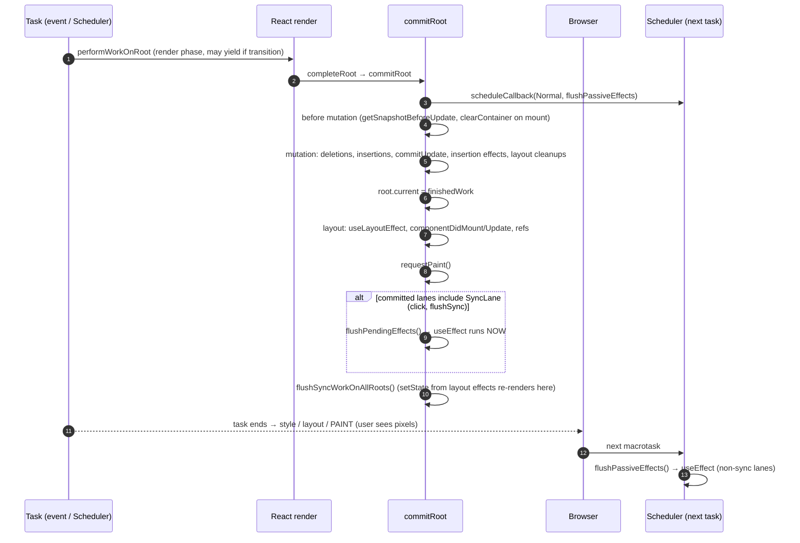

# Commit 阶段：Mutation、Layout 与被动副作用

> [!summary] 核心速览（TL;DR）
> 从 `completeRoot` 到 `commitRoot`，React 会**以不可中断的同步方式（不向浏览器出让主线程）**，将已构建完毕的工作单元树（work-in-progress tree）按固定的子阶段依次应用到真实 DOM 上。
> - **Before mutation（DOM 突变前）**：读取 DOM 当前快照状态（类组件的 `getSnapshotBeforeUpdate`、焦点与选区范围），并在首次渲染时清理容器残留内容；
> - **Mutation（DOM 突变阶段）**：集中执行 DOM 节点的删除、插入（`commitPlacement`）与属性更新（`commitUpdate`），并执行上一轮 Layout 副作用的**清理函数（cleanups）**；
> - **双缓存指针切换**：执行 **`root.current = finishedWork`**，使新树正式成为当前树；
> - **Layout（布局阶段）**：同步执行 `useLayoutEffect` 回调、`componentDidMount` / `componentDidUpdate`，并挂载与更新 ref 引用；
> - **Passive（被动副作用阶段）**：`useEffect` 通常作为独立的调度任务（Scheduler task）在宏任务中异步排队执行；但若由同步离散交互（如点击事件）触发，则会在当前 Commit 阶段结束前被同步清空执行（flush）。
> 
> 浏览器只有在当前整个 JavaScript 任务彻底结束之后才会执行重排重绘（Paint）。因此，Layout 阶段必定在用户肉眼看到像素**之前**执行完毕，而 Passive 被动副作用绝大多数情况下都在像素呈现**之后**运行。

## 从渲染阶段跨入提交阶段（From Render to Commit）

当 Render 工作循环结束时（详见 [[06 The Work Loop - Render Phase|06 · 工作循环]]），调用链路沿着 `performWorkOnRoot` → `finishConcurrentRender` → `completeRootWhenReady` → **`completeRoot`** → **`commitRoot`** 推进。在较旧的技术文章中，这一入口常被称为 `commitRootImpl`。而在 React 19.3.1 中，职责被清晰拆分为两部分：`completeRoot` 负责准备工作，而 `commitRoot` 负责驱动具体子阶段的运转；每个阶段都由一个专属的 `flushXxx` 函数负责，并由一个精简的状态机来调度推进。[^cr][^commit]

`completeRoot` 的入口逻辑如下：

```js
do {
  flushPendingEffects();
} while (pendingEffectsStatus !== NO_PENDING_EFFECTS);
```
[^cr]

这意味着，在正式提交新树之前，React **必须先强制清空上一轮提交中尚未执行的任何被动副作用（passive effects）**。核心铁律是：**提交 N 的副作用，必定在提交 N+1 的 DOM 突变发生之前执行完毕**。随后，React 会将 `pendingFinishedWork`、`pendingEffectsRoot`、`pendingEffectsLanes` 等关键上下文存入模块级全局状态，供各阶段函数后续读取。[^pending]

阶段状态机定义如下：[^status]

```js
const NO_PENDING_EFFECTS = 0;
const PENDING_MUTATION_PHASE = 1;
const PENDING_LAYOUT_PHASE = 2;
const PENDING_AFTER_MUTATION_PHASE = 3;
const PENDING_SPAWNED_WORK = 4;
const PENDING_PASSIVE_PHASE = 5;
const PENDING_GESTURE_MUTATION_PHASE = 6;
const PENDING_GESTURE_ANIMATION_PHASE = 7;
```

之所以引入显式的状态机，而不是写成一个线性单调执行的函数，核心原因在于 **视图过渡（View Transitions）**：Mutation 和 Layout 阶段可能需要被包裹在 `document.startViewTransition()` 的回调中执行——这意味着它们必须能被**推迟（asynchronously / later）**触发；与此同时，任何需要“立即冲刷”（如 `flushSync` 或紧急新渲染插队）的场景，都可以随时调用 `flushPendingEffects()`，无论状态机当前停在哪个步骤，都能驱动它一口气推进到底。[^fpe]

## commitRoot 核心逻辑

```js
// ReactFiberWorkLoop.js (简化版)
function commitRoot(root, finishedWork, lanes, /* ... */) {
  let remainingLanes = mergeLanes(finishedWork.lanes, finishedWork.childLanes);
  remainingLanes = mergeLanes(remainingLanes, getConcurrentlyUpdatedLanes());
  markRootFinished(root, lanes, remainingLanes, /* ... */);

  // 尽早调度被动副作用（Schedule passive effects as EARLY as possible）
  if ((finishedWork.subtreeFlags & PassiveMask) !== NoFlags ||
      (finishedWork.flags & PassiveMask) !== NoFlags) {
    root.callbackNode = null;
    root.callbackPriority = NoLane;
    scheduleCallback(NormalSchedulerPriority, () => {
      flushPassiveEffects();
      return null;
    });
  }

  if (/* 子树包含 BeforeMutation | Mutation 标记 */) {
    // 携带 DiscreteEventPriority 优先级，executionContext |= CommitContext
    commitBeforeMutationEffects(root, finishedWork, lanes);
  }

  pendingEffectsStatus = PENDING_MUTATION_PHASE;
  if (enableViewTransition && shouldStartViewTransition) {
    pendingViewTransition = startViewTransition(
      suspendedState, root.containerInfo, pendingTransitionTypes,
      flushMutationEffects, flushLayoutEffects, flushAfterMutationEffects,
      flushSpawnedWork, flushPassiveEffects, /* ... */);
  } else {
    flushMutationEffects();
    flushLayoutEffects();
    flushSpawnedWork();
  }
}
```
[^commit]

值得关注的关键细节：

- `markRootFinished` 会从 `root.pendingLanes` 中清除本次已提交的赛道（lanes）。而那些残留在 `finishedWork.childLanes` 中的赛道（即在本次渲染中因优先级不足而被跳过的更新）依然保持挂起（pending）状态。
- **Passive 副作用调度任务在任何 DOM 突变发生之前就已经派发**。源码注释指明这与 PR #16714 相关：将其尽早推入调度队列，能确保它排在本次提交过程本身所调度的任何异步任务之前。[^passive-sched]
- 整个提交过程中的每个子阶段均在 `setCurrentUpdatePriority(DiscreteEventPriority)` 和 `ReactSharedInternals.T = null` 环境下运行。因此，即使引发本次渲染的是一个 Transition 过渡更新，在 Layout 副作用中调用的 `setState` 也会被视为**同步更新（Sync Update）**，绝不会被当作过渡更新处理。

## 1. Before Mutation 阶段（DOM 突变前）

```js
export function commitBeforeMutationEffects(root, firstChild, committedLanes) {
  focusedInstanceHandle = prepareForCommit(root.containerInfo);
  // ...
  nextEffect = firstChild;
  commitBeforeMutationEffects_begin(isViewTransitionEligible);
  focusedInstanceHandle = null;
}
```
[^bme]

- **`prepareForCommit`**（DOM 环境）：调用 `getSelectionInformation()` 暂存当前的聚焦元素与文本选区范围，并**暂时禁用 React 事件系统**（`ReactBrowserEventEmitterSetEnabled(false)`）。这样做的目的是防止 DOM 变动触发同步原生事件（例如删除当前处于聚焦状态的节点时触发 `blur`）时在中途重入 React。直到 Mutation 阶段结束时，`resetAfterCommit` 才会恢复选区与焦点，并重新启用事件系统。[^pfc]
- 针对单个 Fiber 节点的处理（`commitBeforeMutationEffectsOnFiber`）：[^bmeof]
  - 带有 `Snapshot` 标记的 `ClassComponent` → 触发 `getSnapshotBeforeUpdate` 生命周期。这是读取**旧 DOM 真实几何状态**（例如列表高度增长前滚动条的具体偏移量）的最后时机。
  - 带有 `Snapshot` 标记的 `HostRoot` → 执行 **`clearContainer(root.containerInfo)`**。在首次客户端渲染中，`completeWork` 会为此根节点打上该标记（详见 [[08 completeWork - Building DOM Nodes|08 · completeWork]]），从而清空容器内的任何静态占位文本或旧节点（`container.textContent = ''`）。[^clear]
  - `ViewTransitionComponent` → 对即将启动的视图过渡拍摄旧状态的快照与尺寸测量。
  - 在过去未开启 `enableEffectEventMutationPhase` 特性开关时，`useEffectEvent` 的具体实现函数会在此处完成指针替换。而在 React 19.3.1 中，该开关已被**默认开启**，因此该替换操作被顺延到了 Mutation 阶段开始时进行。[^ee-flag]

## 2. Mutation 阶段（DOM 增删改）

```js
function flushMutationEffects() {
  if (pendingEffectsStatus !== PENDING_MUTATION_PHASE) return;
  pendingEffectsStatus = NO_PENDING_EFFECTS;
  // ...
  if (subtreeMutationHasEffects || rootMutationHasEffect) {
    // DiscreteEventPriority, CommitContext ...
    commitMutationEffects(root, finishedWork, lanes);
    resetAfterCommit(root.containerInfo);
  }
  // 工作中的树（work-in-progress）正式成为当前树（current tree）。
  // 这行赋值必须放在 Mutation 阶段之后，以保证 componentWillUnmount 期间
  // 旧树仍然是 current；同时必须放在 Layout 阶段之前，
  // 以保证 componentDidMount/Update 期间新树已成为 current。
  root.current = finishedWork;
  pendingEffectsStatus = PENDING_LAYOUT_PHASE;
}
```
[^fme]

### 遍历机制

`commitMutationEffectsOnFiber` 是一个递归遍历函数。针对每个 Fiber 节点，它会首先调用 `recursivelyTraverseMutationEffects`：该函数先处理该父节点下所记录的**子节点删除（deletions）**操作；接着，*只有当*检测到 `subtreeFlags & (MutationMask | Cloned)` 时，才会继续递归深入子树；随后调用 `commitReconciliationEffects` 处理当前节点的**插入与移动（Placement）**；最后应用当前 Fiber 自身的 `Update` 属性更新逻辑。[^rtme][^mutof]

因此，在同一个父节点内部的处理顺序是：**删除旧子节点 → 递归子节点副作用 → 当前节点挂载/插入 → 当前节点属性更新**。

### 节点删除（Deletions）

`commitDeletionEffects(root, returnFiber, deletedFiber)` 会首先寻找到距离最近的宿主父节点，然后遍历整棵待删除的子树：[^cde][^cdeof]

- `FunctionComponent`：立即执行其 **insertion-effect** 与 **layout-effect** 的销毁函数（即 `useInsertionEffect` 与 `useLayoutEffect` 的 cleanup 函数）。
- `ClassComponent`：解绑 ref 引用，同步调用 `componentWillUnmount` 生命周期钩子。
- `HostComponent`：调用 `safelyDetachRef`（以 `null` 执行 ref 回调，或执行 React 19 新引入的 ref 清理函数）。随后递归子树时将 `hostParent` 置为 `null`，因此**后代 DOM 节点不会被逐个从父容器中移除**。只有子树中最顶层的宿主 DOM 节点会执行一次 `removeChild`。这恰好是 `appendAllChildren` 的镜像对称设计：整棵子树挂载时只需一次 DOM 插入，销毁时同样只需一次 DOM 移除。
- **请注意**：被删除子树中 `useEffect` 的清理函数**并不会在此处执行**，它们会被延迟到后续的 Passive 阶段统一运行（`commitPassiveUnmountEffectsInsideOfDeletedTree_*`）。[^passive-unmount]

### 节点挂载与插入：commitPlacement → insertOrAppendPlacementNode

```js
function commitPlacement(finishedWork) {
  // 1. 寻找最近的宿主父节点（HostComponent / HostRoot / HostPortal / HostSingleton）
  let parentFiber = finishedWork.return;
  while (parentFiber !== null) {
    if (isHostParent(parentFiber)) { hostParentFiber = parentFiber; break; }
    parentFiber = parentFiber.return;
  }
  switch (hostParentFiber.tag) {
    case HostComponent: {
      const parent = hostParentFiber.stateNode;
      if (hostParentFiber.flags & ContentReset) { resetTextContent(parent); /* ... */ }
      const before = getHostSibling(finishedWork);
      insertOrAppendPlacementNode(finishedWork, before, parent, /* ... */);
      break;
    }
    case HostRoot:
    case HostPortal: {
      const parent = hostParentFiber.stateNode.containerInfo;
      const before = getHostSibling(finishedWork);
      insertOrAppendPlacementNodeIntoContainer(finishedWork, before, parent, /* ... */);
      break;
    }
  }
}
```
[^cp]

- **`getHostSibling`**：负责寻找调用原生 `insertBefore` 时的定位参照节点。它会沿着当前节点的兄弟链向后遍历（若遇到组件节点则深入其内部），寻找第一个**自身并未被打上 Placement 标记**的宿主 DOM 节点。若找不到，则返回 `null`，节点将被直接追加（append）到父节点末尾。[^ghs] 这种遍历搜索是 React 不在内存中维护独立 DOM 平行列表的代价值，也是海量带有 key 的节点发生乱序重新排列时计算开销远超表面直觉的核心原因。
- **`insertOrAppendPlacementNode(IntoContainer)`**：若待插入的 Fiber 本身就是宿主节点（`HostComponent`），直接针对其 `stateNode` 执行 `insertBefore` 或 `appendChild`；若它是一个自定义组件，则递归向下遍历其子节点，逐一找出每个最浅层的宿主后代节点并执行插入。[^ioapn]

**具象还原：首次渲染时的真实挂载过程**。在组件树首次挂载时，唯一被打上 `Placement` 标记的 Fiber 只有顶层的 `App`（详见 [[07 beginWork and Reconciliation|07 · beginWork 与协调]]）。它的宿主父级是 `HostRoot`，因此会执行 `insertOrAppendPlacementNodeIntoContainer(App, null, container)`。由于 `App` 本身不是宿主 DOM 节点，函数递归进入其子级 `<div>`，识别到它是真实的宿主节点，于是触发 `appendChildToContainer(container, div)` → 原生 `container.appendChild(div)`。[^actc] **正是这一次原生 DOM API 调用，让整棵在离屏内存中组装完毕的 UI 瞬间挂载进入 document 文档中！**（此外，`appendChildToContainer` 还会对非根容器兜底设置空的 `onclick` 处理器以修复 iOS Safari 的点击事件冒泡怪癖；而在未来 `enableMoveBefore` 特性开启后，React 还会利用浏览器全新的 `moveBefore` API 来无缝移动节点，不过该开关在 19.3.1 中仍设为 `false`。[^movebefore]）

### 属性更新（Updates）

- 带有 `Update` 标记的 `HostComponent` → `commitHostUpdate(finishedWork, newProps, oldProps)` → 宿主环境的 `commitUpdate` → `updateProperties`（在真实 DOM 上执行属性差量变更，详见 [[08 completeWork - Building DOM Nodes|08 · completeWork]]）+ `updateFiberProps`。[^hc-mut][^cu]
- 带有更新的 `HostText` → 直接执行 `textNode.nodeValue = newText`。
- 带有 `Update` 标记的 `FunctionComponent`：[^fc-mut]
```js
commitHookEffectListUnmount(HookInsertion | HookHasEffect, finishedWork, finishedWork.return);
commitHookEffectListMount(HookInsertion | HookHasEffect, finishedWork);
commitHookLayoutUnmountEffects(finishedWork, finishedWork.return, HookLayout | HookHasEffect);
```
从这段代码可以看出：**`useInsertionEffect` 的销毁（cleanup）与挂载（setup）全部在 Mutation 阶段同步执行**，抢在任何 Layout 副作用之前——这正是 CSS-in-JS 库梦寐以求的时机，确保它们能在任何尺寸测量代码执行前将 `<style>` 样式规则精准注入 DOM 中。

同时，**`useLayoutEffect` 的清理函数（cleanup）也在此处（Mutation 阶段）执行完毕**。而它的挂载函数（setup）则要等到随后的 Layout 阶段才执行。这意味着：**整棵树上所有的清理逻辑必然先于任何新的 setup 执行**，因此任何副作用 A 的挂载逻辑绝对不可能观察到副作用 B 遗留的陈旧状态。

## 为什么 root.current = finishedWork 恰好位于 Mutation 与 Layout 之间？

源码注释对此给出了最直白的技术解释。[^fme]
- 在 **Mutation 阶段**执行的 `componentWillUnmount` 以及各类 Layout 清理函数，在逻辑上应当将**旧树**视作当前的激活树（`current`）；
- 而在 **Layout 阶段**执行的 `componentDidMount` / `componentDidUpdate` 以及各类 Layout 挂载函数，则理应将**新提交的树**视作激活树。

任何在副作用执行过程中读取 `root.current` 的操作——无论是类似 `findDOMNode` 的节点查找、事件目标到 Fiber 节点的反查路由，还是在 Layout 副作用中调用 `setState` 时从当前树推导优先级，都能获得绝对自洽的结果。
一旦这行指针赋值代码执行完毕，原先的旧 `current` 树便退居为 `alternate`，成为下一轮渲染的离屏暂存工作区（详见 [[05 The Fiber Data Structure|05 · Fiber 数据结构]]）。

## 3. Layout 阶段（执行 useLayoutEffect 与 ref 挂载）

```js
function flushLayoutEffects() {
  if (pendingEffectsStatus !== PENDING_LAYOUT_PHASE) return;
  // ...
  if (subtreeHasLayoutEffects || rootHasLayoutEffect) {
    commitLayoutEffects(finishedWork, root, lanes);
  }
  pendingEffectsStatus = PENDING_AFTER_MUTATION_PHASE;
}
```
[^fle]

`commitLayoutEffectOnFiber` 采用**子节点优先（Post-Order 后序遍历）**的递归策略（借助 `subtreeFlags & LayoutMask` 进行子树剪枝），遍历到节点本身时根据类型分发执行：[^cleof][^rtle]

| Fiber 类型 | 携带的标记（Flag） | 触发的操作 |
|---|---|---|
| Function / ForwardRef / SimpleMemo | `Update` | `commitHookLayoutEffects` → 执行 `useLayoutEffect` 的 setup 回调（以及 `useImperativeHandle`） |
| ClassComponent | `Update` / `Callback` / `Ref` | 调用 `componentDidMount` 或 `componentDidUpdate(prevProps, prevState, snapshot)`，执行 `setState` 回调，挂载 ref |
| HostComponent | 首次挂载时的 `Update` | `commitHostMount` → `commitMount`（处理 `autoFocus` 聚焦 `.focus()`，图片 `src` 重新赋值等）[^chm] |
| HostComponent | `Ref` | `safelyAttachRef` → `ref.current = node` 或执行 ref 回调函数，并暂存其返回的清理函数[^ref] |

由于此遍历遵循子节点优先原则，**子组件的 Layout 副作用与 ref 绑定总是在父组件之前执行完毕**。因此，父组件的 `useLayoutEffect` 完全可以安全地依赖子组件的 `childRef.current` 已经完成装配绑定。

此时此刻，DOM 已经彻底完成了结构与属性变更，且已经被真实插入到文档树中，因此调用 `getBoundingClientRect()` 可以获得真实准确的几何尺寸。虽然浏览器为了响应 JS 的尺寸读取不得不**同步计算样式与排版（强制重排/Forced Reflow）**，但此时屏幕**尚未绘制任何像素（Paint）**。

## 4. 派生任务与同步清空被动副作用（Sync Passive Flush）

在（供视图过渡选用的）After-Mutation 阶段结束后，执行 `flushSpawnedWork`：[^fsw]

1. **`requestPaint()`**：告知调度器设置 `needsPaint = true`。这样在下一次执行 `shouldYieldToHost` 检查时便会返回 `true`，促使 Scheduler 放弃连续执行队列中的下一个任务，及时将主线程交还给浏览器排版与绘制。[^rp][^yield]
2. 若存在被动副作用，则将状态机置为 `pendingEffectsStatus = PENDING_PASSIVE_PHASE`。
3. 上报可恢复错误（`onRecoverableError`），并触发 React DevTools 的 commit 钩子。
4. **若本次提交包含 `SyncLane` 同步赛道**（如点击 `click`、键盘 `keydown` 等离散交互事件，或是 `flushSync`），它会**立刻**调用 `flushPendingEffects()`——因此，**在同步提交的末尾，被动副作用会在浏览器绘制屏幕之前同步执行完毕**：[^syncflush]
   ```js
   // 如果被动副作用由离散渲染触发，则在当前任务末尾立即同步清空它们，
   // 以便其执行结果能被立即可见地观察到。
   if (includesSyncLane(pendingEffectsLanes) && (disableLegacyMode || root.tag !== LegacyRoot)) {
     flushPendingEffects();
   }
   ```
5. 针对未完成的赛道调用 `ensureRootIsScheduled(root)` 重新安排调度，并检测嵌套更新死循环（累加 `nestedUpdateCount`，这正是臭名昭著的 "Maximum update depth exceeded" 报错根源）。
6. **`flushSyncWorkOnAllRoots()`**：若某个 Layout 副作用（或是已同步清空的 Passive 副作用）中调用了 `setState`，该更新会被归入同步赛道，并且**在同一个 JavaScript 宏任务中立刻就地执行渲染与提交**！[^fsw] 这正是经典模式“在 `useLayoutEffect` 中读取 DOM 尺寸并立即 `setState`”**绝对不会造成肉眼可见闪烁（flicker）**的底层奥秘：因为第二次渲染同样抢在浏览器屏幕绘制之前全部落盘！

## 5. Passive 阶段（被动副作用调度执行）

对于非同步赛道（如 Default 默认优先级、Transition 过渡等），Passive 副作用会在 `commitRoot` 派发给 Scheduler 的独立调度任务触发时运行，优先级为 `NormalPriority`：

```js
function flushPassiveEffects() {
  if (pendingEffectsStatus !== PENDING_PASSIVE_PHASE) return false;
  const renderPriority = lanesToEventPriority(pendingEffectsLanes);
  const priority = lowerEventPriority(DefaultEventPriority, renderPriority);
  // setCurrentUpdatePriority(priority); T = null
  return flushPassiveEffectsImpl();
}
function flushPassiveEffectsImpl() {
  // ...
  executionContext |= CommitContext;
  commitPassiveUnmountEffects(root.current);   // 先统一执行整棵树所有 useEffect 的清理函数
  commitPassiveMountEffects(root, root.current, lanes, transitions, /* ... */); // 再统一执行所有的挂载函数
  // ...
  flushSyncWorkOnAllRoots();
}
```
[^fpe2][^fpei]

- **整棵树上所有的被动副作用清理函数（cleanups）必定在任何新的挂载函数（setups）之前执行**，其中也涵盖了被删除子树的清理工作。[^passive-unmount]
- 在每一轮遍历中，执行顺序依然是**子节点优先（Post-Order）**，与 Layout 阶段保持一致。
- 在 `useEffect` 内部触发的 `setState` 最高只能获得 `DefaultEventPriority` 优先级，因此会像普通更新一样被批量合并处理（除非所属提交来自离散事件，此时已在步骤 4 中以同步方式提前清空）。

此外，被动副作用还可能被其它调用链路**提前清空（flush early）**：例如下一次 `performWorkOnRootViaSchedulerTask` 或 `performSyncWorkOnRoot` 在开启新一轮渲染之前都会先行调用 `flushPendingEffects`；`completeRoot` 在开启新一轮提交前同样会如此操作（详见 [[06 The Work Loop - Render Phase|06 · 工作循环]]）。React 内部坚守的核心不变式是：**“提交 N 的副作用必定在渲染/提交 N+1 之前执行完毕”**，而**绝非**“副作用必定在绘制之后运行”。

## 用户究竟在何时才能真正肉眼看到屏幕像素？

浏览器只有在当前 JavaScript 任务（包括其微任务队列）彻底执行完毕后，才有机会执行屏幕绘制。从 Mutation 到 Layout 副作用，以及它们内部触发的任何同步重新渲染，整体都处于一个连续的、不可分割的 JavaScript 同步任务块中。因此，全流程时序如下：



| 代码环节 | 相比浏览器绘制（Paint）的运行时机 |
|---|---|
| 组件 render 函数 | **绘制之前**（若被中断则可能直接废弃丢弃） |
| `useInsertionEffect`、Layout 清理函数 | **绘制之前**，在 Mutation 阶段同步执行 |
| `useLayoutEffect`、`componentDidMount`、ref 挂载 | **绘制之前**：DOM 虽已修改完成，但尚未绘制上屏。在此处进行视觉修正是实现“无闪烁渲染”的绝招 |
| 来自**离散交互（discrete）**更新（如点击）的 `useEffect` | **绘制之前**，在本次提交的末尾被同步清空执行 |
| 来自默认/过渡更新（包括首次 `root.render`）的 `useEffect` | **通常在绘制之后**，由 Scheduler 放入后续的独立任务中调度执行 |

这与 React 官方文档（react.dev）的表述完全严丝合缝：“如果你的 Effect 不是由直接交互（如点击）引起的，React 通常会让浏览器先绘制更新后的屏幕，然后再运行你的 Effect”；以及“如果你的 Effect 是由交互（如点击）引起的，React 可能会在浏览器绘制更新后的屏幕之前运行你的 Effect”。[^docs-effect]

> [!warning] 警惕迷信：“useEffect 必定在绘制后运行”只是一种启发式调度策略，绝非绝对保证
> Scheduler 通过 `MessageChannel` 派发宏任务。虽然 `requestPaint()` 能够促使 Scheduler 主动让出主线程，但是浏览器是否真正会在两个宏任务之间插入并渲染一帧，完全取决于浏览器自身的渲染管线调度策略（当恰好到达垂直同步帧周期时通常会渲染）。对于离散更新，官方文档的规则直接生效：副作用会在绘制**之前**同步执行完毕。如果你在业务中硬性要求“必须在浏览器绘制后执行”，请结合使用 `requestAnimationFrame` + `setTimeout`；若必须要求“在绘制前执行”，请果断选用 `useLayoutEffect`。

> [!tip] 核心避坑：`useLayoutEffect` 绝非免费午餐
> 所有写在 Layout 副作用中的逻辑，都会直接拉长阻塞浏览器首次绘制的时间；如果在其中读取 DOM 几何信息，还会触发昂贵的强制同步重排（forced reflow）。因此，请仅将其用于“先测量 DOM、再调整位置/样式”的几何修正工作，切勿滥用它来发起数据请求或建立事件订阅。

## 视图过渡与手势动画（View Transitions & Gestures in React 19.3）

在 React 19.3.1 中，特性开关 `enableViewTransition` 已经默认设为 `true`。[^flags] 当本次提交的赛道符合视图过渡条件（即 Transition 赛道）且涉及 `<ViewTransition>` 组件时，`commitRoot` 会调用浏览器原生 DOM API `startViewTransition(...)`，并将 `flushMutationEffects`、`flushLayoutEffects`、`flushAfterMutationEffects`、`flushSpawnedWork` 以及 `flushPassiveEffects` 作为回调函数打包传入。[^commit][^svt]

浏览器会对旧视图状态拍摄快照，React 随后在视图过渡的回调中执行 DOM 突变，最后浏览器在两组视图状态之间运行平滑补间动画。在此模式下，DOM 突变被**推迟（deferred）**到了浏览器完成快照之后，这正是 React 必须将 Commit 阶段设计为状态机运作的真正动因。如果在该等待窗口期内突然插入了一个 `flushSync` 同步更新，React 会强制取消当前过渡动画，并在控制台抛出开发警告。[^fpe] 此外，手势过渡 API（`startGestureTransition`，对应特性开关 `enableGestureTransition = __EXPERIMENTAL__`）引入了 `PENDING_GESTURE_*` 等状态机节点，目前仍属于实验性特性。

## 首次渲染 vs 状态更新时的 Commit 差异对比

| 阶段环节 | 首次渲染（First render） | 状态更新（setState update） |
|---|---|---|
| **Before Mutation** | 调用 `clearContainer` 清空容器（根节点带有 `Snapshot` 标记） | 针对类组件执行 `getSnapshotBeforeUpdate` 读取旧快照 |
| **Mutation** | 仅需一次原生 `appendChild`，将预装配好的整棵离屏 DOM 树挂入容器 | 执行精准的节点删除、按需插入/位移，针对带 `Update` 标记的宿主节点执行 `updateProperties` 属性差量更新，执行 Layout/Insertion 清理函数 |
| **Layout** | 执行所有的 `useLayoutEffect` setup 回调，装配所有的 ref 引用 | 仅执行依赖发生变更的副作用回调（带有 `HookHasEffect` 标记）以及发生变动的 ref |
| **Passive** | `root.render` 属于 DefaultLane 赛道 → 派发独立宏任务，通常在首次像素绘制之后执行 | 点击事件 → 同步清空，抢在绘制前执行；Transition 过渡 → 异步调度，在绘制后执行 |

## 引入 React 编译器之后的影响

Commit 阶段本身的底层实现**完全保持不变**。它只负责消费 Fiber 上记录的标记（flags），React 编译器完全没有侵入修改 `ReactFiberCommitWork.js`。编译器的优化红利是以间接方式体现的：

- **更少的 Fiber 发生重新渲染**：宿主 Fiber 上被打上的 `Update` 标记显著减少，`updateProperties` 的差量遍历循环大幅缩减，`subtreeFlags` 的影响范围大幅收窄，从而使得更多的整棵子树在 `MutationMask` 与 `LayoutMask` 的前置检查中被直接**快速剪枝跳过**；
- **副作用的依赖项数组更加稳定**：由于在 render 中创建的对象、数组与回调函数被编译器智能记忆缓存，因此形如 `useEffect(() => …, [options])` 的副作用不会再仅仅因为 `options` 是新生成的字面量引用而无谓重复触发。更少的 `HookHasEffect` 标记直接意味着 Layout 和 Passive 阶段中需要执行的销毁/挂载调用对大幅减少；
- **阶段时序与调用机制保持绝对一致**：Layout 依然抢在绘制前同步执行，Passive 依然异步执行（或在离散事件中同步清空）。

关于详细比对，可参阅 [[15 Rendering With vs Without the Compiler|15 · 启用与未启用编译器的对比]]，以及完整时序追踪篇章 [[20 Walkthrough - First Render End to End|20 · 首次渲染端到端源码追踪]] 与 [[21 Walkthrough - setState to Pixels|21 · 从 setState 到像素呈现]]。

## 本篇总结（Summary）

Commit 阶段的核心使命，是以不可中断的同步执行方式，将 [[08 completeWork - Building DOM Nodes|08 · completeWork]] 中组装完成的离屏树按固定子阶段一步到位应用到真实环境中：依序历经 Before Mutation、Mutation、`root.current` 双缓存指针切换、Layout，最后排队执行 Passive 被动副作用。为了让现代浏览器视图过渡（View Transitions）能够按需推迟 DOM 突变，React 特意将其设计为状态机架构。

核心认知心智模型：**从 Mutation 到 Layout 副作用，以及它们内部触发的任何同步重新渲染，全部构成一个不可分割、连续执行的 JavaScript 同步任务块，必须彻底运行完毕之后，浏览器才有机会执行排版与像素绘制（Paint）。** `useEffect` 通常作为独立的调度任务在屏幕绘制之后异步触发，但如果本次提交源于用户点击等离散交互，它便会在提交末尾提前同步执行；即便对于异步执行的场景，“绘制后执行”本质上也只是一种依赖浏览器事件循环调度的启发式策略。

### 核心要点清单（Key takeaways）

- **`completeRoot`**：在开启新提交前，优先强制清空所有残留的被动副作用，确保“提交 N 的副作用必定先于提交 N+1 的渲染或提交执行”；
- **`commitRoot`**：在任何 DOM 突变发生之前就尽早推入被动副作用调度任务；整个提交过程均以 `DiscreteEventPriority` 优先级运行，确保 Layout 副作用中的 `setState` 必定是同步更新；
- **`prepareForCommit`**：保存当前焦点与文本选区，并临时冻结 React 事件系统；首次渲染时根节点的 `Snapshot` 标记会触发 `clearContainer` 容器清空；
- **Mutation 遍历顺序**：父节点删除 → 子节点副作用 → 当前节点 Placement 插入 → 当前节点 Update 更新；无论子树规模多大，挂载只需一次 `appendChild`，销毁只需一次 `removeChild`；
- **`useInsertionEffect` 与 Layout 清理函数**：均在 Mutation 阶段集中执行，确保整棵树的所有销毁清理逻辑绝对先于任何挂载逻辑运行；
- **`root.current = finishedWork` 指针切换**：精准卡位在 Mutation 与 Layout 之间，让卸载逻辑始终观察旧树，而挂载逻辑始终观察新树；
- **Layout 阶段**：子节点优先遍历，因此子组件的 ref 与 `useLayoutEffect` 必定先于父组件就绪；此时虽然 DOM 几何尺寸真实可读，但像素仍未渲染上屏；
- **`flushSpawnedWork`**：主动调用 `requestPaint()` 提示调度器及时让出主线程；若提交包含 `SyncLane` 则立即就地清空被动副作用；在 Layout 中触发的同步 `setState` 亦在当前微任务/宏任务中同步完成重新渲染与落盘。

← [[08 completeWork - Building DOM Nodes|08 · completeWork]] · [[00 React Internals Index|00 · 目录索引]] · [[10 Hooks on Mount|10 · Hooks 挂载阶段]] →

[^cr]: `completeRoot`（清空前序副作用循环位于 L3530-L3532）— [packages/react-reconciler/src/ReactFiberWorkLoop.js#L3511-L3723](https://github.com/facebook/react/blob/v19.3.1/packages/react-reconciler/src/ReactFiberWorkLoop.js#L3511-L3723)
[^pending]: `completeRoot` 中对 pending-effects 模块级状态的赋值 — [packages/react-reconciler/src/ReactFiberWorkLoop.js#L3639-L3644](https://github.com/facebook/react/blob/v19.3.1/packages/react-reconciler/src/ReactFiberWorkLoop.js#L3639-L3644)
[^status]: pending-effects 状态常量定义 — [packages/react-reconciler/src/ReactFiberWorkLoop.js#L724-L731](https://github.com/facebook/react/blob/v19.3.1/packages/react-reconciler/src/ReactFiberWorkLoop.js#L724-L731)
[^commit]: `commitRoot` — [packages/react-reconciler/src/ReactFiberWorkLoop.js#L3725-L3922](https://github.com/facebook/react/blob/v19.3.1/packages/react-reconciler/src/ReactFiberWorkLoop.js#L3725-L3922)
[^passive-sched]: `commitRoot` 中尽早调度被动副作用 — [packages/react-reconciler/src/ReactFiberWorkLoop.js#L3771-L3827](https://github.com/facebook/react/blob/v19.3.1/packages/react-reconciler/src/ReactFiberWorkLoop.js#L3771-L3827)
[^fpe]: `flushPendingEffects`（flushSync 时取消视图过渡）— [packages/react-reconciler/src/ReactFiberWorkLoop.js#L4662-L4689](https://github.com/facebook/react/blob/v19.3.1/packages/react-reconciler/src/ReactFiberWorkLoop.js#L4662-L4689)
[^bme]: `commitBeforeMutationEffects` — [packages/react-reconciler/src/ReactFiberCommitWork.js#L352-L371](https://github.com/facebook/react/blob/v19.3.1/packages/react-reconciler/src/ReactFiberCommitWork.js#L352-L371)
[^pfc]: `prepareForCommit` / `resetAfterCommit` — [packages/react-dom-bindings/src/client/ReactFiberConfigDOM.js#L424-L462](https://github.com/facebook/react/blob/v19.3.1/packages/react-dom-bindings/src/client/ReactFiberConfigDOM.js#L424-L462)
[^bmeof]: `commitBeforeMutationEffectsOnFiber` — [packages/react-reconciler/src/ReactFiberCommitWork.js#L483-L579](https://github.com/facebook/react/blob/v19.3.1/packages/react-reconciler/src/ReactFiberCommitWork.js#L483-L579)
[^clear]: `clearContainer` — [packages/react-dom-bindings/src/client/ReactFiberConfigDOM.js#L3972-L3988](https://github.com/facebook/react/blob/v19.3.1/packages/react-dom-bindings/src/client/ReactFiberConfigDOM.js#L3972-L3988)
[^ee-flag]: `enableEffectEventMutationPhase = true` — [packages/shared/ReactFeatureFlags.js#L139](https://github.com/facebook/react/blob/v19.3.1/packages/shared/ReactFeatureFlags.js#L139)
[^fme]: `flushMutationEffects` 与 `root.current` 指针切换（L4047-L4051）— [packages/react-reconciler/src/ReactFiberWorkLoop.js#L4009-L4053](https://github.com/facebook/react/blob/v19.3.1/packages/react-reconciler/src/ReactFiberWorkLoop.js#L4009-L4053)
[^rtme]: `commitMutationEffects` / `recursivelyTraverseMutationEffects` — [packages/react-reconciler/src/ReactFiberCommitWork.js#L2027-L2068](https://github.com/facebook/react/blob/v19.3.1/packages/react-reconciler/src/ReactFiberCommitWork.js#L2027-L2068)
[^mutof]: `commitMutationEffectsOnFiber` — [packages/react-reconciler/src/ReactFiberCommitWork.js#L2072-L2843](https://github.com/facebook/react/blob/v19.3.1/packages/react-reconciler/src/ReactFiberCommitWork.js#L2072-L2843)；`commitReconciliationEffects` — [#L2845-L2864](https://github.com/facebook/react/blob/v19.3.1/packages/react-reconciler/src/ReactFiberCommitWork.js#L2845-L2864)
[^cde]: `commitDeletionEffects` — [packages/react-reconciler/src/ReactFiberCommitWork.js#L1386-L1475](https://github.com/facebook/react/blob/v19.3.1/packages/react-reconciler/src/ReactFiberCommitWork.js#L1386-L1475)
[^cdeof]: `commitDeletionEffectsOnFiber` 针对宿主节点（L1569-L1630）与函数组件（L1706-L1729）的处理分支 — [packages/react-reconciler/src/ReactFiberCommitWork.js#L1569-L1729](https://github.com/facebook/react/blob/v19.3.1/packages/react-reconciler/src/ReactFiberCommitWork.js#L1569-L1729)
[^passive-unmount]: `recursivelyTraversePassiveUnmountEffects`（优先处理节点删除）— [packages/react-reconciler/src/ReactFiberCommitWork.js#L5071-L5116](https://github.com/facebook/react/blob/v19.3.1/packages/react-reconciler/src/ReactFiberCommitWork.js#L5071-L5116)；`commitPassiveUnmountEffectsInsideOfDeletedTree_begin` — [#L5347](https://github.com/facebook/react/blob/v19.3.1/packages/react-reconciler/src/ReactFiberCommitWork.js#L5347)
[^cp]: `commitPlacement` — [packages/react-reconciler/src/ReactFiberCommitHostEffects.js#L452-L543](https://github.com/facebook/react/blob/v19.3.1/packages/react-reconciler/src/ReactFiberCommitHostEffects.js#L452-L543)
[^ghs]: `getHostSibling` — [packages/react-reconciler/src/ReactFiberCommitHostEffects.js#L271-L328](https://github.com/facebook/react/blob/v19.3.1/packages/react-reconciler/src/ReactFiberCommitHostEffects.js#L271-L328)
[^ioapn]: `insertOrAppendPlacementNodeIntoContainer` / `insertOrAppendPlacementNode` — [packages/react-reconciler/src/ReactFiberCommitHostEffects.js#L330-L450](https://github.com/facebook/react/blob/v19.3.1/packages/react-reconciler/src/ReactFiberCommitHostEffects.js#L330-L450)
[^actc]: `appendChildToContainer` — [packages/react-dom-bindings/src/client/ReactFiberConfigDOM.js#L1082-L1133](https://github.com/facebook/react/blob/v19.3.1/packages/react-dom-bindings/src/client/ReactFiberConfigDOM.js#L1082-L1133)
[^movebefore]: `supportsMoveBefore` / `appendChild` — [packages/react-dom-bindings/src/client/ReactFiberConfigDOM.js#L1026-L1042](https://github.com/facebook/react/blob/v19.3.1/packages/react-dom-bindings/src/client/ReactFiberConfigDOM.js#L1026-L1042)；`enableMoveBefore = false` — [packages/shared/ReactFeatureFlags.js#L194](https://github.com/facebook/react/blob/v19.3.1/packages/shared/ReactFeatureFlags.js#L194)
[^hc-mut]: Mutation 阶段 HostComponent `Update` → `commitHostUpdate` — [packages/react-reconciler/src/ReactFiberCommitWork.js#L2302-L2314](https://github.com/facebook/react/blob/v19.3.1/packages/react-reconciler/src/ReactFiberCommitWork.js#L2302-L2314)
[^cu]: `commitUpdate` — [packages/react-dom-bindings/src/client/ReactFiberConfigDOM.js#L999-L1012](https://github.com/facebook/react/blob/v19.3.1/packages/react-dom-bindings/src/client/ReactFiberConfigDOM.js#L999-L1012)
[^fc-mut]: Mutation 阶段 FunctionComponent 处理分支（Insertion 副作用与 Layout 清理函数）— [packages/react-reconciler/src/ReactFiberCommitWork.js#L2088-L2128](https://github.com/facebook/react/blob/v19.3.1/packages/react-reconciler/src/ReactFiberCommitWork.js#L2088-L2128)
[^fle]: `flushLayoutEffects` — [packages/react-reconciler/src/ReactFiberWorkLoop.js#L4055-L4152](https://github.com/facebook/react/blob/v19.3.1/packages/react-reconciler/src/ReactFiberWorkLoop.js#L4055-L4152)
[^cleof]: `commitLayoutEffectOnFiber`（函数组件 L614-L626、类组件 L627-L645、宿主节点 L681-L705）— [packages/react-reconciler/src/ReactFiberCommitWork.js#L600-L934](https://github.com/facebook/react/blob/v19.3.1/packages/react-reconciler/src/ReactFiberCommitWork.js#L600-L934)
[^rtle]: `commitLayoutEffects` / `recursivelyTraverseLayoutEffects` — [packages/react-reconciler/src/ReactFiberCommitWork.js#L3063-L3093](https://github.com/facebook/react/blob/v19.3.1/packages/react-reconciler/src/ReactFiberCommitWork.js#L3063-L3093)
[^chm]: `commitHostMount` — [packages/react-reconciler/src/ReactFiberCommitHostEffects.js#L70-L90](https://github.com/facebook/react/blob/v19.3.1/packages/react-reconciler/src/ReactFiberCommitHostEffects.js#L70-L90)
[^ref]: `commitAttachRef` / `safelyAttachRef` — [packages/react-reconciler/src/ReactFiberCommitEffects.js#L757-L840](https://github.com/facebook/react/blob/v19.3.1/packages/react-reconciler/src/ReactFiberCommitEffects.js#L757-L840)
[^fsw]: `flushSpawnedWork`（`requestPaint` 位于 L4189，`flushSyncWorkOnAllRoots` 位于 L4401）— [packages/react-reconciler/src/ReactFiberWorkLoop.js#L4154-L4437](https://github.com/facebook/react/blob/v19.3.1/packages/react-reconciler/src/ReactFiberWorkLoop.js#L4154-L4437)
[^rp]: Scheduler 的 `requestPaint` — [packages/scheduler/src/forks/Scheduler.js#L474-L479](https://github.com/facebook/react/blob/v19.3.1/packages/scheduler/src/forks/Scheduler.js#L474-L479)
[^yield]: `shouldYieldToHost` 响应 `needsPaint` 标记 — [packages/scheduler/src/forks/Scheduler.js#L459-L472](https://github.com/facebook/react/blob/v19.3.1/packages/scheduler/src/forks/Scheduler.js#L459-L472)
[^syncflush]: 针对离散渲染同步清空被动副作用 — [packages/react-reconciler/src/ReactFiberWorkLoop.js#L4316-L4329](https://github.com/facebook/react/blob/v19.3.1/packages/react-reconciler/src/ReactFiberWorkLoop.js#L4316-L4329)
[^fpe2]: `flushPassiveEffects` — [packages/react-reconciler/src/ReactFiberWorkLoop.js#L4691-L4726](https://github.com/facebook/react/blob/v19.3.1/packages/react-reconciler/src/ReactFiberWorkLoop.js#L4691-L4726)
[^fpei]: `flushPassiveEffectsImpl`（L4788-L4795 先卸载后挂载）— [packages/react-reconciler/src/ReactFiberWorkLoop.js#L4728-L4875](https://github.com/facebook/react/blob/v19.3.1/packages/react-reconciler/src/ReactFiberWorkLoop.js#L4728-L4875)
[^docs-effect]: react.dev 官方文档，"useEffect — Caveats" — https://react.dev/reference/react/useEffect#caveats
[^flags]: `enableViewTransition = true`, `enableGestureTransition = __EXPERIMENTAL__` — [packages/shared/ReactFeatureFlags.js#L90-L96](https://github.com/facebook/react/blob/v19.3.1/packages/shared/ReactFeatureFlags.js#L90-L96)
[^svt]: DOM `startViewTransition` — [packages/react-dom-bindings/src/client/ReactFiberConfigDOM.js#L2167](https://github.com/facebook/react/blob/v19.3.1/packages/react-dom-bindings/src/client/ReactFiberConfigDOM.js#L2167)
