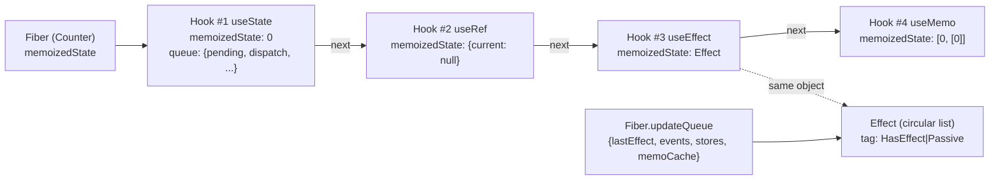

# Hooks 挂载阶段：链表构建与状态初始化

> [!summary] 核心速览（TL;DR）
> 函数组件的首次渲染是在 `renderWithHooks` 函数中执行的。它首先将全局 Hooks 分发器（`ReactSharedInternals.H`）指向专用于**挂载阶段**的实现（`HooksDispatcherOnMount`），随后调用你的组件函数。在组件函数内部，每一次对 `useState`、`useEffect`、`useMemo` 或 `useRef` 的调用，都会在挂载于 `fiber.memoizedState` 的 **Hook 单向链表**尾部追加一个 `Hook` 对象。与此同时，副作用（Effects）还会被单独挂载到 `fiber.updateQueue` 的环形链表中。在整个底层数据结构中，React 根本没有为 Hook 记录任何名称（name）或键值（key）——每个 Hook 的唯一标识就是它在链表中的**相对物理位置**。这就是为什么必须严格遵守 Hooks 使用规则（Rules of Hooks）的根本底层原因。

当前执行上下文：在 [[06 The Work Loop - Render Phase|工作循环（Render 渲染阶段）]] 中，[[07 beginWork and Reconciliation|beginWork 与协调]] 遍历到了一个 `current === null` 的函数组件（`FunctionComponent`）Fiber 节点（即首次挂载），随即调用 `updateFunctionComponent`，进而进入 `renderWithHooks` 函数。[^ufc] 本篇所讨论的所有底层细节，均发生在**你的组件函数被调用的那段执行期间**。

## 1. `renderWithHooks`：搭好舞台

`react` 核心包中的 `useState` 自身几乎不包含任何实质逻辑。它仅仅是读取 `ReactSharedInternals.H` 并直接将函数调用转发给它。[^resolve][^usestate] 整个 `react` 包根本没有任何关于 Hooks 的具体实现算法；真正的协调器（`react-reconciler`）会在调用你的组件函数之前，动态注入一个分发器（Dispatcher）对象，并在组件执行完毕后立即将其卸载。至于为什么要进行这样的职责拆分，参见 [[01 Bootstrap - Packages, JSX and the Dispatcher|01 · 初始化引导]]：这样可以保证同一套轻量级 `react` API 包无缝驱动 DOM（Web）、Native（移动端）以及自动化测试等不同的渲染器。

`renderWithHooks` 在底层主要完成以下五件事（简化版代码如下）：[^rwh]

```js
export function renderWithHooks(current, workInProgress, Component, props, secondArg, nextRenderLanes) {
  renderLanes = nextRenderLanes;
  currentlyRenderingFiber = workInProgress;          // 模块级全局游标：“当前正在渲染哪个 Fiber”

  workInProgress.memoizedState = null;               // 重置 Hook 链表，准备在执行中全新构建
  workInProgress.updateQueue = null;                 // 重置 Effect 链表
  workInProgress.lanes = NoLanes;

  ReactSharedInternals.H =
    current === null || current.memoizedState === null
      ? HooksDispatcherOnMount
      : HooksDispatcherOnUpdate;

  let children = Component(props, secondArg);        // <-- 你的组件代码在此处被调用执行
  if (didScheduleRenderPhaseUpdateDuringThisPass) {
    children = renderWithHooksAgain(/* ... */);      // 渲染阶段调用了 setState → 循环重新渲染
  }
  // DEV + StrictMode：执行 renderWithHooksAgain() 再渲染一次（双重渲染）
  finishRenderingHooks(current, workInProgress, Component);
  return children;
}
```

判定采用哪个分发器的核心条件是 `current === null || current.memoizedState === null`。这个条件的后半部分至关重要：一个 Fiber 节点可能已经存在对应的 `current`（即之前经历过渲染流程），但其内部却未曾提交过任何 Hook 状态——典型场景是在提交 Hooks 之前就已经因 Suspense 而挂起（Suspend）的组件。对于这种情况，React 依然将其视同首次挂载处理。在 DEV 开发环境下，React 还提供了第三种分发器变体 `HooksDispatcherOnMountWithHookTypesInDEV`，用于在开发阶段检测 Hook 调用顺序发生变更时给出精准警告。[^rwh]

这两个分发器本质上都是普通的对象字面量，负责将对外暴露的公共 Hook API 映射到内部的具体实现函数：[^dmount][^dupdate]

| 公共 Hook API | 挂载阶段（Mount） | 更新阶段（Update） |
|---|---|---|
| `useState` | `mountState` | `updateState` → `updateReducer` |
| `useReducer` | `mountReducer` | `updateReducer` |
| `useEffect` | `mountEffect` | `updateEffect` |
| `useMemo` / `useCallback` | `mountMemo` / `mountCallback` | `updateMemo` / `updateCallback` |
| `useRef` | `mountRef` | `updateRef` |
| `useContext` | `readContext` | `readContext` |
| `use` | `use` | `use` |
| `useMemoCache` (编译器) | `useMemoCache` | `useMemoCache` |

注意最后三行：无论挂载阶段还是更新阶段，它们映射的都是同一个底层函数。这是一个非常重要的内部信号——它们完全不占用 Hook 链表中的节点槽位（下文会详细剖析）。

在你的组件函数返回之后，`finishRenderingHooks` 会将分发器切换为 `ContextOnlyDispatcher`。该分发器中的每一个 Hook 方法都会直接抛出 `throwInvalidHookError`。[^finish][^ctxonly] 这就是为什么在事件处理函数或 `setTimeout` 异步回调中调用 `useState` 会直接抛出著名的 *"Invalid hook call"*（无效的 Hook 调用）报错。这绝非 ESLint 静态代码检查的约束，而是因为在渲染阶段之外，运行时的分发器本身就是一个碰之即炸的雷区。此外，`finishRenderingHooks` 还会校验 `currentHook !== null && currentHook.next !== null`，如果你在某个条件分支中提前 `return`，导致执行的 Hook 数量少于上一次渲染，React 会立即抛出 *"Rendered fewer hooks than expected"* 运行时异常。[^finish]

## 2. Hook 数据对象与单向链表

```js
export type Hook = {
  memoizedState: any,          // Hook 实际保存的当前状态数据：state 值、Effect 对象、[value, deps]、ref 等
  baseState: any,              // 遭遇第一个被跳过的更新之前的基准状态（详见第 11 篇）
  baseQueue: Update<any, any> | null, // 之前渲染被跳过、仍需继续累加应用的更新链表
  queue: any,                  // 状态更新队列（仅 useState/useReducer 具备，其余 Hook 为 null）
  next: Hook | null,           // 指向链表中下一个 Hook 节点的单向指针
};
```
[^hooktype]

`mountWorkInProgressHook`（创建并链入当前 Hook 节点）负责分配一个新的 `Hook` 对象，并将其追加到链表末尾：[^mwih]

```js
function mountWorkInProgressHook(): Hook {
  const hook = { memoizedState: null, baseState: null, baseQueue: null, queue: null, next: null };
  if (workInProgressHook === null) {
    currentlyRenderingFiber.memoizedState = workInProgressHook = hook; // 首个 Hook 节点
  } else {
    workInProgressHook = workInProgressHook.next = hook;               // 追加到链表尾部
  }
  return workInProgressHook;
}
```

`workInProgressHook` 是一个定义在模块顶层的全局游标指针，所以在整个源码文件中根本不存在任何所谓的 `index` 数组索引变量。对于如下组件：

```js
function Counter() {
  const [count, setCount] = useState(0);
  const ref = useRef(null);
  useEffect(() => { document.title = count; }, [count]);
  const doubled = useMemo(() => count * 2, [count]);
  // ...
}
```

该 Fiber 节点在内存中的完整数据拓扑结构如下：



> [!note] `memoizedState` 字段在不同场景下的双重含义
> 在**类组件**（Class Component）对应的 Fiber 节点上，`fiber.memoizedState` 存储的是类实例的 `state` 状态对象；而在**函数组件**（Function Component）的 Fiber 节点上，它则存放着整个 Hook 单向链表的**头节点（Head）**。同一个字段，承载着截然不同的数据结构。这也正是为什么在 [[05 The Fiber Data Structure|Fiber 数据结构]] 的类型定义中，`memoizedState` 被声明为 `any` 的原因。

## 3. `useState` 与 `useReducer`：更新队列与绑定的 dispatch

`mountState` 会调用内部的 `mountStateImpl`，其核心执行逻辑如下（简化版）：[^mountstateimpl][^mountstate]

```js
const hook = mountWorkInProgressHook();
if (typeof initialState === 'function') {
  initialState = initialState();               // 惰性初始化函数，仅在挂载时执行一次
  // DEV StrictMode：在开发环境下会再次调用以检验纯度，并丢弃二次执行的结果
}
hook.memoizedState = hook.baseState = initialState;
const queue = {
  pending: null,                    // 待处理更新构成的单向环形链表
  lanes: NoLanes,                   // 用于 Transition 优先级纠缠
  dispatch: null,
  lastRenderedReducer: basicStateReducer,
  lastRenderedState: initialState,  // 用于 setState 时的急切计算跳过（Eager Bailout）判定
};
hook.queue = queue;
// mountState 阶段绑定分发函数：
const dispatch = dispatchSetState.bind(null, currentlyRenderingFiber, queue);
queue.dispatch = dispatch;
return [hook.memoizedState, dispatch];
```

以下三点设计思想非常值得深入理解与内化：

1. **`setState` 是一个预先绑定的函数（Bound Function）。** 它通过闭包直接固化了目标 *Fiber* 节点与更新队列 *queue*，而不是绑定在组件实例或某个数组索引上。后续当你在事件处理回调中调用它时，React 根本无需遍历组件树去查找目标是谁，就已经精准锁定了这次状态更新应该归属的 Fiber 节点和队列。详见 [[12 setState - dispatchSetState and Batching|12 · setState 底层实现]]。
2. **Setter 函数具有天然的引用稳定性（Stable Identity）。** 它在首次挂载时被创建一次并缓存在 `queue.dispatch` 上。后续所有的更新渲染路径，都只是直接从 `queue.dispatch` 读取并返回它。[^uri] 这就是为什么在 `useEffect` 的依赖数组中省略 `setCount` 永远是绝对安全的。
3. **`useState` 本质上就是内置了基础 Reducer 的 `useReducer`。** React 内部使用的 `basicStateReducer` 实现极其简单：`typeof action === 'function' ? action(state) : action`。[^bsr] `mountReducer` 的执行逻辑与 `mountState` 如出一辙，只不过把内置 Reducer 替换为了你自定义传入的 reducer 以及可选的 `init(initialArg)` 初始化函数，其 dispatch 绑定的是 `dispatchReducerAction`。[^mountreducer] 两者唯一的行为差异在于：`dispatchReducerAction` 默认不会尝试“急切状态预判跳过”（Eager-state bailout），因为用户传入的 reducer 逻辑可能会在不同渲染之间发生变动。[^dra]

> [!warning] 绑定分发函数中的 `fiber` 可能会是双缓存镜像中的“另一半”
> 在初次挂载时，`currentlyRenderingFiber` 是正在构建中的 `workInProgress` Fiber，它在提交后会变为 `current`。但在经历了数轮更新之后，dispatch 闭包中固化的那个 fiber 引用可能是双缓存 `current`/`alternate` 对中的任意一边。React 优雅地解决了这个问题：当你在 dispatch 中触发更新时，React 会**同时**在当前 Fiber 及其 `alternate` 镜像节点上标记优先级 Lanes（详见 [[12 setState - dispatchSetState and Batching|12 · setState 底层实现]]）。

## 4. `useEffect`：Effect 对象与双层标志位

`mountEffect` 底层会调用 `mountEffectImpl(PassiveEffect | PassiveStaticEffect, HookPassive, create, deps)`。在开发模式的 StrictMode 下，还会额外附加 `MountPassiveDevEffect` 标志。[^mounteffect]

```js
function mountEffectImpl(fiberFlags, hookFlags, create, deps) {
  const hook = mountWorkInProgressHook();
  const nextDeps = deps === undefined ? null : deps;
  currentlyRenderingFiber.flags |= fiberFlags;          // “该 Fiber 节点包含待执行的被动副作用（Passive Work）”
  hook.memoizedState = pushSimpleEffect(
    HookHasEffect | hookFlags,                          // 挂载时必然包含 HookHasEffect，确保在初次挂载时执行
    createEffectInstance(),                             // 构造实例容器：{ destroy: undefined }
    create,
    nextDeps,
  );
}
```
[^mounteffectimpl]

这里的标志位设计分为两个层级，开发者极易混淆：

- **Fiber 节点级标志位（Fiber flags）**：保存在 `fiber.flags` 上（如 `PassiveEffect`）。这些标志位会在 [[08 completeWork - Building DOM Nodes|completeWork]] 自底向上归并阶段汇聚冒泡为 `subtreeFlags`，从而使 [[09 Commit Phase - Mutation, Layout, Passive Effects|Commit 提交阶段]] 能够通过掩码快速跳过那些完全没有副作用的整棵子树。
- **Hook 级别的副作用标签（Hook effect tags）**：保存在具体 `Effect.tag` 字段中（例如二进制位 `HasEffect = 0b0001`、`Insertion = 0b0010`、`Layout = 0b0100`、`Passive = 0b1000`）。[^hooktags] 在 Commit 阶段，`commitHookEffectListMount(HookPassive | HookHasEffect, fiber)` 会遍历该 Fiber 上的 Effect 环形链表，且仅执行那些标签**完整匹配这组二进制位掩码**的 Effect。[^chelm]

`pushSimpleEffect` 负责构建 `{tag, create, deps, inst, next}` 结构体，而 `pushEffectImpl` 则会以**惰性初始化**的方式创建 `FunctionComponentUpdateQueue`（包含 `{lastEffect, events, stores, memoCache}`），并将新建的 Effect 追加到 `fiber.updateQueue.lastEffect` 构成的**单向环形链表**中。[^pushsimple][^pusheffectimpl][^fcuq] 这种环形链表的设计极其巧妙：由指针直接指向链表的*最后一个元素*（尾节点），因此追加新节点的操作复杂度恒为 $O(1)$，同时 `lastEffect.next` 即刻就能索引到链表头部。React 在全套架构中随处都在使用这个技巧（包括状态更新队列 `UpdateQueue` 亦是如此）。

因此，每一个 Effect 实际上在底层存在**双重存储位置**：
1. Hook 节点自身的 `memoizedState` 指向对应的 Effect 对象，以便下一轮渲染阶段能够比对上一轮保存的依赖项 `deps`；
2. Fiber 节点的 `updateQueue` 环形链表则是 Commit 阶段集中遍历和执行副作用的专用队列。

而其中的 `inst` 容器对象（结构为 `{destroy}`）在组件整个生命周期中跨渲染共享，你的 Effect 回调执行后返回的清理函数（cleanup）就存放在这里。[^effecttype]

`useLayoutEffect` 与 `useInsertionEffect` 完全遵循相同的执行流，仅在传入的标志位上分别对应为 `HookLayout` / `UpdateEffect` 以及 `HookInsertion`。三者唯一的区别在于执行时机的不同，而这一执行时机完全由 Commit 阶段掌控。

## 5. `useRef`、`useMemo` 与 `useCallback`

这些 Hook 的底层实现甚至显得有些“平淡无奇”，但这恰恰体现了其设计的精炼：

```js
function mountRef(initialValue) {
  const hook = mountWorkInProgressHook();
  const ref = { current: initialValue };
  hook.memoizedState = ref;      // 该对象引用终生不变；updateRef 只是直接返回它
  return ref;
}
```
[^mountref][^updateref]

`mountMemo` 会立即执行工厂函数 `nextCreate()`，并将计算结果及其依赖项打包为 `[nextValue, nextDeps]` 存入 `memoizedState`。在开发模式的 StrictMode 下，它会额外执行第二次 `nextCreate()`，以主动暴露那些非纯函数工厂产生的副作用。[^mountmemo]

而 `mountCallback` 则直接存储 `[callback, nextDeps]`，**中途绝不会执行该函数**。[^mountcb] 换句话说，`useCallback(fn, deps)` 在底层本质上就是省去了一层闭包调用的 `useMemo(() => fn, deps)`。

> [!tip] Ref 的本质：一个仅仅持有可变普通对象的 Hook 槽位
> 修改 `ref.current` 的值不会触发任何重新调度。这其中完全没有队列、没有优先级 Lanes、更没有 Fiber 树的参与。这正是为什么 Ref 能够成为“更新时无需引起重新渲染的数据”的逃生通道；但这也正是为什么在并发渲染（Concurrent Rendering）模式下，在渲染期间直接读取 `ref.current` 会极度脆弱的根源——因为一轮被中止或丢弃的无用渲染，可能已经不可逆地篡改了该 Ref 上的可变数据。

## 6. 不占用 Hook 链表槽位的特殊 Hooks：`useContext`、`use` 与 `useMemoCache`

**`useContext`**：在挂载分发器和更新分发器中，其映射的都是同一个底层函数 `readContext`。[^dmount] `readContext` 会读取目标 `context._currentValue`（该值在 beginWork 阶段由距离最近的 Context Provider 压入）。随后，它会在当前 Fiber 节点的 `fiber.dependencies` 链表尾部追加一个 `{context, memoizedValue, next}` 节点。它**自始至终绝不会调用 `mountWorkInProgressHook`**。[^readctx][^readctxconsumer] Context 的依赖项存放在一个独立的专用链表中，当 Provider 的 value 发生变更时，Context 传播算法会专门扫描这个列表。这带来了一个鲜为人知的结论：从纯运行时的角度来看，`useContext` 并不严格依赖调用顺序的稳定性。官方之所以依然将 Hooks 规则应用在它身上，主要是为了保持 API 心智模型的高度一致性以及前向兼容；但实际上，就算你把 `useContext` 写在条件分支里，其底层实现也完全不会导致 Hook 链表错位。

**`use(usable)`**：如果传入的是 Promise 等 Thenable 对象，底层会调用 `useThenable`。它依靠自身独立的游标计数器（`thenableIndexCounter`）在 `thenableState` 数组中索引位置，而根本不走 Hook 链表。如果传入的是 Context，则直接调用 `readContext`。[^use][^usethenable] 这正是为什么 `use` 是 React 中**唯一允许在 `if` 条件分支和循环语句中调用的 Hook**：它的索引规则是*“当前组件到目前为止 await 了多少个 thenable”*，并在重试重放（Replay）时自动归零重置。这里还有一个幽微的细节：如果一个组件在执行到任何标准 Hook 之前就因为 `use` 发生了挂起（Suspend），`useThenable` 会在重放时为后续的 Hooks 重新裁决是采用 Mount 还是 Update 分发器，从而妥善应对 WIP 链表尚为空的边界状态。[^usethenable]

## 7. 深入本质：为什么必须存在 Hooks 使用规则？

串联起所有的底层碎片：在组件更新阶段，`updateWorkInProgressHook` 绝不会通过字符串或键名去查找所谓的“`count` 状态”。它只是单纯地取出 `currentHook.next`——也就是**上一次渲染**所构建链表中的下一个节点，并将其实例克隆过来。[^uwih] 当前渲染中的第 $n$ 次 Hook 调用，只会机械地与上一次已提交渲染中的第 $n$ 个链表节点配对。这就是底层全部的真相。

```js
function Bad({ show }) {
  if (show) useState('a');     // 仅当 show 为 true 时才作为第 1 个 Hook 执行
  const [n] = useState(0);     // 依据 show 的状态，它有时是第 1 个，有时是第 2 个！
}
```

当 `show` 由 `true` 变为 `false` 时，`useState(0)` 会错位配对到上一轮存放 `'a'` 的那个节点，因而荒谬地返回了状态值 `'a'`。而如果两次渲染的 Hook 类型发生了错位（例如本该是 State 的位置复用了 Effect 节点），React 发现该节点的 `queue` 为 `null`，就会立即抛出致命异常：*"Should have a queue. You are likely calling Hooks conditionally"*（当前 Hook 应包含更新队列，你可能在条件语句中调用了 Hook）。[^uri] 如果新一轮渲染调用的 Hook 数量**超过**了旧链表的总长度，`updateWorkInProgressHook` 会抛出 *"Rendered more hooks than during the previous render"*；相反，如果调用的 Hook 数量**少于**旧链表，则会在第 1 节提到的 `finishRenderingHooks` 中触发 *"Rendered fewer hooks than expected"* 报错。[^uwih][^finish] 官方规则文档参见 react.dev。[^rulesdoc]

为什么不采用 Key，而偏偏采用物理位置？基于物理位置标识（Positional Identity）的设计，使得整个 Hooks API 完全免除了显式 Key 的心智负担（你可以直接书写 `useState(0)`，而不是繁琐的 `useState('count', 0)`）；更重要的是，它让自定义 Hook 能够像搭积木一样自由组合而完全无需担心命名空间冲突，并在运行时将状态查找的开销从哈希表查询（Map Lookup）骤降为了极速的指针单步递增（Pointer Bump）。其唯一付出的代价，就是引入了一条需要通过 Linter 静态规则来约束的开发范式——而在 React 团队看来，这是一笔极其划算的架构权衡。

## 8. StrictMode 严格模式：精准拆解“双重调用”机制

在开发模式（DEV）下，如果当前 Fiber 节点的模式包含 `StrictLegacyMode`，`renderWithHooks` 会将你的组件函数连续调用**两次**。第二次调用通过 `renderWithHooksAgain` 触发。[^rwh][^rwha] 详细执行细节如下：

- **首轮调用**：采用挂载分发器（`HooksDispatcherOnMount`）执行，并开启标志位 `shouldDoubleInvokeUserFnsInHooksDEV = true`。在此过程中，`mountState` 的惰性初始化函数、`mountReducer` 的 `init` 函数以及 `mountMemo` 的工厂函数都会被**主动调用两次**，随后默默丢弃第二次调用的执行结果。[^mountstateimpl][^mountreducer][^mountmemo]
- **次轮调用**：切换至重渲染分发器 `HooksDispatcherOnRerender`。`renderWithHooksAgain` 会将游标指针 `currentHook` 和 `workInProgressHook` 重置为 `null`，但**完整保留**第一轮调用已经构建出来的 `workInProgress.memoizedState` 链表。因此，第二轮执行时 `updateWorkInProgressHook` 只是沿着既有链表前行，并**直接复用**第一轮创建好的 Hook 节点。[^rwha][^uwih] Ref 对象、状态存储和缓存计算值在两次调用之间完全保持同一引用，只有组件函数本身的代码体被重复执行了一遍。
- **Effect 副作用在渲染阶段绝不执行两次**：开发者常常误以为 StrictMode 的“挂载 → 卸载 → 再次挂载”是发生在渲染阶段，但实际上它完全发生在 Commit 提交阶段（由 `MountPassiveDevEffect` / `MountLayoutDevEffect` 标志位驱动，在 `doubleInvokeEffectsInDEVIfNecessary` 中模拟调度）。[^dbleffects]

> [!warning] 常见误区：“严格模式渲染了两次，所以 State 初始化了两次”
> 事实真相是：初始化的计算**函数**确实被调用了两次，但内存中自始至终只创建了**一个** Hook 节点，并且 React 最终保留的是第一次的计算结果。如果你的初始化函数暗含副作用（例如在函数体内发起了事件订阅、或者递增了全局计数器），你才会观察到两次执行带来的偏差；而只要你的初始化逻辑保持纯粹，这两次调用在外部表现上完全毫无痕迹。

## 联动 React 编译器：`useMemoCache` 底层机制

编译器会改写你的组件代码，使其在开头声明 `const $ = _c(N)`，其中 `_c` 从 `react/compiler-runtime` 中导入。在 React 19 中，`_c` **本质上就是 `useMemoCache`**：`ReactCompilerRuntime.js` 直接通过 `export { useMemoCache as c }` 导出，且运行时包在检测到 `React.__COMPILER_RUNTIME.c` 存在时会优先直接使用它。只有在 React 19 之前的版本中，它才会降级为基于 `useMemo` 的 Polyfill 实现。[^ccompilerrt][^cruntime] `useMemoCache` 与其他 Hook 一样，都是通过全局分发器 `ReactSharedInternals.H` 完成路由调度的。[^reacthooksmc] 完整的编译转换细节详见 [[14 React Compiler - How It Works|14 · 编译器工作原理]]。

源码中**根本不存在 `mountMemoCache`**。所有的分发器（挂载、更新、重渲染）共用同一个 `useMemoCache` 函数实现，而且它**完全不触碰 Hook 单向链表**。[^umc][^dmount] 简化后的实现如下：

```js
function useMemoCache(size) {
  let updateQueue = currentlyRenderingFiber.updateQueue;
  let memoCache = updateQueue?.memoCache;
  if (memoCache == null) {
    const current = currentlyRenderingFiber.alternate;
    const currentMemoCache = current?.updateQueue?.memoCache;
    if (currentMemoCache != null) {
      memoCache = {                                   // 更新阶段：写时复制（Copy-on-write）克隆
        data: enableNoCloningMemoCache
          ? currentMemoCache.data
          : currentMemoCache.data.map(array => array.slice()),
        index: 0,
      };
    }
  }
  if (memoCache == null) memoCache = { data: [], index: 0 };   // 挂载阶段：全新创建
  if (updateQueue === null) {
    updateQueue = createFunctionComponentUpdateQueue();
    currentlyRenderingFiber.updateQueue = updateQueue;
  }
  updateQueue.memoCache = memoCache;

  let data = memoCache.data[memoCache.index];
  if (data === undefined) {
    data = memoCache.data[memoCache.index] = new Array(size);
    for (let i = 0; i < size; i++) data[i] = REACT_MEMO_CACHE_SENTINEL; // 填充“从未计算过”哨兵值
  }
  memoCache.index++;
  return data;
}
```

存储物理位置：**`fiber.updateQueue.memoCache`**，其数据结构为 `{data: Array<Array<mixed>>, index}`。其中 `data` 是一个由若干缓存数组组成的二维数组，组件中每次调用 `useMemoCache` 会分配其中一项（经过编译后的组件通常只在顶部调用一次）。`index` 则是一个与 Hook 链表游标工作原理高度相似的索引指针。[^fcuq][^umc]

在挂载阶段，分配出的缓存数组包含 `size` 个插槽，全部用哨兵值 `REACT_MEMO_CACHE_SENTINEL`（其值为全局 Symbol `Symbol.for('react.memo_cache_sentinel')`）填满。[^umc][^sentinel] 编译产物在运行时对于“仅需计算一次”的值会比对 `if ($[0] === Symbol.for("react.memo_cache_sentinel"))`；而对于带依赖项的块，则比对 `if ($[0] !== props.x)`。在首次渲染时，由于缓存中全为哨兵值，所有的比对条件均必然判定为失效，所有代码块都会如实计算。因此，在挂载阶段，编译器所谓的“零成本”仅仅是指它只增加了一次数组内存分配和若干次基础条件比对而已。

架构层面的关键细节：

- **不影响 Hook 链表排位**：由于 `useMemoCache` 直接寄生在 `updateQueue` 上而不是插入 Hook 链表，它绝不会打乱任何业务 Hook 的相对位置偏移。尽管如此，编译器仍然总会无条件地将其作为组件函数的第一行语句输出。
- **跨渲染的缓存继承**：`renderWithHooks` 在每一次渲染开始时，都会主动将 `workInProgress.updateQueue` 置为 `null`。[^rwh] 这正是为什么在更新分支中，它必须从 `alternate` 镜像节点中拉取已有的缓存。关于写时复制（COW）与 Bailout 跳过机制，详见 [[11 Hooks on Update|11 · Hooks 更新阶段]]。
- **双重调用下的缓存预热**：在渲染阶段发生重渲染（以及 StrictMode 的第二轮执行）时，`resetFunctionComponentUpdateQueue` 只会将 `memoCache.index` 重置为 `0`，而**完整保留**已经计算填充分配好的数组。[^resetfcuq] 这意味着第二轮渲染直接享受到了一个“已预热（Warm）”的高速缓存。
- **开发环境 Fast Refresh 热重载**：在 DEV 下，如果标记了 `ignorePreviousDependencies`（例如热重载替换了组件实现），缓存数组会被强制重新分配；若同一调用处的 `size` 发生了变更，React 则会在控制台抛出明确错误。[^umc]

与 [[15 Rendering With vs Without the Compiler|15 · 启用与未启用编译器的对比]] 相比：手写的 `useMemo` 每调用一次，都需要在内存中分配一个完整的 `Hook` 链表节点以及一个 `[value, deps]` 依赖元组；而 React 编译器的缓存机制在整个组件生命周期中，无论需要记忆化多少个内部变量，都仅仅只需要一个扁平的一维/二维数组即可完成全部托管。

## 全文总结

函数组件的首次渲染完全封装在 `renderWithHooks` 中运行：它将挂载阶段分发器安装到全局 `ReactSharedInternals.H` 上，执行你的组件函数，并在退出时迅速替换为一个处处抛错的分发器。组件内部每一次 Hook 调用，都会向挂载在 `fiber.memoizedState` 上的单向链表追加一个 `Hook` 节点；与此同时，副作用还会被额外编入 `fiber.updateQueue` 的环形链表中。在整个底层数据流中没有任何变量名或 Key：Hook 的唯一身份标识就是它在链表中的物理序列位置，Hooks 的使用规则正是这一底层拓扑结构的必然推论。而 React 编译器的 `useMemoCache` 则完全绕开了 Hook 链表，将独立缓存寄托在 `fiber.updateQueue.memoCache` 上。在下一篇 [[11 Hooks on Update|11 · Hooks 更新阶段]] 中，我们将看到更新阶段是如何步步对齐并遍历这条链表的。

### 核心知识点清单

- **`renderWithHooks`**：当满足 `current === null || current.memoizedState === null` 时装配 `HooksDispatcherOnMount`；组件函数返回后立即切换为 `ContextOnlyDispatcher`，从而确保在渲染阶段之外调用 Hook 必定抛出异常。
- **`mountWorkInProgressHook`**：借助模块级全局游标指针向链表尾部追加节点，底层压根不存在任何数组索引变量。
- **`mountState`**：`useState` 底层就是搭载了 `basicStateReducer` 的 `useReducer`；其状态变更器 `dispatchSetState` 在挂载时一次性绑定到对应的 Fiber 节点与更新队列上，具有天然且绝对的引用稳定性。
- **`mountEffectImpl`**：在 Fiber 节点上打上能够向上冒泡至 `subtreeFlags` 的标志位（`PassiveEffect`），并在 Hook 自身打上副作用标签（`HookHasEffect | HookPassive`），供 Commit 阶段作为执行掩码进行精确过滤。
- **`useRef`**：仅是一个持有普通可变对象的 Hook 槽位；对 `ref.current` 的读写赋值不会触发任何更新调度，不涉及优先级赛道（Lanes）和 Fiber 机制。
- **`useContext` 与 `use`**：两者均不占用 Hook 链表槽位；`readContext` 将依赖关系记录在 `fiber.dependencies` 中，而 `use` 则拥有自己独立的 Thenable 计数器（将 Hooks 规则套用在 `useContext` 上主要是为了保持 API 心智一致性）。
- **Hooks 使用规则的本质**：在更新阶段，当前的第 $n$ 次 Hook 调用会无条件与上一轮的第 $n$ 个链表节点配对，因此在条件语句中调用 Hook 必然会导致状态错位或运行时崩溃。
- **StrictMode 严格模式**：第二轮调用完整复用第一轮构建的 Hook 链表，因此只有组件函数体以及惰性初始化函数会真正被执行两次。
- **`useMemoCache`**：每个组件独享一个扁平数组，首次挂载时所有槽位均预填为哨兵值 `REACT_MEMO_CACHE_SENTINEL`。

---
← [[09 Commit Phase - Mutation, Layout, Passive Effects|上一篇：Commit 阶段]] · [[00 React Internals Index|专栏目录索引]] · [[11 Hooks on Update|下一篇：Hooks 更新阶段]] →

[^ufc]: `updateFunctionComponent` 调用 `renderWithHooks` — [packages/react-reconciler/src/ReactFiberBeginWork.js#L1453-L1562](https://github.com/facebook/react/blob/v19.3.1/packages/react-reconciler/src/ReactFiberBeginWork.js#L1453-L1562)
[^resolve]: `resolveDispatcher` 读取 `ReactSharedInternals.H` — [packages/react/src/ReactHooks.js#L24-L42](https://github.com/facebook/react/blob/v19.3.1/packages/react/src/ReactHooks.js#L24-L42)
[^usestate]: 公共 `useState` API — [packages/react/src/ReactHooks.js#L66-L71](https://github.com/facebook/react/blob/v19.3.1/packages/react/src/ReactHooks.js#L66-L71)
[^rwh]: `renderWithHooks` 核心调度与分发器装配 — [packages/react-reconciler/src/ReactFiberHooks.js#L505-L634](https://github.com/facebook/react/blob/v19.3.1/packages/react-reconciler/src/ReactFiberHooks.js#L505-L634)
[^dmount]: `HooksDispatcherOnMount` 挂载分发器实现 — [packages/react-reconciler/src/ReactFiberHooks.js#L3926-L3952](https://github.com/facebook/react/blob/v19.3.1/packages/react-reconciler/src/ReactFiberHooks.js#L3926-L3952)
[^dupdate]: `HooksDispatcherOnUpdate` 更新分发器实现 — [packages/react-reconciler/src/ReactFiberHooks.js#L3954-L3980](https://github.com/facebook/react/blob/v19.3.1/packages/react-reconciler/src/ReactFiberHooks.js#L3954-L3980)
[^finish]: `finishRenderingHooks`（重置分发器并执行“Hook 数量少于预期”校验）— [packages/react-reconciler/src/ReactFiberHooks.js#L636-L753](https://github.com/facebook/react/blob/v19.3.1/packages/react-reconciler/src/ReactFiberHooks.js#L636-L753)
[^ctxonly]: `ContextOnlyDispatcher`（所有 Hook 调用均指向 `throwInvalidHookError`）— [packages/react-reconciler/src/ReactFiberHooks.js#L3898-L3924](https://github.com/facebook/react/blob/v19.3.1/packages/react-reconciler/src/ReactFiberHooks.js#L3898-L3924)
[^hooktype]: `Hook` 数据类型定义 — [packages/react-reconciler/src/ReactFiberHooks.js#L197-L203](https://github.com/facebook/react/blob/v19.3.1/packages/react-reconciler/src/ReactFiberHooks.js#L197-L203)
[^mwih]: `mountWorkInProgressHook` 分配并追加 Hook 节点 — [packages/react-reconciler/src/ReactFiberHooks.js#L983-L1002](https://github.com/facebook/react/blob/v19.3.1/packages/react-reconciler/src/ReactFiberHooks.js#L983-L1002)
[^mountstateimpl]: `mountStateImpl` 状态挂载底层实现 — [packages/react-reconciler/src/ReactFiberHooks.js#L1920-L1946](https://github.com/facebook/react/blob/v19.3.1/packages/react-reconciler/src/ReactFiberHooks.js#L1920-L1946)
[^mountstate]: `mountState`（固化绑定 `dispatchSetState`）— [packages/react-reconciler/src/ReactFiberHooks.js#L1948-L1960](https://github.com/facebook/react/blob/v19.3.1/packages/react-reconciler/src/ReactFiberHooks.js#L1948-L1960)
[^uri]: `updateReducerImpl`（“Should have a queue”校验并返回 `queue.dispatch`）— [packages/react-reconciler/src/ReactFiberHooks.js#L1316-L1589](https://github.com/facebook/react/blob/v19.3.1/packages/react-reconciler/src/ReactFiberHooks.js#L1316-L1589)
[^bsr]: `basicStateReducer` 默认状态规约函数 — [packages/react-reconciler/src/ReactFiberHooks.js#L1265-L1268](https://github.com/facebook/react/blob/v19.3.1/packages/react-reconciler/src/ReactFiberHooks.js#L1265-L1268)
[^mountreducer]: `mountReducer` 实现 — [packages/react-reconciler/src/ReactFiberHooks.js#L1270-L1305](https://github.com/facebook/react/blob/v19.3.1/packages/react-reconciler/src/ReactFiberHooks.js#L1270-L1305)
[^dra]: `dispatchReducerAction`（不包含急切状态计算跳过逻辑）— [packages/react-reconciler/src/ReactFiberHooks.js#L3583-L3624](https://github.com/facebook/react/blob/v19.3.1/packages/react-reconciler/src/ReactFiberHooks.js#L3583-L3624)
[^mounteffect]: `mountEffect` — [packages/react-reconciler/src/ReactFiberHooks.js#L2697-L2719](https://github.com/facebook/react/blob/v19.3.1/packages/react-reconciler/src/ReactFiberHooks.js#L2697-L2719)
[^mounteffectimpl]: `mountEffectImpl` — [packages/react-reconciler/src/ReactFiberHooks.js#L2640-L2655](https://github.com/facebook/react/blob/v19.3.1/packages/react-reconciler/src/ReactFiberHooks.js#L2640-L2655)
[^hooktags]: Hook 副作用标签定义 — [packages/react-reconciler/src/ReactHookEffectTags.js#L12-L20](https://github.com/facebook/react/blob/v19.3.1/packages/react-reconciler/src/ReactHookEffectTags.js#L12-L20)
[^chelm]: `commitHookEffectListMount`（`(effect.tag & flags) === flags` 掩码匹配）— [packages/react-reconciler/src/ReactFiberCommitEffects.js#L141-L247](https://github.com/facebook/react/blob/v19.3.1/packages/react-reconciler/src/ReactFiberCommitEffects.js#L141-L247)
[^pushsimple]: `pushSimpleEffect` — [packages/react-reconciler/src/ReactFiberHooks.js#L2588-L2603](https://github.com/facebook/react/blob/v19.3.1/packages/react-reconciler/src/ReactFiberHooks.js#L2588-L2603)
[^pusheffectimpl]: `pushEffectImpl`（在 `updateQueue.lastEffect` 上构建环形链表）— [packages/react-reconciler/src/ReactFiberHooks.js#L2605-L2622](https://github.com/facebook/react/blob/v19.3.1/packages/react-reconciler/src/ReactFiberHooks.js#L2605-L2622)
[^fcuq]: `FunctionComponentUpdateQueue` 类型定义与工厂函数 — [packages/react-reconciler/src/ReactFiberHooks.js#L249-L254](https://github.com/facebook/react/blob/v19.3.1/packages/react-reconciler/src/ReactFiberHooks.js#L249-L254), [#L1075-L1082](https://github.com/facebook/react/blob/v19.3.1/packages/react-reconciler/src/ReactFiberHooks.js#L1075-L1082)
[^effecttype]: `EffectInstance` 与 `Effect` 类型定义 — [packages/react-reconciler/src/ReactFiberHooks.js#L219-L229](https://github.com/facebook/react/blob/v19.3.1/packages/react-reconciler/src/ReactFiberHooks.js#L219-L229)
[^mountref]: `mountRef` — [packages/react-reconciler/src/ReactFiberHooks.js#L2628-L2633](https://github.com/facebook/react/blob/v19.3.1/packages/react-reconciler/src/ReactFiberHooks.js#L2628-L2633)
[^updateref]: `updateRef` — [packages/react-reconciler/src/ReactFiberHooks.js#L2635-L2638](https://github.com/facebook/react/blob/v19.3.1/packages/react-reconciler/src/ReactFiberHooks.js#L2635-L2638)
[^mountmemo]: `mountMemo` — [packages/react-reconciler/src/ReactFiberHooks.js#L2944-L2961](https://github.com/facebook/react/blob/v19.3.1/packages/react-reconciler/src/ReactFiberHooks.js#L2944-L2961)
[^mountcb]: `mountCallback` — [packages/react-reconciler/src/ReactFiberHooks.js#L2923-L2928](https://github.com/facebook/react/blob/v19.3.1/packages/react-reconciler/src/ReactFiberHooks.js#L2923-L2928)
[^readctx]: `readContext` — [packages/react-reconciler/src/ReactFiberNewContext.js#L553-L567](https://github.com/facebook/react/blob/v19.3.1/packages/react-reconciler/src/ReactFiberNewContext.js#L553-L567)
[^readctxconsumer]: `readContextForConsumer`（追加依赖到 `fiber.dependencies`）— [packages/react-reconciler/src/ReactFiberNewContext.js#L580-L627](https://github.com/facebook/react/blob/v19.3.1/packages/react-reconciler/src/ReactFiberNewContext.js#L580-L627)
[^use]: `use` — [packages/react-reconciler/src/ReactFiberHooks.js#L1159-L1179](https://github.com/facebook/react/blob/v19.3.1/packages/react-reconciler/src/ReactFiberHooks.js#L1159-L1179)
[^usethenable]: `useThenable` — [packages/react-reconciler/src/ReactFiberHooks.js#L1098-L1157](https://github.com/facebook/react/blob/v19.3.1/packages/react-reconciler/src/ReactFiberHooks.js#L1098-L1157)
[^uwih]: `updateWorkInProgressHook` — [packages/react-reconciler/src/ReactFiberHooks.js#L1004-L1073](https://github.com/facebook/react/blob/v19.3.1/packages/react-reconciler/src/ReactFiberHooks.js#L1004-L1073)
[^rulesdoc]: React 官方 Hooks 规则文档 — react.dev, https://react.dev/reference/rules/rules-of-hooks
[^rwha]: `renderWithHooksAgain` — [packages/react-reconciler/src/ReactFiberHooks.js#L791-L857](https://github.com/facebook/react/blob/v19.3.1/packages/react-reconciler/src/ReactFiberHooks.js#L791-L857)
[^dbleffects]: `doubleInvokeEffectsOnFiber` / `doubleInvokeEffectsInDEVIfNecessary` — [packages/react-reconciler/src/ReactFiberWorkLoop.js#L5328-L5388](https://github.com/facebook/react/blob/v19.3.1/packages/react-reconciler/src/ReactFiberWorkLoop.js#L5328-L5388)
[^ccompilerrt]: `react/compiler-runtime` 重新导出 `useMemoCache as c` — [packages/react/src/ReactCompilerRuntime.js#L10](https://github.com/facebook/react/blob/v19.3.1/packages/react/src/ReactCompilerRuntime.js#L10)
[^cruntime]: `react-compiler-runtime` 中的 `c`（优先使用 `React.__COMPILER_RUNTIME.c`，否则降级为 `useMemo` polyfill）— [compiler/packages/react-compiler-runtime/src/index.ts#L19-L39](https://github.com/facebook/react/blob/v19.3.1/compiler/packages/react-compiler-runtime/src/index.ts#L19-L39)
[^reacthooksmc]: 公共 `useMemoCache` API — [packages/react/src/ReactHooks.js#L212-L216](https://github.com/facebook/react/blob/v19.3.1/packages/react/src/ReactHooks.js#L212-L216)
[^umc]: Reconciler 中的 `useMemoCache` 实现 — [packages/react-reconciler/src/ReactFiberHooks.js#L1181-L1263](https://github.com/facebook/react/blob/v19.3.1/packages/react-reconciler/src/ReactFiberHooks.js#L1181-L1263)
[^sentinel]: `REACT_MEMO_CACHE_SENTINEL` 缓存未命中哨兵值 — [packages/shared/ReactSymbols.js#L41-L43](https://github.com/facebook/react/blob/v19.3.1/packages/shared/ReactSymbols.js#L41-L43)
[^resetfcuq]: `resetFunctionComponentUpdateQueue` — [packages/react-reconciler/src/ReactFiberHooks.js#L1084-L1096](https://github.com/facebook/react/blob/v19.3.1/packages/react-reconciler/src/ReactFiberHooks.js#L1084-L1096)
