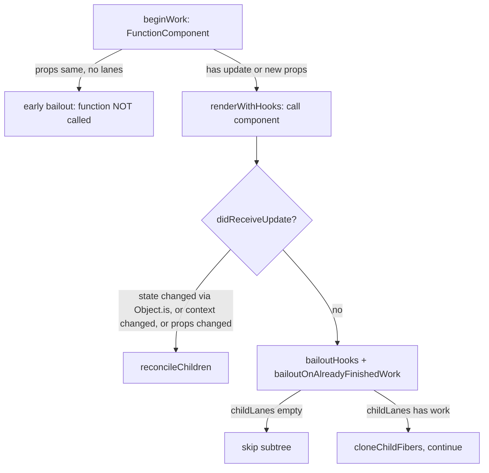

# Hooks 更新阶段（Hooks on Update）

> [!summary] 核心速览（TL;DR）
> 在组件重渲染（Re-render）时，`renderWithHooks` 会挂载 `HooksDispatcherOnUpdate`（更新阶段 Hooks 分发器）。随后每一次 Hook 调用，都会从已提交的 `current` Fiber 上的 Hook 链表中，将对应节点**浅克隆（Clone）**至正在构建的 `workInProgress` Fiber 链表。对于 `useState` 与 `useReducer`，React 会将积压更新的单向环形链表 `pendingQueue` 合并至 `baseQueue` 中并进行重放计算（Replay）。凡是优先级赛道（Lane）不属于当前渲染轮次的 Update 都会被跳过，并妥善保留至后续渲染（即“变基”，Rebasing）。若最终计算得出的新 State 与旧 State 未通过 `Object.is` 比较（值发生变化），当前 Fiber 会被标记为 `didReceiveUpdate = true`。反之，若计算结果未变且 Props / Context 也未发生任何变化，`bailoutHooks` 将直接丢弃本次渲染产物，React 顺水推舟复用原有的子树结构。

阅读本文前，建议先掌握 [[10 Hooks on Mount|10 · Hooks 挂载阶段]] 的基础知识：包括 `Hook` 对象的内存拓扑结构、挂载于 `fiber.updateQueue` 上的 Effect 环形链表，以及 Dispatcher（分发器）的选取与切换逻辑。而这一切更新逻辑的源头，正是通过 `setState` 将 Update 推入队列并触发调度的链路，详见 [[12 setState - dispatchSetState and Batching|12 · setState 底层实现]]。

## 1. `updateWorkInProgressHook`：双链表步调一致的协同推进

在进入更新流程时，`renderWithHooks` 已经提前将 `workInProgress.memoizedState` 置为 `null`[^rwh]。这意味着 WIP Fiber 一开始拥有的是一条空的 Hook 链表，而已提交生效的 `current` Fiber（即 `workInProgress.alternate`）则保存着上一轮渲染提交的完整链表。React 在模块作用域维护了两个全局指针来追踪推进进度：指向旧链表的 `currentHook`，以及指向新链表的 `workInProgressHook`[^cursors]。其核心职责便是**复用或克隆 currentHook 构建 workInProgressHook**。

```js
function updateWorkInProgressHook(): Hook {
  // 推进已提交旧链表上的游标
  let nextCurrentHook = currentHook === null
    ? currentlyRenderingFiber.alternate?.memoizedState ?? null
    : currentHook.next;

  // 当前位置是否已经存在 WIP Hook？（仅在渲染阶段内再次触发渲染时发生）
  let nextWorkInProgressHook = workInProgressHook === null
    ? currentlyRenderingFiber.memoizedState
    : workInProgressHook.next;

  if (nextWorkInProgressHook !== null) {
    workInProgressHook = nextWorkInProgressHook;          // 直接复用
    currentHook = nextCurrentHook;
  } else {
    if (nextCurrentHook === null) {
      throw new Error('Rendered more hooks than during the previous render.');
    }
    currentHook = nextCurrentHook;
    const newHook = {                                     // 浅克隆
      memoizedState: currentHook.memoizedState,
      baseState: currentHook.baseState,
      baseQueue: currentHook.baseQueue,
      queue: currentHook.queue,                           // 与 current 共享引用！
      next: null,
    };
    // 追加到 WIP 链表尾部（同挂载阶段一致）
  }
  return workInProgressHook;
}
```
（简化版源码实现）[^uwih]

核心机制与设计深意：

- **浅克隆节点，但 `queue` 是共享的**：`current` 与 WIP Hook 之间严格共享同一个 `queue` 引用。这绝非偶然——`setState` 在挂载阶段绑定闭包时，手中持有的正是该 `queue` 对象的常驻引用。无论双缓存树中最终是哪一棵 Fiber 提交生效，新产生的 Update 都必须对两者即时可见。
- **克隆确保了已提交树的不可变性（Immutability）**：一旦当前渲染被更高优先级的更新打断，或是因 Suspense 挂起而被丢弃，`current` Fiber 上的 Hook 链表依然分毫不差地忠实描述着屏幕上的已有视图状态。这正是 [[05 The Fiber Data Structure|05 · Fiber 双缓存机制]] 细化到 Hook 粒度的体现。
- **“复用既有 WIP Hook”的分支只在单轮渲染内重跑时触发**：例如在 Render 阶段直接调用 `setState` 触发的 `renderWithHooksAgain`，以及开发模式下 StrictMode 的第二轮校验执行[^rwha]。它只会重置游标指针，而不会将 `workInProgress.memoizedState` 清空。

## 2. `updateReducer`：从 Pending 环形链表推导最新 State

在底层实现上，`updateState` 本质就是 `updateReducer(basicStateReducer, initialState)`。在更新阶段，传入的 `initialState` 会被直接忽略[^updatestate]。`updateReducer` 负责获取当前 Hook 节点，随后委托给核心实现函数 `updateReducerImpl(hook, currentHook, reducer)`[^updatereducer]。

### 2a. 将 `queue.pending` 合并入 `baseQueue`

```js
let baseQueue = hook.baseQueue;            // 上次渲染中被跳过（低优先级）的遗留更新
const pendingQueue = queue.pending;        // 自上次渲染后新产生的更新
if (pendingQueue !== null) {
  if (baseQueue !== null) {                // 将两个单向环形链表拼接成一个
    const baseFirst = baseQueue.next;
    const pendingFirst = pendingQueue.next;
    baseQueue.next = pendingFirst;
    pendingQueue.next = baseFirst;
  }
  current.baseQueue = baseQueue = pendingQueue;
  queue.pending = null;
}
```
[^merge]

两条链表均为单向环形链表（Update 队列），且指针固定指向链表的**最后一个节点（Last Node）**，因此将两条环形链表首尾相接拼接只需交换两个指针的指向。注意这里的 `current.baseQueue = ...` 这一行代码：合并后的完整链表不仅赋值给了 WIP Hook，还同步写回了 **current** Hook。这是因为 `queue.pending` 在此刻已被清空置空；万一本轮 WIP 渲染中途被废弃丢弃，这些 Update 就会彻底丢失。同步备份至 `current`，确保了后续重启渲染时依然能够完整找回这批更新。

> [!note] Update 究竟是在何时被塞进 `queue.pending` 的？
> 答案并非在调用 `setState` 的瞬间。`dispatchSetState` 执行时，仅将 Update 先存入一个全局的 `concurrentQueues` 环形缓冲池中。直到某次渲染正式启动（进入 `prepareFreshStack`）时，才由 `finishQueueingConcurrentUpdates()` 统一批量挂载到各个 Hook 的 `queue.pending` 上。这种设计巧妙避免了当并发渲染正在读取链表时直接突变该队列所引发的数据竞争。详见 [[12 setState - dispatchSetState and Batching|12 · setState 底层实现]]。

### 2b. 链表重放（Replay）：跳过非本轮渲染赛道的更新

```js
let newState = baseState;
let newBaseState = null, newBaseQueueFirst = null, newBaseQueueLast = null;
let update = first;
do {
  const updateLane = removeLanes(update.lane, OffscreenLane);
  const shouldSkipUpdate = !isSubsetOfLanes(renderLanes, updateLane); // （忽略离屏隐藏树等特殊分支）

  if (shouldSkipUpdate) {
    // 浅克隆保存以备后续渲染重放；并记录首个被跳过更新产生*之前*的 State 基准
    const clone = { lane: updateLane, action: update.action, hasEagerState: update.hasEagerState,
                    eagerState: update.eagerState, /* ... */ next: null };
    if (newBaseQueueLast === null) {
      newBaseQueueFirst = newBaseQueueLast = clone;
      newBaseState = newState;
    } else {
      newBaseQueueLast = newBaseQueueLast.next = clone;
    }
    currentlyRenderingFiber.lanes = mergeLanes(currentlyRenderingFiber.lanes, updateLane);
    markSkippedUpdateLanes(updateLane);
  } else {
    if (newBaseQueueLast !== null) {
      // 关键：一旦此前有任何更新被跳过，其后的所有更新无论优先级高低都必须全部保留进 baseQueue！
      // （同时将其 lane 设为 NoLane，确保在后续变基重放时无条件执行）
      newBaseQueueLast = newBaseQueueLast.next = { ...update, lane: NoLane, next: null };
    }
    newState = update.hasEagerState ? update.eagerState : reducer(newState, update.action);
  }
  update = update.next;
} while (update !== null && update !== first);
```
（简化版代码，省略了乐观更新 `revertLane` 及手势相关逻辑）[^skip][^applying]

这套机制被称为**变基（Rebasing）**，是 React 并发状态管理中最精妙的底层核心。举个典型场景：初始 State 为 `0`。某个 Transition 过渡任务先排入了一个 `+1` 更新（`TransitionLane`，低优先级），随后用户的点击交互又排入了一个 `*2` 更新（`SyncLane`，紧急同步优先级）。

| 渲染轮次 | 本轮处理的 Lanes | 实际应用的更新 | 屏幕最终展示的结果 | 保留备用的 `baseState` 与 `baseQueue` |
|---|---|---|---|---|
| 第 1 轮 | SyncLane | 跳过 `+1`，仅应用 `*2` | `0 * 2 = 0` | `0` / [`+1`, `*2`(NoLane)] |
| 第 2 轮 | TransitionLane | 先重放 `+1`，紧接着重放 `*2` | `(0 + 1) * 2 = 2` | `2` / 空（队列已清空） |

紧急渲染会先呈现出一个跳过 Transition 的**中间过渡状态**。但最终视图的结果，依然严格等价于所有更新**按照最初排队进入的先后顺序**执行的结果——与完全同步模式下的 React 表现完全一致。这也正是为什么 `baseState` 的定义是“**首个被跳过的更新产生之前的状态**”，而不是“上一次渲染完成时的状态”；同时解释了为什么**在首个被跳过更新之后的所有后续更新，即便本轮已经计算并应用过，也依然必须完整保存在 `baseQueue` 中并在下一轮重新计算**。正因如此，Reducer 必须是纯函数（Pure function），因为它完全可能因变基机制在多次更新重放中被反复执行。

被跳过的 Lanes 会被重新合并回 `currentlyRenderingFiber.lanes`，并通过根级的 `markSkippedUpdateLanes` 完成登记记录[^msul]。这样一来，当本轮渲染 Commit 提交后，该 Fiber 仍然带有待处理的工作标记，FiberRoot 便会据此为遗留的 Lanes 调度下一轮全新的渲染。

### 2c. 急切计算状态（Eager State）与状态变更判别

当 `dispatchSetState` 在被调用时已经提前计算出下一个状态值时（即急切求值路径 Eager Path，详见 [[12 setState - dispatchSetState and Batching|12 · setState 底层实现]]），会标记 `update.hasEagerState = true`。在此处遍历重放时，便可直接复用预先算好的 `update.eagerState`，无需再次调用 Reducer。这种优化的成立前提是 `useState` 底层采用的 `basicStateReducer` 永远不可能在各轮渲染之间发生改变。

在重放循环结束后：

```js
if (newBaseQueueLast === null) newBaseState = newState;
else newBaseQueueLast.next = newBaseQueueFirst;     // 闭合成单向环形链表

if (!is(newState, hook.memoizedState)) {
  markWorkInProgressReceivedUpdate();               // 标记 didReceiveUpdate = true
}
hook.memoizedState = newState;
hook.baseState = newBaseState;
hook.baseQueue = newBaseQueueLast;
queue.lastRenderedState = newState;                 // 供下一次 setState 时的急切计算比对使用
```
[^didchange][^mwiru]

`markWorkInProgressReceivedUpdate` 的内部逻辑非常简单：它只是将 `ReactFiberBeginWork.js` 模块级别的变量 `didReceiveUpdate` 置为 `true`[^mwiru]。正如第 5 节将要剖析的，该标记是决定组件本次渲染产物是否生效的唯一判定依据。

> [!warning] 常见技术误区：“传入相同值的 setState 绝不会触发组件重新渲染”
> 在多数情况下确实不会触发，这归功于派发阶段的**急切跳过机制（Eager Bailout）**。然而，Eager Bailout 生效的严苛前提是：当前 Fiber 上没有任何待处理的优先级赛道（`fiber.lanes === NoLanes`）。一旦 Fiber 上已有任务积压，该优化便无法生效；React 依然必须调用组件函数执行渲染，直到此时运行至上述逻辑，通过 `Object.is(newState, oldState)` 发现新旧值完全一致，才会触发**函数执行之后的延迟跳过（Late Bailout）**。React 官方文档中的 `useState` 章节对此已有特别说明[^usestatedoc]，而第 5 节将揭开这一机制背后的全部秘密。

## 3. `updateEffect`：依赖项数组决定是否赋予 `HasEffect` 标记

```js
function updateEffectImpl(fiberFlags, hookFlags, create, deps) {
  const hook = updateWorkInProgressHook();
  const nextDeps = deps === undefined ? null : deps;
  const effect = hook.memoizedState;
  const inst = effect.inst;                         // 复用同一个包含 {destroy} 的引用实例

  if (currentHook !== null && nextDeps !== null) {
    const prevDeps = currentHook.memoizedState.deps;
    if (areHookInputsEqual(nextDeps, prevDeps)) {
      hook.memoizedState = pushSimpleEffect(hookFlags, inst, create, nextDeps); // 不带 HookHasEffect 标记！
      return;
    }
  }
  currentlyRenderingFiber.flags |= fiberFlags;      // 赋予 Fiber PassiveEffect 标记
  hook.memoizedState = pushSimpleEffect(HookHasEffect | hookFlags, inst, create, nextDeps);
}
```
[^uei][^ue]

关于 Effect 的底层运转，有两个细节最常被开发者误解：

1. **无论依赖项变与不变，Effect 都会在每一轮渲染中重新入队构建**：挂载在 `fiber.updateQueue` 上的环形链表在每轮渲染中都会被推倒重构，因为 `renderWithHooks` 开头便将 `updateQueue` 置为了 `null`。对于依赖项未变的 Effect，推入链表时**不附带** `HookHasEffect` 标志位，因此提交阶段的 `commitHookEffectListMount(HookPassive | HookHasEffect)` 会将其直接略过[^chelm]。但它依然必须呆在链表中——因为当组件卸载触发清理（Cleanup）时，React 需要遍历该链表并调用每一个 Effect 的 `inst.destroy`。
2. **省略 `deps` 对应的是 `null`，而 `null` 代表“每次渲染必执行”**：`areHookInputsEqual(next, null)` 会直接返回 `false`（若依赖项由有到无变为 `null`，开发环境还会抛出警告）。在常规情况下，它使用 `Object.is` 对数组逐项浅比对，一旦长度不匹配在 DEV 环境中就会报 Warning[^ahie]。若在组件渲染期间直接新建对象或内联函数，其引用永远不可能与前一次相等——这正是引发“Effect 每次渲染都重复执行”的经典 Bug 根源，而这也正是 React 编译器（后文详述）致力于彻底根治的痛点。

只有当依赖项发生实质性变更时，当前 **Fiber** 节点才会被打上 `PassiveEffect` 标记。若一个 Fiber 上的所有 Effect 均无变化，Commit 阶段的 Passive 子阶段将直接跳过该节点；甚至能依托 [[09 Commit Phase - Mutation, Layout, Passive Effects|09 · Commit 阶段]] 中的 `subtreeFlags` 机制，直接跳过整棵子树的深度遍历。

## 4. `updateMemo`、`updateCallback` 与 `updateRef`

```js
function updateMemo(nextCreate, deps) {
  const hook = updateWorkInProgressHook();
  const nextDeps = deps === undefined ? null : deps;
  const prevState = hook.memoizedState;            // 元组结构：[value, deps]
  if (nextDeps !== null && areHookInputsEqual(nextDeps, prevState[1])) {
    return prevState[0];                           // 命中缓存，直接返回历史值
  }
  const nextValue = nextCreate();                  // （在 StrictMode 开发模式下会执行两次）
  hook.memoizedState = [nextValue, nextDeps];
  return nextValue;
}
```
[^umemo]

`updateCallback` 的结构与之如出一辙，其 `memoizedState` 存储的是 `[callback, deps]` 元组，命中缓存时直接返回 `prevState[0]`[^ucb]。这就是回调函数得以维持引用稳定性的本质：**你本次渲染传入的全新闭包函数被直接丢弃了**。而 `updateRef` 则最轻量，它仅仅原封不动地返回 `hook.memoizedState`（即 `{current: ...}` 对象容器）[^updateref]。

需要格外注意的是：这里的缓存**容量仅为 1**。`useMemo` 本质是“比对上一次渲染的记忆化”，而非完整的 LRU 缓存池。此外，React 官方规范中保留了在必要时主动丢弃该缓存的权利；例如当组件在挂载时发生 Suspense 挂起重试时，缓存并不保证绝对常驻。

## 5. `didReceiveUpdate` 标记与 `bailoutHooks` 跳过机制

究竟是谁在消费 `didReceiveUpdate` 这一状态位？答案是 `beginWork`。在调用 `updateFunctionComponent` 之前，`beginWork` 就会对其进行预设：如果 `oldProps !== newProps`（引用不全等）或者旧版 Context 发生了变动，该标记会被初始化为 `true`。反之则设为 `false`，此时若 `checkScheduledUpdateOrContext` 发现当前 Fiber 在本轮渲染赛道中没有任何待处理工作，React 就会直接执行**提前跳过（Early Bailout）**，压根不会调用你的组件函数[^beginwork]。

而如果当前 Fiber **确实**包含待执行的调度更新（其 `lanes` 与本轮 `renderLanes` 存在交集），组件函数便会在初始 `didReceiveUpdate = false` 的前提下开始执行渲染。随后的流程中：

- 一旦有任何一个 State Hook 计算出了新值，`updateReducerImpl` 就会将其强行翻转为 `true`；
- 当组件函数执行完毕进入 `finishRenderingHooks` 时，如果检测到该 Fiber 消费的任何 Context 发生了改变（通过 `checkIfContextChanged(current.dependencies)` 校验），同样会将其翻转为 `true`[^finish]。

回到 `updateFunctionComponent` 的主流程中：

```js
if (current !== null && !didReceiveUpdate) {
  bailoutHooks(current, workInProgress, renderLanes);
  return bailoutOnAlreadyFinishedWork(current, workInProgress, renderLanes);
}
```
[^ufcbail]

```js
export function bailoutHooks(current, workInProgress, lanes) {
  workInProgress.updateQueue = current.updateQueue;            // 丢弃刚构造出来的全新 Effect 环形链表
  workInProgress.flags &= ~(PassiveEffect | UpdateEffect);     // 清除副作用标记，不执行任何 Effect
  current.lanes = removeLanes(current.lanes, lanes);           // 将当前更新赛道标记为“已完成”
}
```
（简化版代码，省略了 DEV 模式下的 StrictEffects 标记处理）[^bailouthooks]

至此，所谓的**延迟跳过（Late Bailout）**浮出水面：React 会直接将刚刚在组件函数内费力构造出来的全新 Effect 链表和函数返回的子节点（Children）全部无情丢弃！紧接着，`bailoutOnAlreadyFinishedWork` 会进一步巡检 `childLanes`。如果没有任何后代节点在当前赛道中存有待处理工作，整棵子树的遍历将戛然而止（完全跳过）；反之，如果某些后代节点仍有更新，则克隆既有子 Fiber 节点，并继续下潜遍历直至对应节点[^bofw]。

> [!tip] 延迟跳过（Late Bailout）究竟保留了什么？
> WIP Fiber 的 Hook 链表（`workInProgress.memoizedState`）**并不会**被重置回旧状态！它完好保留了刚才新鲜推导出的最新状态（尽管通过 `Object.is` 判定与旧值相等）以及已经排空消费的 Update 队列，这样能够保证已处理过的更新不会在后续反复重放。真正被回滚替换的，仅仅是从 `current` 重新捞取的 `updateQueue`（即 Effect 链表与编译器缓存）。



## 融入 React 编译器后的全新图景

经过 React 编译器（React Compiler）编译后的组件，会使用底层内置的 `useMemoCache(n)`（在转译代码中体现为 `_c(n)`）全面取代手动调用的 `useMemo` 与 `useCallback`。在更新阶段，`useMemoCache` 调用的函数实现与挂载阶段完全相同（参见 [[10 Hooks on Mount|10 · Hooks 挂载阶段]]）；其中最关键的分支，正是从 `current` 树上寻回缓存的逻辑[^umc]：

```js
let memoCache = currentlyRenderingFiber.updateQueue?.memoCache;  // 此时为 null：renderWithHooks 预先重置了 updateQueue
if (memoCache == null) {
  const currentMemoCache = currentlyRenderingFiber.alternate?.updateQueue?.memoCache;
  if (currentMemoCache != null) {
    memoCache = {
      data: enableNoCloningMemoCache
        ? currentMemoCache.data                              // 共享引用（开源版本中此特性开关为 false）
        : currentMemoCache.data.map(array => array.slice()), // 写时复制（Copy-on-write）浅克隆数组
      index: 0,
    };
  }
}
// ... 挂载至 WIP Fiber 的 updateQueue，并返回 memoCache.data[index++]
```

缓存是如何递送到 WIP Fiber 上的：

1. `renderWithHooks` 在渲染伊始便清空了 `workInProgress.updateQueue`[^rwh]。因此组件中首次调用 `useMemoCache` 时，WIP 树上必定不存在缓存对象。
2. 它读取已提交生效的 `alternate.updateQueue.memoCache`，并使用 `slice()` 对**内部每个插槽数组进行浅克隆**。在 React 开源版本的特性标志位中，`enableNoCloningMemoCache` 默认为 `false`[^flag]。
3. 接着在 WIP Fiber 上分配全新的 `FunctionComponentUpdateQueue` 实例并将克隆出的缓存挂载其上。在本轮渲染后续压入的各类 Effect，也会一并存放在这个全新的 `updateQueue` 对象中。
4. 编译后的业务代码执行时形如：`if ($[0] !== props.items) { ...; $[0] = props.items; $[1] = result; } else { result = $[1]; }`。所有的覆写都只会落在**克隆后的新缓存**中。

为什么必须采用**写时复制（Copy-on-write）**？因为并发渲染随时可能被彻底抛弃（例如被更高优先级的过渡任务打断、遇到 Suspense 挂起、或是发生未捕获异常）。如果编译产物直接无保护地覆写已提交的缓存，一旦某次渲染被半途丢弃，屏幕从未展现过的脏数据就会永久污染现有缓存；导致下一轮正规渲染拿到的对比基准来自一场“从未发生过的幽灵渲染”。克隆机制确保了 `current` 的缓存状态永远与当前屏幕上真实展示的 UI 保持严密一致，这与第 1 节中克隆 Hook 的设计哲学一脉相承。其性能损耗仅仅是在每次组件渲染时对数组做一次极薄的浅拷贝，相对于缓存为组件计算省下的庞大开销而言，完全微不足道。

与各种跳过机制（Bailout）的协同互动：

- **提前跳过（Early Bailout）**（组件函数未被调用）：`createWorkInProgress` 会直接把 `current.updateQueue` 完整复制给 WIP Fiber[^cwip]，记忆化缓存得以原封不动顺延继承。
- **延迟跳过（Late Bailout）**：`bailoutHooks` 执行 `workInProgress.updateQueue = current.updateQueue`[^bailouthooks]。克隆出的缓存副本（以及本轮渲染往里写入的一切临时数据）均被彻底废弃，旧的提交态缓存得以完好保留——这完全合乎逻辑，因为本次生成的渲染产物已被全盘丢弃。
- **Render 阶段重新渲染 / StrictMode 双重执行**：`resetFunctionComponentUpdateQueue` 会将 `memoCache.index` 重置为 `0` 并复用现有数组[^resetfcuq]，使得第二遍执行能够稳稳命中第一遍刚填入的缓存数据。

在工程实践中的本质转变：在经过编译器处理的组件内部，绝大多数 `useMemo` / `useCallback` 的 Hook 节点以及随之而来的 `areHookInputsEqual` 逐项比对全部消失了。你所编写的 `useState` 与 `useEffect` 依然 100% 沿着上述经典路径运转，因为编译器并没有对协调器（Reconciler）动任何手术。真正的质变发生在**下游链路**：由于编译器把组件产出的 JSX 元素以及向下传递的 Props 对象全自动化记忆化了，子组件将极高频地命中 `oldProps === newProps`（引用全等），从而在 `beginWork` 中走通**提前跳过（Early Bailout）**路径，根本无需触发重新渲染。同时，传递给 `useEffect` 的依赖数组也由记忆化数值构建，使得由于内联对象改变导致的意外重复触发大幅减少。深入剖析详见 [[15 Rendering With vs Without the Compiler|15 · 启用与未启用编译器的对比]] 以及 [[14 React Compiler - How It Works|14 · 编译器工作原理]]。

## 核心总结

在组件重渲染过程中，`renderWithHooks` 会装载 `HooksDispatcherOnUpdate`（更新阶段 Hooks 分发器），随后的每次 Hook 调用都会从已提交生效的 Fiber 链表上浅克隆对应节点。`useState` 与 `useReducer` 将积压的待处理更新合并入 `baseQueue` 并启动重放流程，中途跳过优先级不属于当前渲染赛道的 Update 并将其妥善存留，以此确保最终计算的状态严格等价于按插入顺序无缝应用的所有更新结果。本次计算的产物是否能够最终兑现为屏幕上的视图，完全由 `didReceiveUpdate` 标志位一锤定音——该标志位唯有在 State 通过 `Object.is` 比对发现实质变动，或是所订阅的 Context 发生更新时才会被激活。如果它自始至终保持 `false`，即便你的组件函数已经完整执行，`bailoutHooks` 也会在最后关头将其渲染结果全盘丢弃。至于这些 Update 起初是如何排入队列的，详见 [[12 setState - dispatchSetState and Batching|12 · setState 底层实现]]。

### 核心要点速查清单

- **`updateWorkInProgressHook`**：以同步游标协同遍历 `current` 与 WIP 链表并浅克隆每个 Hook 节点，二者共享 `queue` 引用以保证无论哪棵 Fiber 树最终提交生效，`setState` 都能准确送达。
- **`baseQueue` 环形拼接**：将 `queue.pending` 拼入 `baseQueue` 仅需两次指针重定向；同时必须将合并后的链表同步写回 `current`，确保在渲染意外中断重启时更新队列不发生丢失。
- **变基重放（Rebasing）**：被跳过的低优先级更新以及其后的所有后续更新均会被完整保留；`baseState` 记录的是首个跳过更新之前的基准状态，这也倒逼 Reducer 必须时刻保持绝对的纯函数特性。
- **急切计算状态（Eager State）**：`hasEagerState` 标志位允许重放逻辑直接复用 `dispatchSetState` 预先算好的 State，省去二次调用 Reducer 的开销。
- **`updateEffectImpl`**：每轮渲染都会重新推入所有 Effect 节点，但只有依赖项发生变更的节点才会被打上 `HookHasEffect` 标记并为 Fiber 添加 `PassiveEffect`。
- **`updateMemo` / `updateCallback`**：仅保存最近**一次**计算结果并依赖 `Object.is` 比对依赖项，且 React 拥有在特定场景下主动清理该缓存的权限。
- **`bailoutHooks`（延迟跳过）**：从 `current` 树上还原 `updateQueue` 并清除副作用标记，但完整保留已经计算完成的 Hook 链表状态。
- **更新阶段的 `useMemoCache`**：采用写时复制（Copy-on-write）机制浅克隆提交态的缓存数组，防止中途废弃的渲染脏数据污染 `current`。

---
← [[10 Hooks on Mount|上一篇：10 · Hooks 挂载阶段]] · [[00 React Internals Index|专栏目录]] · [[12 setState - dispatchSetState and Batching|下一篇：12 · setState 底层实现]] →

[^rwh]: `renderWithHooks`（置空 `memoizedState`/`updateQueue` 并选取 Dispatcher）— [packages/react-reconciler/src/ReactFiberHooks.js#L505-L634](https://github.com/facebook/react/blob/v19.3.1/packages/react-reconciler/src/ReactFiberHooks.js#L505-L634)
[^cursors]: 模块级游标变量 `currentlyRenderingFiber`、`currentHook`、`workInProgressHook` — [packages/react-reconciler/src/ReactFiberHooks.js#L261-L271](https://github.com/facebook/react/blob/v19.3.1/packages/react-reconciler/src/ReactFiberHooks.js#L261-L271)
[^uwih]: `updateWorkInProgressHook` 源码实现 — [packages/react-reconciler/src/ReactFiberHooks.js#L1004-L1073](https://github.com/facebook/react/blob/v19.3.1/packages/react-reconciler/src/ReactFiberHooks.js#L1004-L1073)
[^rwha]: `renderWithHooksAgain` — [packages/react-reconciler/src/ReactFiberHooks.js#L791-L857](https://github.com/facebook/react/blob/v19.3.1/packages/react-reconciler/src/ReactFiberHooks.js#L791-L857)
[^updatestate]: `updateState` — [packages/react-reconciler/src/ReactFiberHooks.js#L1962-L1966](https://github.com/facebook/react/blob/v19.3.1/packages/react-reconciler/src/ReactFiberHooks.js#L1962-L1966)
[^updatereducer]: `updateReducer` — [packages/react-reconciler/src/ReactFiberHooks.js#L1307-L1314](https://github.com/facebook/react/blob/v19.3.1/packages/react-reconciler/src/ReactFiberHooks.js#L1307-L1314)
[^merge]: `updateReducerImpl`，将 pending 队列拼接合并入 base queue — [packages/react-reconciler/src/ReactFiberHooks.js#L1332-L1359](https://github.com/facebook/react/blob/v19.3.1/packages/react-reconciler/src/ReactFiberHooks.js#L1332-L1359)
[^skip]: `updateReducerImpl`，赛道检查与跳过更新的克隆保存 — [packages/react-reconciler/src/ReactFiberHooks.js#L1380-L1446](https://github.com/facebook/react/blob/v19.3.1/packages/react-reconciler/src/ReactFiberHooks.js#L1380-L1446)
[^applying]: `updateReducerImpl`，更新应用计算与急切求值状态提取 — [packages/react-reconciler/src/ReactFiberHooks.js#L1446-L1544](https://github.com/facebook/react/blob/v19.3.1/packages/react-reconciler/src/ReactFiberHooks.js#L1446-L1544)
[^msul]: `markSkippedUpdateLanes` — [packages/react-reconciler/src/ReactFiberWorkLoop.js#L2539-L2544](https://github.com/facebook/react/blob/v19.3.1/packages/react-reconciler/src/ReactFiberWorkLoop.js#L2539-L2544)
[^didchange]: `updateReducerImpl`，`Object.is` 差异检测与写回 — [packages/react-reconciler/src/ReactFiberHooks.js#L1546-L1589](https://github.com/facebook/react/blob/v19.3.1/packages/react-reconciler/src/ReactFiberHooks.js#L1546-L1589)
[^mwiru]: `markWorkInProgressReceivedUpdate` 与 `didReceiveUpdate` — [packages/react-reconciler/src/ReactFiberBeginWork.js#L3800-L3806](https://github.com/facebook/react/blob/v19.3.1/packages/react-reconciler/src/ReactFiberBeginWork.js#L3800-L3806), [#L317](https://github.com/facebook/react/blob/v19.3.1/packages/react-reconciler/src/ReactFiberBeginWork.js#L317)
[^uei]: `updateEffectImpl` — [packages/react-reconciler/src/ReactFiberHooks.js#L2657-L2695](https://github.com/facebook/react/blob/v19.3.1/packages/react-reconciler/src/ReactFiberHooks.js#L2657-L2695)
[^ue]: `updateEffect` — [packages/react-reconciler/src/ReactFiberHooks.js#L2721-L2726](https://github.com/facebook/react/blob/v19.3.1/packages/react-reconciler/src/ReactFiberHooks.js#L2721-L2726)
[^chelm]: `commitHookEffectListMount` — [packages/react-reconciler/src/ReactFiberCommitEffects.js#L141-L247](https://github.com/facebook/react/blob/v19.3.1/packages/react-reconciler/src/ReactFiberCommitEffects.js#L141-L247)
[^ahie]: `areHookInputsEqual` — [packages/react-reconciler/src/ReactFiberHooks.js#L456-L503](https://github.com/facebook/react/blob/v19.3.1/packages/react-reconciler/src/ReactFiberHooks.js#L456-L503)
[^umemo]: `updateMemo` — [packages/react-reconciler/src/ReactFiberHooks.js#L2963-L2988](https://github.com/facebook/react/blob/v19.3.1/packages/react-reconciler/src/ReactFiberHooks.js#L2963-L2988)
[^ucb]: `updateCallback` — [packages/react-reconciler/src/ReactFiberHooks.js#L2930-L2942](https://github.com/facebook/react/blob/v19.3.1/packages/react-reconciler/src/ReactFiberHooks.js#L2930-L2942)
[^updateref]: `updateRef` — [packages/react-reconciler/src/ReactFiberHooks.js#L2635-L2638](https://github.com/facebook/react/blob/v19.3.1/packages/react-reconciler/src/ReactFiberHooks.js#L2635-L2638)
[^beginwork]: `beginWork` 设置 `didReceiveUpdate` / 提前跳过判断 — [packages/react-reconciler/src/ReactFiberBeginWork.js#L4250-L4296](https://github.com/facebook/react/blob/v19.3.1/packages/react-reconciler/src/ReactFiberBeginWork.js#L4250-L4296)
[^finish]: `finishRenderingHooks`（Context 变化校验）— [packages/react-reconciler/src/ReactFiberHooks.js#L718-L730](https://github.com/facebook/react/blob/v19.3.1/packages/react-reconciler/src/ReactFiberHooks.js#L718-L730)
[^ufcbail]: `updateFunctionComponent` 延迟跳过（Late Bailout）— [packages/react-reconciler/src/ReactFiberBeginWork.js#L1549-L1552](https://github.com/facebook/react/blob/v19.3.1/packages/react-reconciler/src/ReactFiberBeginWork.js#L1549-L1552)
[^bailouthooks]: `bailoutHooks` 源码实现 — [packages/react-reconciler/src/ReactFiberHooks.js#L908-L927](https://github.com/facebook/react/blob/v19.3.1/packages/react-reconciler/src/ReactFiberHooks.js#L908-L927)
[^bofw]: `bailoutOnAlreadyFinishedWork` — [packages/react-reconciler/src/ReactFiberBeginWork.js#L3826-L3865](https://github.com/facebook/react/blob/v19.3.1/packages/react-reconciler/src/ReactFiberBeginWork.js#L3826-L3865)
[^umc]: `useMemoCache` — [packages/react-reconciler/src/ReactFiberHooks.js#L1181-L1263](https://github.com/facebook/react/blob/v19.3.1/packages/react-reconciler/src/ReactFiberHooks.js#L1181-L1263)
[^flag]: `enableNoCloningMemoCache = false` — [packages/shared/ReactFeatureFlags.js#L128](https://github.com/facebook/react/blob/v19.3.1/packages/shared/ReactFeatureFlags.js#L128)
[^cwip]: `createWorkInProgress` 拷贝 `memoizedState`/`updateQueue` — [packages/react-reconciler/src/ReactFiber.js#L389-L390](https://github.com/facebook/react/blob/v19.3.1/packages/react-reconciler/src/ReactFiber.js#L389-L390)
[^resetfcuq]: `resetFunctionComponentUpdateQueue` — [packages/react-reconciler/src/ReactFiberHooks.js#L1084-L1096](https://github.com/facebook/react/blob/v19.3.1/packages/react-reconciler/src/ReactFiberHooks.js#L1084-L1096)
[^usestatedoc]: useState 官方文档（关于相同值更新的注意事项）— react.dev, https://react.dev/reference/react/useState
