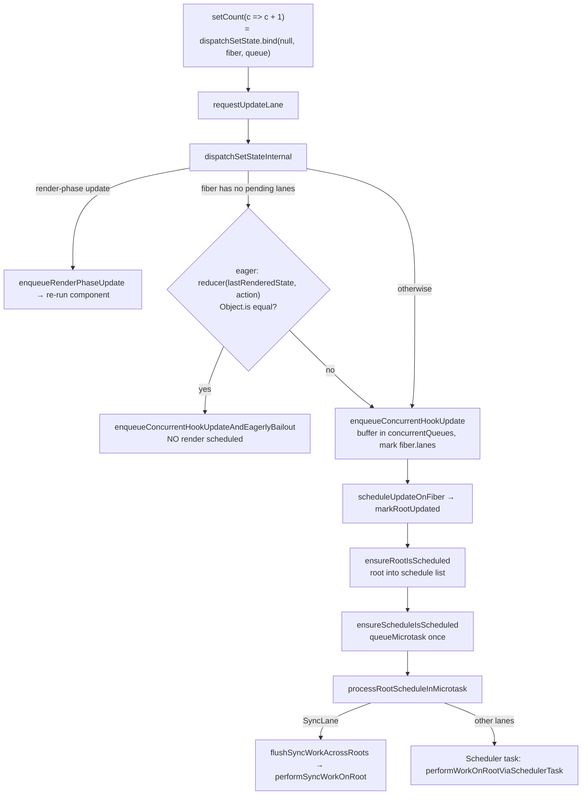

# setState：dispatchSetState 与自动批处理机制

> [!summary] 核心速览（TL;DR）
> 你在组件中调用的 `setCount(x)`，其底层本质是 `dispatchSetState(fiber, queue, x)`。它会根据当前事件优先级或 Transition 过渡上下文选取对应的优先级赛道（**Lane**）；如果在没有积压更新时发现新旧状态完全相同，它甚至会**急切预先计算**（Eagerly Compute）并直接丢弃本次更新（急切跳过计算，Eager Bailout，如果计算后的新状态与旧状态 `Object.is` 相同则跳过调度）。否则，它会将更新推入一个全局暂存缓冲区，在当前 Fiber 及其祖先链路上标记 `lanes`，并请求调度根节点（Root）。整个调度过程在多个关卡被层层去重：每个事件循环 Tick 仅注册一个微任务，且每个 Root 在相同优先级下仅保留一个调度回调。这正是同一个事件处理函数中连续调用十次 `setState` 却只触发一次渲染的根本原因。你在闭包中捕获的状态变量之所以没有立刻改变，是因为组件根本尚未重新渲染。`setState` 并不是字面意义上的“异步”，而是**推迟执行与自动批处理**（Deferred and Batched）。

前文已经剖析了 Hook 链表的挂载及其更新队列 `queue` 的创建（参见 [[10 Hooks on Mount|Hooks 挂载阶段]]），并演示了在重新渲染时该队列是如何被消费与重放的（参见 [[11 Hooks on Update|Hooks 更新阶段]]）。本文将聚焦于**生产者视角**（Producer Side）：从你在 `onClick` 中调用 `setCount` 的那一刻起，直到下一次渲染正式启动之间，React 底层所经历的全部核心流程。

## 1. 核心调用链路总览



## 2. `requestUpdateLane`：本次更新属于什么优先级？

```js
export function requestUpdateLane(fiber) {
  if (!disableLegacyMode && (fiber.mode & ConcurrentMode) === NoMode) return SyncLane; // legacy root
  if ((executionContext & RenderContext) !== NoContext && workInProgressRootRenderLanes !== NoLanes) {
    return pickArbitraryLane(workInProgressRootRenderLanes);  // setState during render
  }
  const transition = requestCurrentTransition();             // ReactSharedInternals.T
  if (transition !== null) return requestTransitionLane(transition);
  return eventPriorityToLane(resolveUpdatePriority());
}
```
（代码已做简化）[^rul]

在 React 19.x 的开源版本构建中，特性开关 `disableLegacyMode` 默认为 `true`，因此第一条分支实际上属于死代码（Dead Code）。[^flags] 真正起作用的核心输入链路包括：

- **Transition 过渡上下文**：在回调函数执行期间，`startTransition` 会将 `ReactSharedInternals.T` 设置为一个 Transition 对象。[^st][^rct] 同一事件中触发的所有过渡更新都会共享同一个 Lane 赛道：`requestTransitionLane` 会将其缓存在 `currentEventTransitionLane` 中，直到本轮微任务将其重置。这样一来，这些更新就能打包在一起合并渲染。[^rtl]
- **事件优先级（Event Priority）**：`react-dom` 中的 `resolveUpdatePriority()` 会优先读取 `ReactDOMSharedInternals.p`（若已设置）。React 自带的事件监听系统会在处理点击（Click）和键盘按键（Keydown）等离散交互时将其设置为 `DiscreteEventPriority`（详见 [[13 The Event System|事件系统]]）。如果未设置该字段，则会降级回退到 `getEventPriority(window.event.type)`。若连全局 `window.event` 也不存在（例如在 `setTimeout` 定时器或 `fetch` 网络请求回调中），则统一赋予默认优先级 `DefaultEventPriority`。[^rup]
- **事件优先级到 Lane 赛道的映射**：`eventPriorityToLane` 本质上是一个恒等映射函数。`DiscreteEventPriority` 直接对应 `SyncLane`（同步赛道），`ContinuousEventPriority` 对应 `InputContinuousLane`（连续输入赛道），而 `DefaultEventPriority` 则对应 `DefaultLane`（默认赛道）。[^ep]

> [!note] `window.event`：因祸得福的全局遗留属性
> 借助全局 `window.event` 对象，React 能够让那些来自**非 React 事件监听器**（比如开发者通过原生 `addEventListener('click', ...)` 手动绑定的事件）内部的 `setState` 调用同样获得恰当合理的优先级。这正是为什么即便你脱离 React 事件系统、直接在原生 DOM `click` 回调中调用 `setState`，React 依然能精准为其分配 `SyncLane` 同步赛道的原因。

## 3. `dispatchSetStateInternal`：急切跳过计算（Eager Bailout）

```js
function dispatchSetStateInternal(fiber, queue, action, lane) {
  const update = { lane, revertLane: NoLane, gesture: null, action,
                   hasEagerState: false, eagerState: null, next: null };

  if (isRenderPhaseUpdate(fiber)) {               // setState while this component renders
    enqueueRenderPhaseUpdate(queue, update);
  } else {
    const alternate = fiber.alternate;
    if (fiber.lanes === NoLanes && (alternate === null || alternate.lanes === NoLanes)) {
      // queue is empty, so the next state depends only on this action
      const currentState = queue.lastRenderedState;
      const eagerState = queue.lastRenderedReducer(currentState, action);
      update.hasEagerState = true;
      update.eagerState = eagerState;
      if (is(eagerState, currentState)) {
        enqueueConcurrentHookUpdateAndEagerlyBailout(fiber, queue, update);
        return false;                              // no render scheduled at all
      }
    }
    const root = enqueueConcurrentHookUpdate(fiber, queue, update, lane);
    if (root !== null) {
      scheduleUpdateOnFiber(root, fiber, lane);
      entangleTransitionUpdate(root, queue, lane);
      return true;
    }
  }
  return false;
}
```
（代码已做简化，省略了 try/catch 以及开发环境下调度器的切换逻辑）[^dssi][^dss]

为什么前提条件必须要求**双缓存双胞胎节点（Both Twins）**上的 `fiber.lanes === NoLanes` 均成立？这是因为，只有当当前更新前面没有任何其他挂起的更新排队时，“急切计算”才能成立。若已有尚未处理的更新，真正的最终状态应当是 `reduce(reduce(base, u1), thisAction)` 的链式计算结果，此时直接基于 `lastRenderedState` 计算必然会得到错误的基准基底。又因为 `dispatchSetState.bind` 在挂载时仅捕获了 `current` 与 `alternate` 这对双胞胎节点中的某一个 Fiber，所以 React 必须同时严格校验两者的 lanes。

这种机制带来了一些常让开发者大吃一惊的底层细节表现：

- **跳过调度时依然会排入更新队列**：急切跳过计算（Eager Bailout，如果计算后的新状态与旧状态 `Object.is` 相同则跳过调度）并不会悄无声息地丢弃更新，而是*依然会将该更新推入队列*（不过其优先级被赋予 `NoLane`）。这样一来，假如此时正有一个并发渲染正在进行，该更新仍能被正确地进行变基（Rebase）合并，只是它完全不会向调度器请求任何新的渲染任务。[^eagerbail]
- **事件处理函数中的第二次调用绝不可能走入急切路径**：在同一个处理函数中，第一次调用 `setX` 会立刻标记 `fiber.lanes`；因此，若当前状态为 `0`，执行 `setX(1); setX(1)` 时，第二次调用由于检测到 lanes 不为空，必定会安排一次渲染，然后在调用组件函数之后才进行**迟缓跳过计算**（Late Bailout，发现状态无变化后丢弃后续 DOM 提交）。参见 [[11 Hooks on Update|Hooks 更新阶段]] 第 5 小节。
- **即使跨越独立的不同事件，急切路径的表现也远比想象中更加脆弱**：当某次渲染完成 Commit 提交后，工作中的 WIP Fiber 副本的 lanes 会被彻底清空，但其*另一侧的副本*（此时退居为 alternate）却可能仍残留着旧的 `SyncLane`。当下一次事件中传来相同值的 `setState` 时，便会因为通不过“双胞胎节点的 lanes 必须皆为 `NoLanes`”的严苛检查，而不得不先执行一次迟缓跳过的渲染！这就是社区广为人知的“连续多次设置相同状态，组件却总会多渲染一次”的经典现象。在 [[21 Walkthrough - setState to Pixels|从 setState 到屏幕呈现端到端追踪]] 中，我们对这一过程进行了逐帧推演。
- **若急切 Reducer 计算抛出异常**：React 会静默吞掉该异常并将更新以常规方式推入队列。异常会在后续正式渲染阶段再次抛出，届时由外层的 Error Boundary（错误边界）统一捕获处理。[^dssi]
- **急切计算的结果会在渲染阶段被直接复用**：更新对象通过 `hasEagerState` 缓存了计算结果，因此函数式更新器（Functional Updater）在生产环境下通常只会被调用一次而非两次。而在开发环境的严格模式（StrictMode DEV）下，为了排查副作用，React 会刻意将其执行两次。

至于**渲染阶段更新**（Render-phase update，即直接在组件函数体顶层调用 `setState`），则会分流到 `enqueueRenderPhaseUpdate` 分支。该函数直接将更新压入 `queue.pending` 环形队列，并置位标记 `didScheduleRenderPhaseUpdateDuringThisPass`。外层的 `renderWithHooks` 捕获到该标记后会立刻重新执行组件，单次最多允许重试 25 次，超出上限后将直接抛出著名的 `"Too many re-renders"` 错误。[^erpu][^rwha]

## 4. 并发排队：全局暂存，而非直接入链

```js
function enqueueUpdate(fiber, queue, update, lane) {
  concurrentQueues[concurrentQueuesIndex++] = fiber;
  concurrentQueues[concurrentQueuesIndex++] = queue;
  concurrentQueues[concurrentQueuesIndex++] = update;
  concurrentQueues[concurrentQueuesIndex++] = lane;
  concurrentlyUpdatedLanes = mergeLanes(concurrentlyUpdatedLanes, lane);
  fiber.lanes = mergeLanes(fiber.lanes, lane);          // mark source fiber right away
  if (fiber.alternate !== null) fiber.alternate.lanes = mergeLanes(fiber.alternate.lanes, lane);
}
```
[^eu][^ecqhu]

在这一阶段，更新会被平铺写入一个模块级的并发更新队列（Concurrent Queue）一维数组 `concurrentQueues` 中，而**非**直接挂入 Hook 的 `queue.pending` 链表。为什么要这样做？设想一下：此时可能正有一个并发渲染任务在后台执行（中途暂停并让出主线程），而底层 `updateReducerImpl` 正在读取 `queue.pending`。如果新更新在中途猝不及防地直接插进链表，两个读取同一状态的组件就可能会看到截然不同的状态值，从而导致页面撕裂（Tearing）。借助全局缓冲区进行暂存隔离，能够确保当前渲染视角下的状态快照绝对稳定。只有当 `finishQueueingConcurrentUpdates()` 执行时，React 才会统一将缓冲区中的所有更新倾倒至各自 Hook 的 `queue.pending` 环形队列中，并调用 `markUpdateLaneFromFiberToRoot` 向上标记赛道。[^fqcu] 该清空操作会在开启全新渲染（`prepareFreshStack`）的起始时刻[^pfs]以及其他若干安全节点触发执行。与此同时，`enqueueConcurrentHookUpdate` 会沿着 `.return` 指针一路向上回溯到 `HostRoot` 并返回根节点，使得后续的调度逻辑可以立即开展。[^grfuf]

### `markUpdateLaneFromFiberToRoot`：为何 `childLanes` 至关重要

```js
sourceFiber.lanes |= lane;  alternate.lanes |= lane;
let parent = sourceFiber.return;
while (parent !== null) {
  parent.childLanes = mergeLanes(parent.childLanes, lane);
  if (parent.alternate !== null) parent.alternate.childLanes = mergeLanes(parent.alternate.childLanes, lane);
  // (track whether we pass through a hidden Offscreen)
  parent = parent.return;
}
```
（代码已做简化）[^mulftr]

这正是 React 渲染阶段得以保持极高吞吐效率的秘密武器。通过沿着父级指针自底向上冒泡，路径上的**每一个祖先节点都会明确得知：在自己的子树下方的某个角落，存在待处理的 Lane X 任务**。当[[06 The Work Loop - Render Phase|工作循环（Work Loop）]]从根节点自顶向下递归展开时，如果某个祖先节点的 props 未变且自身没有任何挂起的 lanes，其 `beginWork` 便会调用 `bailoutOnAlreadyFinishedWork`。该方法会快速校验 `includesSomeLane(renderLanes, workInProgress.childLanes)`：若为 `false`，则以 $O(1)$ 的开销瞬间跳过整棵子树的 Diff 计算；若为 `true`，React 才会克隆当前子节点并继续下钻，但**严格仅沿着带有标记的链路精准深入**。[^bofw] 如果没有 `childLanes`，React 就不得不像无头苍蝇一样遍历整棵 Fiber 树来定位究竟是哪一个节点发生了更新。此外，同时标记双胞胎节点（`fiber` 与 `alternate`）同样不可或缺，因为在未来的提交生命周期中，究竟哪一个副本会成为 WIP 节点完全取决于历史 Commit 轨迹。

## 5. `scheduleUpdateOnFiber` → `ensureRootIsScheduled` → 微任务阶段

`scheduleUpdateOnFiber` 首先会调用 `markRootUpdated(root, lane)`，将本次更新的赛道附加到根节点的 `root.pendingLanes` 中。它还会处理并发交错场景（例如在当前渲染进行中插进来的更新会被记入 `workInProgressRootInterleavedUpdatedLanes`），随后便紧接着调用 `ensureRootIsScheduled(root)`。[^suof] 这个调度入口函数的实现非常精简：

```js
export function ensureRootIsScheduled(root) {
  // add root to a linked list of scheduled roots (if not already there)
  mightHavePendingSyncWork = true;
  ensureScheduleIsScheduled();
}
export function ensureScheduleIsScheduled() {
  if (!didScheduleMicrotask) {
    didScheduleMicrotask = true;
    scheduleImmediateRootScheduleTask();     // queueMicrotask(processRootScheduleInMicrotask)
  }
}
```
（代码已做简化）[^eris][^esis][^sirst]

在 DOM 宿主环境配置（Host Config）中，`scheduleMicrotask` 直接由浏览器的原生 API `queueMicrotask` 提供支持。[^qm] 当本轮事件循环进入微任务检查点时，`processRootScheduleInMicrotask` 开始运行并重置调度标志。针对调度链表中的每一个 Root，`scheduleTaskForRootDuringMicrotask` 会计算其 `getNextLanes`。如果计算出的最高优先级赛道包含 `SyncLane`（同步赛道），React 会取消之前挂在 Scheduler 上的任何异步宏任务，并将 `callbackNode` 置为 `null`；否则，它会通过[[04 Lanes and the Scheduler|Scheduler 调度器]]安排一个异步任务 `performWorkOnRootViaSchedulerTask`（除非当前已存在一个**完全相同优先级**的回调任务，此时会直接复用现有任务）。[^prsim][^stfrdm] 最后，微任务内的 `flushSyncWorkAcrossRoots_impl` 会在微任务上下文中直接通过 `performSyncWorkOnRoot` 以完全同步的方式渲染所有带有同步赛道的根节点。[^fswar][^pswor]

## 6. 自动批处理：优雅架构设计下的“自然副产物”

在 React 源码中，根本不存在任何名为“Batch（批处理）”的实体对象。自动批处理（Automatic Batching）的产生，纯粹是以下三大调度去重点（Dedup Points）水到渠成的自然结果：

1. **`didScheduleMicrotask` 布尔锁**：无论当前任务中连续调用了多少次 `setState`，整个事件循环 Tick 期间全局只会向浏览器注册**唯一一个微任务**。
2. **根节点链表去重**：根节点仅会被插入待调度链表一次（通过 `root === lastScheduledRoot || root.next !== null` 进行去重判断）。
3. **`root.callbackPriority` 优先级复用**：如果后续到来的更新优先级与已安排的任务优先级一致，直接复用现存的 Scheduler 回调，不再重复创建新任务。

在微任务真正执行*之前*，所有被触发的更新对象都已悄然就位并沉淀在各个 Hook 的更新队列与根节点的 `pendingLanes` 掩码中。随之而来的那唯一一次渲染，便会一口气将这批积攒的所有更新统一合并处理。正因这套去重机制建立在根节点调度（Root Scheduling）的核心底层，完全不依赖于代码是否处于 React 的事件合成函数内部，因此 React 18+ 能够浑然天成地对 `setTimeout` 定时器、Promise 异步回调以及原生 DOM 监听器内的多次状态更新实现全场景自动批处理。而在 React 17 时代，批处理完全受限在 React 原生事件处理函数内（依赖外层的 `batchedUpdates` 上下文包裹）；一旦在 `setTimeout` 中连续调用 `setState`，每一次调用都会立刻引发一次独立的同步渲染。[^batchingwg] 来到 React 19.x 开源版本，由于 Legacy 模式已被彻底禁用，协调器内部的 `batchedUpdates` 函数已经精简成纯粹的透传调用 `return fn(a)`。[^bu]

```js
function handleClick() {
  setCount(c => c + 1);   // 赋予 SyncLane，入队；注册微任务调度
  setFlag(f => !f);       // 赋予 SyncLane，入队；微任务已被锁定，不再重复注册
  setCount(c => c + 1);   // 再次入队
}                         // → 处理函数退出后，微任务执行，合并触发仅此 1 次渲染
```

> [!tip] 不同的赛道，意味着不同的独立渲染
> 自动批处理是严格**基于 Lane 赛道**进行的。比如执行 `setA(1); startTransition(() => setB(2))` 时，前者进入 `SyncLane`，后者进入 `TransitionLane`。随后的微任务会先同步执行并提交 `SyncLane` 的渲染结果；而过渡更新则会被推迟到 Scheduler 宏任务中异步执行，且执行期间支持被更高优先级的交互随时打断。这是 React 为了保障交互响应度而做出的刻意设计，绝非批处理失效的 Bug。

## 7. `flushSync` 与 `startTransition`：改写默认调度行为

**`flushSync(fn)`**：它的内部执行逻辑是先将 `ReactSharedInternals.T` 置为 `null`，将全局更新优先级 `p` 强行设为 `DiscreteEventPriority`，同步执行回调函数 `fn`，随后恢复先前的环境变量，并立即调用 `flushSyncWork()` 触发 `flushSyncWorkOnAllRoots()`。[^fs][^fsw] 在其回调内部触发的更新会被无条件赋予 `SyncLane`，并在 `flushSync` 函数返回*之前*同步完成渲染**与 DOM 提交**，根本无需等待微任务的到来。只有当你必须在下一行代码执行前立刻拿到最新 DOM 状态时（例如获取元素几何尺寸、强制聚焦或对接第三方非 React 类库），才应使用该 API。除此类特例外，它在任何场景下都是一种性能反模式（De-optimisation）。若在组件渲染或提交生命周期内调用它，React 会在控制台抛出警告：“flushSync was called from inside a lifecycle method”。

**`startTransition(fn)`**：它会先创建一个 Transition 过渡对象并将其挂载到 `ReactSharedInternals.T` 上，随后同步执行 `fn`，并在执行完毕后立刻恢复上下文原值。[^st] 只有在 `fn` 内部**同步发生**的 `setState` 调用才能感知到 Transition 上下文，因为 `requestUpdateLane` 仅在状态被分发的那一瞬间去读取 `T`。从 React 19 开始，`fn` 支持作为异步函数（即 Action）传入。整个 Transition 会持续保持 Pending 挂起状态直到返回的 Promise 敲定（Settled），且处于同一 Action 作用域内的多个更新会绑定共享同一个赛道（通过 `requestTransitionLane` 中的 `peekEntangledActionLane` 实现）。[^rtl] 但需要注意的是，一旦异步函数运行至首个 `await` 之后，同步调用栈即刻返回，`T` 也随之被恢复为原值；因此位于 `await` 之后的 `setState` 便不再处于 Transition 上下文中。如果需要继续保持过渡优先级，必须显式将其再次包裹在另一层 `startTransition` 中。

## 8. 常见认知误区澄清

> [!warning] 误区一：“setState 是异步函数”
> 从 JavaScript Promise 的本质视角来看，`setState` 没有任何地方是异步的。更新对象的创建、Lane 赛道的计算以及入队缓冲区的推入，全都是在你调用它的那刻**完全同步完成**的。真正被“推迟”的只有**渲染阶段（Render）本身**——它被推迟到当前任务执行完毕后的微任务检查点（针对 `SyncLane`），或是等待 Scheduler 宏任务调度推进。这里根本没有任何东西支持你使用 `await` 进行等待，而且调用 `flushSync` 还可以瞬间将其强制变为完全同步执行。

> [!warning] 误区二：“为什么紧跟在 `setCount(count + 1)` 之后打印 `count` 依然是旧值？”
> 变量 `count` 本质上是一个 `const` 常量，它是在**创建该事件处理函数的那一次渲染中**被闭包捕获的。`setCount` 不可能（也无法做到）在底层直接篡改已有闭包中的变量引用。新状态值只会在下一次渲染执行时，被计算并写入新 Fiber 的 `hook.memoizedState` 中，存在于一个全新的函数闭包里。这也正是连续调用三次 `setCount(count + 1)` 最终只给状态加了 1，而调用三次 `setCount(c => c + 1)` 能准确加 3 的原因：函数式更新器会被排入更新队列，并在下一次渲染的 `updateReducerImpl` 中基于演变中的中间状态逐项链式计算。[^queueingdoc] 同理，捕获了 `count` 的 Effect 副作用或定时器闭包，在依赖项发生变化并触发重新创建之前，都会始终持有旧值——这就是前端经典的老化闭包（Stale Closure）现象，而 `useRef` 或实验性的 `useEffectEvent` 正是打破这种闭包陷阱的官方逃生舱。

> [!warning] 误区三：“连续两次设置相同的状态毫无开销”
> 首次调用可能会命中急切跳过计算（Eager Bailout）。但只要当前 Fiber 上已经被标记了待处理的 Lane 赛道，后续传入相同值的调用就无法满足急切跳过的严苛前提条件，React 依然会执行一次你的组件函数，并在发现新旧状态完全无异后触发迟缓跳过计算（Late Bailout）。尽管这个过程免去了昂贵的 DOM 操作，代价相对廉价，但你的组件函数体确实实打实地重新执行了一遍。

## 结合 React 编译器（React Compiler）的视角

**底层核心机制保持不变**。`dispatchSetState`、Lanes 优先级、并发缓冲队列以及根节点调度体系全部属于 React 运行时的协调器内核代码，而 React 编译器仅在编译阶段转译组件与自定义 Hook 的函数体。不过，编译器确实深刻改变了本篇所调度的渲染任务**在后续执行过程中的工作量**。得益于编译器自动生成的 JSX 与 props 记忆化缓存，更多的子组件能够在运行时直接命中 `oldProps === newProps` 的全等跳过机制（Early Bailout），使得单次 `setState` 所引发的子树重新渲染范围大幅缩小。另外，由于状态派发函数（Setters）在 React 底层本身就具备稳定的内存引用，编译器会将其认定为非响应式实体（通过 `isStableType` 与 `isSetStateType` 标记），从而避免将它们写入多余的缓存依赖比对数组中。[^stable] 深入了解请参见 [[15 Rendering With vs Without the Compiler|启用与未启用编译器的对比]]。

## 全文总结

从你在事件处理函数中调用 `setCount` 开始，到下一次渲染正式启动之间，`dispatchSetState` 会首先计算对应的 Lane 赛道；在满足条件时，它会急切地预先计算新状态，若无变化则直接跳过调度；在常规情况下，它会将更新推入全局并发缓冲区、沿着 Fiber 链表向上标记祖先节点的 lanes，并请求根节点调度。调度过程通过微任务和优先级复用机制在多个关卡进行去重，因此自动批处理本质上是这套精妙架构设计下的自然副产物，而非打补丁式的额外功能。请牢记这一心智模型：**setState 并非异步，而是推迟执行与自动批处理**；而你当前闭包中捕获的 `count` 变量，永远隶属于创建它的那次历史渲染。关于该队列在重新渲染时如何被消费，请参阅 [[11 Hooks on Update|Hooks 更新阶段]]。

### 核心要点清单（Key Takeaways）

- **`requestUpdateLane` 赛道决策**：优先读取 `ReactSharedInternals.T` 上的过渡状态；若无则解析当前事件优先级，其中离散交互事件 `DiscreteEventPriority` 直接映射为 `SyncLane`。
- **急切跳过计算（Eager Bailout）**：唯有当 Fiber 及其双胞胎节点的 lanes 均为 `NoLanes` 时方可触发；即使跳过渲染调度，更新对象依然会被记入队列；后续设置相同值的调用则只能在组件函数运行后执行迟缓跳过（Late Bailout）。
- **`concurrentQueues` 隔离缓冲**：更新优先平铺进入全局一维数组，而非直接挂载到 Hook 的 `queue.pending` 链表上，彻底杜绝并发渲染因中途让出主线程而引发的状态撕裂。
- **`markUpdateLaneFromFiberToRoot` 冒泡标记**：以按位或（Bitwise OR）运算将 Lane 赛道层层汇入整条链路所有祖先节点的 `childLanes` 中，使得 `beginWork` 能够以 $O(1)$ 的时间复杂度快速跳过无需更新的纯净子树。
- **`ensureRootIsScheduled` 调度收敛**：全局仅注册一个 `processRootScheduleInMicrotask` 微任务；带有 `SyncLane` 的根节点直接在当前微任务中同步完成渲染，其他赛道则被打包推入 Scheduler 宏任务队列。
- **全场景自动批处理**：依赖三大去重点，天然统一支持对 `setTimeout` 定时器、Promise 回调及原生 DOM 监听器内的多次更新进行批量合并；不同的 Lane 赛道依然对应独立的渲染批次。
- **`flushSync` 强制同步刷新**：强行将更新升级为 `SyncLane` 并在方法返回前同步完成组件渲染与 DOM 提交；除非急需读取最新 DOM，否则属于性能反模式。
- **`startTransition` 作用域边界**：仅在回调函数内**同步调用**的 `setState` 能够继承过渡赛道；对于异步 Action，`await` 之后的状态更新必须重新使用 `startTransition` 显式包裹。

---
← [[11 Hooks on Update|上一篇：Hooks 更新阶段]] · [[00 React Internals Index|目录导航]] · [[13 The Event System|下一篇：事件系统]] →

[^rul]: `requestUpdateLane`（获取更新的优先级赛道）— [packages/react-reconciler/src/ReactFiberWorkLoop.js#L812-L868](https://github.com/facebook/react/blob/v19.3.1/packages/react-reconciler/src/ReactFiberWorkLoop.js#L812-L868)
[^flags]: `disableLegacyMode = true`（禁用遗留模式特性开关）— [packages/shared/ReactFeatureFlags.js#L205](https://github.com/facebook/react/blob/v19.3.1/packages/shared/ReactFeatureFlags.js#L205)
[^st]: `startTransition`（开启过渡更新）— [packages/react/src/ReactStartTransition.js#L45-L118](https://github.com/facebook/react/blob/v19.3.1/packages/react/src/ReactStartTransition.js#L45-L118)
[^rct]: `requestCurrentTransition`（读取当前 Transition 上下文）— [packages/react-reconciler/src/ReactFiberTransition.js#L193-L195](https://github.com/facebook/react/blob/v19.3.1/packages/react-reconciler/src/ReactFiberTransition.js#L193-L195)
[^rtl]: `requestTransitionLane`（单事件内共享过渡赛道）— [packages/react-reconciler/src/ReactFiberRootScheduler.js#L698-L724](https://github.com/facebook/react/blob/v19.3.1/packages/react-reconciler/src/ReactFiberRootScheduler.js#L698-L724)
[^rup]: `resolveUpdatePriority`（解析事件优先级）— [packages/react-dom-bindings/src/client/ReactDOMUpdatePriority.js#L35-L45](https://github.com/facebook/react/blob/v19.3.1/packages/react-dom-bindings/src/client/ReactDOMUpdatePriority.js#L35-L45)
[^ep]: 事件优先级定义与 `eventPriorityToLane` 映射 — [packages/react-reconciler/src/ReactEventPriorities.js#L24-L53](https://github.com/facebook/react/blob/v19.3.1/packages/react-reconciler/src/ReactEventPriorities.js#L24-L53)
[^dssi]: `dispatchSetStateInternal`（内部状态分发实现）— [packages/react-reconciler/src/ReactFiberHooks.js#L3656-L3726](https://github.com/facebook/react/blob/v19.3.1/packages/react-reconciler/src/ReactFiberHooks.js#L3656-L3726)
[^dss]: `dispatchSetState`（对外暴露的 dispatchSetState 入口）— [packages/react-reconciler/src/ReactFiberHooks.js#L3626-L3654](https://github.com/facebook/react/blob/v19.3.1/packages/react-reconciler/src/ReactFiberHooks.js#L3626-L3654)
[^eagerbail]: `enqueueConcurrentHookUpdateAndEagerlyBailout`（急切跳过入队）— [packages/react-reconciler/src/ReactFiberConcurrentUpdates.js#L127-L151](https://github.com/facebook/react/blob/v19.3.1/packages/react-reconciler/src/ReactFiberConcurrentUpdates.js#L127-L151)
[^erpu]: `isRenderPhaseUpdate` / `enqueueRenderPhaseUpdate`（渲染阶段更新入队）— [packages/react-reconciler/src/ReactFiberHooks.js#L3838-L3864](https://github.com/facebook/react/blob/v19.3.1/packages/react-reconciler/src/ReactFiberHooks.js#L3838-L3864)
[^rwha]: `renderWithHooksAgain`（`RE_RENDER_LIMIT` 重新渲染次数限制）— [packages/react-reconciler/src/ReactFiberHooks.js#L791-L857](https://github.com/facebook/react/blob/v19.3.1/packages/react-reconciler/src/ReactFiberHooks.js#L791-L857)
[^eu]: `enqueueUpdate`（`concurrentQueues` 全局缓冲数组）— [packages/react-reconciler/src/ReactFiberConcurrentUpdates.js#L90-L113](https://github.com/facebook/react/blob/v19.3.1/packages/react-reconciler/src/ReactFiberConcurrentUpdates.js#L90-L113)
[^ecqhu]: `enqueueConcurrentHookUpdate`（并发 Hook 更新入队）— [packages/react-reconciler/src/ReactFiberConcurrentUpdates.js#L115-L125](https://github.com/facebook/react/blob/v19.3.1/packages/react-reconciler/src/ReactFiberConcurrentUpdates.js#L115-L125)
[^fqcu]: `finishQueueingConcurrentUpdates`（倾倒缓冲区至各个更新队列）— [packages/react-reconciler/src/ReactFiberConcurrentUpdates.js#L50-L84](https://github.com/facebook/react/blob/v19.3.1/packages/react-reconciler/src/ReactFiberConcurrentUpdates.js#L50-L84)
[^pfs]: `prepareFreshStack` 调用 `finishQueueingConcurrentUpdates` — [packages/react-reconciler/src/ReactFiberWorkLoop.js#L2284](https://github.com/facebook/react/blob/v19.3.1/packages/react-reconciler/src/ReactFiberWorkLoop.js#L2284)
[^grfuf]: `getRootForUpdatedFiber`（向上回溯获取根节点）— [packages/react-reconciler/src/ReactFiberConcurrentUpdates.js#L252-L276](https://github.com/facebook/react/blob/v19.3.1/packages/react-reconciler/src/ReactFiberConcurrentUpdates.js#L252-L276)
[^mulftr]: `markUpdateLaneFromFiberToRoot`（沿祖先链向上标记 lanes）— [packages/react-reconciler/src/ReactFiberConcurrentUpdates.js#L189-L250](https://github.com/facebook/react/blob/v19.3.1/packages/react-reconciler/src/ReactFiberConcurrentUpdates.js#L189-L250)
[^bofw]: `bailoutOnAlreadyFinishedWork`（校验 childLanes 跳过整棵子树）— [packages/react-reconciler/src/ReactFiberBeginWork.js#L3826-L3865](https://github.com/facebook/react/blob/v19.3.1/packages/react-reconciler/src/ReactFiberBeginWork.js#L3826-L3865)
[^suof]: `scheduleUpdateOnFiber`（在 Fiber 上安排更新）— [packages/react-reconciler/src/ReactFiberWorkLoop.js#L987-L1113](https://github.com/facebook/react/blob/v19.3.1/packages/react-reconciler/src/ReactFiberWorkLoop.js#L987-L1113)
[^eris]: `ensureRootIsScheduled`（确保根节点已安排调度）— [packages/react-reconciler/src/ReactFiberRootScheduler.js#L116-L152](https://github.com/facebook/react/blob/v19.3.1/packages/react-reconciler/src/ReactFiberRootScheduler.js#L116-L152)
[^esis]: `ensureScheduleIsScheduled`（确保调度任务已安排）— [packages/react-reconciler/src/ReactFiberRootScheduler.js#L154-L169](https://github.com/facebook/react/blob/v19.3.1/packages/react-reconciler/src/ReactFiberRootScheduler.js#L154-L169)
[^sirst]: `scheduleImmediateRootScheduleTask`（通过微任务注册根节点调度）— [packages/react-reconciler/src/ReactFiberRootScheduler.js#L650-L696](https://github.com/facebook/react/blob/v19.3.1/packages/react-reconciler/src/ReactFiberRootScheduler.js#L650-L696)
[^qm]: `scheduleMicrotask` 映射为 `queueMicrotask` — [packages/react-dom-bindings/src/client/ReactFiberConfigDOM.js#L871-L877](https://github.com/facebook/react/blob/v19.3.1/packages/react-dom-bindings/src/client/ReactFiberConfigDOM.js#L871-L877)
[^prsim]: `processRootScheduleInMicrotask`（在微任务中处理根节点调度）— [packages/react-reconciler/src/ReactFiberRootScheduler.js#L259-L348](https://github.com/facebook/react/blob/v19.3.1/packages/react-reconciler/src/ReactFiberRootScheduler.js#L259-L348)
[^stfrdm]: `scheduleTaskForRootDuringMicrotask`（在微任务执行期为根节点创建任务）— [packages/react-reconciler/src/ReactFiberRootScheduler.js#L384-L509](https://github.com/facebook/react/blob/v19.3.1/packages/react-reconciler/src/ReactFiberRootScheduler.js#L384-L509)
[^fswar]: `flushSyncWorkAcrossRoots_impl`（跨根节点冲洗同步工作）— [packages/react-reconciler/src/ReactFiberRootScheduler.js#L185-L247](https://github.com/facebook/react/blob/v19.3.1/packages/react-reconciler/src/ReactFiberRootScheduler.js#L185-L247)
[^pswor]: `performSyncWorkOnRoot`（在根节点上执行同步工作）— [packages/react-reconciler/src/ReactFiberRootScheduler.js#L608-L622](https://github.com/facebook/react/blob/v19.3.1/packages/react-reconciler/src/ReactFiberRootScheduler.js#L608-L622)
[^batchingwg]: "Automatic batching for fewer renders in React 18"（React 18 自动批处理工作组讨论 #21）— https://github.com/reactwg/react-18/discussions/21
[^bu]: `batchedUpdates`（禁用 Legacy 模式后为无操作透传）— [packages/react-reconciler/src/ReactFiberWorkLoop.js#L1854-L1878](https://github.com/facebook/react/blob/v19.3.1/packages/react-reconciler/src/ReactFiberWorkLoop.js#L1854-L1878)
[^fs]: `flushSyncImpl`（flushSync 核心实现）— [packages/react-dom/src/shared/ReactDOMFlushSync.js#L19-L50](https://github.com/facebook/react/blob/v19.3.1/packages/react-dom/src/shared/ReactDOMFlushSync.js#L19-L50)
[^fsw]: DOM `flushSyncWork` 调用 `flushSyncWorkOnAllRoots` — [packages/react-dom-bindings/src/client/ReactFiberConfigDOM.js#L5222-L5234](https://github.com/facebook/react/blob/v19.3.1/packages/react-dom-bindings/src/client/ReactFiberConfigDOM.js#L5222-L5234)
[^queueingdoc]: "Queueing a Series of State Updates"（React 官方文档：排队一系列状态更新）— react.dev, https://react.dev/learn/queueing-a-series-of-state-updates
[^stable]: `isSetStateType` / `isStableType`（编译器将 Setter 标记为稳定类型）— [compiler/packages/babel-plugin-react-compiler/src/HIR/HIR.ts#L1850-L1909](https://github.com/facebook/react/blob/v19.3.1/compiler/packages/babel-plugin-react-compiler/src/HIR/HIR.ts#L1850-L1909)
