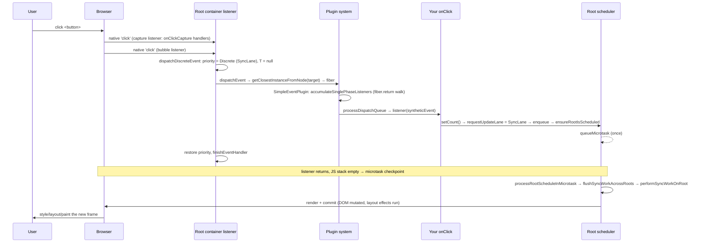

# 事件系统（The Event System）

> [!summary] 核心速览（TL;DR）
> React 从未将你的 `onClick` 直接绑定在 `<button>` 元素上。当你调用 `createRoot(container)` 时，React 会在根容器节点（Root Container）上，为支持的每种原生事件类型**分别挂载一个捕获阶段监听器和一个冒泡阶段监听器**。当点击事件触发时，冒泡监听器（由 `dispatchDiscreteEvent` 包装，将更新优先级置为 Discrete 离散事件优先级）会通过 DOM 节点上注入的内部私有属性定位到 `event.target` 对应的 Fiber 节点。随后，它沿着 `fiber.return` 指针链一路向上回溯至根节点，收集沿途所有的 `onClick` 回调，将原生事件封装为统一的合成事件（`SyntheticEvent`），并严格按序调用这些处理函数。你在事件处理函数中调用的 `setState` 会被赋予最高优先级的 `SyncLane`（同步车道），React 会赶在浏览器绘制（Paint）之前，在微任务（Microtask）中完成渲染与提交。

本篇处于开发者交互与 [[12 setState - dispatchSetState and Batching|setState 状态更新]] 之间的关键枢纽位置。它将深度剖析：*为什么*一次用户点击会产生 `SyncLane` 更新，以及在真实 DOM 元素没有任何独立监听器的情况下，React 是如何精准定位并执行你所编写的事件处理函数的。

## 1. 初始化监听挂载：`listenToAllSupportedEvents`

`createRoot`（以及 `hydrateRoot`）在初始化每个容器时，都会且仅会调用一次 `listenToAllSupportedEvents(rootContainerElement)`。[^createroot]

```js
export function listenToAllSupportedEvents(rootContainerElement) {
  if (!rootContainerElement[listeningMarker]) {
    rootContainerElement[listeningMarker] = true;
    allNativeEvents.forEach(domEventName => {
      if (domEventName !== 'selectionchange') {
        if (!nonDelegatedEvents.has(domEventName)) {
          listenToNativeEvent(domEventName, false, rootContainerElement); // bubble 冒泡
        }
        listenToNativeEvent(domEventName, true, rootContainerElement);    // capture 捕获
      }
    });
    // 'selectionchange' 仅在 document 上触发 → 因此仅在 document 上全局监听一次
  }
}
```
(代码经精简)[^ltase]

- **`allNativeEvents`**：在模块加载时由各插件静态填充。`SimpleEventPlugin.registerEvents()` 以及若干兼容性 Polyfill 插件（EnterLeave、Change、Select、BeforeInput）会向其注册所关心的事件名称。[^plugins] 其中 `registerSimpleEvents` 负责构建 `domEventName → reactName` 的映射字典（例如 `click → onClick`）以及各类特殊映射规则。特别需要注意的是 `focusin → onFocus` 和 `focusout → onBlur`：在 React 中 `onFocus` 之所以能够冒泡，正是因为其底层实际监听的是支持冒泡的原生 `focusin` 事件。[^rse]
- **`nonDelegatedEvents`**（非委托事件集）：包括 `scroll`、`scrollend`、`load`、`cancel`、`close`、`invalid`、`toggle`、`beforetoggle` 以及全部多媒体（Media）事件，它们在原生 DOM 规范中本身是不支持冒泡的。针对这类事件，React 在根容器上**仅挂载捕获阶段监听器**。此外，当 React 创建需要响应这些事件的宿主 DOM 节点时，还会直接在具体元素上单独绑定原生监听器（`listenToNonDelegatedEvent`）。[^nde]
- **`addTrappedEventListener`**：通过 `createEventListenerWrapperWithPriority` 创建实际的原生事件监听器包装函数。在支持的环境中，它会将 `touchstart`、`touchmove` 和 `wheel` 标记为 `{passive: true}`，以确保 React 的事件处理永远不会阻塞浏览器的原生平滑滚动。[^atel]

> [!note] 为什么全局事件委托挂载在 root 容器而非 `document`？
> 在 React 16 及之前版本中，所有事件均统一委托至全局 `document`。React 17 将事件委托下移至应用的根容器（Root Container）。这样一来，当同一页面中并存多个不同版本的 React 实例（或多个独立的 Root）时，它们各自内部调用 `e.stopPropagation()` 时便不会相互打架干扰；同时也让嵌入在非 React 传统应用中的 React 组件树行为更加独立受控。[^react17]

为什么要采用全局事件委托？试想一个包含 10,000 行的表格，如果采用传统做法，不仅需要注册 10,000 个原生监听器，而且在每次挂载和卸载时都要反复绑定与解绑。而在全局事件委托机制下，为 JSX 节点添加 `onClick` 除了在 Fiber 属性对象上存储一个函数引用外，完全零额外开销；处理函数哪怕每次渲染都生成新的闭包，也绝不会引起任何底层的 `add/removeEventListener` 抖动。其唯一的微小代价，仅是在事件触发时需要在 Fiber 树上执行一次向上的回溯遍历。

## 2. 预先注入监听器的优先级模型

```js
export function createEventListenerWrapperWithPriority(targetContainer, domEventName, eventSystemFlags) {
  const eventPriority = getEventPriority(domEventName);
  let listenerWrapper;
  switch (eventPriority) {
    case DiscreteEventPriority:   listenerWrapper = dispatchDiscreteEvent; break;
    case ContinuousEventPriority: listenerWrapper = dispatchContinuousEvent; break;
    default:                      listenerWrapper = dispatchEvent; break;
  }
  return listenerWrapper.bind(null, domEventName, eventSystemFlags, targetContainer);
}
```
[^celwp]

`getEventPriority` 内部是一个庞大的 `switch` 分支。`click`、`keydown`、`input`、`mousedown`、`pointerup`、`focusin` 等用户确定性离散操作属于 **Discrete（离散事件优先级 DiscreteEventPriority）**。`mousemove`、`pointermove`、`scroll`、`wheel`、`drag` 以及 `mouseenter`/`leave` 等高频连续触发事件属于 **Continuous（连续事件优先级 ContinuousEventPriority）**。`message` 事件则直接映射自当前 Scheduler 的优先级。其余所有事件均归为 **Default（默认事件优先级 DefaultEventPriority）**。[^gep]

```js
function dispatchDiscreteEvent(domEventName, eventSystemFlags, container, nativeEvent) {
  const prevTransition = ReactSharedInternals.T;
  ReactSharedInternals.T = null;                       // 点击事件绝不会隐式处于 Transition 过渡更新中
  const previousPriority = getCurrentUpdatePriority();
  try {
    setCurrentUpdatePriority(DiscreteEventPriority);   // 写入 ReactDOMSharedInternals.p = SyncLane
    dispatchEvent(domEventName, eventSystemFlags, container, nativeEvent);
  } finally {
    setCurrentUpdatePriority(previousPriority);
    ReactSharedInternals.T = prevTransition;
  }
}
```
[^dde]

这里正是连接 [[12 setState - dispatchSetState and Batching|setState 状态更新机制]] 的关键桥梁。在调用链条中，`requestUpdateLane` → `resolveUpdatePriority()` 会读取全局变量 `ReactDOMSharedInternals.p`，发现当前优先级为 `DiscreteEventPriority`（对应二进制车道 `SyncLane`），于是你在点击事件回调中所发起的每一次 `setState` 都会被赋予最高的 `SyncLane`。[^rup] `dispatchContinuousEvent` 的运作机理完全相同，只是其注入的是 `ContinuousEventPriority`（对应 `InputContinuousLane`）。[^dce] 这种优先级机制本质上是一个**动态作用域（Dynamic Scope）**：在事件分发调用前压入设定，调用结束后在 `finally` 块中严格还原，这与 `flushSync` 和 `startTransition` 所采用的设计模式如出一辙。

## 3. `dispatchEvent`：从 DOM 节点到 Fiber 节点

`dispatchEvent` 首先会调用 `findInstanceBlockingEvent(nativeEvent)`。该方法获取原生事件的目标节点，随后调用 `findInstanceBlockingTarget`，通过 `getClosestInstanceFromNode(target)` 解析出对应的 Fiber 节点。[^de][^fibt] 在服务端渲染（SSR）注水激活（Hydration）过程中，如果事件目标恰好落在尚未注水完成的脱水 Suspense / Activity 边界内部，该事件就会被判定为“受阻（Blocked）”：此时连续事件会被暂存等待注水后重放，而离散事件则会尝试先行触发同步注水。在普通正常场景下，事件不受阻，随后会携带目标 Fiber 节点直接调用 `dispatchEventForPluginEventSystem`。

**DOM 节点如何感知其对应的 Fiber 节点**：当 [[08 completeWork - Building DOM Nodes|completeWork]] 在渲染阶段构建宿主 DOM 实例时，`createInstance` 会先后调用 `precacheFiberNode(fiber, domElement)` 和 `updateFiberProps(domElement, props)`。[^ci] 这两个方法会在真实 DOM 节点上动态写入两个带有运行时随机后缀的私有属性（Expando Properties）：`'__reactFiber$' + randomKey` 与 `'__reactProps$' + randomKey`。[^keys][^pfn][^ufp] 随后，在每次组件更新的提交阶段，`commitUpdate` 都会同步刷新 DOM 节点上的 `__reactProps$`，因此该属性中保存的永远是**最近一次已提交（Committed）的最新 props**。[^cu]

`getClosestInstanceFromNode` 通过读取 `node[internalInstanceKey]` 来提取 Fiber 节点。如果事件触发的目标 DOM 并不受 React 直接托管（例如使用 `innerHTML` 插入的内容或第三方原生控件），它会沿着 `parentNode` 链条向上逐级查找，直到找到第一个由 React 托管的祖先 DOM 节点为止。[^gcifn]（顺带一提，在当前 React 19.3.1 发行版中，使用 `WeakMap` 替代 DOM 扩展属性的实验性特性开关 `enableInternalInstanceMap` 仍保持为 `false`。）

> [!tip] 可以在 DevTools 控制台中直接利用此特性
> 在浏览器开发者工具的 Console 控制台中，选中某个元素后执行 `Object.keys($0).find(k => k.startsWith('__reactFiber$'))`，便能立即获取该 DOM 节点对应的底层 Fiber 对象。这在调试审查组件的 `memoizedState`（即 [[10 Hooks on Mount|Hooks 挂载阶段]] 建立的 Hook 链表）时非常方便。当然，这属于 React 的内部私有实现细节，严禁在生产业务代码中对其产生依赖。

接下来，`dispatchEventForPluginEventSystem` 会统一处理 Portal 传送门与嵌套根节点的情况。它会向上回溯寻找容器与接收事件容器相匹配的 `HostRoot` 或 `HostPortal`，防止事件被嵌套的多个 Root 重复响应。最后，它调用 `batchedUpdates(() => dispatchEventsForPlugins(...))`。[^defpes] 在 React 19.x 开源版本中，DOM 层面的 `batchedUpdates` 最核心的使命是在事件处理完毕后执行 `finishEventHandler`。后者负责受控输入框（Controlled Inputs）的状态重置与校准，并在受控组件有需要时优先同步清空（Flush）积压的同步工作。[^dombu]

## 4. `extractEvents` 与 `accumulateSinglePhaseListeners`

`dispatchEventsForPlugins` 会初始化一个空的调度分发队列 `dispatchQueue`，依次调用 `extractEvents` 和 `processDispatchQueue`。[^defp] 其中 `extractEvents` 会固定执行核心的 `SimpleEventPlugin.extractEvents`；对于冒泡阶段，它还会额外执行一系列 Polyfill 兼容插件：EnterLeave（通过配对计算 `mouseover`/`mouseout` 来合成 `onMouseEnter`）、Change、Select、BeforeInput 以及 FormAction。[^ee]

`SimpleEventPlugin.extractEvents` 将原生 `click` 映射为 React 属性名 `onClick`，并选取对应的合成事件构造函数（针对 `click` 选取 `SyntheticMouseEvent`）。随后根据监听器标记推导出当前是否处于捕获阶段 `inCapturePhase`，接着调用收集函数收集执行链路上的所有监听器：[^seee]

```js
const listeners = accumulateSinglePhaseListeners(
  targetInst, reactName /* 'onClick' */, nativeEvent.type,
  inCapturePhase, accumulateTargetOnly /* 针对非冒泡事件（如 scroll）为 true */, nativeEvent,
);
if (listeners.length > 0) {
  const event = new SyntheticEventCtor(reactName, reactEventType, null, nativeEvent, nativeEventTarget);
  dispatchQueue.push({ event, listeners });
}
```

```js
export function accumulateSinglePhaseListeners(targetFiber, reactName, nativeEventType,
                                               inCapturePhase, accumulateTargetOnly, nativeEvent) {
  const reactEventName = inCapturePhase ? reactName + 'Capture' : reactName; // onClickCapture
  const listeners = [];
  let instance = targetFiber;
  let lastHostComponent = null;
  while (instance !== null) {
    const { stateNode, tag } = instance;
    if ((tag === HostComponent || tag === HostHoistable || tag === HostSingleton) && stateNode !== null) {
      lastHostComponent = stateNode;
      const listener = getListener(instance, reactEventName);  // stateNode.__reactProps$[...].onClick
      if (listener != null) listeners.push({ instance, listener, currentTarget: lastHostComponent });
    }
    if (accumulateTargetOnly) break;
    instance = instance.return;
  }
  return listeners;   // 收集结果顺序为：从 target 到 root
}
```
(代码经精简，移除了 createEventHandle 与 Scope API 相关分支)[^aspl]

核心机制解析：

- **遍历的是 Fiber 树，而非真实 DOM 树**：这正是为什么通过 Portal 渲染的内容，其事件能够自然顺畅地冒泡至 JSX 层面的父组件——即便该 Portal 在真实 DOM 树中被挂载在遥远的 `document.body` 下。`instance.return` 严格遵循 React 的组件层级结构向上攀爬。
- **仅收集宿主 Fiber 节点的事件**：在自定义函数组件上声明的 `<MyButton onClick>` 仅仅是一个普通的生活在 JS 闭包中的 prop。只有当数据层层传递并最终落实到 `<button>`（HostComponent 宿主组件）上时，`onClick` 才会真正被读取；而且它是从 **DOM 节点上绑定的当前最新 props**（通过 `getListener` → `getFiberCurrentPropsFromNode`）中读取的，而不是从 `fiber.memoizedProps` 中读取。[^gl] 正因 `commitUpdate` 会在每次提交阶段实时刷新 `__reactProps$`，所以执行的回调永远是最新的已提交函数，期间完全无需任何监听器重新绑定的繁重操作。
- `getListener` 会在交互元素（`button`、`input`、`select`、`textarea`）处于 `disabled` 禁用状态时直接返回 `null`（忽略鼠标事件），这精准抹平了各类浏览器在不同表单元素上的原生禁用行为差异。[^gl]
- **单次事件分发对应同一个 SyntheticEvent 实例**：在整条传播链路中，所有监听函数共享同一个合成事件（SyntheticEvent）实例；React 会在调用每个处理函数前动态更新该实例的 `currentTarget`。

## 5. 合成事件（SyntheticEvent）与 `processDispatchQueue`

`createSyntheticEvent(Interface)` 会返回一个合成事件构造函数。该构造函数会按照指定的接口定义从原生事件中拷贝字段（在此过程中磨平各大浏览器的底层兼容性怪癖），并挂载 `nativeEvent`、`target`、`type` 与 `_reactName`。它内部通过直接调用原生事件的同名方法并翻转内部状态标记 `isDefaultPrevented` / `isPropagationStopped` 来实现 `preventDefault()` 与 `stopPropagation()`。[^cse] 在 React 17 中，原有的事件对象池（Event Pooling）机制已被彻底废弃移除，因此 `persist()` 变成了空操作（No-op），而 `isPersistent()` 则恒定返回 `true`，这些方法保留下来纯粹是为了维持向下兼容。[^cse]

```js
function processDispatchQueueItemsInOrder(event, dispatchListeners, inCapturePhase) {
  let previousInstance;
  if (inCapturePhase) {
    for (let i = dispatchListeners.length - 1; i >= 0; i--) { /* root → target */ }
  } else {
    for (let i = 0; i < dispatchListeners.length; i++) {      /* target → root */
      const { instance, currentTarget, listener } = dispatchListeners[i];
      if (instance !== previousInstance && event.isPropagationStopped()) return;
      executeDispatch(event, listener, currentTarget);         // try { listener(event) } catch → reportGlobalError
      previousInstance = instance;
    }
  }
}
```
(代码经精简)[^pdqio][^ed][^pdq]

事件的捕获阶段与冒泡阶段完全是通过对同一份收集列表进行正向或反向遍历来模拟实现的。挂载在根容器上的原生捕获阶段监听器会收集 `onClickCapture` 处理函数，并从后往前（root → target）逆序执行它们；而原生冒泡阶段监听器则收集 `onClick`，并从前往后（target → root）顺序执行。某个处理函数在执行期间抛出的异常会通过 `reportGlobalError`（进而触发 `window.onerror`）向上抛报，但它**绝不会**中断同一链路上后续其他事件处理函数的执行。

## 6. 端到端全链路图解：从一次点击到像素呈现



由于离散更新的优先级是 `SyncLane`，`scheduleTaskForRootDuringMicrotask` 不会向 Scheduler 调度器注册宏任务，而是直接在当前微任务中由 `flushSyncWorkAcrossRoots_impl` 同步驱动渲染流程。[^stfrdm][^fswar] 微任务检查点总是在浏览器有机会进行下一帧渲染绘制之前执行，因此 DOM 突变在下一次浏览器重绘（Paint）前就已全部同步落盘。此外，由离散交互更新所触发的被动副作用（`useEffect`）也会在 Commit 阶段的末尾被同步清空执行，而非拖延到后续宏任务中调度[^fsw]，从而确保在用户发起下一轮交互之前整套 UI 与状态已达到绝对一致（详见 [[09 Commit Phase - Mutation, Layout, Passive Effects|Commit 阶段]]）。每一处底层函数的完整执行链路详见 [[21 Walkthrough - setState to Pixels|从 setState 到屏幕呈现]]。

> [!warning] 核心陷阱与注意事项
> - **原生监听器与 React 监听器的执行顺序差异**：如果在 `<button>` DOM 元素本身通过原生 `addEventListener` 绑定了监听器，该监听器的触发时机必定**早于**任何 React 的 `onClick` 回调。因为 React 的监听器位于根容器上，只有当原生事件在 DOM 树中冒泡至根容器时，React 才会介入处理。在 React 回调中调用 `e.stopPropagation()`，本质上是在根容器层级阻止该原生事件继续向上冒泡；它可以成功拦截冒泡至 `document` 或 `window` 上的监听器，但**绝对无法**阻止处于根容器之下的原生 DOM 监听器。
> - **`e.nativeEvent.stopImmediatePropagation()` 无法阻止同级 React 回调**：由于 React 内部的所有事件处理函数都是在根容器的同一个原生事件监听回调中由 JS 数组集中遍历执行的，因此调用原生对象的 `stopImmediatePropagation()` 对 React 自身分发的同级处理函数无效。
> - **编程式触发 `el.click()`**：通过 JS 代码主动调用 `el.click()` 会在当前 JS 调用栈内部同步分发事件，此时主线程栈尚未清空，微任务检查点必须等待你的全部外层同步代码执行完毕后才会触发。如果你需要在此类代码中间立即看到最新的 DOM 结果，必须显式使用 `flushSync`。
> - **`onScroll` 事件不会冒泡**（自 React 17 起生效）：与原生 DOM 规范一致，`onScroll` 仅在目标元素本身上收集并触发（`accumulateTargetOnly`）。
> - **`onMouseEnter` 并非原生委托的 `mouseenter`**：由于原生 `mouseenter` 不支持冒泡，React 借助 `EnterLeaveEventPlugin` 插件，通过智能比对 `mouseover` 与 `mouseout` 的节点路径配对实时计算并合成。

## 协同机制：React 编译器的影响

在事件系统的底层运作上，**完全不受影响**。事件系统全部独立运行在 `react-dom-bindings` 层面，除了依次调用你所编写的处理函数外，它本身并不涉及任何组件函数的执行。React 编译器真正重塑的是**事件处理函数的引用稳定性（Handler Identity）**。在未开启编译器时，JSX 中内联书写的 `onClick={() => setCount(c => c + 1)}` 在每次组件渲染时都会生成一个全新的函数引用。对于普通 DOM 元素而言，这没有任何副作用：React 每次渲染只需在提交阶段将新函数写入 `__reactProps$` 即可，且属性 Diff 算法对以 `on` 开头的事件属性会做特殊豁免处理；然而，这会导致接收该回调作为 prop 的下游子组件上的 `memo` 记忆化保护彻底失效。React 编译器会在编译阶段将此类内联闭包自动存入 `memo cache` 缓存中（以闭包捕获的自由变量为缓存键），使得下游 `memo` 子组件以及各类 Effect 依赖项能够始终观察到稳定的函数引用。详见 [[14 React Compiler - How It Works|React 编译器：底层工作原理]] 与 [[15 Rendering With vs Without the Compiler|启用与未启用编译器的对比]]。

## 总结

React 从未将你的 `onClick` 直接绑定在 `<button>` 真实元素上。`createRoot` 会在初始化时向根容器统一安装每种原生事件类型对应的捕获与冒泡监听器，每个监听器都根据事件类型注入了对应的执行优先级。当用户点击时，React 借助 DOM 节点上的私有属性指针逆向解析出目标 Fiber 节点，沿着 `fiber.return` 链条一路向上回溯收集所有匹配的事件处理函数，并通过单例复用的合成事件（`SyntheticEvent`）按序调用它们。包裹在该分发过程外侧的优先级动态作用域，正是驱动 [[12 setState - dispatchSetState and Batching|setState 状态更新]] 的动力源泉：处理函数中所触发的每一次 `setState` 都会被赋予最高等级的 `SyncLane`，并在浏览器下一次重绘之前的微任务中完成同步渲染与提交。紧接本篇之后的，将是深入探究 React 编译器——它虽然彻底重构了事件处理函数的引用稳定性，但底层的整套事件分发流水线依然坚如磐石。

### 核心要点速记

- **`listenToAllSupportedEvents`**：每个应用根容器只执行一次；`nonDelegatedEvents`（如 `scroll`）在此处仅注册捕获监听器，同时会单独在宿主元素上直接绑定。
- **`createEventListenerWrapperWithPriority`**：通过 `getEventPriority` 挑选对应的事件分发包装函数，将优先级深度绑定进原生监听器中。
- **`dispatchDiscreteEvent`**：在事件分发期间将全局更新优先级置为 `DiscreteEventPriority`（即 `SyncLane`），同时清空当前的 Transition 状态，调用结束后严格还原二者。
- **`__reactFiber$` / `__reactProps$`**：由 `createInstance` 写入并在 `commitUpdate` 提交阶段持续刷新的 DOM 扩展属性；它们不仅建立了真实 DOM 到对应 Fiber 的双向映射，更始终保持着最新已提交的 props 状态。
- **`accumulateSinglePhaseListeners`**：严格沿 Fiber 树而非 DOM 树回溯攀爬，因此跨 Portal 传送门的内容也能正常冒泡；过程中仅收集宿主组件（Host Fiber）上声明的监听函数。
- **`processDispatchQueue`**：通过单份收集列表的反向与正向遍历分别模拟捕获与冒泡阶段；某个处理函数抛出异常不会中断同链路后续其他处理函数的执行。
- **`SyntheticEvent`（合成事件）**：单次事件分发链路中全局共享同一实例；因 React 17 已彻底移除对象池机制，`persist()` 现为空操作。
- **微任务同步清空（Sync Flush）**：`SyncLane` 车道的更新不会向 Scheduler 申请宏任务，而是直接在微任务中执行渲染提交，确保在浏览器下一次绘制前彻底完成 DOM 更新。

---

← [[12 setState - dispatchSetState and Batching|上一篇：setState 底层实现]] · [[00 React Internals Index|目录]] · [[14 React Compiler - How It Works|下一篇：编译器工作原理]] →

[^createroot]: `createRoot` 调用 `listenToAllSupportedEvents` — [packages/react-dom/src/client/ReactDOMRoot.js#L171-L262](https://github.com/facebook/react/blob/v19.3.1/packages/react-dom/src/client/ReactDOMRoot.js#L171-L262)
[^ltase]: `listenToAllSupportedEvents` 核心实现 — [packages/react-dom-bindings/src/events/DOMPluginEventSystem.js#L432-L459](https://github.com/facebook/react/blob/v19.3.1/packages/react-dom-bindings/src/events/DOMPluginEventSystem.js#L432-L459)
[^plugins]: 事件插件注册机制 — [packages/react-dom-bindings/src/events/DOMPluginEventSystem.js#L93-L100](https://github.com/facebook/react/blob/v19.3.1/packages/react-dom-bindings/src/events/DOMPluginEventSystem.js#L93-L100)
[^rse]: `registerSimpleEvent` / `registerSimpleEvents` 属性注册 — [packages/react-dom-bindings/src/events/DOMEventProperties.js#L125-L149](https://github.com/facebook/react/blob/v19.3.1/packages/react-dom-bindings/src/events/DOMEventProperties.js#L125-L149)
[^nde]: `nonDelegatedEvents` 非委托事件清单 — [packages/react-dom-bindings/src/events/DOMPluginEventSystem.js#L236-L250](https://github.com/facebook/react/blob/v19.3.1/packages/react-dom-bindings/src/events/DOMPluginEventSystem.js#L236-L250)
[^atel]: `addTrappedEventListener` 事件绑定与 passive 配置 — [packages/react-dom-bindings/src/events/DOMPluginEventSystem.js#L461-L558](https://github.com/facebook/react/blob/v19.3.1/packages/react-dom-bindings/src/events/DOMPluginEventSystem.js#L461-L558)
[^react17]: React 官方博客《React v17.0 Release Candidate: No New Features》，事件委托架构变更 — https://legacy.reactjs.org/blog/2020/08/10/react-v17-rc.html
[^celwp]: `createEventListenerWrapperWithPriority` 优先级包装器创建 — [packages/react-dom-bindings/src/events/ReactDOMEventListener.js#L94-L119](https://github.com/facebook/react/blob/v19.3.1/packages/react-dom-bindings/src/events/ReactDOMEventListener.js#L94-L119)
[^gep]: `getEventPriority` 原生事件到优先级的映射 — [packages/react-dom-bindings/src/events/ReactDOMEventListener.js#L312-L416](https://github.com/facebook/react/blob/v19.3.1/packages/react-dom-bindings/src/events/ReactDOMEventListener.js#L312-L416)
[^dde]: `dispatchDiscreteEvent` 离散事件分发处理 — [packages/react-dom-bindings/src/events/ReactDOMEventListener.js#L121-L137](https://github.com/facebook/react/blob/v19.3.1/packages/react-dom-bindings/src/events/ReactDOMEventListener.js#L121-L137)
[^rup]: `resolveUpdatePriority` 读取更新优先级 — [packages/react-dom-bindings/src/client/ReactDOMUpdatePriority.js#L35-L45](https://github.com/facebook/react/blob/v19.3.1/packages/react-dom-bindings/src/client/ReactDOMUpdatePriority.js#L35-L45)
[^dce]: `dispatchContinuousEvent` 连续事件分发处理 — [packages/react-dom-bindings/src/events/ReactDOMEventListener.js#L139-L155](https://github.com/facebook/react/blob/v19.3.1/packages/react-dom-bindings/src/events/ReactDOMEventListener.js#L139-L155)
[^de]: `dispatchEvent` 事件分发核心入口 — [packages/react-dom-bindings/src/events/ReactDOMEventListener.js#L157-L235](https://github.com/facebook/react/blob/v19.3.1/packages/react-dom-bindings/src/events/ReactDOMEventListener.js#L157-L235)
[^fibt]: `findInstanceBlockingTarget` 寻找阻断事件的目标节点 — [packages/react-dom-bindings/src/events/ReactDOMEventListener.js#L248-L310](https://github.com/facebook/react/blob/v19.3.1/packages/react-dom-bindings/src/events/ReactDOMEventListener.js#L248-L310)
[^ci]: `createInstance` 调用 `precacheFiberNode` 与 `updateFiberProps` — [packages/react-dom-bindings/src/client/ReactFiberConfigDOM.js#L534-L664](https://github.com/facebook/react/blob/v19.3.1/packages/react-dom-bindings/src/client/ReactFiberConfigDOM.js#L534-L664)
[^keys]: `internalInstanceKey` 与 `internalPropsKey` 内部键名 — [packages/react-dom-bindings/src/client/ReactDOMComponentTree.js#L43-L45](https://github.com/facebook/react/blob/v19.3.1/packages/react-dom-bindings/src/client/ReactDOMComponentTree.js#L43-L45)
[^pfn]: `precacheFiberNode` 缓存 Fiber 至 DOM 节点 — [packages/react-dom-bindings/src/client/ReactDOMComponentTree.js#L94-L111](https://github.com/facebook/react/blob/v19.3.1/packages/react-dom-bindings/src/client/ReactDOMComponentTree.js#L94-L111)
[^ufp]: `getFiberCurrentPropsFromNode` 与 `updateFiberProps` 读取及更新 props — [packages/react-dom-bindings/src/client/ReactDOMComponentTree.js#L281-L301](https://github.com/facebook/react/blob/v19.3.1/packages/react-dom-bindings/src/client/ReactDOMComponentTree.js#L281-L301)
[^cu]: `commitUpdate` 调用 `updateFiberProps` 刷新属性 — [packages/react-dom-bindings/src/client/ReactFiberConfigDOM.js#L999-L1012](https://github.com/facebook/react/blob/v19.3.1/packages/react-dom-bindings/src/client/ReactFiberConfigDOM.js#L999-L1012)
[^gcifn]: `getClosestInstanceFromNode` 从 DOM 查找最近的 Fiber — [packages/react-dom-bindings/src/client/ReactDOMComponentTree.js#L136-L223](https://github.com/facebook/react/blob/v19.3.1/packages/react-dom-bindings/src/client/ReactDOMComponentTree.js#L136-L223)
[^defpes]: `dispatchEventForPluginEventSystem` 插件系统事件分发 — [packages/react-dom-bindings/src/events/DOMPluginEventSystem.js#L589-L703](https://github.com/facebook/react/blob/v19.3.1/packages/react-dom-bindings/src/events/DOMPluginEventSystem.js#L589-L703)
[^dombu]: DOM 层面 `batchedUpdates` 与 `finishEventHandler` — [packages/react-dom-bindings/src/events/ReactDOMUpdateBatching.js#L27-L59](https://github.com/facebook/react/blob/v19.3.1/packages/react-dom-bindings/src/events/ReactDOMUpdateBatching.js#L27-L59)
[^defp]: `dispatchEventsForPlugins` 遍历插件派发事件 — [packages/react-dom-bindings/src/events/DOMPluginEventSystem.js#L325-L344](https://github.com/facebook/react/blob/v19.3.1/packages/react-dom-bindings/src/events/DOMPluginEventSystem.js#L325-L344)
[^ee]: `extractEvents` 插件事件提取分发 — [packages/react-dom-bindings/src/events/DOMPluginEventSystem.js#L102-L203](https://github.com/facebook/react/blob/v19.3.1/packages/react-dom-bindings/src/events/DOMPluginEventSystem.js#L102-L203)
[^seee]: `SimpleEventPlugin.extractEvents` 基础事件提取 — [packages/react-dom-bindings/src/events/plugins/SimpleEventPlugin.js#L57-L235](https://github.com/facebook/react/blob/v19.3.1/packages/react-dom-bindings/src/events/plugins/SimpleEventPlugin.js#L57-L235)
[^aspl]: `accumulateSinglePhaseListeners` 沿 Fiber 树单阶段收集监听器 — [packages/react-dom-bindings/src/events/DOMPluginEventSystem.js#L717-L829](https://github.com/facebook/react/blob/v19.3.1/packages/react-dom-bindings/src/events/DOMPluginEventSystem.js#L717-L829)
[^gl]: `getListener` 从 DOM 节点读取当前 props（含 disabled 校验） — [packages/react-dom-bindings/src/events/getListener.js#L14-L78](https://github.com/facebook/react/blob/v19.3.1/packages/react-dom-bindings/src/events/getListener.js#L14-L78)
[^cse]: `createSyntheticEvent` 合成事件构造器（`persist` 为空操作，`isPersistent`） — [packages/react-dom-bindings/src/events/SyntheticEvent.js#L31-L143](https://github.com/facebook/react/blob/v19.3.1/packages/react-dom-bindings/src/events/SyntheticEvent.js#L31-L143)
[^pdqio]: `processDispatchQueueItemsInOrder` 按序执行派发队列 — [packages/react-dom-bindings/src/events/DOMPluginEventSystem.js#L266-L311](https://github.com/facebook/react/blob/v19.3.1/packages/react-dom-bindings/src/events/DOMPluginEventSystem.js#L266-L311)
[^ed]: `executeDispatch` 派发执行与全局错误捕获 — [packages/react-dom-bindings/src/events/DOMPluginEventSystem.js#L252-L264](https://github.com/facebook/react/blob/v19.3.1/packages/react-dom-bindings/src/events/DOMPluginEventSystem.js#L252-L264)
[^pdq]: `processDispatchQueue` 派发队列消费循环 — [packages/react-dom-bindings/src/events/DOMPluginEventSystem.js#L313-L323](https://github.com/facebook/react/blob/v19.3.1/packages/react-dom-bindings/src/events/DOMPluginEventSystem.js#L313-L323)
[^stfrdm]: `scheduleTaskForRootDuringMicrotask`（SyncLane：无需创建 Scheduler 任务） — [packages/react-reconciler/src/ReactFiberRootScheduler.js#L384-L509](https://github.com/facebook/react/blob/v19.3.1/packages/react-reconciler/src/ReactFiberRootScheduler.js#L384-L509)
[^fswar]: `flushSyncWorkAcrossRoots_impl` 同步清空执行所有 Root 的工作 — [packages/react-reconciler/src/ReactFiberRootScheduler.js#L185-L247](https://github.com/facebook/react/blob/v19.3.1/packages/react-reconciler/src/ReactFiberRootScheduler.js#L185-L247)
[^fsw]: `flushSpawnedWork`：同步更新产生的被动副作用在 Commit 末尾立即清空 — [packages/react-reconciler/src/ReactFiberWorkLoop.js#L4316-L4329](https://github.com/facebook/react/blob/v19.3.1/packages/react-reconciler/src/ReactFiberWorkLoop.js#L4316-L4329)
