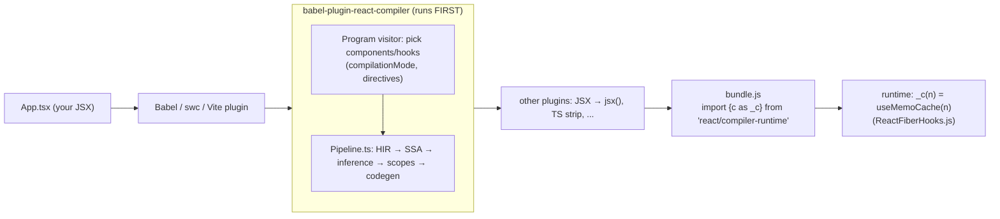

# React 编译器：底层工作原理

> [!summary] 核心速览（TL;DR）
> React Compiler（`babel-plugin-react-compiler`，自 2025 年 10 月 7 日起发布 1.0 稳定版）是一个**构建期（build-time）** Babel 插件。它通过重写组件与 Hook 函数体，使每个组件都能在一个绑定于对应 Fiber 的数组 `const $ = _c(n)` 中自动记忆化（Memoize）其中间计算值与 JSX 元素。编译器会将源码降级为控制流图（CFG）形式的中间表示（IR），推断哪些变量会产生协同突变、哪些具备响应性（Reactive），将其归类组合为“响应式作用域（Reactive Scopes）”，并为每个作用域生成形如 `if ($[i] !== dep) { recompute } else { reuse }` 的缓存分块。在运行时，它唯一依赖的 React 基础设施仅有 `useMemoCache`。React 的协调器（Reconciler）、调度器（Scheduler）与 Commit 阶段机制皆完全保持不变。

## 它的定位：在工具链中身处何处

React 编译器是一个“通过自动化记忆化来优化组件与 Hook 的优化型编译器”。虽然它以 Babel 插件的形式交付，但其核心引擎“很大程度上与 Babel 完全解耦”：它将 Babel 的 AST 降级为自研的高级中间表示（High-level Intermediate Representation，HIR），并在 HIR 上展开全套数据流分析与可变性分析。[^blog] 它是一个在打包构建时执行的纯开发依赖（dev dependency），除了一行轻量的运行时引用外，不会向浏览器多打入任何运行时负担；并且**它必须作为 Babel 插件流水线中的第一个插件运行**，因为后续的分析严重依赖最原始的源码结构形态。[^install] 目前 Vite、Next.js（借助 SWC 深度集成）、Expo/Metro、Rsbuild 和 Rspack 均已提供开箱即用的配置开关。[^install][^intro]

这套核心引擎同样也是 `eslint-plugin-react-hooks` 代码检查规则的动力之源：ESLint 插件在后台实际上会完整运行一遍编译器，并提炼输出其中的一部分诊断告警。[^design-arch]



该插件对象在内部命名为 `react-forget`（此为该项目早期的内部代号）。它通过 `Program.enter` 访问器接管整个编译流程，以确保能在任何其他插件改动源码之前尽早审视代码。[^babelplugin] 对于文件中的每一个函数，它首先判断其是否属于需要编译的组件或 Hook，接着调用编译器核心流水线，最后将生成的新 AST 节点整体替换回原代码树中。[^design-arch]

### 哪些函数会被编译：`compilationMode` 与指令控制

由 `getReactFunctionType` 函数做出裁决。[^getfntype]

| `compilationMode` 模式 | 编译目标 |
|---|---|
| `'infer'`（默认模式） | 命名符合组件规范（大驼峰 PascalCase）或 Hook 规范（`useX`），**且内部创建了 JSX 或调用了其他 Hook** 的函数；此外还包括显式带有 `"use memo"` 指令的任何函数 |
| `'annotation'` | 仅编译带有 `"use memo"` 指令的函数（适合渐进式逐步迁移改造） |
| `'syntax'` | 仅针对 Flow 的 `component`/`hook` 专属语法进行编译 |
| `'all'` | 编译顶层声明的所有函数（不推荐在生产中开启） |

开发者可通过 `"use memo"` / `"use forget"` 声明主动开启编译，亦可通过 `"use no memo"` / `"use no forget"` 显式跳过编译。[^directives] 无论处于何种模式下，**`"use no memo"` 的优先级永远最高**。[^compmode] 在默认的 `'infer'` 模式下会带来一个关键推论：普通的辅助工具函数（例如下文演示中的 `expensiveSum()`）**不会**被单独编译。编译器会自动记忆化组件内部对该工具函数的*调用*，但工具函数本身不会被重构，其计算缓存也无法跨不同组件共享。[^intro]

## 核心编译流水线（`Entrypoint/Pipeline.ts`）

`runWithEnvironment` 是编译器全部 Pass 的真实执行清单。这是一个直截了当的单向长函数，每一个 Pass 都会在一个明确的阶段名称下记录其变换输出；这些阶段名称与官方 Playground 中各个 IR 标签页的展示名称完全一一对应。[^pipe-start] 官方的设计架构文档亦将其划分为对应阶段。[^design-arch] 以下是按先后顺序执行的核心 Pass 解析：

### 1. 降级为 HIR：`lower()`
降级 Pass 会将 Babel AST 转化为由**基础块（Basic Blocks）组成的控制流图（CFG）**。每个基础块内包含线性执行的指令序列，并以终止跳转指令（Terminal）收尾。该 IR 严格保持 JS 原生执行顺序，并明确解析所有 `break`/`continue` 的跳转目标。称其为“高级（High-level）”表示，是因为它依然清晰保留着 `if`、三元表达式与 `&&` 的语义差异，以及 `for` 与 `for..of` 的结构区别，从而确保最终代码生成器能够输出与开发者手写习惯高度相仿的代码。[^lower][^design-principles] 为何选择 CFG 而不是直接在 AST 上重写？因为精准的记忆化必须立足于严密的数据流事实判定（如：“变量 `x` 在第 5 行之后是否发生过变异？存在于哪些执行分支路径上？”），而这些都是经典的控制流图分析课题。早期原型曾在 AST 上直接尝试，最终全面切换到 HIR 才使高精度的全自动分析成为可能。[^blog]

在转入静态单赋值（SSA）之前，编译器还会执行一系列清理与预处理 Pass：`pruneMaybeThrows`、`validateUseMemo`、**`dropManualMemoization`**（将开发者手写的 `useMemo`/`useCallback` 还原为普通求值代码，但保留标记以便后续验证是否完好保留了原有的性能保障）、IIFE 即时函数内联以及基础块合并。[^dropmanual]

### 2. SSA 静态单赋值：`enterSSA` 与 `eliminateRedundantPhi`
在此阶段，每一次变量赋值都会被分配一个全新的唯一标识符（Identifier），各控制流汇合分支处则插入 Phi（$\phi$）合并节点。[^ssa] 经历此 Pass 后，“此处的变量 `x` 究竟由哪一次定义抵达？”将拥有唯一无二的确定答案，为后续推断奠定坚实基石。随后紧跟常量折叠传播 Pass（`constantPropagation`）。

### 3. 类型推断与 Hook 合规性校验：`inferTypes` 与 `validateHooksUsage`
`inferTypes` 遵循**审慎且保守**的设计哲学。它仅精确识别后续流程所必需的核心形态：哪些值是 Hook、`useState` 派发函数（Setter）、Ref、基础原始类型、JSX 节点等。[^infertypes][^design-arch] 紧接着执行 `validateHooksUsage` 和 `validateNoCapitalizedCalls`。任何将 Hook 放在条件语句内的违规调用都会在此处被拦截并报错。[^pipe-validate-hooks]

### 4. 效应分析与别名推断：`analyseFunctions`、`inferMutationAliasingEffects`、`inferMutationAliasingRanges`
这是整个编译器的核心精髓所在。`inferMutationAliasingEffects` 会基于抽象堆（Abstract Heap）逐步模拟解释每一条指令，精确记录诸如 *Create（创建）*、*Capture（捕获）*、*Alias（别名化）*、*Mutate（变异）* 与 *Freeze（冻结）* 等生命周期效应。凡是流入 JSX 或传给 Hook 的变量都会被赋予 **Frozen（冻结）** 状态；组件接收的 props 以及 Hook 的返回结果在诞生之初便被默认冻结。任何对已冻结变量的修改都将触发编译器经典的“该值不可被修改（This value cannot be modified）”报错。[^aliasing-effects][^immut-error] 

紧接着，`inferMutationAliasingRanges` 会为每个变量推导其**可变生命周期区间（Mutable Range）**：即从变量初次创建，到最后一次被修改（涵盖通过别名引用的间接修改）的整个指令跨度。[^ranges] **可变区间是全书最核心的概念**。一个复杂变量只有在其**彻底完成构建组装**之后，才能作为不可变实体被安全地放入缓存；因此，所有对其造成修改的代码都必须被收敛包裹在同一个记忆化作用域块内部。

随后执行组件纯粹性规则校验（Render-purity Validations）：包括禁止在渲染期间读取 ref、禁止在渲染主体内无条件调用 `setState`、禁止在渲染后重写局部变量等。[^pipe-validations]

### 5. 响应性分析：`inferReactivePlaces`
此 Pass 会全面标注出在**不同渲染轮次之间可能发生变动**的值：包括 props、state、context、Hook 执行结果以及由它们计算衍生的所有下游变量。[^reactiveplaces] 值得一提的是，`useState` 的 setter 派发函数在机制上被判定为永久引用稳定，因此**不具备**响应性。这正是为何下文实战示例中的 `handleSelect` 可以被分配一个免依赖检查、仅需比对哨兵标记的常量级缓存槽位。

### 6. 响应式作用域的构造与对齐合并
- `inferReactiveScopeVariables`：将发生协同变异的操作数归入彼此互斥的不相交集合中。每个集合都将成长为一个**响应式作用域（Reactive Scope）**，即未来生成的独立 `if (...) {...}` 记忆化代码块。[^scopevars]
- `alignReactiveScopesToBlockScopesHIR` 与 `mergeOverlappingReactiveScopesHIR`：拉伸并兼并各个作用域，使其完美契合 JS 的块级作用域（Block Scope）语法嵌套结构。编译器绝不能生成一个起点在 `if` 分支内、终点却在外层的语法畸变代码。[^mergeoverlap]
- `buildReactiveScopeTerminalsHIR`：在控制流图中将作用域实体化为明确的作用域边界。
- `flattenScopesWithHooksOrUseHIR`：**强制展平任何内部包含 Hook 或 `use` 调用的作用域**。因为对 Hook 进行记忆化将直接导致 Hook 调用变成条件分支执行，彻底破坏 React 底层单向链表的拓扑契约。[^flattenhooks] 这正是为何编译产物中的 `useState` 永远端正地处于所有 `if ($[i] ...)` 缓存块**外部**的原因。
- `propagateScopeDependenciesHIR`：精算每个作用域的**输入依赖项（Dependencies）**，即该作用域读取的所有响应式变量（甚至能细化追踪到如 `props.items.length` 这样的属性路径），这些依赖项最终直接编译为 `$[i] !== dep` 比较守卫。[^propdeps]

### 7. ReactiveFunction 树重构与剪枝优化
`buildReactiveFunction` 将控制流图重新折叠反编译为 HIR 与 AST 融合的高级树状结构。[^buildrf] 随后运行一系列投入产出比（Cost/Benefit）优化 Pass：
- `pruneNonEscapingScopes`：若一个变量从未逃逸到外部（既未被 return 返回，也无法从返回值深层遍历抵达，更未传给 Hook），对其缓存没有任何性能收益，故彻底剔除其作用域包装。[^nonescaping]
- `pruneNonReactiveDependencies` 与 `pruneUnusedScopes`：修剪非响应式依赖与空置作用域。
- `mergeReactiveScopesThatInvalidateTogether`：若两个作用域依赖项完全相同，或前一个作用域的产出恰好是后一个作用域的唯一输入，二者必然永远同步失效，编译器会将它们合并为一个作用域，以节约缓存槽位和分支比对开销。[^mergeinval]
- `pruneAlwaysInvalidatingScopes`：若一个字面量对象或数组从未被记忆化且每次渲染都会新建，那么其下游的一切记忆化都是徒劳无功的浪费，编译器会顺藤摸瓜清理掉下游的失效缓存块。[^alwaysinval]
- 随后执行提前返回传播（`propagateEarlyReturns`）、临时变量提升（`promoteUsedTemporaries`）、变量重命名（`renameVariables`）以及手写记忆化校验（`validatePreservedManualMemoization`，确保编译器产物绝不低于开发者原有手写 `useMemo` 的保真度）。

### 8. 目标代码生成：`codegenFunction`
若组件内部使用了任何缓存槽位，代码生成器会在函数顶部注入 `const $ = _c(<槽位总数>)` 声明。[^codegen-c] 为每个作用域生成由 `||` 串联的 `$[i] !== dep` 守卫条件。[^codegen-neq] 若作用域**完全无动态依赖**，则生成一次性初始化判定：`$[k] === Symbol.for("react.memo_cache_sentinel")`。[^codegen-sentinel] 对应的运行时导入模块来源：若编译目标为 React 19（`target: '19'`），则直接从 `react/compiler-runtime` 引入；若面向 React 17/18，则从外部 `react-compiler-runtime` npm 运行时包导入。[^runtime-module]

> [!note] 流水线是一个演进中的活动目标
> 上述列举的 Pass 名称源自官方 Monorepo 仓库在 `v19.3.1` 标签下的 `Pipeline.ts`。下方演示使用的 npm 包 `babel-plugin-react-compiler@1.0.0` 为独立发版，其实际内部 Pass 清单可能有细微增删，但整体核心架构与各阶段核心逻辑完全一致。

## 编译器真实输出详解（逐行技术注释）

以下示例代码经由 `@babel/core` 与 `babel-plugin-react-compiler@1.0.0` 真实编译生成；为了保持最清晰的阅读体验，JSX 语法转换特意保留未展开。

**输入源码（Input）：**

```jsx
import { useState } from "react";

function expensiveSum(items) {
  let total = 0;
  for (const item of items) total += item.price;
  return total;
}

export function List({ items, onSelect }) {
  return (
    <ul>
      {items.map((item) => (
        <li key={item.id} onClick={() => onSelect(item.id)}>{item.name}</li>
      ))}
    </ul>
  );
}

export function Counter({ items }) {
  const [count, setCount] = useState(0);
  const [selected, setSelected] = useState(null);
  const total = expensiveSum(items);
  const handleSelect = (id) => setSelected(id);

  return (
    <div>
      <button onClick={() => setCount(count + 1)}>Clicked {count}</button>
      <p>Total: {total} / selected: {selected}</p>
      <List items={items} onSelect={handleSelect} />
    </div>
  );
}
```

**`Counter` 组件编译输出结果：**（代码为真实编译器产物，`// ◀` 旁注为技术机制解析）

```js
import { c as _c } from "react/compiler-runtime";        // ◀ 每个文件仅引入一次；指向 React 底层的 useMemoCache
export function Counter(t0) {
  const $ = _c(17);                                        // ◀ 在该 Fiber 的记忆化缓存上分配 17 个槽位
  const {
    items
  } = t0;                                                  // ◀ props 解构被移入函数体内部规范执行
  const [count, setCount] = useState(0);                   // ◀ Hooks 永远无条件执行（flattenScopesWithHooks）
  const [selected, setSelected] = useState(null);
  let t1;
  if ($[0] !== items) {                                    // ◀ 作用域 1：依赖 items（首屏挂载时为 sentinel 哨兵，必为 true）
    t1 = expensiveSum(items);                              // ◀ 自动补全了你无需手写的 "useMemo"
    $[0] = items;                                          // ◀ 暂存输入依赖...
    $[1] = t1;                                             // ◀ ...并暂存计算结果（原子化成对写入）
  } else {
    t1 = $[1];                                             // ◀ 命中缓存：直接跳过循环求值
  }
  const total = t1;
  let t2;
  if ($[2] === Symbol.for("react.memo_cache_sentinel")) {  // ◀ 无响应式依赖：setSelected 永远引用稳定
    t2 = id => setSelected(id);                            // ◀ 自动补全了你无需手写的 "useCallback"；仅在挂载时创建一次
    $[2] = t2;
  } else {
    t2 = $[2];
  }
  const handleSelect = t2;
  let t3;
  if ($[3] !== count) {                                    // ◀ 内联处理函数捕获闭包变量 count → 依赖为 count
    t3 = () => setCount(count + 1);
    $[3] = count;
    $[4] = t3;
  } else {
    t3 = $[4];
  }
  let t4;
  if ($[5] !== count || $[6] !== t3) {                     // ◀ <button> 元素，依赖 count 与处理函数
    t4 = <button onClick={t3}>Clicked {count}</button>;
    $[5] = count;
    $[6] = t3;
    $[7] = t4;
  } else {
    t4 = $[7];
  }
  let t5;
  if ($[8] !== selected || $[9] !== total) {               // ◀ <p> 元素仅在其输入变更时才重新构造
    t5 = <p>Total: {total} / selected: {selected}</p>;
    $[8] = selected;
    $[9] = total;
    $[10] = t5;
  } else {
    t5 = $[10];
  }
  let t6;
  if ($[11] !== items) {                                   // ◀ <List> 元素：handleSelect 稳定，故唯一依赖为 items
    t6 = <List items={items} onSelect={handleSelect} />;
    $[11] = items;
    $[12] = t6;
  } else {
    t6 = $[12];                                            // ◀ 产出与上一轮渲染完全相同的 Element 内存对象 → 达成 Bailout
  }
  let t7;
  if ($[13] !== t4 || $[14] !== t5 || $[15] !== t6) {      // ◀ 最外层 <div>：依赖子元素对象引用
    t7 = <div>{t4}{t5}{t6}</div>;
    $[13] = t4;
    $[14] = t5;
    $[15] = t6;
    $[16] = t7;
  } else {
    t7 = $[16];                                            // ◀ 全无变化 → 完整复用整棵旧元素树
  }
  return t7;
}
```

深度解析：
- **粒度比任何手工优化都要精细**：每个 JSX 节点对应一个独立的微型 `useMemo`，其依赖键精准收敛到该节点实际读取的字段上。当你点击按钮时，仅 `count` 变动，因此只有 `t3`、`t4` 与 `t7` 重新生成，而 `t5` 与 `t6`（`<List>` 元素对象）则被 100% 原样复用。
- **元素对象的内存引用全等是核心价值兑现点**：`t6` 产出的是与上一轮渲染在内存地址上**完全相同（`===`）**的对象实例。正是这个机制让下游协调器能够直接跳过 `List` 的递归 Diff；详见 [[15 Rendering With vs Without the Compiler|使用与不使用编译器的渲染差异对比]]。
- **缓存写入严格原子化**：一个作用域的输入依赖与输出结果永远在同一帧内成对写入。React 在 `useMemoCache` 内部重度依赖此特性。

**`List` 组件编译输出结果：**

```js
export function List(t0) {
  const $ = _c(7);
  const { items, onSelect } = t0;
  let t1;
  if ($[0] !== items || $[1] !== onSelect) {
    let t2;
    if ($[3] !== onSelect) {
      t2 = item => <li key={item.id} onClick={() => onSelect(item.id)}>{item.name}</li>;
      $[3] = onSelect;
      $[4] = t2;
    } else {
      t2 = $[4];
    }
    t1 = items.map(t2);
    $[0] = items; $[1] = onSelect; $[2] = t1;
  } else {
    t1 = $[2];
  }
  // ... <ul>{t1}</ul> 元素对象缓存于 t1 之上（占用槽位 5-6）
}
```

当内联回调未捕获任何外部响应式变量时，编译器还会进一步将其**外提（Function Outlining）**至模块顶层。在第 15 篇的场景中，`data.map((d) => <Row .../>)` 会直接被优化为 `data.map(_temp)`，其中 `_temp` 被提升为模块级单例函数。[^outline]

## 运行时架构：`_c` 与 `useMemoCache`

在 React 19 中，`react/compiler-runtime` 是一个极简的单行重导出：`export {useMemoCache as c} from './ReactHooks'`；在全局环境上 React 也以 `React.__COMPILER_RUNTIME` 暴露它。[^react-runtime] `useMemoCache` 在本质上就是挂载在 Dispatcher 分发器上的一个标准 Hook；挂载分发器与更新分发器内部指向同一个函数实现。[^dispatchers] 它不遵循常规 Hook 的挂载/更新二段分立，并且**绝不在 `memoizedState` 链表上额外分配 `Hook` 节点**（关于该链表结构详见 [[10 Hooks on Mount|Hooks 挂载阶段]]）。相反，记忆化缓存直接寄宿在 Fiber 对象的 **`fiber.updateQueue.memoCache`** 属性上。[^fcuq]

```js
// packages/react-reconciler/src/ReactFiberHooks.js（架构精简版）
function useMemoCache(size) {
  let memoCache = currentlyRenderingFiber.updateQueue?.memoCache;  // 同一轮渲染阶段中的重渲染
  if (memoCache == null) {
    const current = currentlyRenderingFiber.alternate;
    const currentMemoCache = current?.updateQueue?.memoCache;
    if (currentMemoCache != null) {
      memoCache = {
        data: enableNoCloningMemoCache
          ? currentMemoCache.data
          : currentMemoCache.data.map(array => array.slice()), // 写时复制（Copy-on-write）
        index: 0,
      };
    }
  }
  if (memoCache == null) memoCache = { data: [], index: 0 };     // 首次挂载初始化
  // ... 确保 updateQueue 存在，并将 memoCache 挂载其上
  let data = memoCache.data[memoCache.index];
  if (data === undefined) {
    data = memoCache.data[memoCache.index] = new Array(size);
    for (let i = 0; i < size; i++) data[i] = REACT_MEMO_CACHE_SENTINEL;
  }
  memoCache.index++;
  return data;
}
```

源码实现见 `ReactFiberHooks.js`。[^usememocache] 几项资深架构师必须掌握的底层机理：

- **挂载首屏（Mount）**：缓存数组被全量填充为 `Symbol.for('react.memo_cache_sentinel')` 哨兵符号。首屏所有的 `$[i] !== dep` 判定将必然为 true（因为没有任何业务数据会全等于该私有 Symbol），从而顺利驱使所有作用域完成首次计算。无依赖的作用域则显式执行 `=== sentinel` 初始化。
- **更新轮次（Update）与写时复制（COW）**：`renderWithHooks` 在每次开始渲染组件前，都会主动将 `workInProgress.updateQueue = null` 置空清零。[^rwh-null] 因此，`useMemoCache` 在更新时会通过浅克隆（`slice()`）复制来自 `current` 树的缓存数组（除非显式开启 `enableNoCloningMemoCache` 实验特性，但在 React v19.3.1 中该开关默认保持关闭）。[^nocloneflag] 这种浅克隆机制确保了即使并发渲染由于高优先级中断而被随时丢弃，也绝不会污染当前已经提交生效的稳定缓存；这与 Fiber 树本身的**双缓存（Double Buffering）机制**（详见 [[05 The Fiber Data Structure|Fiber 数据结构]]）如出一辙。其代价仅为每个组件在每轮渲染中付出一次极小的数组克隆开销。
- **原子化写入的深意**：官方源码注释指明，由于编译器绝不会单独记录输入而遗漏输出，未来版本甚至可以探索跨多次中断渲染共享同一套缓存，从而实现组件执行到一半时的“断点续传（Resume）”。[^usememocache]
- **Render 阶段内的重渲染（Render-phase re-renders）**：若在渲染阶段调用了 `setState`，重跑时会复用同一个 `workInProgress` 缓存，`resetFunctionComponentUpdateQueue` 仅将游标 `index` 归零，而不会抹除数据。[^resetuq]
- 槽位长度 `size` 在该组件的所有生命周期中必须是绝对恒定的常量。在 DEV 调试模式下，如果动态改变大小，React 会立即抛出控制台错误。[^usememocache]

### 面向 React 17/18 的兼容方案：`react-compiler-runtime`
当指定 `target: '17' | '18'` 时，代码生成器会转为从 `react-compiler-runtime` 引入依赖，该库必须作为**生产运行时依赖（runtime dependency）**安装在项目中。[^target][^runtime-module] 它的 `c` 方法在检测到宿主环境存在 `React.__COMPILER_RUNTIME.c` 时会直接桥接调用原生实现；若不存在，则平滑降级为用户态 Polyfill：`useMemo(() => new Array(size).fill($empty), [])`，即由一个常规的 `useMemo` 维系一个哨兵数组。该 Polyfill 还会标记 `$[$empty] = true` 供 React DevTools 识别。[^polyfill] 这种兼容模式的妥协在于：缓存回退为普通的 Hook 槽位，丧失了在更新队列上的写时复制（COW）保护。

## 跳过机制（Bailouts）：编译器何时对函数放手

编译器秉持的核心哲学是：**跳过优化永远是绝对安全的**。在默认配置（`panicThreshold: 'none'`）下，任何未通过语法校验的函数都会被**原样保留输出**，构建流程绝不会中断。[^panic][^handleerror] 针对几类典型代码的编译器实测行为如下：

| 组件特征 | 编译结果 | 编译器触发事件 |
|---|---|---|
| 函数体包含 `"use no memo"` 指令 | 原样输出，不做任何修改 | `CompileSkip`，指令跳过 |
| 包含条件 Hook：`if (cond) { useState() }` | 原样输出，不做任何修改 | `CompileError`：“Hooks must always be called in a consistent order…”[^hooksusage] |
| 渲染期间读取 Ref：`return <div>{ref.current}</div>` | 原样输出，不做任何修改 | `CompileError`：“Cannot access refs during render”[^refaccess] |
| 直接修改入参：`props.label = "x"` | 原样输出，不做任何修改 | `CompileError`：“This value cannot be modified”[^immut-error] |
| 对解构后的 prop 执行变异：`items.push(1)` | **被成功编译！** | `CompileSuccess` |

> [!warning] 最后一行的深层启示
> 在组件内调用 `items.push(1)` 明明违反了 React 核心规范（Rules of React），为何编译器依然判定编译成功？因为编译器只静态推导出 `items` 是一个被冻结的值，但它在编译期无法证明 `items` 运行时一定是个数组，也就无法断定 `.push` 必然是变异操作。编译器最终将组件编译，并将 `<div>{items.length}</div>` 绑定在 `items.length` 依赖上。**编译器只对它能在静态分析中完全证伪的内容进行拦截；其余契约依然依赖开发者自觉恪守**。这正是官方文档的论述：“如果你的代码以编译器无法探测的微妙方式破坏了 React 规范，就会引发运行时异常”。[^debugging]

其他常见跳过原因：函数内部若包含针对 React 规范的 ESLint/Flow 禁用注释（`findProgramSuppressions`），编译器会直接推定该代码已知违规而放弃优化。[^suppressions] 此外，针对已知存在兼容冲突的三方库 API（如 `react-hook-form` 的 `watch`、TanStack Table 等，内置于 `DefaultModuleTypeProvider.ts` 清单中）也会主动放弃优化。[^incompatible] 类组件（Class Components）由于属于明确的非目标范畴，同样一律跳过。[^design-goals]

配置项 `panicThreshold` 控制抛错严苛程度：`'none'`（默认，官方建议生产环境始终保持）静默跳过不合规函数；`'critical_errors'` 仅在遇到致命未识别错误时中断构建；`'all_errors'` 则在遇到任何诊断异样时直接让构建失败。[^panic][^panicenum] 配置本身的错误无论何种模式均会中断构建。[^handleerror] 若希望在不中断构建的前提下排查跳过原因，可配置 `logger` 并挂载 `logEvent` 回调，或直接启用配套的 ESLint 规则。

## 编译器“不做什么”的边界澄清

- **完全不碰协调器、调度器、Lanes 赛道或 Commit 提交机制**。它只负责重构组件函数体内部的逻辑。[[06 The Work Loop - Render Phase|工作循环]]、[[07 beginWork and Reconciliation|beginWork 与协调]]、[[04 Lanes and the Scheduler|Lanes 赛道模型与 Scheduler]] 以及 [[09 Commit Phase - Mutation, Layout, Passive Effects|Commit 阶段]] 在编译前后的执行逻辑 100% 相同。整体性能跃升是**间接促成的**：通过产出稳定的 Element 与 Prop 内存引用，顺水推舟地击中了 React 架构早已内建的 Bailout 跳过通道。
- **它无法阻止拥有状态变更的组件自身重新执行**。当组件自身触发 `setState` 时，函数体依然会运行，编译器只是让这次运行的开销变得极其廉价。
- **它默认不编译 `node_modules`**（默认 `sources` 规则将其排斥在外），不编译类组件，也不编译非组件/Hook 的通用辅助函数。[^defaults][^design-goals]
- **不跨组件或跨组件实例共享记忆化缓存**。每一个 Fiber 实例都独立拥有属于自己的专属缓存槽位。[^intro]
- **它并非追求理论上的“完美（零冗余）记忆化”**。消除全部冗余计算是官方明确宣布的非目标（Non-Goal），因为过度的追踪开销和膨胀的代码体积反倒会严重拖垮页面的首屏冷启动表现。[^design-goals]
- **它绝不改变合规代码的原生语义**。现存手写的 `useMemo`/`useCallback` 依然可用作语义逃逸舱（例如强制锚定某个 Effect 的依赖项稳定性）。官方建议在接入编译器时保留既有手写优化，因为直接粗暴删除可能会对编译器的依赖划分推断产生扰动。[^intro]

> [!tip] 破除迷思：“React 编译器让 React 变成了类似 Solid/Signals 的细粒度响应式系统”
> 并非如此。React 依然是从发起状态更新的组件节点出发，自顶向下进行树级单向重渲染。编译器做的是让这些重渲染开销大幅**降低**，并让未变动的整棵子树直接**跳过（Bailout）**递归，这正是官方文档将“细粒度响应性（fine-grained reactivity）”特意加上引号的原因。[^intro]

欲观察编译器在状态更新时如何精准作用于每一个 Fiber 节点，请参阅专栏下一篇：[[15 Rendering With vs Without the Compiler|使用与不使用编译器的渲染差异对比]]。

## 总结

React 编译器是一个在构建期运行的 Babel 插件。它通过将组件与 Hook 重写为挂载在 Fiber 节点独立数组 `const $ = _c(n)` 上的自动记忆化形态，彻底免去了手动优化心智负担。它将源码降级为控制流图（CFG），推导变量变异生命周期与响应式流动，聚合为响应式作用域，并为每个作用域输出形如 `$[i] !== dep` 的微型缓存守卫。运行时仅需一个轻量的 `useMemoCache` 即可运转。React 原生的协调器、调度器与 Commit 管道完全保持原样；编译器只是负责为其递交高度稳定的内存对象，并顺势激活底层沉睡的高性能跳过路径。

### 核心要点速查

- **`compilationMode`**：`'infer'` 仅编译命名合规且内部包含 JSX 或 Hook 调用的函数；`"use no memo"` 拥有绝对否决权。
- **HIR 控制流降级**：精确记忆化依赖控制流事实判断，因此 AST 必须被转化为由基础块构成的控制流图。
- **可变区间（Mutable Range）**：复杂对象只有在其彻底装配完结后才能作为单元被缓存，因而引发变异的代码必须收敛于同一记忆化块内。
- **`inferReactivePlaces`**：props、state、context 与 Hook 产物具备响应性；`useState` 的 setter 被推断为绝对稳定。
- **`flattenScopesWithHooksOrUseHIR`**：强制展平包含 Hook 的作用域，确保 `useState` 等永远在记忆化 `if` 条件块外安全调用。
- **Codegen 代码生成**：生成成对的 `$[i] !== dep` 比较守卫（无依赖则为哨兵检查），且输入依赖与输出计算必须原子化成对存入。
- **`useMemoCache`**：缓存直接宿主在 `fiber.updateQueue.memoCache` 上而无需占用 Hook 链表槽位；更新阶段采用写时复制（COW，`enableNoCloningMemoCache` 默认关闭）。
- **跳过容错机制（Bailouts）**：校验失败的函数默认静默原样保留，编译器仅拦截静态可证伪的违规；若隐蔽破坏规范（如未声明类型的 `items.push(1)`）仍会被编译。
- **并非细粒度框架**：React 依然保持基于状态持有者的自顶向下重渲染流水线；只是重渲染被极大轻量化，无变动子树得以提前跳过。

---

← [[13 The Event System|上一篇：事件系统]] · [[00 React Internals Index|目录导航]] · [[15 Rendering With vs Without the Compiler|下一篇：使用与不使用编译器的渲染对比]] →

[^blog]: React Compiler v1.0 官方发布博文 (Lauren Tan, Joe Savona, Mofei Zhang, 2025年10月7日): https://react.dev/blog/2025/10/07/react-compiler-1
[^intro]: react.dev 官方文档, "React Compiler: Introduction": https://react.dev/learn/react-compiler/introduction
[^install]: react.dev 官方文档, "React Compiler: Installation" (必须在 Babel 插件流水线第一位运行): https://react.dev/learn/react-compiler/installation
[^debugging]: react.dev 官方文档, "Debugging and Troubleshooting": https://react.dev/learn/react-compiler/debugging
[^compmode]: react.dev 官方参考, `compilationMode` 模式参考: https://react.dev/reference/react-compiler/compilationMode
[^panic]: react.dev 官方参考, `panicThreshold` 异常阈值参考: https://react.dev/reference/react-compiler/panicThreshold
[^target]: react.dev 官方参考, `target` 构建目标参考: https://react.dev/reference/react-compiler/target
[^incompatible]: react.dev 官方参考, `incompatible-library` 检查规范: https://react.dev/reference/eslint-plugin-react-hooks/lints/incompatible-library; 包含 `react-hook-form` 与 `@tanstack/react-table` 的内置冲突清单见 [compiler/packages/babel-plugin-react-compiler/src/HIR/DefaultModuleTypeProvider.ts#L46-L89](https://github.com/facebook/react/blob/v19.3.1/compiler/packages/babel-plugin-react-compiler/src/HIR/DefaultModuleTypeProvider.ts#L46-L89)
[^design-arch]: 编译器设计文档，系统架构章节: [compiler/docs/DESIGN_GOALS.md#L38-L55](https://github.com/facebook/react/blob/v19.3.1/compiler/docs/DESIGN_GOALS.md#L38-L55)
[^design-principles]: 编译器设计文档，设计原则 (HIR): [compiler/docs/DESIGN_GOALS.md#L29-L36](https://github.com/facebook/react/blob/v19.3.1/compiler/docs/DESIGN_GOALS.md#L29-L36)
[^design-goals]: 编译器设计文档，核心目标与非目标: [compiler/docs/DESIGN_GOALS.md#L5-L27](https://github.com/facebook/react/blob/v19.3.1/compiler/docs/DESIGN_GOALS.md#L5-L27)
[^babelplugin]: `BabelPluginReactCompiler` 入口实现 — [compiler/packages/babel-plugin-react-compiler/src/Babel/BabelPlugin.ts#L24-L36](https://github.com/facebook/react/blob/v19.3.1/compiler/packages/babel-plugin-react-compiler/src/Babel/BabelPlugin.ts#L24-L36)
[^getfntype]: `getReactFunctionType` 实现 — [compiler/packages/babel-plugin-react-compiler/src/Entrypoint/Program.ts#L865-L911](https://github.com/facebook/react/blob/v19.3.1/compiler/packages/babel-plugin-react-compiler/src/Entrypoint/Program.ts#L865-L911)
[^directives]: `OPT_IN_DIRECTIVES` / `OPT_OUT_DIRECTIVES` 常量定义 — [compiler/packages/babel-plugin-react-compiler/src/Entrypoint/Program.ts#L49-L50](https://github.com/facebook/react/blob/v19.3.1/compiler/packages/babel-plugin-react-compiler/src/Entrypoint/Program.ts#L49-L50)
[^pipe-start]: `runWithEnvironment` 驱动 `lower` — [compiler/packages/babel-plugin-react-compiler/src/Entrypoint/Pipeline.ts#L148-L158](https://github.com/facebook/react/blob/v19.3.1/compiler/packages/babel-plugin-react-compiler/src/Entrypoint/Pipeline.ts#L148-L158)
[^lower]: `lower` 实现 — [compiler/packages/babel-plugin-react-compiler/src/HIR/BuildHIR.ts#L72](https://github.com/facebook/react/blob/v19.3.1/compiler/packages/babel-plugin-react-compiler/src/HIR/BuildHIR.ts#L72)
[^dropmanual]: 早期清理 Pass 包括 `dropManualMemoization` — [Pipeline.ts#L160-L181](https://github.com/facebook/react/blob/v19.3.1/compiler/packages/babel-plugin-react-compiler/src/Entrypoint/Pipeline.ts#L160-L181); 核心实现见 [Inference/DropManualMemoization.ts#L391](https://github.com/facebook/react/blob/v19.3.1/compiler/packages/babel-plugin-react-compiler/src/Inference/DropManualMemoization.ts#L391)
[^ssa]: `enterSSA` 实现 — [compiler/packages/babel-plugin-react-compiler/src/SSA/EnterSSA.ts#L254](https://github.com/facebook/react/blob/v19.3.1/compiler/packages/babel-plugin-react-compiler/src/SSA/EnterSSA.ts#L254); 在 [Pipeline.ts#L188-L198](https://github.com/facebook/react/blob/v19.3.1/compiler/packages/babel-plugin-react-compiler/src/Entrypoint/Pipeline.ts#L188-L198) 调用
[^infertypes]: `inferTypes` 类型推断 — [compiler/packages/babel-plugin-react-compiler/src/TypeInference/InferTypes.ts#L64](https://github.com/facebook/react/blob/v19.3.1/compiler/packages/babel-plugin-react-compiler/src/TypeInference/InferTypes.ts#L64)
[^pipe-validate-hooks]: `inferTypes` 衔接 `validateHooksUsage` — [Pipeline.ts#L200-L212](https://github.com/facebook/react/blob/v19.3.1/compiler/packages/babel-plugin-react-compiler/src/Entrypoint/Pipeline.ts#L200-L212)
[^aliasing-effects]: `analyseFunctions` 与 `inferMutationAliasingEffects` — [Pipeline.ts#L217-L221](https://github.com/facebook/react/blob/v19.3.1/compiler/packages/babel-plugin-react-compiler/src/Entrypoint/Pipeline.ts#L217-L221); 具体实现见 [Inference/InferMutationAliasingEffects.ts#L98](https://github.com/facebook/react/blob/v19.3.1/compiler/packages/babel-plugin-react-compiler/src/Inference/InferMutationAliasingEffects.ts#L98)
[^immut-error]: “This value cannot be modified” 报错实现 — [compiler/packages/babel-plugin-react-compiler/src/Inference/InferMutationAliasingEffects.ts#L612-L615](https://github.com/facebook/react/blob/v19.3.1/compiler/packages/babel-plugin-react-compiler/src/Inference/InferMutationAliasingEffects.ts#L612-L615)
[^ranges]: `inferMutationAliasingRanges` 架构注释 — [compiler/packages/babel-plugin-react-compiler/src/Inference/InferMutationAliasingRanges.ts#L32-L75](https://github.com/facebook/react/blob/v19.3.1/compiler/packages/babel-plugin-react-compiler/src/Inference/InferMutationAliasingRanges.ts#L32-L75)
[^pipe-validations]: 可变区间后的渲染合规性校验 — [Pipeline.ts#L234-L296](https://github.com/facebook/react/blob/v19.3.1/compiler/packages/babel-plugin-react-compiler/src/Entrypoint/Pipeline.ts#L234-L296)
[^reactiveplaces]: `inferReactivePlaces` 响应性识别 — [compiler/packages/babel-plugin-react-compiler/src/Inference/InferReactivePlaces.ts#L205](https://github.com/facebook/react/blob/v19.3.1/compiler/packages/babel-plugin-react-compiler/src/Inference/InferReactivePlaces.ts#L205); 于 [Pipeline.ts#L298-L299](https://github.com/facebook/react/blob/v19.3.1/compiler/packages/babel-plugin-react-compiler/src/Entrypoint/Pipeline.ts#L298-L299) 触发
[^scopevars]: `inferReactiveScopeVariables` 作用域推导 — [compiler/packages/babel-plugin-react-compiler/src/ReactiveScopes/InferReactiveScopeVariables.ts#L60-L86](https://github.com/facebook/react/blob/v19.3.1/compiler/packages/babel-plugin-react-compiler/src/ReactiveScopes/InferReactiveScopeVariables.ts#L60-L86); 在 [Pipeline.ts#L328-L336](https://github.com/facebook/react/blob/v19.3.1/compiler/packages/babel-plugin-react-compiler/src/Entrypoint/Pipeline.ts#L328-L336) 经 `enableMemoization` 控制
[^mergeoverlap]: `alignReactiveScopesToBlockScopesHIR` 与 `mergeOverlappingReactiveScopesHIR` — [Pipeline.ts#L384-L395](https://github.com/facebook/react/blob/v19.3.1/compiler/packages/babel-plugin-react-compiler/src/Entrypoint/Pipeline.ts#L384-L395); [HIR/MergeOverlappingReactiveScopesHIR.ts#L105](https://github.com/facebook/react/blob/v19.3.1/compiler/packages/babel-plugin-react-compiler/src/HIR/MergeOverlappingReactiveScopesHIR.ts#L105)
[^flattenhooks]: `flattenScopesWithHooksOrUseHIR` 展平包含 Hook 的作用域 — [compiler/packages/babel-plugin-react-compiler/src/ReactiveScopes/FlattenScopesWithHooksOrUseHIR.ts#L20-L40](https://github.com/facebook/react/blob/v19.3.1/compiler/packages/babel-plugin-react-compiler/src/ReactiveScopes/FlattenScopesWithHooksOrUseHIR.ts#L20-L40)
[^propdeps]: `propagateScopeDependenciesHIR` 依赖精算 — [compiler/packages/babel-plugin-react-compiler/src/HIR/PropagateScopeDependenciesHIR.ts#L53](https://github.com/facebook/react/blob/v19.3.1/compiler/packages/babel-plugin-react-compiler/src/HIR/PropagateScopeDependenciesHIR.ts#L53); 在 [Pipeline.ts#L428-L433](https://github.com/facebook/react/blob/v19.3.1/compiler/packages/babel-plugin-react-compiler/src/Entrypoint/Pipeline.ts#L428-L433) 运行
[^buildrf]: `buildReactiveFunction` 重构树结构 — [compiler/packages/babel-plugin-react-compiler/src/ReactiveScopes/BuildReactiveFunction.ts#L42](https://github.com/facebook/react/blob/v19.3.1/compiler/packages/babel-plugin-react-compiler/src/ReactiveScopes/BuildReactiveFunction.ts#L42); 剪枝优化群位于 [Pipeline.ts#L435-L491](https://github.com/facebook/react/blob/v19.3.1/compiler/packages/babel-plugin-react-compiler/src/Entrypoint/Pipeline.ts#L435-L491)
[^nonescaping]: `pruneNonEscapingScopes` 架构注释 — [compiler/packages/babel-plugin-react-compiler/src/ReactiveScopes/PruneNonEscapingScopes.ts#L40-L60](https://github.com/facebook/react/blob/v19.3.1/compiler/packages/babel-plugin-react-compiler/src/ReactiveScopes/PruneNonEscapingScopes.ts#L40-L60)
[^mergeinval]: `mergeReactiveScopesThatInvalidateTogether` 架构注释 — [compiler/packages/babel-plugin-react-compiler/src/ReactiveScopes/MergeReactiveScopesThatInvalidateTogether.ts#L60-L86](https://github.com/facebook/react/blob/v19.3.1/compiler/packages/babel-plugin-react-compiler/src/ReactiveScopes/MergeReactiveScopesThatInvalidateTogether.ts#L60-L86)
[^alwaysinval]: `pruneAlwaysInvalidatingScopes` 消除持续失效作用域 — [compiler/packages/babel-plugin-react-compiler/src/ReactiveScopes/PruneAlwaysInvalidatingScopes.ts#L18-L29](https://github.com/facebook/react/blob/v19.3.1/compiler/packages/babel-plugin-react-compiler/src/ReactiveScopes/PruneAlwaysInvalidatingScopes.ts#L18-L29)
[^outline]: `enableFunctionOutlining` 驱动 `outlineFunctions` — [Pipeline.ts#L358-L361](https://github.com/facebook/react/blob/v19.3.1/compiler/packages/babel-plugin-react-compiler/src/Entrypoint/Pipeline.ts#L358-L361)
[^codegen-c]: `codegenFunction` 生成 `const $ = _c(n)` 注入 — [compiler/packages/babel-plugin-react-compiler/src/ReactiveScopes/CodegenReactiveFunction.ts#L163-L178](https://github.com/facebook/react/blob/v19.3.1/compiler/packages/babel-plugin-react-compiler/src/ReactiveScopes/CodegenReactiveFunction.ts#L163-L178)
[^codegen-neq]: `codegenReactiveScope` 构造 `$[i] !== dep` 比较 — [CodegenReactiveFunction.ts#L560-L590](https://github.com/facebook/react/blob/v19.3.1/compiler/packages/babel-plugin-react-compiler/src/ReactiveScopes/CodegenReactiveFunction.ts#L560-L590)
[^codegen-sentinel]: 针对无依赖作用域的哨兵测试 — [CodegenReactiveFunction.ts#L650-L667](https://github.com/facebook/react/blob/v19.3.1/compiler/packages/babel-plugin-react-compiler/src/ReactiveScopes/CodegenReactiveFunction.ts#L650-L667); 常量 `MEMO_CACHE_SENTINEL` 位于 [L62](https://github.com/facebook/react/blob/v19.3.1/compiler/packages/babel-plugin-react-compiler/src/ReactiveScopes/CodegenReactiveFunction.ts#L62)
[^runtime-module]: `getReactCompilerRuntimeModule` 运行时决议 — [compiler/packages/babel-plugin-react-compiler/src/Entrypoint/Program.ts#L1337-L1345](https://github.com/facebook/react/blob/v19.3.1/compiler/packages/babel-plugin-react-compiler/src/Entrypoint/Program.ts#L1337-L1345)
[^react-runtime]: `react/compiler-runtime` 实现 → [packages/react/src/ReactCompilerRuntime.js#L10](https://github.com/facebook/react/blob/v19.3.1/packages/react/src/ReactCompilerRuntime.js#L10); `__COMPILER_RUNTIME` 暴露见 [packages/react/src/ReactClient.js#L111](https://github.com/facebook/react/blob/v19.3.1/packages/react/src/ReactClient.js#L111); `useMemoCache` 挂载于 Dispatcher 见 [packages/react/src/ReactHooks.js#L212-L216](https://github.com/facebook/react/blob/v19.3.1/packages/react/src/ReactHooks.js#L212-L216)
[^dispatchers]: `HooksDispatcherOnMount` 与 `OnUpdate` 均绑定 `useMemoCache` — [packages/react-reconciler/src/ReactFiberHooks.js#L3926-L3981](https://github.com/facebook/react/blob/v19.3.1/packages/react-reconciler/src/ReactFiberHooks.js#L3926-L3981)
[^fcuq]: `FunctionComponentUpdateQueue.memoCache` 存储结构 — [packages/react-reconciler/src/ReactFiberHooks.js#L249-L254](https://github.com/facebook/react/blob/v19.3.1/packages/react-reconciler/src/ReactFiberHooks.js#L249-L254)
[^usememocache]: `useMemoCache` 核心源码 — [packages/react-reconciler/src/ReactFiberHooks.js#L1181-L1263](https://github.com/facebook/react/blob/v19.3.1/packages/react-reconciler/src/ReactFiberHooks.js#L1181-L1263)
[^rwh-null]: `renderWithHooks` 初始化清空 `updateQueue` — [packages/react-reconciler/src/ReactFiberHooks.js#L529-L531](https://github.com/facebook/react/blob/v19.3.1/packages/react-reconciler/src/ReactFiberHooks.js#L529-L531)
[^nocloneflag]: `enableNoCloningMemoCache = false` 特性开关 — [packages/shared/ReactFeatureFlags.js#L128](https://github.com/facebook/react/blob/v19.3.1/packages/shared/ReactFeatureFlags.js#L128)
[^resetuq]: `resetFunctionComponentUpdateQueue` 重置更新队列 — [packages/react-reconciler/src/ReactFiberHooks.js#L1084-L1096](https://github.com/facebook/react/blob/v19.3.1/packages/react-reconciler/src/ReactFiberHooks.js#L1084-L1096)
[^polyfill]: `react-compiler-runtime` 中 `c` 的 Polyfill 实现 — [compiler/packages/react-compiler-runtime/src/index.ts#L19-L39](https://github.com/facebook/react/blob/v19.3.1/compiler/packages/react-compiler-runtime/src/index.ts#L19-L39)
[^handleerror]: `handleError` (panicThreshold) 异常兜底机制 — [compiler/packages/babel-plugin-react-compiler/src/Entrypoint/Program.ts#L246-L262](https://github.com/facebook/react/blob/v19.3.1/compiler/packages/babel-plugin-react-compiler/src/Entrypoint/Program.ts#L246-L262)
[^panicenum]: `PanicThresholdOptionsSchema` 枚举模式 — [compiler/packages/babel-plugin-react-compiler/src/Entrypoint/Options.ts#L20-L37](https://github.com/facebook/react/blob/v19.3.1/compiler/packages/babel-plugin-react-compiler/src/Entrypoint/Options.ts#L20-L37)
[^defaults]: `defaultOptions` 默认配置项 (`compilationMode: 'infer'`, `panicThreshold: 'none'`, `sources` 排除 `node_modules`, `target: '19'`) — [compiler/packages/babel-plugin-react-compiler/src/Entrypoint/Options.ts#L312-L330](https://github.com/facebook/react/blob/v19.3.1/compiler/packages/babel-plugin-react-compiler/src/Entrypoint/Options.ts#L312-L330)
[^hooksusage]: `validateHooksUsage` 校验 Hook 规范 — [compiler/packages/babel-plugin-react-compiler/src/Validation/ValidateHooksUsage.ts#L86](https://github.com/facebook/react/blob/v19.3.1/compiler/packages/babel-plugin-react-compiler/src/Validation/ValidateHooksUsage.ts#L86)
[^refaccess]: `validateNoRefAccessInRender` 校验渲染期 Ref 访问 — [compiler/packages/babel-plugin-react-compiler/src/Validation/ValidateNoRefAccessInRender.ts#L122](https://github.com/facebook/react/blob/v19.3.1/compiler/packages/babel-plugin-react-compiler/src/Validation/ValidateNoRefAccessInRender.ts#L122)
[^suppressions]: `findProgramSuppressions` 规范禁用注释识别 — [compiler/packages/babel-plugin-react-compiler/src/Entrypoint/Program.ts#L431-L443](https://github.com/facebook/react/blob/v19.3.1/compiler/packages/babel-plugin-react-compiler/src/Entrypoint/Program.ts#L431-L443)
