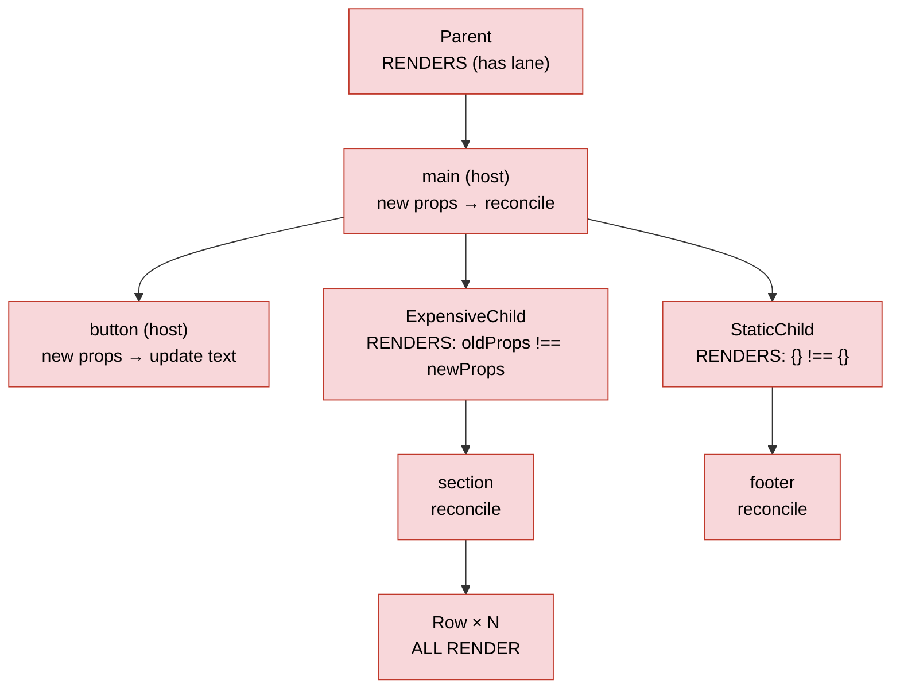
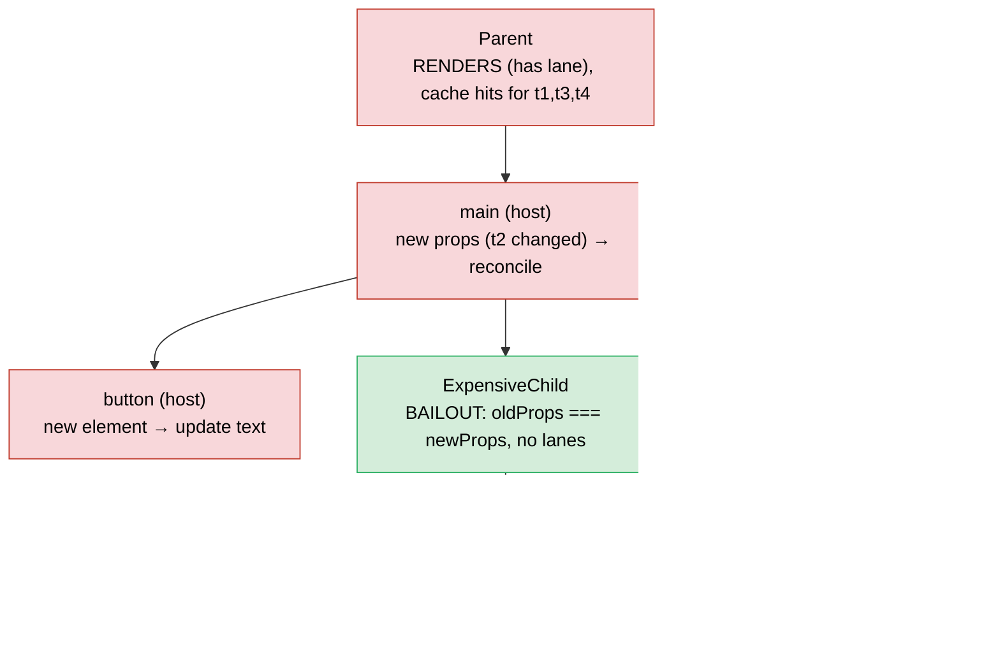

# 启用与未启用编译器时的渲染比对（Rendering With vs Without the Compiler）

> [!summary] 核心速览（TL;DR）
> React 协调器（Reconciler）一直内置了一条开销极低的跳过路径：如果某个 Fiber 的 props 对象与上一次渲染时具有**完全相同的内存引用**，且自身没有待处理的更新任务，`beginWork` 就会直接跳过它，甚至跳过它的整棵子树。然而在未启用编译器时，一旦父组件重新渲染，其下方的子树几乎**永远无法命中**这条跳过路径——因为每次渲染都会重新创建 JSX 元素对象，从而生成全新的 props 对象。经过编译器编译后的组件则会直接返回**缓存的**元素对象，使 `oldProps === newProps` 恒成立，整棵子树得以直接跳过渲染（Bailout）。除了初始化填充缓存的微小开销外，两种模式下的首次渲染流程完全一致；最终真正落到真实 DOM 上的必要更新操作也完全相同。

关于编译器的底层工作机制，请参阅 [[14 React Compiler - How It Works|React 编译器工作原理]]。本文将针对单次状态更新，逐行追踪其在两种模式下穿过 [[07 beginWork and Reconciliation|beginWork 与协调（Reconciliation）]] 的完整运行时执行轨迹比对。

## 示例应用

```jsx
function ExpensiveChild({ data }) {
  const rows = data.map((d) => <Row key={d.id} value={d.value} />);
  return <section>{rows}</section>;
}

function StaticChild() {
  return <footer>Static footer</footer>;
}

export function Parent({ data }) {
  const [count, setCount] = useState(0);
  return (
    <main>
      <button onClick={() => setCount((c) => c + 1)}>{count}</button>
      <ExpensiveChild data={data} />
      <StaticChild />
    </main>
  );
}
```

以下是 `babel-plugin-react-compiler@1.0.0` 为 `Parent` 生成的真实转译代码。代码完全保持原样，注释为译者/作者所加。（源码来源：演练场中的 `compile-demo/examples/Parent.jsx` → `out-Parent.js`。）

```js
export function Parent(t0) {
  const $ = _c(9);
  const { data } = t0;
  const [count, setCount] = useState(0);
  let t1;
  if ($[0] === Symbol.for("react.memo_cache_sentinel")) {
    t1 = () => setCount(_temp2);              // 处理函数仅创建一次（setCount 引用保持稳定）
    $[0] = t1;
  } else { t1 = $[0]; }
  let t2;
  if ($[1] !== count) {
    t2 = <button onClick={t1}>{count}</button>; // 仅当 count 变化时重新构建
    $[1] = count; $[2] = t2;
  } else { t2 = $[2]; }
  let t3;
  if ($[3] !== data) {
    t3 = <ExpensiveChild data={data} />;        // 依赖 data 进行缓存
    $[3] = data; $[4] = t3;
  } else { t3 = $[4]; }
  let t4;
  if ($[5] === Symbol.for("react.memo_cache_sentinel")) {
    t4 = <StaticChild />;                       // 无依赖项：在 Fiber 生命周期内仅创建一次
    $[5] = t4;
  } else { t4 = $[5]; }
  let t5;
  if ($[6] !== t2 || $[7] !== t3) {
    t5 = <main>{t2}{t3}{t4}</main>;
    $[6] = t2; $[7] = t3; $[8] = t5;
  } else { t5 = $[8]; }
  return t5;
}
function _temp2(c) { return c + 1; }            // updater 更新函数被提取至模块作用域
```

（这里合并了部分换行，语句逻辑未作任何改动。）`ExpensiveChild` 同样经过了编译：`rows` 基于 `data` 进行缓存，而 `<section>` 则基于 `rows` 进行缓存。`map` 的回调函数未捕获任何响应式变量，因此被直接提取到模块作用域成为 `_temp`。`StaticChild` 则被转换为由哨兵值（Sentinel）守卫保护的单一 `<footer>` 元素。

## 支撑这一奇效的跳过机制（Bailout）

所有性能收益，本质上都源于 `beginWork` 入口处的一段判定逻辑：

```js
// packages/react-reconciler/src/ReactFiberBeginWork.js（简化版）
if (current !== null) {
  const oldProps = current.memoizedProps;
  const newProps = workInProgress.pendingProps;
  if (oldProps !== newProps || hasLegacyContextChanged() /* || DEV hot reload */) {
    didReceiveUpdate = true;
  } else {
    const hasScheduledUpdateOrContext = checkScheduledUpdateOrContext(current, renderLanes);
    if (!hasScheduledUpdateOrContext && (workInProgress.flags & DidCapture) === NoFlags) {
      didReceiveUpdate = false;
      return attemptEarlyBailoutIfNoScheduledUpdate(current, workInProgress, renderLanes);
    }
    // ...
  }
}
```

这就是跳过渲染判定的全部规则。[^bw-bailout] 请特别注意：这里的比对是对**整个 props 对象的全等引用比对（`oldProps !== newProps`）**，而非浅比较（Shallow Compare）。`checkScheduledUpdateOrContext` 会检查当前 Fiber 是否在正在渲染的赛道（`current.lanes`）上存在待处理更新，或者它所读取的 Context 是否发生了变化。[^checksched] 如果两者皆无，这次提前跳过就会进入 `bailoutOnAlreadyFinishedWork`。若其 `childLanes` 同样与 `renderLanes` 没有交集，函数将直接返回 `null`，这意味着**整棵子树都被彻底跳过渲染（Bailout）**。反之，若子树中存在工作，它会克隆现有子节点，并继续向下遍历，直至找到真正有待处理工作的 Fiber。[^bailout-finished]

那么，`pendingProps` 与 `memoizedProps` 究竟从何而来？
- 当父节点协调（Reconcile）子节点并发现相同类型的元素时，会调用 `useFiber(current, element.props)`，通过 `pendingProps = element.props` 创建正在处理的 WIP（Work-In-Progress）Fiber。[^useFiber][^cwip]
- 当 `beginWork` 处理完毕后，`performUnitOfWork` 会将 `memoizedProps = pendingProps`。[^puow]

由此可见，`memoizedProps` 从字面意义上讲，就是上次渲染时该元素的 props 对象。**一旦父组件在此次渲染中交出的是同一个元素对象，`newProps === oldProps` 便自然成立。** 在未编译代码中，JSX 会被转译为 `jsx(type, props)`，每次调用都会分配全新的元素对象和全新的 props 对象（参见 [[01 Bootstrap - Packages, JSX and the Dispatcher|初始化引导]]），因此父组件绝不可能交出引用相同的对象。而在编译后的代码中，只要响应式作用域的依赖项未发生改变，父组件就能直接复用并交出上次缓存的元素对象。

> [!note] 这项技巧并非编译器的专属发明
> 过去将 `const footer = <StaticChild />` 手动提升（Hoist）至模块作用域，或者直接从外部由父组件透传 `children`，在底线上命中的也一直是这条完全相同的跳过路径。而 React 编译器所做的事情，只不过是将其自动化应用到了每一个输入未发生变化的元素之上。

## 首次渲染：相同的执行路径，附加缓存填充

首次挂载（Mount）时，所有 Fiber 上的 `current === null`，因此在两种模式下都无法命中跳过分支。所有组件均需执行，所有 Fiber 都会被创建，且 [[08 completeWork - Building DOM Nodes|completeWork 构建 DOM 节点]] 会构建出所有的真实 DOM 节点。

编译器在此基础上仅仅增加了以下步骤：
1. `_c(9)` → `useMemoCache(9)` 在当前 Fiber 及其 alternate 上均未发现缓存，因此分配 `{data: [], index: 0}`，将其挂载到 `fiber.updateQueue.memoCache` 上，并分配一个包含 9 个槽位的数组，填充初始哨兵值 `REACT_MEMO_CACHE_SENTINEL`。[^umc]
2. 各个响应式作用域依次运行。由于槽位中存放的是哨兵值，`$[i] !== dep` 判定为真，而受哨兵保护的作用域按定义必然求值为真。各作用域随后将各自的依赖项和产出值写入对应槽位。
3. 额外开销仅为每个已编译组件实例分配的一个数组，以及存储依赖项与输出产物所需的少量内存：每个作用域仅增加数次简单的比对与赋值操作。编译器官方宣称的设计目标是“保持首屏启动耗时持平（Startup time neutral）”。[^design-goals] 对一个 1.5 万行代码规模的应用进行的独立基准测试表明，其对首屏加载并未产生任何可观测到的负面影响。[^makarevich]

除此之外，整条执行链路完全相同：[[03 root.render - Scheduling the First Update|root.render 调度首次更新]] → [[06 The Work Loop - Render Phase|工作循环（Work Loop）]] → [[09 Commit Phase - Mutation, Layout, Passive Effects|提交阶段（Commit Phase）]]。

## 状态变迁：点击按钮

点击按钮触发 `setCount` → `dispatchSetState`，为 `Parent` Fiber 标记更新赛道（Lane），并将 `childLanes` 一路向上冒泡至根节点（参见 [[12 setState - dispatchSetState and Batching|setState 底层实现]]）。渲染流程从根节点开始，`Parent` 的所有祖先节点均通过 `oldProps === newProps` 命中跳过逻辑，同时依据 `childLanes` 的标记克隆子节点并逐层向下推进到 `Parent`。这一部分在两种模式下完全相同。

`Parent` 自身携带待处理的赛道，因此它**在两种模式下都会重新执行渲染**。`updateReducer` 发现新的 `count` 与旧值不同（`!is(new, old)`），随即调用 `markWorkInProgressReceivedUpdate()`。[^reducer-mark] 详见 [[11 Hooks on Update|Hooks 更新阶段]]。

### 未启用编译器时的执行链路

`Parent()` 返回全新的 `<main>` 元素，其内部包含全新的 `<button>`、全新的 `<ExpensiveChild data={data}/>`（全新的 props 对象，即便 `data` 引用相同）以及全新的 `<StaticChild/>`（全新的空对象 `{}` 作为 props）。



`Parent` 下方的每一个函数组件都会被执行：`ExpensiveChild` 重新遍历 `data` 映射并创建 N 个全新的 `<Row>` 元素，每个 `Row` 依次执行，依此类推层层向下。该子树中的每一个宿主 Fiber（Host Fiber，如 `<section>`、`Row` 所渲染的具体标签、`<footer>`）同样获得了全新的 props 对象。`completeWork` 中的 `updateHostComponent` 仅仅进行 `oldProps === newProps` 比较，判定不相等后，便会将它们全部标记上 `Update` 副作用。[^hostcomplete] 随后在 Commit 提交阶段，`commitUpdate` → `updateProperties` 会对每一个被打上标记的节点逐一进行新旧 props 的 Diff 比对。[^commitupdate] 尽管绝大多数 Diff 最终都会发现属性并无实质变化，因而**真实 DOM 上发生的唯一定点写入就只有按钮的文本**，但你依然为整棵子树白白支付了所有组件执行与 props 差异比对的算力成本。（这里并不存在独立的 `HostText` Fiber。因为 `<button>{count}</button>` 只有一个基础数据类型子节点，React 会直接将其视作 `children` 属性进行优化处理：通过 `updateProperties` → `setTextContent` 直接更新。此外，未编译版本在每次渲染时还会重新绑定 `onClick` 事件，因为每次生成的箭头函数都是全新的；而编译后版本则会直接跳过此操作，因为事件处理函数已经被缓存。参见 [[21 Walkthrough - setState to Pixels|从 setState 到屏幕呈现]]。）此时唯一的传统优化手段就是使用 `React.memo`，它在 `updateSimpleMemoComponent` 中将严格的全等引用检查转为 `shallowEqual(prevProps, nextProps)`。但它唯有在每个 prop 引用都保持稳定的前提下才能生效，这反过来又强迫开发者必须在父组件中大量铺设 `useCallback` 与 `useMemo`。[^simplememo]

### 启用编译器时的执行链路

由于更新发起于 `Parent`，`Parent()` 依然会照常执行。但在其函数内部：
- `$[1] !== count` 为真，因此重新构建了全新的 `<button>` 元素。
- `$[3] !== data` 为假，因此 `t3` 直接复用上次渲染时**完全相同的 `<ExpensiveChild>` 元素对象**。
- `t4` 同样是完全相同的 `<StaticChild>` 元素对象（初始哨兵值已在首轮渲染中被替换）。
- 由于 `t2` 发生了变化，因而重新构建了全新的 `<main>` 容器。



`<main>` 开始协调其子节点数组。对于 `ExpensiveChild` 和 `StaticChild`，它调用 `useFiber(current, element.props)` 时传入的是*被缓存*元素的 props——而这恰恰就是上一次作为 `memoizedProps` 存下的同一个对象。当协调进入这些 Fiber 的 `beginWork` 时，满足 `oldProps === newProps`、没有待处理的 Lane 且无 Context 变化，因此 `attemptEarlyBailoutIfNoScheduledUpdate` → `bailoutOnAlreadyFinishedWork` 直接返回 `null`。**组件函数压根不会被调用，其整棵子树也完全不会被遍历访问。**[^bw-bailout][^bailout-finished] 虽然对于成功跳过渲染（Bailout）的 Fiber 节点本身而言，`completeWork` 依然会走一遍（`performUnitOfWork` 规定任何 `beginWork` 返回 `null` 的工作单元都直接进入 complete 流程），但其下方所有后代节点均被完整跳过，毫厘未动。[^puow]

### 第二道防线：已编译子组件的自愈能力

退一步讲，假设 `ExpensiveChild` *确实*需要重新渲染——例如 `data` 本身发生了改变，或是它读取的某个 Context 发生了变化。此时它自身的内部缓存机制依然会构筑起第二道坚固防线。只有在 `data` 确实变更时才会重新计算 `rows`；若 `ExpensiveChild` 是因为不相关的外部原因（如自身订阅的某个 Context 变更）触发重渲染，那么 `rows` 与 `<section>` 都会直接从缓存数组 `$` 中取出，其下的所有 `Row` 节点将全部成功跳过渲染（Bailout）。在未启用编译器时，重新渲染永远是瀑布式层层下泄的；而在启用编译器后，重新渲染会在遇到“输入未变”的第一级子节点处戛然而止。这直接覆盖了以往 `React.memo` 绝大部分的使用场景。当然，二者并非*完全等价*：当父组件递交一个 props 浅层相等的新元素时，已编译组件的函数本身仍会执行一次（开销极低），而 `React.memo` 则是直接跳过该函数调用。

> [!warning] 常见误区：“启用了编译器，Parent 就不会重新渲染了”
> 这是一个误解。拥有并变更状态的组件本身始终会重新执行。编译器**无法改变被调度的对象是谁**。它改变的是每次执行时会分配多少新对象，以及**子组件**能否拿到完全相同的 props 引用。在 React DevTools 中，`Parent` 依然会高亮显示触发重渲染，而编译通过的组件则会带上 ✨ 图标标记。[^debugging]

## 两种模式全方位比对表

| 关注维度 | 未启用编译器（Without Compiler） | 启用编译器（With Compiler） |
|---|---|---|
| 持有状态的组件本身 | 照常渲染 | 照常渲染（二者完全一致） |
| 其产出的 JSX 元素 | 每次渲染全部重新分配全新对象 | 仅重新分配依赖项发生改变的元素；其余直接从 `$` 缓存复用 |
| 输入未发生变化的子组件 | 递归触发重新渲染（因每次 props 对象都是全新的） | 命中 `beginWork` 的跳过逻辑（`oldProps === newProps`），整棵子树直接跳过渲染（Bailout） |
| 协调算法（子节点 Diff 比对） | 覆盖更新组件下方的整棵子树 | 仅限于实际发生变动的路径；被跳过的子树压根不参与 Diff |
| 被标记 `Update` 的宿主 Fiber（Commit 阶段需比对 props） | 重渲染子树中的每个宿主 Fiber 都会被标记，因为其 props 对象引用全都是新的 | 仅标记发生真实变更链路上的宿主 Fiber |
| Commit 阶段真实发生的 DOM 变更 | 仅针对真正变更的属性/内容（本例中仅为一个文本节点） | **完全相同**。编译器无法削减必要的 DOM 写入，而 `updateProperties` 原本就会自动跳过无实质变化的写入 |
| 副作用（Effects）依赖项稳定性 | 渲染期间创建的对象/函数每次都是新的 → 除非手动加上 `useMemo`/`useCallback`，否则 Effects 每次都会重新触发 | 依赖项基于其真实输入进行记忆化，因此仅在输入变化时触发（见下文详解） |
| `useMemo` / `useCallback` / `memo` | 维持性能的硬性必需品 | 绝大多数场景下不再需要。可作为特定场景下的逃生通道保留，但切勿在未充分测试前盲目移除既有优化代码[^intro] |
| 内存占用 | 基线水平 | 每个编译组件实例增加一个缓存数组（在 v19.3.1 中，每次渲染执行写时复制克隆）[^umc] |
| 首次挂载开销 | 基线水平 | 基本持平：仅需分配并填充分配槽位 |

### 真实转译产物中的 Effect 依赖项稳定性

```jsx
function EffectDeps({ userId }) {
  const options = { userId, retry: 3 };
  useEffect(() => { subscribe(options); }, [options]);
  return <i>{userId}</i>;
}
```

在未编译状态下，`options` 在每次渲染时都会重新创建，导致 Effect 在每次组件执行后都会重新订阅。这是前端开发中最经典的 Bug 之一。而在经过编译器处理后（真实转译产物，略作精简）：

```js
if ($[0] !== userId) { t1 = { userId, retry: 3 }; $[0] = userId; $[1] = t1; } else { t1 = $[1]; }
const options = t1;
if ($[2] !== options) { t2 = () => { subscribe(options); }; t3 = [options]; /* ... */ } else { /* reuse */ }
useEffect(t2, t3);
```

如今，只有当 `userId` 真正改变时，`options` 的内存引用才会更新，因此该 Effect 只有在输入变动时才会重新触发。但硬币总有另一面，官方调试指南中特别指出了这种隐患：某些在过去*偶然*依赖了记忆化（或依赖了非记忆化所带来的频繁重执行）的代码可能会出现非预期行为。例如，当编译器推导出的记忆化粒度与开发者以往手写的假定不一致时，Effects 可能会出现过度触发或触发不足的现象。[^debugging]

## 陷阱与边界：两种模式的真正差异点

针对以下每一项，我都对照了编译器 1.0.0 的真实输出进行了逐项实测验证（`examples/Gotchas.jsx` → `out-Gotchas.js`）。

1. **非幂等的渲染逻辑会被“冻结”**。例如 `const t = Date.now(); return <span>{t}</span>;` 会被编译为*纯哨兵守卫*的作用域。该时间戳在**挂载时仅计算一次**便被永久缓存，即便父组件重新渲染，它也绝不会更新。在未编译状态下，每次渲染都会显示全新时间。组件的渲染逻辑必须保持纯粹。读取时钟或生成随机数的操作应当移至 Effect、事件处理函数中，或者存入 State 中维护。
2. **外部可变全局状态**。形如 `<span>{globalCounter.n}</span>` 且 `globalCounter` 为模块级可变对象的代码，同样会被编译为仅由哨兵守卫的作用域，因为模块全局变量并不具备响应式特征。此时即便在外部修改了 `globalCounter.n` 并触发重新渲染，界面上也永远只会显示陈旧的初始值。在未编译模式下，它仅仅是“侥幸可用”。正确的做法是使用 State、Context 或 `useSyncExternalStore`。
3. **在渲染期间直接读取 Ref**。在 JSX 渲染求值过程中读取 `ref.current` 属于合规性校验错误，编译器会直接**放弃编译并跳过（Skip）**该组件，以避免缓存陈旧的读操作（参见 [[14 React Compiler - How It Works|React 编译器工作原理]] 中的跳过编译分类表）。
4. **未能检测到的就地突变（Mutation）**。通过方法调用对 props 进行直接突变（如 `items.push(...)`）在编译期能够无报错通过。在无法直接证明代码违反规则的地方，编译器会默认信任开发者遵循了 React 原则（Rules of React）。
5. **依赖引用不稳定性或内部可变性（Interior Mutability）的第三方库**。像 `react-hook-form` 的 `watch()` 或 MobX 的 `observer` 对象这类 API，在内部数据发生变化时往往返回*完全相同*的引用。经过记忆化优化的代码将永远感知不到底层内容的变化，导致界面看似被“彻底冻结”。已知的冲突 API 会被 `incompatible-library` ESLint 规则标记，编译器会自动跳过对该组件的编译。但 MobX 等目前尚无法自动检测，因此必须手动添加 `"use no memo"` 指令。[^incompatible] 针对真实业务项目的审计发现，不少组件仅仅因为调用了一个外部库方法就被迫跳过编译，这成为了现实中制约优化上限的实际天花板。[^makarevich]
6. **记忆化缓存并不跨组件共享**。若两个不同的组件都调用了 `expensive(items)`，它们各自都会在*属于自己的*缓存槽中独立计算一次。编译器的记忆化是绑定在单个 Fiber 实例维度的，而非全局共享。[^intro]

> [!tip] 实用排错指南
> 如果某个组件仅在开启编译后出现异常，可优先在该组件顶部添加 `"use no memo"`。如果 Bug 随之消失，请重点排查该组件内部是否违反了 React 原则（特别是上述陷阱 1、2、4、5）。在绝大多数情况下，这都不是编译器的 Bug。[^debugging]

## 保持原貌的底层底座

调度器（Scheduler）、优先级赛道（Lanes）、工作循环（Work Loop）、`beginWork` 的核心判定、子节点协调 Diff 算法、`completeWork`、Commit 提交阶段以及副作用清空链路，**底层运行的代码完全一模一样**。即便是缓存机制本身，在 Fiber 视角下也不过是挂载的又一个普通的 Hook（`useMemoCache`）。在启用编译器后，React 既有的跳过渲染路径只是被大幅高频地触发了——这纯粹是因为编译后的组件产出了引用高度稳定的元素对象。

## 总结

React 协调器一直拥有一条开销极低的跳过渲染路径：如果一个 Fiber 的 props 对象与上次渲染保持相同引用，且没有待处理的工作，`beginWork` 就会直接跳过该节点，并极大可能跳过其整棵子树。在未编译代码中，只要父组件重新渲染，其下方的子节点几乎永远无法命中该逻辑，因为每次 `jsx()` 调用都会分配全新的 props 对象。编译后的组件则直接返回缓存的元素对象，使 `oldProps === newProps` 恒成立，输入未变的子树根本无需遍历。持有状态的组件依然会按规渲染，落到真实 DOM 上的必要写入也完全一致；编译器带来的核心红利，是彻底跳过了不必要的组件渲染以及大面积无效的 props Diff 比对。至此，本文与 [[14 React Compiler - How It Works|React 编译器工作原理]] 一道，构成了完整的 React 编译器核心全貌。

### 核心要点回顾

- **`beginWork` 跳过机制（Bailout）**：基于 props 的全等内存引用比对（而非浅比较），且自身无待处理工作；若 `childLanes` 同样干净，则整棵子树直接被跳过渲染（Bailout）。
- **`useFiber(current, element.props)`**：元素的 props 会成为 Fiber 的 `memoizedProps`，因此只要父组件交出相同元素，该检查就能自动通过。
- **首次渲染**：所有节点的 `current === null`，两种模式下的工作量完全一致，编译模式仅多出一步初始化填充缓存的操作。
- **未启用编译器**：状态属主下方的每个组件都会被触发渲染，每个宿主 Fiber 都会被打上 `Update` 标记并参与 props Diff 比对。
- **启用编译器**：`ExpensiveChild` 与 `StaticChild` 获得缓存的元素对象，成功命中跳过渲染（Bailout），其后代子树完全不被访问。
- **第二道防线**：即使子组件被迫重新渲染，它也能利用自身的缓存数组快速跳过内部计算；效果逼近 `React.memo`，但机制微有差异。
- **Effect 依赖项**：渲染中创建的对象会基于其实际输入进行记忆化，因此 Effects 仅在依赖真实变化时才会触发。
- **常见陷阱**：渲染过程中的 `Date.now()`、可变全局变量以及内部可变的第三方库可能会导致视图“冻结”；遇到异常时优先尝试添加 `"use no memo"`。

---

← [[14 React Compiler - How It Works|上一篇：14 · 编译器工作原理]] · [[00 React Internals Index|专栏目录]] · [[20 Walkthrough - First Render End to End|下一篇：20 · 首次渲染端到端源码追踪]] →

[^bw-bailout]: `beginWork` 中的 props 与 lane 跳过机制 —— [packages/react-reconciler/src/ReactFiberBeginWork.js#L4250-L4294](https://github.com/facebook/react/blob/v19.3.1/packages/react-reconciler/src/ReactFiberBeginWork.js#L4250-L4294)
[^checksched]: `checkScheduledUpdateOrContext` —— [packages/react-reconciler/src/ReactFiberBeginWork.js#L3939-L3956](https://github.com/facebook/react/blob/v19.3.1/packages/react-reconciler/src/ReactFiberBeginWork.js#L3939-L3956)
[^bailout-finished]: `bailoutOnAlreadyFinishedWork`（当 `childLanes` 与 `renderLanes` 无交集时返回 `null`）—— [packages/react-reconciler/src/ReactFiberBeginWork.js#L3826-L3865](https://github.com/facebook/react/blob/v19.3.1/packages/react-reconciler/src/ReactFiberBeginWork.js#L3826-L3865)；`attemptEarlyBailoutIfNoScheduledUpdate` 起始于 [L3958](https://github.com/facebook/react/blob/v19.3.1/packages/react-reconciler/src/ReactFiberBeginWork.js#L3958)
[^useFiber]: `updateElement` → `useFiber(current, element.props)` —— [packages/react-reconciler/src/ReactChildFiber.js#L580-L627](https://github.com/facebook/react/blob/v19.3.1/packages/react-reconciler/src/ReactChildFiber.js#L580-L627)；`useFiber` [L502-L508](https://github.com/facebook/react/blob/v19.3.1/packages/react-reconciler/src/ReactChildFiber.js#L502-L508)
[^cwip]: `createWorkInProgress` 设置 `pendingProps` —— [packages/react-reconciler/src/ReactFiber.js#L323-L353](https://github.com/facebook/react/blob/v19.3.1/packages/react-reconciler/src/ReactFiber.js#L323-L353)
[^puow]: `performUnitOfWork`：`memoizedProps = pendingProps`，当返回 `null` 时执行 complete —— [packages/react-reconciler/src/ReactFiberWorkLoop.js#L3081-L3119](https://github.com/facebook/react/blob/v19.3.1/packages/react-reconciler/src/ReactFiberWorkLoop.js#L3081-L3119)
[^reducer-mark]: `updateReducerImpl` → 状态变更时调用 `markWorkInProgressReceivedUpdate` —— [packages/react-reconciler/src/ReactFiberHooks.js#L1551-L1555](https://github.com/facebook/react/blob/v19.3.1/packages/react-reconciler/src/ReactFiberHooks.js#L1551-L1555)；`updateFunctionComponent` 中的渲染后跳过逻辑 [packages/react-reconciler/src/ReactFiberBeginWork.js#L1549-L1552](https://github.com/facebook/react/blob/v19.3.1/packages/react-reconciler/src/ReactFiberBeginWork.js#L1549-L1552)
[^simplememo]: `updateSimpleMemoComponent`（`shallowEqual`）—— [packages/react-reconciler/src/ReactFiberBeginWork.js#L547-L617](https://github.com/facebook/react/blob/v19.3.1/packages/react-reconciler/src/ReactFiberBeginWork.js#L547-L617)
[^hostcomplete]: `updateHostComponent`（completeWork）—— [packages/react-reconciler/src/ReactFiberCompleteWork.js#L463-L481](https://github.com/facebook/react/blob/v19.3.1/packages/react-reconciler/src/ReactFiberCompleteWork.js#L463-L481)
[^commitupdate]: `commitUpdate` → `updateProperties` —— [packages/react-dom-bindings/src/client/ReactFiberConfigDOM.js#L999-L1012](https://github.com/facebook/react/blob/v19.3.1/packages/react-dom-bindings/src/client/ReactFiberConfigDOM.js#L999-L1012)
[^umc]: `useMemoCache` —— [packages/react-reconciler/src/ReactFiberHooks.js#L1181-L1263](https://github.com/facebook/react/blob/v19.3.1/packages/react-reconciler/src/ReactFiberHooks.js#L1181-L1263)
[^design-goals]: 编译器设计文档：Goals —— [compiler/docs/DESIGN_GOALS.md#L5-L15](https://github.com/facebook/react/blob/v19.3.1/compiler/docs/DESIGN_GOALS.md#L5-L15)
[^intro]: react.dev 官方文档 "React Compiler: Introduction": https://react.dev/learn/react-compiler/introduction
[^debugging]: react.dev 官方文档 "Debugging and Troubleshooting": https://react.dev/learn/react-compiler/debugging
[^incompatible]: react.dev 官方文档 `incompatible-library` 检查规则: https://react.dev/reference/eslint-plugin-react-hooks/lints/incompatible-library
[^makarevich]: Nadia Makarevich, "How React Compiler Performs on Real Code": https://dev.to/adevnadia/how-react-compiler-performs-on-real-code-5gkf
