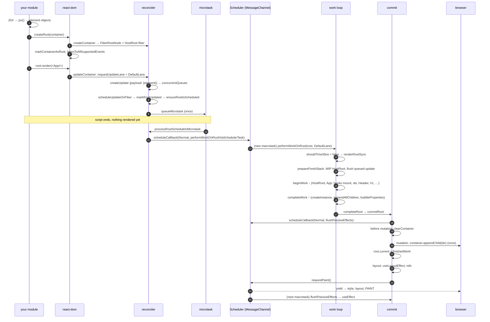

# 全流程穿透：首次渲染端到端源码追踪

> [!summary] 核心速览（TL;DR）
> 调用 `createRoot(el).render(<App/>)` 并不会同步渲染任何真实 DOM。它在同步阶段仅做四件事：构建根节点管理对象、绑定全局事件监听器、入队一个 `DefaultLane` 级别的更新，并预约一个微任务（Microtask）。随后，该微任务会向 Scheduler 注册一个调度任务。该任务在执行时，会使用 **`renderRootSync`** 同步渲染整棵 Fiber 树——因为 `DefaultLane` 属于*阻塞型赛道（Blocking Lane）*，绝不会进行时间切片。在 `completeWork` 阶段，整棵离屏 DOM 树在内存中组装完毕；进入 commit 提交阶段后，仅凭**单次** `appendChild` 操作即可将整棵 UI 一次性挂载至真实文档中。紧接着同步执行 Layout Effects，触发浏览器绘制（Paint），最后在后续的 Scheduler 任务中异步冲刷 `useEffect`。即使引入了 React 编译器（React Compiler），这套底层执行链路也完全一致，唯一额外的工作只是在各组件内部填充记忆缓存（Memo Cache）。

本文是一篇端到端贯穿全文的宏观叙事指南。链路中的每一个关键步骤，都配有指向对应专题深度剖析的链接，以便读者按图索骥探究底层细节。与之相呼应的姐妹篇——点击按钮触发计数器自增的更新全流程，请参阅 [[21 Walkthrough - setState to Pixels|从 setState 到屏幕呈现]]。

## 贯穿全篇的示例应用

本系列的两篇全流程分析均使用同一个示例应用。为了让 commit 提交阶段有具体的副作用可供执行，本例特意加入了一个 Layout Effect 和一个 Passive Effect：

```jsx
import { useState, useEffect, useLayoutEffect } from "react";
import { createRoot } from "react-dom/client";

function Header({ title }) {
  return <h1>{title}</h1>;
}

function Footer() {
  return <footer>made with React</footer>;
}

function App() {
  const [count, setCount] = useState(0);
  useLayoutEffect(() => {
    document.title = `count: ${count}`;
  }, [count]);
  useEffect(() => {
    console.log("committed", count);
  }, [count]);
  return (
    <div>
      <Header title="Counter" />
      <button onClick={() => setCount((c) => c + 1)}>{count}</button>
      <Footer />
    </div>
  );
}

createRoot(document.getElementById("root")).render(<App />);
```

这段代码最终生成的 Fiber 树恰好包含 **8 个 Fiber 节点**：`HostRoot → App → div → [Header → h1, button, Footer → footer]`。这里**没有任何** `HostText` 类型的文本 Fiber 节点。因为 `<h1>{title}</h1>`、`<button>{count}</button>` 以及 `<footer>made with React</footer>` 内部都只包含单个字符串或数字类型的子节点，React 内部的 `shouldSetTextContent` 判断会直接将它们作为宿主元素的 `textContent` 写入，而不会为它们单独分配 Fiber 节点。[^sstc] 这个精妙的性能优化细节，我们将在后续的 [[21 Walkthrough - setState to Pixels|组件更新源码追踪]] 中再次遇到。

## 全流程时序图



## 调用栈全景速查

```text
── synchronous, in your module ───────────────────────────────────────────
jsx(App, {})                                   → ReactElement {type: App, props: {}}
createRoot(container)
  createContainer → createFiberRoot            → FiberRootNode + HostRoot fiber, initializeUpdateQueue
  markContainerAsRoot(root.current, container)
  listenToAllSupportedEvents(container)
root.render(<App/>)  (ReactDOMRoot.prototype.render)
  updateContainer
    requestUpdateLane(current)                 → DefaultLane
    updateContainerImpl
      createUpdate(lane); update.payload = {element}
      enqueueUpdate → enqueueConcurrentClassUpdate  (buffered in concurrentQueues)
      scheduleUpdateOnFiber
        markRootUpdated                        (root.pendingLanes |= DefaultLane)
        ensureRootIsScheduled → ensureScheduleIsScheduled
          scheduleImmediateRootScheduleTask    → queueMicrotask(...)
── microtask ──────────────────────────────────────────────────────────────
processRootScheduleInMicrotask
  scheduleTaskForRootDuringMicrotask           → scheduleCallback(NormalPriority, performWorkOnRootViaSchedulerTask)
── macrotask: Scheduler (MessageChannel) ──────────────────────────────────
performWorkUntilDeadline → flushWork → workLoop
  performWorkOnRootViaSchedulerTask
    performWorkOnRoot(root, DefaultLane, forceSync=false)
      renderRootSync                           (shouldTimeSlice === false)
        prepareFreshStack → createWorkInProgress(root.current), finishQueueingConcurrentUpdates
        workLoopSync → performUnitOfWork × 8
          beginWork(HostRoot) → updateHostRoot → processUpdateQueue → reconcileChildFibers
          beginWork(App)      → updateFunctionComponent → renderWithHooks → App()
                                 mountState, mountLayoutEffect, mountEffect → mountChildFibers
          beginWork(div)      → updateHostComponent → reconcileChildrenArray
          …
          completeUnitOfWork → completeWork(h1 | button | footer | div)
                                 createInstance, appendAllChildren, finalizeInitialChildren, bubbleProperties
      finishConcurrentRender → completeRootWhenReady → completeRoot → commitRoot
        commitBeforeMutationEffects            (HostRoot Snapshot → clearContainer)
        flushMutationEffects → commitMutationEffects → … → commitPlacement
          insertOrAppendPlacementNodeIntoContainer → appendChildToContainer
          root.current = finishedWork
        flushLayoutEffects → commitLayoutEffects → commitHookLayoutEffects
        flushSpawnedWork → requestPaint()
── browser: style / layout / paint ───────────────────────────────────────
── later macrotask: Scheduler ─────────────────────────────────────────────
flushPassiveEffects → flushPassiveEffectsImpl → commitPassiveMountEffects → useEffect create()
```

## 核心步骤详解

### 1. 模块加载：JSX 转译为纯对象

在 React 开始执行任何逻辑之前，打包工具（Bundler）早已在编译阶段借助 JSX 自动运行时（Automatic Runtime）将 `<App />` 转换为了 `jsx(App, {})`。在生产环境下，`jsx` 函数的具体实现为 `jsxProd`，它会复用配置对象字面量作为 `props`，并调用 `ReactElement` 构造出纯数据对象：`{$$typeof: REACT_ELEMENT_TYPE, type: App, key: null, ref: null, props: {}}`。[^jsxprod][^reactelement] 此时没有任何多余的事情发生——React 元素仅仅是一份静态的声明式描述，`App` 组件内部的任何代码都尚未执行。此时的 `useState` 也仅仅是一个空壳占位转发函数（Stub）：它尝试读取 `ReactSharedInternals.H`，而在渲染周期之外，该字段的值始终为 `null`。[^usestate-react]

→ 深度剖析：[[01 Bootstrap - Packages, JSX and the Dispatcher|01 · 初始化引导]]

### 2. createRoot：创建 FiberRoot、HostRoot 并绑定所有事件监听器

`createRoot(container)` 首先校验目标容器的合法性，接着调用 `createContainer`，后者进一步调用 `createFiberRoot`。[^createroot][^createcontainer] 该过程会构造出两个相互引用的核心对象：[^createfiberroot][^fiberrootnode][^hostrootfiber]

```text
ReactDOMRoot { _internalRoot } ──► FiberRootNode
                                     containerInfo: div#root
                                     current ──────────────► HostRoot fiber (tag 3, ConcurrentMode)
                                     pendingLanes: 0           stateNode ──► FiberRootNode
                                     callbackNode: null        memoizedState: {element: null, isDehydrated: false, cache}
                                                               updateQueue: {baseState, shared: {pending: null}, …}
                                                               alternate: null, child: null
```

随后，`initializeUpdateQueue` 为宿主根节点 `HostRoot` 分配一个类组件风格的更新队列（Update Queue）。[^initqueue] 紧接着，`createRoot` 会在 DOM 容器上盖上形如 `__reactContainer$<random>` 的属性标记（`markContainerAsRoot`），并调用 `listenToAllSupportedEvents(container)`，针对所有原生事件类型向容器注册捕获阶段与冒泡阶段的监听器。[^markcontainer][^listen] 至此，后续在第 21 篇点击交互中所依赖的全部底层事件系统管线，在任何组件尚未开始渲染之前就已全数布署就绪。

→ 深度剖析：[[02 createRoot - FiberRoot and HostRoot|02 · createRoot]]、[[13 The Event System|13 · 事件系统]]

### 3. root.render(\<App/\>) → updateContainer：调度起点

`ReactDOMRoot.prototype.render` 首先确保该根节点尚未被卸载，随后调用 `updateContainer(children, root, null, null)`。[^render] `updateContainer` 获取 `container.current`（即 `HostRoot` Fiber），为其挑选合适的优先级赛道（Lane），并将任务正式移交给 `updateContainerImpl` 处理。[^updatecontainer]

→ 深度剖析：[[03 root.render - Scheduling the First Update|03 · root.render]]

### 4. requestUpdateLane → DefaultLane：计算更新赛道

`requestUpdateLane` 首先检查当前是否处于渲染阶段更新（答案是否），接着检查是否处于 Transition 过渡更新环境中（此时 `ReactSharedInternals.T` 为 `null`），最终返回 `eventPriorityToLane(resolveUpdatePriority())`。[^requestlane] DOM 宿主环境的 `resolveUpdatePriority` 发现当前并无任何 React 事件包装器设定的优先级，且在模块顶层直接执行时 `window.event === undefined`，因此返回 `DefaultEventPriority`。[^resolveprio] 在设计上，事件优先级（Event Priority）本质上就是赛道：`DefaultEventPriority` 的底层定义正是 `DefaultLane`。[^eventprio]

```text
SyncLane     = 0b0000000000000000000000000000010
DefaultLane  = 0b0000000000000000000000000100000   ← 本次更新所分配的赛道
```
[^lanes]

→ 深度剖析：[[04 Lanes and the Scheduler|04 · Lanes 赛道模型与 Scheduler]]

### 5. 创建 Update 对象并暂存入缓冲区

`updateContainerImpl` 创建一个更新对象：`Update {lane: DefaultLane, tag: UpdateState, payload: {element: <App/>}}`，并调用 `enqueueUpdate(rootFiber, update, lane)`。[^updatecontainerimpl][^createupdate] 该调用转入 `enqueueConcurrentClassUpdate`，但此时它并**不会**立即将更新链接到 `updateQueue.shared.pending` 链表中。[^enqueueupdate-class] 而是将四元组 `(fiber, queue, update, lane)` 压入模块全局的 `concurrentQueues` 缓冲区数组中，并立即将当前节点的赛道标记更新为 `fiber.lanes |= DefaultLane`。[^concurrent-enqueue] 随后，`getRootForUpdatedFiber` 沿着 `.return` 指针一路向上回溯至 `HostRoot`（对于根节点本身而言这一步是立竿见影的），并返回顶层的 `FiberRootNode`。[^getroot]

```text
concurrentQueues = [HostRoot, hostRootQueue, update{payload:{element}}, DefaultLane]
HostRoot.lanes   = DefaultLane
HostRoot.updateQueue.shared.pending = null      ← 此时依然为空；将在步骤 10 中正式串联入链
```

→ 深度剖析：[[03 root.render - Scheduling the First Update|03 · root.render]]、[[12 setState - dispatchSetState and Batching|12 · setState 与自动批处理]]（复用同一个缓冲区）

### 6. scheduleUpdateOnFiber：标记根节点待处理赛道

`scheduleUpdateOnFiber(root, rootFiber, DefaultLane)` 调用 `markRootUpdated`，将分配的赛道按位或（OR）合并进 `root.pendingLanes`，并重置挂起（Suspended）与唤醒（Pinged）相关的记账字段。[^suof][^markrootupdated] 鉴于当前并非处于渲染阶段内部，执行流程直接推进至 `ensureRootIsScheduled(root)`。执行完该步骤后，`root.pendingLanes === DefaultLane` 便成为了系统中记录“尚有未决任务需要执行”的唯一凭据。

### 7. ensureRootIsScheduled：预约单个微任务

`ensureRootIsScheduled` 将该根节点追加至调度器的根节点单向链表中，将 `mightHavePendingSyncWork` 置为 true，并调用 `ensureScheduleIsScheduled`。[^ensureroot][^ensureschedule] 随后通过 `scheduleImmediateRootScheduleTask` 在一个事件循环 Tick 中至多注册**一个**微任务；在 DOM 宿主配置中，`scheduleMicrotask` 的具体实现就是原生 `queueMicrotask`。[^sirst][^schedulemicrotask] **至此，`root.render` 的同步调用正式返回执行完毕。** 你的外部业务脚本继续向下运行。如果在同一事件循环轮次中再次调用 `root.render`，后发更新也将排入同一个队列并被该微任务一并捕获合并。

> [!note] 为什么不在此时此刻就地同步渲染？
> 将渲染决策推迟到微任务中执行，正是 React 能够做到**开箱即用自动批处理（Automatic Batching）**的关键所在。在调度器最终决定渲染什么内容之前，同一同步执行轮次内产生的所有更新，都会先统一收集沉淀在 `pendingLanes` 中。

### 8. 微任务执行：筛选赛道并注册 Scheduler 调度任务

当主线程 JS 执行栈清空后，微任务 `processRootScheduleInMicrotask` 开始执行。它会遍历每一个被调度的根节点，并触发 `scheduleTaskForRootDuringMicrotask`。[^prsim] 该函数调用 `getNextLanes`，计算得出待处理的赛道为 `DefaultLane`。由于该计算结果**不包含** `SyncLane`（同步赛道），React 不会在当前微任务中直接同步冲刷渲染，而是将该赛道的事件优先级映射为 `NormalPriority`（普通优先级），并调用 `scheduleCallback(NormalPriority, performWorkOnRootViaSchedulerTask.bind(null, root))`。[^stfrdm] Scheduler（调度器）随即将该任务压入其内部的任务最小堆（Min-heap），并通过 `MessageChannel` 发送一条跨端口消息以预约一个宏任务。[^schedcb][^messagechannel]

→ 深度剖析：[[04 Lanes and the Scheduler|04 · Lanes 赛道模型与 Scheduler]]

### 9. Scheduler 宏任务与 performWorkOnRoot：为什么首次渲染不会被时间切片？

在随后的全新宏任务中，`performWorkUntilDeadline` → `flushWork` → `workLoop` 依次被触发，最终调用已注册的回调函数。[^perfdeadline][^flushwork][^schedworkloop] 注意：在前面的微任务与当前宏任务之间，浏览器是有机会执行一次绘制（Paint）的，因此页面原有的任何静态骨架屏或 HTML 结构都会平稳展示。`performWorkOnRootViaSchedulerTask` 首先尝试冲刷可能遗留的被动副作用（此时并无遗留），重新调用 `getNextLanes` 计算赛道（依旧为 `DefaultLane`），接着调用 `performWorkOnRoot(root, lanes, forceSync)`。[^pwvst]

此时，React 会面临一个至关重要的架构分水岭决策：[^timeslice]

```js
const shouldTimeSlice =
  (!forceSync && !includesBlockingLane(lanes) && !includesExpiredLane(root, lanes)) ||
  checkIfRootIsPrerendering(root, lanes);
let exitStatus = shouldTimeSlice
  ? renderRootConcurrent(root, lanes)
  : renderRootSync(root, lanes, true);
```

`includesBlockingLane` 会检查当前赛道集合是否与 `SyncLane | InputContinuousLane | DefaultLane`（以及它们对应的水合变体与 `GestureLane`）存在交集。[^blocking] 显然，`DefaultLane` 正属于这个集合！因此 **`shouldTimeSlice` 的求值结果为 `false`，首次渲染会毫无保留地进入 `renderRootSync`**，以一气呵成的同步循环直接执行到底，中途绝不会调用 `shouldYield()` 检查是否需要让出主线程。在 React 的设计中，唯有 Transition、Retry、Idle 以及 Offscreen 等低优先级赛道才会进入可被中断的 `renderRootConcurrent`。

> [!warning] 业界常见认知误区：“createRoot 让首次渲染具备了并发能力”
> `createRoot` 给首次渲染带来的仅仅是**异步调度（Asynchronous）**特性：渲染任务在后续的任务中执行，发生在 `root.render` 返回之后；但这**并不意味着它是可被中断的（Interruptible）**。一个需要耗时 300ms 构建的首次渲染 Fiber 树，依然会实打实地阻塞主线程 300ms。如果你确实希望首次渲染能够被时间切片打断以主动让出主线程，必须显式将其包裹在 Transition 中：`startTransition(() => root.render(<App/>))`。

→ 深度剖析：[[06 The Work Loop - Render Phase|06 · 工作循环]]

### 10. prepareFreshStack：分配 WIP HostRoot 并正式串联更新队列

`renderRootSync` 首先将执行上下文标记为 `executionContext |= RenderContext`，压入分发器（Dispatcher），并检测到 `workInProgressRoot !== root`，因而调用 `prepareFreshStack(root, DefaultLane)` 初始化工作栈。[^rrs][^pfs] 该步骤完成了两件至关重要的核心工作：

- **调用 `createWorkInProgress(root.current, null)`**：此时根 Fiber 节点（`HostRoot`）尚未拥有替身（`alternate`），因此系统会分配第二个 `HostRoot` Fiber 对象，并将二者建立双向交叉关联（`wip.alternate = current`，`current.alternate = wip`）。WIP 节点会从 `current` 节点上完整拷贝 `updateQueue`、`memoizedState`、`lanes` 以及 `child`（此时为 `null`）。[^cwip]
- **调用 `finishQueueingConcurrentUpdates()`**：彻底倾倒并消费此前在步骤 5 中暂存的 `concurrentQueues` 缓冲区。更新对象被正式拼接进入 `queue.shared.pending`（构成一个单节点的单向环形链表），并通过 `markUpdateLaneFromFiberToRoot` 向上回溯标记祖先节点的 `childLanes`（由于 `HostRoot` 自身已是顶层节点，因此没有祖先节点需要标记）。[^fqcu]

```text
FiberRoot.current ──► HostRoot(A)  ◄──alternate──►  HostRoot(B) = workInProgress
                      shared.pending ──► update ⟲ (两者共享同一个 queue.shared 引用)
```

→ 深度剖析：[[05 The Fiber Data Structure|05 · Fiber 数据结构]]、[[06 The Work Loop - Render Phase|06 · 工作循环]]

### 11. beginWork(HostRoot)：消费更新队列，解析根元素

`workLoopSync` 开启经典的同名同步工作循环，反复调用 `performUnitOfWork` 直至 `workInProgress === null`。[^wls][^puow] 进入循环的第一个工作单元正是 HostRoot(B)。`beginWork` 发现 `current !== null`，且前后 `props` 均为 `null` 保持一致，但紧接着 `checkScheduledUpdateOrContext` 检测到 `current.lanes` 中包含待处理的 `DefaultLane`，因此判定**不可跳过（Bailout）**。它将 `workInProgress.lanes` 重置为 `NoLanes`，并将控制权分发给 `updateHostRoot`。[^beginwork] `updateHostRoot` 会克隆更新队列并执行 `processUpdateQueue`，通过计算更新有效载荷（Payload）推导出新状态：`memoizedState = {element: <App/>, …}`。[^updatehostroot][^processupdatequeue] 此时待渲染的子级 `nextChildren` 正是该 `<App/>` 元素，于是它立即调用 `reconcileChildren` 展开子节点协调。

→ 深度剖析：[[07 beginWork and Reconciliation|07 · beginWork 与协调]]

### 12. 为什么仅在顶层 App 节点标记 Placement 插入副作用？

由于 `HostRoot` 已经存在 `current` 镜像节点，因此 `reconcileChildren` 会选用 `reconcileChildFibers`——这是一个**开启了副作用追踪（Side-effect Tracking）**的协调器分支。[^reconcilechildren] 在处理单节点时，`reconcileSingleElement` 发现当前尚无任何已存在的子 Fiber 节点，于是调用 `createFiberFromElement`（没有 `prototype.isReactComponent` 标识的纯函数会被创建为 `FunctionComponent` 类型的 Fiber 节点）。随后 `placeSingleChild` 检查到该子节点的 `alternate === null`，于是为其盖上 **`Placement`**（新增放置）标志。[^rse][^cffe][^cftp][^pss]

而处于 App 节点**之下**的所有后代 Fiber，在初次渲染时其 `current` 均为 `null`，它们均会流向 `mountChildFibers` 分支——这是同一个协调算法函数，但**彻底关闭了副作用追踪**。因此，App 节点之下的所有子孙 Fiber 节点都不会被打上 `Placement` 标记！这项机制是 React 能够做到在步骤 18 中**只执行一次真实 DOM 插入**的关键伏笔。

### 13. beginWork(App)：挂载阶段 Dispatcher 与 renderWithHooks

工作循环推进至 App 节点，`updateFunctionComponent` 内部调用 `renderWithHooks`。[^ufc] `renderWithHooks` 首先将当前渲染指针指向当前节点 `currentlyRenderingFiber = App`，将 `memoizedState` 与 `updateQueue` 清空初始化；紧接着，由于当前节点的 `current === null`，它会精准地将 **`HooksDispatcherOnMount`** 挂载分发器注入全局的 `ReactSharedInternals.H` 槽位中。随后，它正式执行 `App(props)`。[^rwh][^dmount] 此时此刻，你的业务组件函数代码迎来了生命周期中的第一次运行。

### 14. Hooks 执行：构建 Hook 链表与副作用单向环

在组件函数内部，每次执行 Hook 调用都会通过 `mountWorkInProgressHook` 在当前 Fiber 节点上追加一个 Hook 结构体：[^mwih]

- **`useState(0)`** → 路由到 `mountState` → `mountStateImpl`。它创建该 Hook 节点及其更新队列 `{pending: null, lanes: NoLanes, lastRenderedReducer: basicStateReducer, lastRenderedState: 0}`，并生成一个经过偏函数绑定的分发函数 `dispatch = dispatchSetState.bind(null, App fiber, queue)`。[^mountstate][^mountstateimpl] 这个已经固化了当前 Fiber 及其队列引用的函数，正是你的 `onClick` 点击事件所闭包捕获的 `setCount`。
- **`useLayoutEffect`** → 路由到 `mountLayoutEffect`。它在当前 Fiber 节点上标记 `Update | LayoutStatic` flags，并构造一个带有 `HookHasEffect | HookLayout` 标志的 Effect 结构体追加到副作用环形链表中。[^mountlayout][^mounteffectimpl]
- **`useEffect`** → 路由到 `mountEffect`。它在 Fiber 节点上标记 `Passive | PassiveStatic` flags，并构造一个带有 `HookHasEffect | HookPassive` 标志的 Effect 结构体压入环形链表。[^mounteffect][^pushsimple]

```text
App fiber
  flags: Placement | Update | Passive   (+ static flags)
  memoizedState ─► Hook{useState: 0, queue}
                    └ next ─► Hook{Effect{Layout|HasEffect, deps:[0]}}
                               └ next ─► Hook{Effect{Passive|HasEffect, deps:[0]}}
  updateQueue: {lastEffect ─► passive effect ⟲ layout effect, events: null, stores: null, memoCache: null}
```

随后，`App` 组件执行结束并返回一个 `<div>` 元素。`renderWithHooks` 立即切出分发器，换上 `ContextOnlyDispatcher`（此时若有任何异步代码试图继续调用 Hook 都会立即抛出非法调用异常），并将该 JSX 元素返回。挂载版本的 `reconcileChildren` 随即为该返回值创建对应的 `div` Fiber 节点。

→ 深度剖析：[[10 Hooks on Mount|10 · Hooks 挂载阶段]]

### 15. 子树深度优先遍历与工作单元推进

进入 `beginWork(div)` → `updateHostComponent` 压入宿主上下文（Host Context）。由于其 `props.children` 是一个数组，`reconcileChildrenArray` 立即构造出三个子级 Fiber 节点：`Header`、`button` 和 `Footer`。[^uhc-begin][^rca] 随后，经典的深度优先搜索（DFS）遍历按部就班地继续下潜与回溯：

| 步骤序号 | 处理的工作单元 | 核心运行逻辑与动作 |
|---|---|---|
| 1 | B(HostRoot) | 消费更新队列得到 `<App/>`，创建 App Fiber 并打上 `Placement` 标记 |
| 2 | B(App) | 挂载各个 Hooks，执行函数体得到 `<div>` 子元素 |
| 3 | B(div) | 协调子节点数组，依次创建 3 个子级 Fiber |
| 4 | B(Header) | 执行 `Header({title: "Counter"})`，创建 `<h1>` Fiber |
| 5 | B(h1) | 命中了 `shouldSetTextContent` 判断 → 无需生成子 Fiber → 直接返回 `null` |
| 6 | **C(h1)** | 创建真实 DOM 节点 `<h1>`。寻找兄弟节点？Header 内部无兄弟 → 向上回溯 |
| 7 | C(Header) | 仅执行属性与 flags 冒泡 → 转向处理兄弟节点 `button` |
| 8 | B(button) → **C(button)** | 纯文本子内容 → 不创建 Fiber。创建真实 DOM 节点 `<button>` |
| 9 | B(Footer) → B(footer) → **C(footer)** → C(Footer) | 内部流程与 Header 完全一致 |
| 10 | **C(div)** | 创建真实 DOM 节点 `<div>`，一次性挂载组装 h1、button 和 footer |
| 11 | C(App), C(HostRoot) | 向上层层冒泡收集。`workInProgress = null` → 判定为 `RootCompleted` |

> *注：表格中 `B(...)` 代表 `beginWork`（自顶向下下潜），`C(...)` 代表 `completeWork`（自底向上回溯）。*

在每次 `beginWork` 执行完毕后，`performUnitOfWork` 都会将当前的 `pendingProps` 固化拷贝到 `memoizedProps` 中。这个被妥善保存的 Props 对象，正是下一轮渲染进行引用浅比较以决定是否 Bailout 的核心基准。[^puow] 当遇到叶子节点返回 `null` 时，便由 `completeUnitOfWork` 负责驱动指针向兄弟节点转移或向父节点攀升。[^cuow]

→ 深度剖析：[[06 The Work Loop - Render Phase|06 · 工作循环]]、[[07 beginWork and Reconciliation|07 · beginWork 与协调]]

### 16. completeWork：离屏在内存中构建整棵真实 DOM 树

对于每一个 `current` 为 `null` 的宿主组件 Fiber 节点（`HostComponent`），`completeWork` 都会调用 `createInstance`（其底层调用 `document.createElement`，并执行 `precacheFiberNode` 与 `updateFiberProps`，在 DOM 节点上写入 `__reactFiber$` 和 `__reactProps$` 私有属性，以供后续事件代理系统反查识别）。[^cw-hc][^createinstance][^precache][^ufp] 紧接着它调用 `appendAllChildren`，该函数能够智能穿透中间的组件层级，将直属的宿主子节点追加进来。例如在处理 `div` 时，它会直接穿透并跨过 `Header` 与 `Footer` 组件 Fiber，把 `h1`、`button` 和 `footer` 对应的真实 DOM 节点直接挂载到该 `div` 下。[^aac][^aic] 最后，`finalizeInitialChildren` → `setInitialProperties` 负责设置初始属性，其中 `setProp('children', 0)` 会将 button 的 `textContent` 写入为 `"0"`。[^fic][^sip][^setprop-children] 值得注意的是，`onClick` 并不会作为 DOM 属性被写入真实节点；在 `setProp` 中，它仅仅为了解决 iOS Safari 上非交互式元素的点击穿透问题而挂载一个空函数兜底（`trapClickOnNonInteractiveElement`）。[^setprop-onclick]

```text
游离离屏 DOM 树: <div><h1>Counter</h1><button>0</button><footer>made with React</footer></div>
当前真实文档:    <div id="root"></div>         ← 截至目前依然分毫未动
```

最后在回溯到 `HostRoot` 时，`completeWork` 识别出这是客户端首次渲染（`current.child === null` 且非水合），因此为其打上 **`Snapshot`** 标记，以便在后续 commit 提交阶段触发 `clearContainer` 清理容器。[^cw-root]

→ 深度剖析：[[08 completeWork - Building DOM Nodes|08 · completeWork]]

### 17. bubbleProperties：自底向上汇总提交标记

每一次 `completeWork` 的收尾阶段都会调用 `bubbleProperties`。该函数将子节点的 `flags | subtreeFlags` 经由按位或运算汇总并入父节点的 `subtreeFlags` 中，同时将子节点的 `lanes | childLanes` 合并进父节点的 `childLanes`。[^bubble] 当整棵树回溯到根节点时，全局标记状态一目了然：

```text
HostRoot(B)  flags: Snapshot      subtreeFlags: Placement|Update|Passive|…   childLanes: 0
App          flags: Placement|Update|Passive
div, h1, button, footer, Header, Footer: 没有任何 DOM 突变 flags
```

如此一来，在后续的 commit 提交阶段，React 只需在每个 Fiber 节点上进行单次位掩码运算，就能以 $O(1)$ 的开销瞬间判别“该节点下方的整棵子树中是否存在某种类型的副作用”，从而精准跳过无关的庞大子树。

### 18. commitRoot 提交阶段：突变执行与单次 DOM 挂载

`performWorkOnRoot` 获取渲染产物 `finishedWork = root.current.alternate`，并调用 `finishConcurrentRender`（该函数同样用于同步渲染收尾）。紧接着按顺序触发 `completeRootWhenReady` → `completeRoot` → `commitRoot`。[^pwor][^fcr][^crwr][^completeroot][^commitroot] 请注意：在 React 19.3.1 中，历史遗留的 `commitRootImpl` 函数已被重构内联，所有核心提交逻辑由 `commitRoot` 直接统辖：

1. **清理赛道**：调用 `markRootFinished`，将本次已完成的 `DefaultLane` 从 `pendingLanes` 中剥除重置。
2. **提前预约被动副作用**：检测到整棵树的 `subtreeFlags` 中包含 `Passive` 标记，**在对真实 DOM 动刀之前，立即通过 `scheduleCallback(NormalSchedulerPriority, flushPassiveEffects)` 提前预约被动副作用的后续冲刷**。[^passive-sched]
3. **Before Mutation（DOM 突变前阶段）**：`commitBeforeMutationEffects` 临时锁定 React 事件系统；并针对 `HostRoot` 上的 `Snapshot` 标志调用 `clearContainer`，将宿主容器内部可能残留的原有静态占位内容（如预渲染标签等）彻底清空。[^cbme][^bmeof][^clearcontainer]
4. **Mutation（DOM 突变阶段）**：`flushMutationEffects` → `commitMutationEffects` → `commitMutationEffectsOnFiber` 沿着 `subtreeFlags & MutationMask` 的路径一路向下递归，直到 `commitReconciliationEffects` 发现了 App 节点上盖着的 `Placement` 标记。[^fme][^cme][^cmeof][^cre] 随后 `commitHostPlacement` → `commitPlacement` 向上寻找最近的真实宿主父级（即 `HostRoot` 对应的 `containerInfo`）。由于 App 自身只是组件节点而非真实 DOM 宿主，`insertOrAppendPlacementNodeIntoContainer` 继续向下穿透到子级 `div`，并最终执行 **`appendChildToContainer(container, div)`**！[^chp][^commitplacement][^ioapnic][^actc] **仅凭这唯一的一次 DOM API 调用，此前在内存中预先装配好的整棵离屏 UI 就被整体插入到了真实文档之中。**

→ 深度剖析：[[09 Commit Phase - Mutation, Layout, Passive Effects|09 · Commit 阶段]]

### 19. 双缓存指针切换：root.current = finishedWork

在 `flushMutationEffects` 即将执行完毕的最末尾（源码第 4051 行），React 执行了一次至关重要的指针重新赋值：`root.current = finishedWork`。[^swap] 这个切换节点卡位得极其精准：它恰好位于 DOM 突变之后，因此卸载（Unmount）相关的回调在执行时看到的依然是旧 Fiber 树；而它又严丝合缝地处于 Layout 阶段之前，因此后续执行的 `useLayoutEffect` 和 Ref 绑定拿到的已经是代表最新真实状态的新 Fiber 树。至此，HostRoot(B) 正式荣升为 `current`；而原先的 HostRoot(A) 则退居二线，沦为下一次更新迭代时的草稿缓冲区（Scratch Buffer）。

### 20. Layout Effects（在浏览器绘制之前同步执行）

`flushLayoutEffects` → `commitLayoutEffects` → `commitLayoutEffectOnFiber` 按照“子节点优先”的顺序自底向上遍历，利用 `LayoutMask` 掩码精准剪枝。[^fle][^cle][^cleof] 鉴于 App 节点带有 `Update` 标志，`commitHookLayoutEffects` → `commitHookEffectListMount(HookLayout | HookHasEffect)` 被触发，立即同步运行该 Layout Hook 的创建函数：`document.title = "count: 0"`。[^chle][^chelm] 此时真实 DOM 已经在文档树中就位，因此如果在该回调中读取 DOM 节点的几何尺寸（如 `getBoundingClientRect()`），能够直接获取到真实准确的排版数据（但会触发浏览器的同步强制重排）。截至此时，浏览器屏幕上**尚未发生任何真正的像素绘制（Paint）**。

### 21. flushSpawnedWork → requestPaint → 屏幕像素真正呈现

在提交阶段的收尾处，`flushSpawnedWork` 调用了 `requestPaint()`，它会将 Scheduler 内部的 `needsPaint` 标志置为 true。[^fsw][^requestpaint] 鉴于本次更新属于 `DefaultLane` 而非绝对同步的 `SyncLane`，React 直接跳过了“同步立即冲刷被动副作用”的执行分支。[^syncflush] 当前宏任务主体逻辑执行完毕并返回。此时控制权交还给 Scheduler 调度器的 `workLoop`，由于此前标记了 `needsPaint`，`shouldYieldToHost()` 的判断立即返回 `true`，调度器便会当机立断主动刹车并再次派发一条消息，而**绝不会**自作主张直接紧接着去冲刷被动副作用任务。[^syh] **此时当前主线程 JS 任务彻底结束，浏览器终于迎来了空闲喘息之机，立即全速执行样式计算（Style）、布局排版（Layout）与像素绘制（Paint）。至此，用户的肉眼在屏幕上首次看到了 "Counter / 0 / made with React"。**

### 22. 在后续独立宏任务中执行 Passive Effects（useEffect）

在随后被触发的另一个全新 Scheduler 宏任务中，在步骤 18 中预约的回调终于登场：`flushPassiveEffects` → `flushPassiveEffectsImpl` 开始执行。它首先负责触发所有被动卸载销毁逻辑（首次挂载时为空），随后执行 `commitPassiveMountEffects` → `commitPassiveMountOnFiber` → `commitHookPassiveMountEffects`，最终触发了业务代码中编写的 `useEffect` 回调函数，在控制台打印出：`console.log("committed", 0)`。[^fpe][^fpei][^cpme][^chpme] 如果此时在这个 effect 中调用了 `setState`，该更新至多只能拿到 `DefaultLane` 赛道，并会被按照标准流程正常排入下一轮批处理中。

> [!tip] 破除迷思：“useEffect 一定在浏览器绘制之后执行”的真实底牌
> 在首次渲染的场景下，这句断言确实是成立的——因为 `DefaultLane` 提交会将被动副作用推迟到独立的后续任务中，且 `requestPaint` 会强令 Scheduler 主动让出主线程给浏览器排版绘制。然而在 [[21 Walkthrough - setState to Pixels|用户点击交互的全流程追踪]] 中你将会大吃一惊：同一个 `useEffect` 在该场景下竟然会赶在浏览器绘制**之前**就被同步冲刷执行了！因为离散交互触发的提交走的是最高优先级的 `SyncLane`。

## 引入 React 编译器（React Compiler）后的底层对照

以下是前文示例应用经过真实的 `babel-plugin-react-compiler@1.0.0` 编译生成的真实产物代码（除添加了解释注释并适度合并了单行语句外，完全忠实于编译器原始输出）：

```js
import { c as _c } from "react/compiler-runtime";
function Header(t0) {
  const $ = _c(2);
  const { title } = t0;
  let t1;
  if ($[0] !== title) {
    t1 = <h1>{title}</h1>;
    $[0] = title;
    $[1] = t1;
  } else {
    t1 = $[1];
  }
  return t1;
}
function Footer() {
  const $ = _c(1);
  let t0;
  if ($[0] === Symbol.for("react.memo_cache_sentinel")) {
    t0 = <footer>made with React</footer>;
    $[0] = t0;
  } else {
    t0 = $[0];
  }
  return t0;
}
function App() {
  const $ = _c(13);
  const [count, setCount] = useState(0);
  let t0;
  let t1;
  if ($[0] !== count) {
    t0 = () => { document.title = `count: ${count}`; };
    t1 = [count];
    $[0] = count; $[1] = t0; $[2] = t1;
  } else {
    t0 = $[1]; t1 = $[2];
  }
  useLayoutEffect(t0, t1);
  let t2;
  let t3;
  if ($[3] !== count) {
    t2 = () => { console.log("committed", count); };
    t3 = [count];
    $[3] = count; $[4] = t2; $[5] = t3;
  } else {
    t2 = $[4]; t3 = $[5];
  }
  useEffect(t2, t3);
  let t4;
  let t5;
  if ($[6] === Symbol.for("react.memo_cache_sentinel")) {
    t4 = <Header title="Counter" />;        // 无反应性输入：每个 Fiber 仅需构造一次
    t5 = () => setCount(_temp);             // setCount 引用恒定，因而事件处理函数也是稳定的
    $[6] = t4; $[7] = t5;
  } else {
    t4 = $[6]; t5 = $[7];
  }
  let t6;
  if ($[8] !== count) {
    t6 = <button onClick={t5}>{count}</button>;
    $[8] = count; $[9] = t6;
  } else {
    t6 = $[9];
  }
  let t7;
  if ($[10] === Symbol.for("react.memo_cache_sentinel")) {
    t7 = <Footer />;
    $[10] = t7;
  } else {
    t7 = $[10];
  }
  let t8;
  if ($[11] !== t6) {
    t8 = <div>{t4}{t6}{t7}</div>;
    $[11] = t6; $[12] = t8;
  } else {
    t8 = $[12];
  }
  return t8;
}
function _temp(c) {
  return c + 1;                             // 状态更新器，被提升至模块作用域
}
```

现在，让我们带着编译器的产物，将前文解析的 22 个步骤重新复盘一遍：

- **步骤 1–12：完全没有任何变化。** 编译器根本不会干预 `react-dom`、根节点结构、Lanes 优先级模型、Scheduler 调度器或 `beginWork(HostRoot)`。在模块顶层调用的 `createRoot(...).render(<App />)` 并不处于任何组件内部，因此原封不动。编译生成的 `_c` 导入在运行时指向 `useMemoCache`：在源码中，`react/compiler-runtime` 的实质内容仅仅是一行简单的重命名再导出：`export {useMemoCache as c} from './ReactHooks'`。[^compiler-runtime]
- **步骤 13：在执行组件之初，多出了一次 Hook 调用。** `App()` 函数在第一行代码首先执行 `_c(13)`，它会通过挂载分发器路由至 `useMemoCache`。[^dmount][^umc] 由于此时该 Fiber 及其（尚不存在的）替身节点上均没有任何缓存，它会初始化分配一个 `{data: [], index: 0}` 结构，创建函数组件的 `FunctionComponentUpdateQueue`，并将该缓存保存在 **`fiber.updateQueue.memoCache`** 中；最后返回一个长度为 13 的数组，其内部每个槽位均使用 `REACT_MEMO_CACHE_SENTINEL`（即 `Symbol.for('react.memo_cache_sentinel')` 哨兵标记）填满。[^umc][^sentinel] 这一操作并不会在 Fiber 的 Hook 链表中追加常规 Hook 节点。
- **步骤 14：完全相同的 Hook 链表，外加一次性的缓存填充。** 每一个 `$[i] !== dep` 与哨兵值的初次比较结果均必然为 true，每一个 `=== sentinel` 的检测在初次挂载时也全部命中为 true；因此，编译器划分的每一个作用域（Memo Scope）都会无条件执行一次，并把计算结果写入对应的槽位。`useState`、`useLayoutEffect` 和 `useEffect` 依然在 Fiber 上严格构建出步骤 14 中展示的 Hook 链表与副作用环形链表。而这些副作用，恰恰被推入了**同一个持有 memoCache 的 `updateQueue` 对象**中。

  ```text
  App.updateQueue.memoCache.data[0] =
    [0, layoutFn, [0], 0, passiveFn, [0], <Header/>, onClickFn, 0, <button/>, <Footer/>, <button/>, <div/>]
     0     1      2   3     4       5       6          7      8      9         10        11       12
  ```
- **步骤 15：完全一致的树形遍历与回溯。** `Header` 与 `Footer` 同样被编译器进行了改写。`Header` 以 `title` 为依赖缓存其生成的 `<h1>`（使用 `_c(2)`），而 `Footer` 则直接在哨兵标记之后缓存 `<footer>`（使用 `_c(1)`）。它们各自在自身的 Fiber 节点上填充各自的私有缓存。每个组件在首次挂载时依然必须实打实地运行一次，每个 Fiber 节点的创建也与此前别无二致：由于整棵树处处都是 `current === null`，因此在首次渲染时没有任何 Bailout 跳过机制会生效。
- **步骤 16–22：完全没有任何变化。** 构建出的真实 DOM 节点完全相同、单次 `appendChildToContainer` 挂载完全相同、双缓存指针切换完全相同、Layout Effect 同步执行完全相同、屏幕像素绘制完全相同，且在下一个宏任务中冲刷 Passive Effect 也完全相同。被缓存下来的 React 元素对象，只是顺理成章地充当了子 Fiber 节点的 `pendingProps` 来源，就像未被编译器处理过的普通元素一样。

在首次挂载时，引入 React 编译器所增加的开销微乎其微：仅仅是分配了三个极小的槽位数组（长度分别为 13、2、1），执行了几次简单的相等性比较与赋值，以及无论如何都必然要创建的函数闭包。而这项投资的丰厚回报，要在**后续的更新渲染**中才会淋漓尽致地显现出来——这正是我们在 [[21 Walkthrough - setState to Pixels|从 setState 到屏幕呈现]] 中将要剖析的主角：正是因为在首次渲染中缓存下来的 `<Header/>` 和 `<Footer/>` 元素保持了内存引用的绝对一致，才使得 React 在更新时能够信心十足地跳过整棵子树的重复协调！

### 逐步骤执行对照表

| 核心步骤 | 未使用编译器（Without compiler） | 使用 React 编译器（With compiler） |
|---|---|---|
| 1. JSX 元素解析 | 在渲染时调用 `jsx()` 生成元素 | 完全相同的调用，但被包裹在各缓存作用域内 |
| 2. `createRoot` | 初始化 FiberRoot + HostRoot + 全局事件监听 | 完全相同 |
| 3–7. `root.render` → 缓冲更新 → 微任务 | 分配 `DefaultLane`，暂存更新，预约单个微任务 | 完全相同 |
| 8–9. Scheduler 任务，`renderRootSync` | 阻塞型赛道，绝不进行时间切片 | 完全相同 |
| 10–12. `prepareFreshStack`，HostRoot，App 的 `Placement` | 双缓存建立，串联更新，顶层标记插入 | 完全相同 |
| 13. `renderWithHooks(App)` | 挂载分发器生效 → 执行 `App()` | 流程完全相同，但首条执行语句为 `_c(13)` → `useMemoCache` → 在 `updateQueue.memoCache` 上分配哨兵填充数组 |
| 14. Hooks 执行 | 创建 3 个 Hook 节点，构建 2 个副作用结构体 | 同样创建 3 个 Hook 节点和 2 个副作用，额外将计算结果写入 13 个缓存槽位 |
| 15. 子树深度遍历 | Header 和 Footer 依次运行，共构建 8 个 Fiber | 完全相同，Header/Footer 分别填充各自 `_c(2)`/`_c(1)` 缓存 |
| 16–17. `completeWork` 与标记冒泡 | 4 个离屏 DOM 节点在内存中组装完毕 | 完全相同 |
| 18–19. Commit 阶段，单次 `appendChild`，双缓存切换 | 真实 DOM 单次挂载，指针秒级切换 | 完全相同 |
| 20. Layout effect | 同步运行 `document.title = "count: 0"` | 完全相同 |
| 21. 浏览器绘制（Paint） | 当前 JS 任务结束，屏幕真实绘制像素 | 完全相同 |
| 22. Passive effect | 在下一个独立 Scheduler 宏任务中执行 | 完全相同 |

## 全篇核心总结

调用 `createRoot(el).render(<App/>)` 并不会同步向屏幕渲染任何内容：它在同步阶段迅速搭建起根节点数据结构、挂载全局事件代理、在缓冲区暂存一个 `DefaultLane` 级别的更新，并预约一个微任务。随后由该微任务向 Scheduler 调度器注册一个普通优先级任务。由于 `DefaultLane` 属于阻塞型赛道，绝不会被时间切片打断，因此该调度任务会使用 `renderRootSync` 一气呵成地同步完成整棵树的渲染。在渲染过程中，整棵离屏 DOM 树在内存中自底向上组装完毕，并在 commit 提交阶段仅凭一次 `appendChildToContainer` 调用整体挂入真实文档；随后在绘制前同步触发 Layout Effects，浏览器完成样式与像素绘制，最后在后续的独立宏任务中执行 `useEffect`。React 编译器的介入在首次渲染阶段仅仅多做了一件事——填充各个组件的记忆缓存数组；其真正的性能红利将在下一轮更新中全面爆发。

### 关键认知提炼

- **JSX 与 `createRoot`**：JSX 元素仅仅是轻量级的静态描述对象；`createRoot` 会在任何组件执行之前，提前构建好 `FiberRootNode` 与宿主根 Fiber（HostRoot），并通过 `listenToAllSupportedEvents` 将所有原生事件委托全部挂载就绪。
- **`requestUpdateLane` 赛道推导**：在顶层没有 React 事件包装器、没有 Transition 标记的场景下，`root.render` 会回退推导为 `DefaultEventPriority`，即对应的 `DefaultLane` 赛道。
- **更新对象的缓冲暂存**：`enqueueConcurrentClassUpdate` 并不会立刻修改当前 Fiber 的更新链表，而是将更新对象暂存到全局的 `concurrentQueues` 缓冲区中；直到渲染正式启动、执行 `prepareFreshStack` 时，才会将其正式串联进 `shared.pending` 中（详见 [[03 root.render - Scheduling the First Update|03 · root.render]]）。
- **先微任务，后宏任务**：`ensureRootIsScheduled` 在同一 Tick 内至多注册一个微任务；随后微任务执行 `scheduleTaskForRootDuringMicrotask`，由于赛道中不包含 `SyncLane`，因此会向 Scheduler 预约一个 `NormalPriority` 的宏任务调度（详见 [[04 Lanes and the Scheduler|04 · Lanes 赛道模型与 Scheduler]]）。
- **首次渲染绝不切片**：`includesBlockingLane` 判定规则明确覆盖了 `DefaultLane`，因此 `shouldTimeSlice` 计算结果为 `false`；`createRoot` 让首次渲染变成了**异步启动**，但绝不是**可被随意中断**（详见 [[06 The Work Loop - Render Phase|06 · 工作循环]]）。
- **`Placement` 标志仅打在顶层 App 节点**：HostRoot 在协调其子节点时开启了副作用追踪；而 App 节点之下的所有后代 Fiber 均通过关闭副作用追踪的 `mountChildFibers` 构建，自身不携带任何 DOM 突变标志。
- **挂载阶段的 Hooks**：全局激活 `HooksDispatcherOnMount` 分发器，按序构建 Hook 单向链表，将 `setCount` 偏函数绑定为 `dispatchSetState`，并在 Fiber 上打上 `Update | Passive` 等 flags。
- **`completeWork` 离屏拼装**：调用 `createInstance` 并通过 `precacheFiberNode` 与 `updateFiberProps` 预埋反向查找指针；调用 `appendAllChildren` 穿透组件层级拼装离屏 DOM 树；并通过 `bubbleProperties` 将所有副作用标记自底向上汇总冒泡（详见 [[08 completeWork - Building DOM Nodes|08 · completeWork]]）。
- **commitRoot 提交阶段**：提前向调度器预约 Passive Effects；执行 `clearContainer` 清除容器原有残余；仅凭单次 `appendChildToContainer` 操作将离屏 DOM 树一次性注入文档；并在绘制前精准完成 `root.current = finishedWork` 双缓存指针切换与 Layout Effects 同步执行（详见 [[09 Commit Phase - Mutation, Layout, Passive Effects|09 · Commit 阶段]]）。
- **先绘制，后执行 `useEffect`**：通过 `requestPaint` 强制让 Scheduler 让出主线程；浏览器优先执行样式计算、排版与绘制；因为本次提交并非 `SyncLane`，被动副作用最终在后续独立的宏任务中从容执行。

---

← [[15 Rendering With vs Without the Compiler|上一篇：编译期与非编译期对比]] · [[00 React Internals Index|专栏目录]] · [[21 Walkthrough - setState to Pixels|下一篇：从 setState 到屏幕呈现]] →

[^sstc]: `shouldSetTextContent` — [packages/react-dom-bindings/src/client/ReactFiberConfigDOM.js#L744-L755](https://github.com/facebook/react/blob/v19.3.1/packages/react-dom-bindings/src/client/ReactFiberConfigDOM.js#L744-L755)
[^jsxprod]: `jsxProd` — [packages/react/src/jsx/ReactJSXElement.js#L291-L348](https://github.com/facebook/react/blob/v19.3.1/packages/react/src/jsx/ReactJSXElement.js#L291-L348)
[^reactelement]: `ReactElement` — [packages/react/src/jsx/ReactJSXElement.js#L170-L283](https://github.com/facebook/react/blob/v19.3.1/packages/react/src/jsx/ReactJSXElement.js#L170-L283)
[^usestate-react]: `useState` / `resolveDispatcher` in the `react` package — [packages/react/src/ReactHooks.js#L24-L71](https://github.com/facebook/react/blob/v19.3.1/packages/react/src/ReactHooks.js#L24-L71)
[^createroot]: `createRoot` — [packages/react-dom/src/client/ReactDOMRoot.js#L171-L262](https://github.com/facebook/react/blob/v19.3.1/packages/react-dom/src/client/ReactDOMRoot.js#L171-L262)
[^createcontainer]: `createContainer` — [packages/react-reconciler/src/ReactFiberReconciler.js#L235-L280](https://github.com/facebook/react/blob/v19.3.1/packages/react-reconciler/src/ReactFiberReconciler.js#L235-L280)
[^createfiberroot]: `createFiberRoot` — [packages/react-reconciler/src/ReactFiberRoot.js#L157-L236](https://github.com/facebook/react/blob/v19.3.1/packages/react-reconciler/src/ReactFiberRoot.js#L157-L236)
[^fiberrootnode]: `FiberRootNode` — [packages/react-reconciler/src/ReactFiberRoot.js#L50-L155](https://github.com/facebook/react/blob/v19.3.1/packages/react-reconciler/src/ReactFiberRoot.js#L50-L155)
[^hostrootfiber]: `createHostRootFiber` — [packages/react-reconciler/src/ReactFiber.js#L529-L551](https://github.com/facebook/react/blob/v19.3.1/packages/react-reconciler/src/ReactFiber.js#L529-L551)
[^initqueue]: `initializeUpdateQueue` — [packages/react-reconciler/src/ReactFiberClassUpdateQueue.js#L176-L189](https://github.com/facebook/react/blob/v19.3.1/packages/react-reconciler/src/ReactFiberClassUpdateQueue.js#L176-L189)
[^markcontainer]: `markContainerAsRoot` — [packages/react-dom-bindings/src/client/ReactDOMComponentTree.js#L113-L116](https://github.com/facebook/react/blob/v19.3.1/packages/react-dom-bindings/src/client/ReactDOMComponentTree.js#L113-L116)
[^listen]: `listenToAllSupportedEvents` — [packages/react-dom-bindings/src/events/DOMPluginEventSystem.js#L432-L459](https://github.com/facebook/react/blob/v19.3.1/packages/react-dom-bindings/src/events/DOMPluginEventSystem.js#L432-L459)
[^render]: `ReactDOMRoot.prototype.render` — [packages/react-dom/src/client/ReactDOMRoot.js#L107-L136](https://github.com/facebook/react/blob/v19.3.1/packages/react-dom/src/client/ReactDOMRoot.js#L107-L136)
[^updatecontainer]: `updateContainer` — [packages/react-reconciler/src/ReactFiberReconciler.js#L353-L370](https://github.com/facebook/react/blob/v19.3.1/packages/react-reconciler/src/ReactFiberReconciler.js#L353-L370)
[^requestlane]: `requestUpdateLane` — [packages/react-reconciler/src/ReactFiberWorkLoop.js#L812-L868](https://github.com/facebook/react/blob/v19.3.1/packages/react-reconciler/src/ReactFiberWorkLoop.js#L812-L868)
[^resolveprio]: `resolveUpdatePriority` (DOM) — [packages/react-dom-bindings/src/client/ReactDOMUpdatePriority.js#L35-L45](https://github.com/facebook/react/blob/v19.3.1/packages/react-dom-bindings/src/client/ReactDOMUpdatePriority.js#L35-L45)
[^eventprio]: Event priorities defined as lanes — [packages/react-reconciler/src/ReactEventPriorities.js#L24-L28](https://github.com/facebook/react/blob/v19.3.1/packages/react-reconciler/src/ReactEventPriorities.js#L24-L28)
[^lanes]: `SyncLane`, `InputContinuousLane`, `DefaultLane` — [packages/react-reconciler/src/ReactFiberLane.js#L47-L54](https://github.com/facebook/react/blob/v19.3.1/packages/react-reconciler/src/ReactFiberLane.js#L47-L54)
[^updatecontainerimpl]: `updateContainerImpl` — [packages/react-reconciler/src/ReactFiberReconciler.js#L393-L458](https://github.com/facebook/react/blob/v19.3.1/packages/react-reconciler/src/ReactFiberReconciler.js#L393-L458)
[^createupdate]: `createUpdate` — [packages/react-reconciler/src/ReactFiberClassUpdateQueue.js#L210-L221](https://github.com/facebook/react/blob/v19.3.1/packages/react-reconciler/src/ReactFiberClassUpdateQueue.js#L210-L221)
[^enqueueupdate-class]: `enqueueUpdate` (class queue) — [packages/react-reconciler/src/ReactFiberClassUpdateQueue.js#L223-L274](https://github.com/facebook/react/blob/v19.3.1/packages/react-reconciler/src/ReactFiberClassUpdateQueue.js#L223-L274)
[^concurrent-enqueue]: `enqueueUpdate` (concurrent buffer) — [packages/react-reconciler/src/ReactFiberConcurrentUpdates.js#L90-L113](https://github.com/facebook/react/blob/v19.3.1/packages/react-reconciler/src/ReactFiberConcurrentUpdates.js#L90-L113)
[^getroot]: `getRootForUpdatedFiber` — [packages/react-reconciler/src/ReactFiberConcurrentUpdates.js#L252-L276](https://github.com/facebook/react/blob/v19.3.1/packages/react-reconciler/src/ReactFiberConcurrentUpdates.js#L252-L276)
[^suof]: `scheduleUpdateOnFiber` — [packages/react-reconciler/src/ReactFiberWorkLoop.js#L987-L1113](https://github.com/facebook/react/blob/v19.3.1/packages/react-reconciler/src/ReactFiberWorkLoop.js#L987-L1113)
[^markrootupdated]: `markRootUpdated` — [packages/react-reconciler/src/ReactFiberLane.js#L825-L849](https://github.com/facebook/react/blob/v19.3.1/packages/react-reconciler/src/ReactFiberLane.js#L825-L849)
[^ensureroot]: `ensureRootIsScheduled` — [packages/react-reconciler/src/ReactFiberRootScheduler.js#L116-L152](https://github.com/facebook/react/blob/v19.3.1/packages/react-reconciler/src/ReactFiberRootScheduler.js#L116-L152)
[^ensureschedule]: `ensureScheduleIsScheduled` — [packages/react-reconciler/src/ReactFiberRootScheduler.js#L154-L169](https://github.com/facebook/react/blob/v19.3.1/packages/react-reconciler/src/ReactFiberRootScheduler.js#L154-L169)
[^sirst]: `scheduleImmediateRootScheduleTask` — [packages/react-reconciler/src/ReactFiberRootScheduler.js#L650-L696](https://github.com/facebook/react/blob/v19.3.1/packages/react-reconciler/src/ReactFiberRootScheduler.js#L650-L696)
[^schedulemicrotask]: `scheduleMicrotask` = `queueMicrotask` — [packages/react-dom-bindings/src/client/ReactFiberConfigDOM.js#L871-L877](https://github.com/facebook/react/blob/v19.3.1/packages/react-dom-bindings/src/client/ReactFiberConfigDOM.js#L871-L877)
[^prsim]: `processRootScheduleInMicrotask` — [packages/react-reconciler/src/ReactFiberRootScheduler.js#L259-L348](https://github.com/facebook/react/blob/v19.3.1/packages/react-reconciler/src/ReactFiberRootScheduler.js#L259-L348)
[^stfrdm]: `scheduleTaskForRootDuringMicrotask` — [packages/react-reconciler/src/ReactFiberRootScheduler.js#L384-L509](https://github.com/facebook/react/blob/v19.3.1/packages/react-reconciler/src/ReactFiberRootScheduler.js#L384-L509)
[^schedcb]: `unstable_scheduleCallback` — [packages/scheduler/src/forks/Scheduler.js#L335-L427](https://github.com/facebook/react/blob/v19.3.1/packages/scheduler/src/forks/Scheduler.js#L335-L427)
[^messagechannel]: `MessageChannel` host callback — [packages/scheduler/src/forks/Scheduler.js#L546-L554](https://github.com/facebook/react/blob/v19.3.1/packages/scheduler/src/forks/Scheduler.js#L546-L555)
[^perfdeadline]: `performWorkUntilDeadline` — [packages/scheduler/src/forks/Scheduler.js#L498-L528](https://github.com/facebook/react/blob/v19.3.1/packages/scheduler/src/forks/Scheduler.js#L498-L528)
[^flushwork]: `flushWork` — [packages/scheduler/src/forks/Scheduler.js#L145-L191](https://github.com/facebook/react/blob/v19.3.1/packages/scheduler/src/forks/Scheduler.js#L145-L191)
[^schedworkloop]: Scheduler `workLoop` — [packages/scheduler/src/forks/Scheduler.js#L193-L266](https://github.com/facebook/react/blob/v19.3.1/packages/scheduler/src/forks/Scheduler.js#L193-L266)
[^pwvst]: `performWorkOnRootViaSchedulerTask` — [packages/react-reconciler/src/ReactFiberRootScheduler.js#L513-L606](https://github.com/facebook/react/blob/v19.3.1/packages/react-reconciler/src/ReactFiberRootScheduler.js#L513-L606)
[^timeslice]: `shouldTimeSlice` in `performWorkOnRoot` — [packages/react-reconciler/src/ReactFiberWorkLoop.js#L1165-L1181](https://github.com/facebook/react/blob/v19.3.1/packages/react-reconciler/src/ReactFiberWorkLoop.js#L1165-L1181)
[^blocking]: `includesBlockingLane` — [packages/react-reconciler/src/ReactFiberLane.js#L684-L694](https://github.com/facebook/react/blob/v19.3.1/packages/react-reconciler/src/ReactFiberLane.js#L684-L694)
[^rrs]: `renderRootSync` — [packages/react-reconciler/src/ReactFiberWorkLoop.js#L2623-L2768](https://github.com/facebook/react/blob/v19.3.1/packages/react-reconciler/src/ReactFiberWorkLoop.js#L2623-L2768)
[^pfs]: `prepareFreshStack` (`createWorkInProgress` at L2256, `finishQueueingConcurrentUpdates` at L2284) — [packages/react-reconciler/src/ReactFiberWorkLoop.js#L2023-L2293](https://github.com/facebook/react/blob/v19.3.1/packages/react-reconciler/src/ReactFiberWorkLoop.js#L2023-L2293)
[^cwip]: `createWorkInProgress` — [packages/react-reconciler/src/ReactFiber.js#L323-L437](https://github.com/facebook/react/blob/v19.3.1/packages/react-reconciler/src/ReactFiber.js#L323-L437)
[^fqcu]: `finishQueueingConcurrentUpdates` — [packages/react-reconciler/src/ReactFiberConcurrentUpdates.js#L50-L84](https://github.com/facebook/react/blob/v19.3.1/packages/react-reconciler/src/ReactFiberConcurrentUpdates.js#L50-L84)
[^wls]: `workLoopSync` — [packages/react-reconciler/src/ReactFiberWorkLoop.js#L2772-L2777](https://github.com/facebook/react/blob/v19.3.1/packages/react-reconciler/src/ReactFiberWorkLoop.js#L2772-L2777)
[^puow]: `performUnitOfWork` — [packages/react-reconciler/src/ReactFiberWorkLoop.js#L3081-L3123](https://github.com/facebook/react/blob/v19.3.1/packages/react-reconciler/src/ReactFiberWorkLoop.js#L3081-L3123)
[^beginwork]: `beginWork` (bailout gate L4250-L4320, tag switch after) — [packages/react-reconciler/src/ReactFiberBeginWork.js#L4226-L4512](https://github.com/facebook/react/blob/v19.3.1/packages/react-reconciler/src/ReactFiberBeginWork.js#L4226-L4512)
[^updatehostroot]: `updateHostRoot` — [packages/react-reconciler/src/ReactFiberBeginWork.js#L1831-L1949](https://github.com/facebook/react/blob/v19.3.1/packages/react-reconciler/src/ReactFiberBeginWork.js#L1831-L1949)
[^processupdatequeue]: `processUpdateQueue` — [packages/react-reconciler/src/ReactFiberClassUpdateQueue.js#L487-L698](https://github.com/facebook/react/blob/v19.3.1/packages/react-reconciler/src/ReactFiberClassUpdateQueue.js#L487-L698)
[^reconcilechildren]: `reconcileChildren` — [packages/react-reconciler/src/ReactFiberBeginWork.js#L339-L370](https://github.com/facebook/react/blob/v19.3.1/packages/react-reconciler/src/ReactFiberBeginWork.js#L339-L370)
[^rse]: `reconcileSingleElement` — [packages/react-reconciler/src/ReactChildFiber.js#L1703-L1806](https://github.com/facebook/react/blob/v19.3.1/packages/react-reconciler/src/ReactChildFiber.js#L1703-L1806)
[^cffe]: `createFiberFromElement` — [packages/react-reconciler/src/ReactFiber.js#L739-L765](https://github.com/facebook/react/blob/v19.3.1/packages/react-reconciler/src/ReactFiber.js#L739-L765)
[^cftp]: `createFiberFromTypeAndProps` (defaults to `FunctionComponent`) — [packages/react-reconciler/src/ReactFiber.js#L554-L737](https://github.com/facebook/react/blob/v19.3.1/packages/react-reconciler/src/ReactFiber.js#L554-L737)
[^pss]: `placeSingleChild` — [packages/react-reconciler/src/ReactChildFiber.js#L543-L550](https://github.com/facebook/react/blob/v19.3.1/packages/react-reconciler/src/ReactChildFiber.js#L543-L550)
[^ufc]: `updateFunctionComponent` — [packages/react-reconciler/src/ReactFiberBeginWork.js#L1453-L1562](https://github.com/facebook/react/blob/v19.3.1/packages/react-reconciler/src/ReactFiberBeginWork.js#L1453-L1562)
[^rwh]: `renderWithHooks` (dispatcher choice at L562-L566) — [packages/react-reconciler/src/ReactFiberHooks.js#L505-L634](https://github.com/facebook/react/blob/v19.3.1/packages/react-reconciler/src/ReactFiberHooks.js#L505-L634)
[^dmount]: `HooksDispatcherOnMount` — [packages/react-reconciler/src/ReactFiberHooks.js#L3926-L3952](https://github.com/facebook/react/blob/v19.3.1/packages/react-reconciler/src/ReactFiberHooks.js#L3926-L3952)
[^mwih]: `mountWorkInProgressHook` — [packages/react-reconciler/src/ReactFiberHooks.js#L983-L1002](https://github.com/facebook/react/blob/v19.3.1/packages/react-reconciler/src/ReactFiberHooks.js#L983-L1002)
[^mountstate]: `mountState` — [packages/react-reconciler/src/ReactFiberHooks.js#L1948-L1960](https://github.com/facebook/react/blob/v19.3.1/packages/react-reconciler/src/ReactFiberHooks.js#L1948-L1960)
[^mountstateimpl]: `mountStateImpl` — [packages/react-reconciler/src/ReactFiberHooks.js#L1920-L1946](https://github.com/facebook/react/blob/v19.3.1/packages/react-reconciler/src/ReactFiberHooks.js#L1920-L1946)
[^mountlayout]: `mountLayoutEffect` — [packages/react-reconciler/src/ReactFiberHooks.js#L2796-L2808](https://github.com/facebook/react/blob/v19.3.1/packages/react-reconciler/src/ReactFiberHooks.js#L2796-L2808)
[^mounteffectimpl]: `mountEffectImpl` — [packages/react-reconciler/src/ReactFiberHooks.js#L2640-L2655](https://github.com/facebook/react/blob/v19.3.1/packages/react-reconciler/src/ReactFiberHooks.js#L2640-L2655)
[^mounteffect]: `mountEffect` — [packages/react-reconciler/src/ReactFiberHooks.js#L2697-L2719](https://github.com/facebook/react/blob/v19.3.1/packages/react-reconciler/src/ReactFiberHooks.js#L2697-L2719)
[^pushsimple]: `pushSimpleEffect` — [packages/react-reconciler/src/ReactFiberHooks.js#L2588-L2603](https://github.com/facebook/react/blob/v19.3.1/packages/react-reconciler/src/ReactFiberHooks.js#L2588-L2603)
[^uhc-begin]: `updateHostComponent` (begin phase) — [packages/react-reconciler/src/ReactFiberBeginWork.js#L1966-L2033](https://github.com/facebook/react/blob/v19.3.1/packages/react-reconciler/src/ReactFiberBeginWork.js#L1966-L2033)
[^rca]: `reconcileChildrenArray` — [packages/react-reconciler/src/ReactChildFiber.js#L1177-L1369](https://github.com/facebook/react/blob/v19.3.1/packages/react-reconciler/src/ReactChildFiber.js#L1177-L1369)
[^cuow]: `completeUnitOfWork` — [packages/react-reconciler/src/ReactFiberWorkLoop.js#L3368-L3431](https://github.com/facebook/react/blob/v19.3.1/packages/react-reconciler/src/ReactFiberWorkLoop.js#L3368-L3431)
[^cw-hc]: `completeWork`, `HostComponent` case — [packages/react-reconciler/src/ReactFiberCompleteWork.js#L1374-L1472](https://github.com/facebook/react/blob/v19.3.1/packages/react-reconciler/src/ReactFiberCompleteWork.js#L1374-L1472)
[^createinstance]: `createInstance` — [packages/react-dom-bindings/src/client/ReactFiberConfigDOM.js#L534-L664](https://github.com/facebook/react/blob/v19.3.1/packages/react-dom-bindings/src/client/ReactFiberConfigDOM.js#L534-L664)
[^precache]: `precacheFiberNode` — [packages/react-dom-bindings/src/client/ReactDOMComponentTree.js#L94-L111](https://github.com/facebook/react/blob/v19.3.1/packages/react-dom-bindings/src/client/ReactDOMComponentTree.js#L94-L111)
[^ufp]: `updateFiberProps` — [packages/react-dom-bindings/src/client/ReactDOMComponentTree.js#L295-L301](https://github.com/facebook/react/blob/v19.3.1/packages/react-dom-bindings/src/client/ReactDOMComponentTree.js#L295-L301)
[^aac]: `appendAllChildren` — [packages/react-reconciler/src/ReactFiberCompleteWork.js#L245-L352](https://github.com/facebook/react/blob/v19.3.1/packages/react-reconciler/src/ReactFiberCompleteWork.js#L245-L352)
[^aic]: `appendInitialChild` — [packages/react-dom-bindings/src/client/ReactFiberConfigDOM.js#L695-L701](https://github.com/facebook/react/blob/v19.3.1/packages/react-dom-bindings/src/client/ReactFiberConfigDOM.js#L695-L701)
[^fic]: `finalizeInitialChildren` — [packages/react-dom-bindings/src/client/ReactFiberConfigDOM.js#L703-L721](https://github.com/facebook/react/blob/v19.3.1/packages/react-dom-bindings/src/client/ReactFiberConfigDOM.js#L703-L721)
[^sip]: `setInitialProperties` — [packages/react-dom-bindings/src/client/ReactDOMComponent.js#L1111-L1496](https://github.com/facebook/react/blob/v19.3.1/packages/react-dom-bindings/src/client/ReactDOMComponent.js#L1111-L1496)
[^setprop-children]: `setProp`, `case 'children'` (string/number → `setTextContent`) — [packages/react-dom-bindings/src/client/ReactDOMComponent.js#L406-L434](https://github.com/facebook/react/blob/v19.3.1/packages/react-dom-bindings/src/client/ReactDOMComponent.js#L406-L434)
[^setprop-onclick]: `setProp`, `case 'onClick'` → `trapClickOnNonInteractiveElement` — [packages/react-dom-bindings/src/client/ReactDOMComponent.js#L618-L627](https://github.com/facebook/react/blob/v19.3.1/packages/react-dom-bindings/src/client/ReactDOMComponent.js#L618-L627)
[^cw-root]: `completeWork`, `HostRoot` case (`Snapshot` at L1178) — [packages/react-reconciler/src/ReactFiberCompleteWork.js#L1119-L1198](https://github.com/facebook/react/blob/v19.3.1/packages/react-reconciler/src/ReactFiberCompleteWork.js#L1119-L1198)
[^bubble]: `bubbleProperties` — [packages/react-reconciler/src/ReactFiberCompleteWork.js#L793-L914](https://github.com/facebook/react/blob/v19.3.1/packages/react-reconciler/src/ReactFiberCompleteWork.js#L793-L914)
[^pwor]: `performWorkOnRoot` (`finishedWork = root.current.alternate` at L1222) — [packages/react-reconciler/src/ReactFiberWorkLoop.js#L1137-L1325](https://github.com/facebook/react/blob/v19.3.1/packages/react-reconciler/src/ReactFiberWorkLoop.js#L1137-L1325)
[^fcr]: `finishConcurrentRender` — [packages/react-reconciler/src/ReactFiberWorkLoop.js#L1420-L1576](https://github.com/facebook/react/blob/v19.3.1/packages/react-reconciler/src/ReactFiberWorkLoop.js#L1420-L1576)
[^crwr]: `completeRootWhenReady` — [packages/react-reconciler/src/ReactFiberWorkLoop.js#L1578-L1701](https://github.com/facebook/react/blob/v19.3.1/packages/react-reconciler/src/ReactFiberWorkLoop.js#L1578-L1701)
[^completeroot]: `completeRoot` — [packages/react-reconciler/src/ReactFiberWorkLoop.js#L3511-L3723](https://github.com/facebook/react/blob/v19.3.1/packages/react-reconciler/src/ReactFiberWorkLoop.js#L3511-L3723)
[^commitroot]: `commitRoot` — [packages/react-reconciler/src/ReactFiberWorkLoop.js#L3725-L3922](https://github.com/facebook/react/blob/v19.3.1/packages/react-reconciler/src/ReactFiberWorkLoop.js#L3725-L3922)
[^passive-sched]: `commitRoot` posting the passive-effects callback — [packages/react-reconciler/src/ReactFiberWorkLoop.js#L3771-L3820](https://github.com/facebook/react/blob/v19.3.1/packages/react-reconciler/src/ReactFiberWorkLoop.js#L3771-L3820)
[^cbme]: `commitBeforeMutationEffects` — [packages/react-reconciler/src/ReactFiberCommitWork.js#L352-L371](https://github.com/facebook/react/blob/v19.3.1/packages/react-reconciler/src/ReactFiberCommitWork.js#L352-L371)
[^bmeof]: `commitBeforeMutationEffectsOnFiber` — [packages/react-reconciler/src/ReactFiberCommitWork.js#L483-L579](https://github.com/facebook/react/blob/v19.3.1/packages/react-reconciler/src/ReactFiberCommitWork.js#L483-L579)
[^clearcontainer]: `clearContainer` — [packages/react-dom-bindings/src/client/ReactFiberConfigDOM.js#L3972-L3988](https://github.com/facebook/react/blob/v19.3.1/packages/react-dom-bindings/src/client/ReactFiberConfigDOM.js#L3972-L3988)
[^fme]: `flushMutationEffects` — [packages/react-reconciler/src/ReactFiberWorkLoop.js#L4009-L4053](https://github.com/facebook/react/blob/v19.3.1/packages/react-reconciler/src/ReactFiberWorkLoop.js#L4009-L4053)
[^cme]: `commitMutationEffects` — [packages/react-reconciler/src/ReactFiberCommitWork.js#L2027-L2044](https://github.com/facebook/react/blob/v19.3.1/packages/react-reconciler/src/ReactFiberCommitWork.js#L2027-L2044)
[^cmeof]: `commitMutationEffectsOnFiber` — [packages/react-reconciler/src/ReactFiberCommitWork.js#L2072-L2843](https://github.com/facebook/react/blob/v19.3.1/packages/react-reconciler/src/ReactFiberCommitWork.js#L2072-L2843)
[^cre]: `commitReconciliationEffects` — [packages/react-reconciler/src/ReactFiberCommitWork.js#L2845-L2864](https://github.com/facebook/react/blob/v19.3.1/packages/react-reconciler/src/ReactFiberCommitWork.js#L2845-L2864)
[^chp]: `commitHostPlacement` — [packages/react-reconciler/src/ReactFiberCommitHostEffects.js#L585-L595](https://github.com/facebook/react/blob/v19.3.1/packages/react-reconciler/src/ReactFiberCommitHostEffects.js#L585-L595)
[^commitplacement]: `commitPlacement` — [packages/react-reconciler/src/ReactFiberCommitHostEffects.js#L452-L543](https://github.com/facebook/react/blob/v19.3.1/packages/react-reconciler/src/ReactFiberCommitHostEffects.js#L452-L543)
[^ioapnic]: `insertOrAppendPlacementNodeIntoContainer` — [packages/react-reconciler/src/ReactFiberCommitHostEffects.js#L330-L392](https://github.com/facebook/react/blob/v19.3.1/packages/react-reconciler/src/ReactFiberCommitHostEffects.js#L330-L392)
[^actc]: `appendChildToContainer` — [packages/react-dom-bindings/src/client/ReactFiberConfigDOM.js#L1082-L1133](https://github.com/facebook/react/blob/v19.3.1/packages/react-dom-bindings/src/client/ReactFiberConfigDOM.js#L1082-L1133)
[^swap]: `root.current = finishedWork` — [packages/react-reconciler/src/ReactFiberWorkLoop.js#L4047-L4051](https://github.com/facebook/react/blob/v19.3.1/packages/react-reconciler/src/ReactFiberWorkLoop.js#L4047-L4051)
[^fle]: `flushLayoutEffects` — [packages/react-reconciler/src/ReactFiberWorkLoop.js#L4055-L4152](https://github.com/facebook/react/blob/v19.3.1/packages/react-reconciler/src/ReactFiberWorkLoop.js#L4055-L4152)
[^cle]: `commitLayoutEffects` — [packages/react-reconciler/src/ReactFiberCommitWork.js#L3063-L3078](https://github.com/facebook/react/blob/v19.3.1/packages/react-reconciler/src/ReactFiberCommitWork.js#L3063-L3078)
[^cleof]: `commitLayoutEffectOnFiber` — [packages/react-reconciler/src/ReactFiberCommitWork.js#L600-L934](https://github.com/facebook/react/blob/v19.3.1/packages/react-reconciler/src/ReactFiberCommitWork.js#L600-L934)
[^chle]: `commitHookLayoutEffects` — [packages/react-reconciler/src/ReactFiberCommitEffects.js#L97-L112](https://github.com/facebook/react/blob/v19.3.1/packages/react-reconciler/src/ReactFiberCommitEffects.js#L97-L112)
[^chelm]: `commitHookEffectListMount` — [packages/react-reconciler/src/ReactFiberCommitEffects.js#L141-L247](https://github.com/facebook/react/blob/v19.3.1/packages/react-reconciler/src/ReactFiberCommitEffects.js#L141-L247)
[^fsw]: `flushSpawnedWork` (`requestPaint()` at L4189) — [packages/react-reconciler/src/ReactFiberWorkLoop.js#L4154-L4437](https://github.com/facebook/react/blob/v19.3.1/packages/react-reconciler/src/ReactFiberWorkLoop.js#L4154-L4437)
[^requestpaint]: Scheduler `requestPaint` — [packages/scheduler/src/forks/Scheduler.js#L474-L479](https://github.com/facebook/react/blob/v19.3.1/packages/scheduler/src/forks/Scheduler.js#L474-L479)
[^syncflush]: Sync-lane passive flush in `flushSpawnedWork` — [packages/react-reconciler/src/ReactFiberWorkLoop.js#L4316-L4329](https://github.com/facebook/react/blob/v19.3.1/packages/react-reconciler/src/ReactFiberWorkLoop.js#L4316-L4330)
[^syh]: `shouldYieldToHost` — [packages/scheduler/src/forks/Scheduler.js#L459-L472](https://github.com/facebook/react/blob/v19.3.1/packages/scheduler/src/forks/Scheduler.js#L459-L472)
[^fpe]: `flushPassiveEffects` — [packages/react-reconciler/src/ReactFiberWorkLoop.js#L4691-L4726](https://github.com/facebook/react/blob/v19.3.1/packages/react-reconciler/src/ReactFiberWorkLoop.js#L4691-L4726)
[^fpei]: `flushPassiveEffectsImpl` — [packages/react-reconciler/src/ReactFiberWorkLoop.js#L4728-L4875](https://github.com/facebook/react/blob/v19.3.1/packages/react-reconciler/src/ReactFiberWorkLoop.js#L4728-L4875)
[^cpme]: `commitPassiveMountEffects` — [packages/react-reconciler/src/ReactFiberCommitWork.js#L3764-L3780](https://github.com/facebook/react/blob/v19.3.1/packages/react-reconciler/src/ReactFiberCommitWork.js#L3764-L3780)
[^chpme]: `commitHookPassiveMountEffects` — [packages/react-reconciler/src/ReactFiberCommitEffects.js#L305-L316](https://github.com/facebook/react/blob/v19.3.1/packages/react-reconciler/src/ReactFiberCommitEffects.js#L305-L316)
[^compiler-runtime]: `react/compiler-runtime` re-export — [packages/react/src/ReactCompilerRuntime.js#L10](https://github.com/facebook/react/blob/v19.3.1/packages/react/src/ReactCompilerRuntime.js#L10)
[^umc]: `useMemoCache` — [packages/react-reconciler/src/ReactFiberHooks.js#L1181-L1263](https://github.com/facebook/react/blob/v19.3.1/packages/react-reconciler/src/ReactFiberHooks.js#L1181-L1263)
[^sentinel]: `REACT_MEMO_CACHE_SENTINEL` — [packages/shared/ReactSymbols.js#L41-L43](https://github.com/facebook/react/blob/v19.3.1/packages/shared/ReactSymbols.js#L41-L43)
