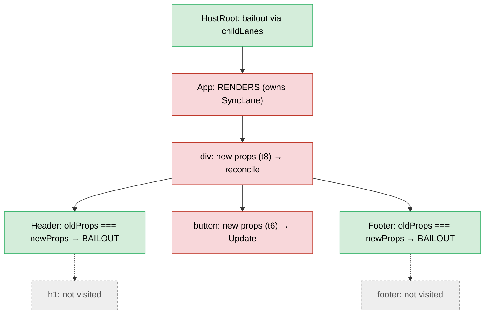

# 全流程穿透：从 setState 到像素呈现

> [!summary] 核心速览（TL;DR）
> 一次用户点击事件，首先通过 `createRoot` 挂载在根容器上的监听器进入 React。`dispatchDiscreteEvent` 将当前更新优先级标记为离散优先级（Discrete），使得 `setCount` 获得 **`SyncLane`（同步赛道）**。该更新被暂存（buffer），系统排入一个微任务（microtask）；一旦你的事件处理函数执行完毕，该微任务便会立即以**纯同步方式执行 Render 与 Commit，无需经过 Scheduler 调度任务**。Render 阶段从根节点出发，顺着 `childLanes` 路径迅速跳过（Bailout）无关祖先直达 `App`，重新执行 `App` 组件函数。在没有编译器介入时，由于子元素对象全部重新生成，`Header` 和 `Footer` 也会随之重跑。真实的 DOM Diff 比对推迟到了 Commit 阶段（`commitUpdate` → `updateProperties`），而最终真正发生的真实 DOM 写入仅有按钮内部的一行文本。对于 `SyncLane` 提交，`useEffect` 会在 Commit 阶段尾声、**浏览器绘制（Paint）之前**同步冲刷执行。若开启 React 编译器（React Compiler），`Header` 与 `Footer` 将直接从 `App` 的记忆缓存（Memo Cache）中取出完全相同的元素对象引用，其整棵子树均被直接跳过；此时最终落到真实 DOM 上的写入操作与未编译版本完全一致。

本文承接 [[20 Walkthrough - First Render End to End|首次渲染端到端源码追踪]] 中的示例应用。此时首次渲染已经完成提交，其被动副作用（Passive Effect）也已执行完毕，屏幕当前静止展示数字 `0`。

## 起始状态（Starting state）

```jsx
function App() {
  const [count, setCount] = useState(0);
  useLayoutEffect(() => { document.title = `count: ${count}`; }, [count]);
  useEffect(() => { console.log("committed", count); }, [count]);
  return (
    <div>
      <Header title="Counter" />
      <button onClick={() => setCount((c) => c + 1)}>{count}</button>
      <Footer />
    </div>
  );
}
```

```text
FiberRoot.current ─► HostRoot(B)          HostRoot(A) = alternate (首次挂载时的旧 WIP)
                      └ App               alternate: null    lanes: 0
                         └ div            alternate: null
                            ├ Header ─ h1     (此时均为 alternate: null；目前仅存在 HostRoot 成对节点)
                            ├ button          stateNode: <button>, __reactProps$.onClick = arrow#1
                            └ Footer ─ footer
App.memoizedState: Hook{0, queue{pending: null, lastRenderedState: 0, dispatch: setCount}} → Hook{layout} → Hook{passive}
root.pendingLanes: 0
```

## 全流程图解（The whole flow）

```mermaid
sequenceDiagram
  autonumber
  participant U as user
  participant B as browser
  participant L as root listener (react-dom)
  participant H as your onClick
  participant RC as reconciler
  participant MT as microtask
  participant WL as work loop
  participant C as commit
  U->>B: click <button>
  B->>L: native click, capture then bubble on #root
  L->>L: dispatchDiscreteEvent: p = DiscreteEventPriority, T = null
  L->>L: dispatchEvent → getClosestInstanceFromNode → button fiber
  L->>L: SimpleEventPlugin: accumulateSinglePhaseListeners('onClick')
  L->>H: processDispatchQueue → listener(syntheticEvent)
  H->>RC: setCount(c => c + 1) = dispatchSetState
  RC->>RC: requestUpdateLane → SyncLane, eager state: 1 ≠ 0
  RC->>RC: enqueueConcurrentHookUpdate (buffered), App.lanes = SyncLane
  RC->>MT: scheduleUpdateOnFiber → ensureRootIsScheduled → queueMicrotask
  L->>L: restore priority; listener returns
  MT->>RC: processRootScheduleInMicrotask: SyncLane → no Scheduler task
  RC->>WL: flushSyncWorkAcrossRoots → performSyncWorkOnRoot → renderRootSync
  WL->>WL: prepareFreshStack: link update, HostRoot.childLanes = SyncLane
  WL->>WL: HostRoot bails out → App renders (updateReducerImpl: 1)
  WL->>WL: div, Header, h1, button, Footer, footer (no compiler: all re-render)
  WL->>WL: completeWork: markUpdate on changed props (no diff yet)
  WL->>C: completeRoot → commitRoot
  C->>B: mutation: commitUpdate → updateProperties → button text "1"
  C->>C: root.current = finishedWork, layout: document.title
  C->>C: flushSpawnedWork: SyncLane → flushPendingEffects → useEffect NOW
  B->>U: microtask ends, task ends → paint "1"
```

## 调用栈全景速览（Call stack at a glance）

```text
── 浏览器任务：原生 'click' 事件 ──────────────────────────────────────────
(根容器捕获监听器)       dispatchDiscreteEvent → dispatchEvent → … 无 onClickCapture 处理函数
(根容器冒泡监听器)       dispatchDiscreteEvent(click, flags, container, nativeEvent)
  setCurrentUpdatePriority(DiscreteEventPriority)            // ReactDOMSharedInternals.p = SyncLane
  dispatchEvent
    findInstanceBlockingEvent → getClosestInstanceFromNode(target)   → button fiber
    dispatchEventForPluginEventSystem → batchedUpdates
      dispatchEventsForPlugins
        extractEvents → SimpleEventPlugin.extractEvents
          accumulateSinglePhaseListeners(buttonFiber, 'onClick') → [{button, arrow}]
        processDispatchQueue → processDispatchQueueItemsInOrder → executeDispatch
          onClick()                                          // 开发者传入的箭头函数
            setCount(c => c + 1)  = dispatchSetState(AppFiber, queue, action)
              requestUpdateLane → resolveUpdatePriority      → SyncLane
              dispatchSetStateInternal
                eager: basicStateReducer(0, action) = 1;  !Object.is(1, 0)
                enqueueConcurrentHookUpdate                  // concurrentQueues, App.lanes |= SyncLane
                scheduleUpdateOnFiber → markRootUpdated → ensureRootIsScheduled
                  ensureScheduleIsScheduled → scheduleImmediateRootScheduleTask → queueMicrotask
  setCurrentUpdatePriority(previous)
── 微任务检查点（事件监听函数返回） ────────────────────────────────────────
processRootScheduleInMicrotask
  scheduleTaskForRootDuringMicrotask                         → SyncLane, callbackNode = null
  flushSyncWorkAcrossRoots_impl → performSyncWorkOnRoot
    flushPendingEffects                                      // 挂载阶段无遗留副作用
    performWorkOnRoot(root, SyncLane, forceSync=true) → renderRootSync
      prepareFreshStack → createWorkInProgress(root.current) // 复用 HostRoot(A)
                          finishQueueingConcurrentUpdates → markUpdateLaneFromFiberToRoot
      workLoopSync → performUnitOfWork
        beginWork(HostRoot) → attemptEarlyBailoutIfNoScheduledUpdate → bailoutOnAlreadyFinishedWork → cloneChildFibers
        beginWork(App)      → updateFunctionComponent → renderWithHooks(HooksDispatcherOnUpdate)
                               updateState → updateReducer → updateReducerImpl → markWorkInProgressReceivedUpdate
                               updateLayoutEffect / updateEffect → updateEffectImpl（依赖发生变更）
                               reconcileChildFibers → reconcileSingleElement → useFiber(div)
        beginWork(div)      → updateHostComponent → reconcileChildrenArray → updateSlot → updateElement → useFiber ×3
        beginWork(Header)   → props !== → renderWithHooks → Header()      // 未使用编译器的情况
        beginWork(h1), beginWork(button), beginWork(Footer), beginWork(footer)
        completeWork(…)     → updateHostComponent (complete): oldProps !== newProps → markUpdate
      finishConcurrentRender → completeRootWhenReady → completeRoot → commitRoot
        flushMutationEffects → commitMutationEffectsOnFiber
          HostComponent + Update → commitHostUpdate → commitUpdate → updateProperties → setProp
                                                                     → setTextContent(button, "1")
          root.current = finishedWork
        flushLayoutEffects → commitHookLayoutEffects                // document.title = "count: 1"
        flushSpawnedWork → requestPaint(); includesSyncLane → flushPendingEffects
          flushPassiveEffects → flushPassiveEffectsImpl → commitPassiveMountEffects   // console.log
── 宏任务结束 → 样式计算 / 布局（Layout） / 像素绘制（Paint） ───────────────
```

## 全流程 25 步深度剖析（The steps）

### 1. 点击事件冒泡至根容器

用户点击 `<button>`。浏览器原生分发 `click` 事件，经历捕获（capture）→ 目标（target）→ 冒泡（bubble）三个阶段。

`<button>` 真实 DOM 节点上本身并没有绑定任何原生监听器。正如在 [[20 Walkthrough - First Render End to End|首次渲染全流程剖析第 2 步]] 中所述，`listenToAllSupportedEvents` 早在挂载阶段便已为 `#root` 根容器预先注册了 `click` 事件的捕获监听器和冒泡监听器[^listen]。捕获监听器在事件下潜阶段首先触发，尝试寻找 `onClickCapture` 回调；由于未配置任何捕获回调，故直接静默退出。随后，冒泡监听器在事件沿 DOM 树回溯至根节点时被正式激活。

→ 深度专题：[[13 The Event System|事件系统架构深度剖析]]

### 2. `dispatchDiscreteEvent`：在回调外层包裹离散优先级

每一个事件监听器均由高阶函数 `createEventListenerWrapperWithPriority` 创建。由于 `getEventPriority('click')` 返回的是 `DiscreteEventPriority`（离散事件优先级），它选择了包装函数 `dispatchDiscreteEvent`[^ctewp][^gep]。

`dispatchDiscreteEvent` 暂存并重置 `ReactSharedInternals.T` 为 `null`（因为原生点击事件默认绝不是过渡更新 Transition），调用 `setCurrentUpdatePriority(DiscreteEventPriority)`，随后调用 `dispatchEvent`，并在 `finally` 块中精准恢复原先的优先级与过渡上下文[^dde]。

这是一种典型的动态作用域（dynamic scope）设计：在此期间所有被同步调用的 `setState`，都将直接处于该离散优先级的管辖之下。

### 3. `dispatchEvent`：从 DOM 节点反查 Fiber

`dispatchEvent` 调用 `findInstanceBlockingEvent`，传入当前原生事件的目标节点（`event.target`），并调用 `getClosestInstanceFromNode`[^de][^fibe]。

该函数读取此前在 `createInstance` 阶段由 `precacheFiberNode` 挂载在 DOM 节点上的 `__reactFiber$<random>` 私有属性，瞬间定位并返回 `button` 对应的 Fiber 节点[^gcifn]。

当前路径上没有遭遇未就绪的脱水注水边界（Dehydrated Boundary），事件无需阻塞；于是 `dispatchEventForPluginEventSystem` 将 `dispatchEventsForPlugins` 放入 `batchedUpdates`（批处理包裹器）中执行[^defpes][^defp]。

### 4. `SimpleEventPlugin` 提取并收集 `onClick`

`SimpleEventPlugin.extractEvents` 将原生 `click` 映射为 React 合成事件属性 `onClick`，实例化 `SyntheticMouseEvent`，并调用 `accumulateSinglePhaseListeners(buttonFiber, 'onClick', …)`[^seee][^aspl]。

该过程沿着 `fiber.return` 链一路向上回溯至根节点。对于途经的每一个**宿主 Fiber（Host Component）**，调用 `getListener`。需要特别注意的是：`getListener` 读取的是真实 DOM 节点上绑定的 `__reactProps$`（代表最近一次*已提交（committed）*的最新属性），而非 `fiber.memoizedProps`[^getlistener]。

```text
button (HostComponent)  onClick: arrow#1   ✔ 收集成功
div    (HostComponent)  无 onClick
App, HostRoot           非宿主 Fiber：直接跳过
dispatchQueue = [{ event: SyntheticMouseEvent('onClick'), listeners: [{button, arrow#1}] }]
```

### 5. 执行业务事件处理函数

`processDispatchQueue` → `processDispatchQueueItemsInOrder` 按照从事件目标向根节点（Target → Root）的顺序遍历监听队列，通过 `executeDispatch` 设置 `event.currentTarget` 并触发调用 `arrow#1(event)`[^pdq][^pdqio][^ed]。

此时，开发者编写的业务逻辑开始运行：`setCount(c => c + 1)`。

### 6. `dispatchSetState` → `requestUpdateLane` 决议为 `SyncLane`

`setCount` 本质上是在组件挂载时（`mountState` 阶段）固化的闭包函数：`dispatchSetState.bind(null, AppFiber, queue)`[^mountstate]。

`dispatchSetState` 首先向系统询问当前的更新赛道：`requestUpdateLane(fiber)`[^dss][^requestlane]。

此时当前主线程并不处于 Render 阶段，且全局过渡标记 `T` 为 `null`，因此赛道由 `eventPriorityToLane(resolveUpdatePriority())` 计算得出。当前 `ReactDOMSharedInternals.p` 记录的正是步骤 2 中设置的 `DiscreteEventPriority`，它在数值上**严格等同于** `SyncLane`[^resolveprio][^eventprio]。

→ 深度专题：[[12 setState - dispatchSetState and Batching|setState 与批处理机制]]、[[04 Lanes and the Scheduler|Lanes 赛道与调度器]]

### 7. 饥渴计算求值尝试（The eager-state attempt）

`dispatchSetStateInternal` 构造更新对象 `{lane: SyncLane, action: c => c + 1, hasEagerState: false, eagerState: null, next: null}`[^dssi]。

接着，它会检测能否**在此时此刻（Render 之前）**预先算出下一次状态：

```js
if (fiber.lanes === NoLanes && (alternate === null || alternate.lanes === NoLanes)) {
  const eagerState = queue.lastRenderedReducer(queue.lastRenderedState, action); // basicStateReducer(0, c => c + 1) = 1
  update.hasEagerState = true;
  update.eagerState = eagerState;
  if (is(eagerState, currentState)) { /* 赋值为 NoLane 入队并直接返回：完全无需触发渲染 */ }
}
```

在这次点击中，`App` 的 Fiber 节点既没有任何未处理的待处理赛道（`lanes === NoLanes`），也没有 alternate 双胞胎节点，因此成功进入饥渴计算分支。Reducer 计算得出新状态为 `1`；因为 `1 !== 0`，所以并未发生跳过（Bailout）。

但这番计算绝非无用功：`hasEagerState: true` 会被标记在更新对象上，使后续的实际 Render 阶段能够直接复用已经算好的 `1`，无需重复执行开发者的更新器函数（见步骤 15）。

这项前置条件至关重要：**饥渴计算只有在当前没有任何排队中的先前更新时才是安全且合法的**。这带来了两条深刻的推论：

- **在同一个事件处理函数中连续调用第二次 `setState` 时，永远无法享受饥渴跳过**。一旦第一次调用为 Fiber 赋予了赛道（`fiber.lanes !== NoLanes`），后续的所有调用都会直接进队列。比如连续执行 `setCount(c => c + 1); setCount(c => c - 1)`，最终状态虽仍为 `0`，但 React 只能通过真正渲染 `App` 才能发现这一点；随后在 `updateReducerImpl` 中发现 `Object.is(0, 0)`，并在 `updateFunctionComponent` 处触发晚期跳过（`bailoutHooks`）。
- **在下一次点击时，饥渴求值通常根本无法执行**。本次更新提交后，`App` Fiber 的*另一侧孪生副本*（Twin）内部依然残留着 `lanes = SyncLane`。因为 `beginWork` 只负责清理 WIP（Work-in-Progress）上的 `lanes`，而 Commit 提交链路上并不会清除旧 Fiber 上的标记。唯有在遭遇晚期跳过时（`bailoutHooks` 执行 `current.lanes = removeLanes(...)`）才会顺手清理[^bailouthooks]。因此，“新旧状态相同则不渲染”仅仅是一种尽力而为的快速通道（best-effort fast path），绝非绝对的静态契约。

→ 深度专题：[[12 setState - dispatchSetState and Batching|setState 与批处理机制]]、[[11 Hooks on Update|Update 阶段的 Hooks 机制]]

### 8. 在 `concurrentQueues` 中暂存更新

`enqueueConcurrentHookUpdate` 将 `(AppFiber, queue, update, SyncLane)` 元组推入模块级的 `concurrentQueues` 全局数组中，并就地执行 `App.lanes |= SyncLane`（若存在 alternate 也会一并标记）[^ecthu][^concurrent-enqueue]。

请注意：**此时它完全不会改动 `queue.pending`，也绝不会触碰祖先节点的 `childLanes`**。这些连接操作被故意推迟到了步骤 12 的 `finishQueueingConcurrentUpdates` 中统一冲刷，以确保如果此时恰好有正在并发执行的渲染任务，它绝不会读到半拉子（不完整）的事件更新。该函数通过沿着 `.return` 向上攀爬，最终返回根节点 `FiberRoot`[^getroot]。

### 9. `scheduleUpdateOnFiber` → 排入单个微任务，处理函数执行完毕返回

`scheduleUpdateOnFiber` 调用 `markRootUpdated`，将根节点的 `root.pendingLanes` 标记上 `SyncLane`；接着 `ensureRootIsScheduled` 将该根节点加入调度排期，由 `ensureScheduleIsScheduled` 派发一个微任务（若尚未派发）[^suof][^markrootupdated][^ensureroot][^ensureschedule][^sirst]。

`setCount` 随即执行完毕退出。你的 `onClick` 事件处理函数返回。`dispatchDiscreteEvent` 恢复了调用前的全局优先级。

**在此关口，React 尚未进行任何渲染，你的闭包函数上下文中的 `count` 依然是 `0`。**

> [!tip] 具象理解自动批处理（Automatic Batching）
> 假设你的事件代码写为 `onClick={() => { setCount(c => c + 1); setCount(c => c + 1); }}`，上述步骤 6–9 会连续执行两次。第二次调用时，由于跳过了饥渴计算（步骤 7），它仅是在全局队列中压入第二个 `(fiber, queue, update, lane)` 元组，并且在检测到 `didScheduleMicrotask === true` 后，直接放弃派发新的微任务。稍后在步骤 15 中，React 会在**同一次 Render** 中一口气重放这两个更新：`0 → 1 → 2`。一次 Render，一次 Commit，一次真实绘制。无论在 `setTimeout` 还是 Promise 回调中，这一行为完全一致——因为现代 React 的批处理机制扎根于根节点的调度器（Root Scheduler），而非事件系统本身。

### 10. 微任务触发：`SyncLane` 意味着无需创建 Scheduler 调度任务

随着原生事件监听函数的调用栈完全清空出栈，宿主环境的微任务检查点触发，调用 `processRootScheduleInMicrotask`[^prsim]。

`scheduleTaskForRootDuringMicrotask` 在调用 `getNextLanes` 时识别出 `SyncLane`。由于这是最高优先级的同步任务，它没有向 Scheduler 预订常规时间切片任务，而是取消了所有现存的调度，直接设置 `root.callbackPriority = SyncLane, callbackNode = null` 并立即返回。源码对此写有一行清晰的注释：“同步任务总是在微任务末尾直接被冲刷”[^stfrdm]。

紧接着，`processRootScheduleInMicrotask` 调用 `flushSyncWorkAcrossRoots_impl`，对所有包含同步赛道的 Root 循环调用 `performSyncWorkOnRoot`[^fswar]。

对比首次挂载阶段：在首次渲染时，微任务为 `NormalPriority` 预订了一个 Scheduler 宏任务，实际渲染被推迟到了后续的宏任务中；而在离散事件更新中，**后文发生的所有一切都紧锁在当前微任务中同步完成**，中途绝不允许浏览器插入帧渲染。

### 11. `performSyncWorkOnRoot` → 进入 `renderRootSync`

`performSyncWorkOnRoot` 首先执行 `flushPendingEffects()`。上一次 Commit 遗留下的被动副作用必须在新一轮 Render 开启前清理并执行完毕。由于首次渲染步骤 22 中副作用早已执行，此处为空操作。

随后它调用 `performWorkOnRoot(root, SyncLane, forceSync = true)`[^pswor]。`forceSync = true` 会直接导致 `shouldTimeSlice` 决议为 `false`；加之 `SyncLane` 本身就是不可中断的阻塞赛道，系统正式进入同步工作循环：`renderRootSync`[^timeslice][^rrs]。

→ 深度专题：[[06 The Work Loop - Render Phase|工作循环：Render 阶段深度解析]]

### 12. `prepareFreshStack`：连接更新链表并标记 `childLanes`

`prepareFreshStack` 调用 `createWorkInProgress(root.current, null)`。与首次挂载不同，此时 `HostRoot(B)` 已经具备了 `alternate`，因此原先首次挂载时的 `HostRoot(A)` 被**原地复用**并重置属性，完全无需分配新内存对象[^pfs][^cwip]。

随后 `finishQueueingConcurrentUpdates` 开始清空暂存区。它将更新对象以环状链表形式串联入 `queue.pending`；接着由 `markUpdateLaneFromFiberToRoot` 沿着 `App` 向上回溯，将 `SyncLane` 逐层按位或（OR）赋值到沿途所有祖先 Fiber 节点的 `childLanes` 上（双侧双胞胎节点均被同步标记）[^fqcu][^mulftr]。

```text
root.pendingLanes      = SyncLane
HostRoot.lanes         = 0          HostRoot.childLanes = SyncLane
App.lanes              = SyncLane   App.childLanes      = 0
App hook[0].queue.pending ─► {lane: SyncLane, action: c => c + 1, hasEagerState: true, eagerState: 1} ⟲
```

### 13. `beginWork(HostRoot)`：触发 Bailout 跳过，沿着 `childLanes` 向下穿透

比较 `HostRoot` 的属性：`memoizedProps === pendingProps`（皆为 `null`），且 `checkScheduledUpdateOrContext` 检测其自身的 `lanes` 中并不包含 `SyncLane`。

因此 `beginWork` 进入 `attemptEarlyBailoutIfNoScheduledUpdate` 分支，推入 Context 栈并转入 `bailoutOnAlreadyFinishedWork`[^beginwork][^csuoc][^aeb]。

此时检查发现其 `childLanes` 与本次渲染赛道存在交集，因此它并不会直接返回 `null` 终结遍历，而是调用 `cloneChildFibers` 为子节点创建 WIP。即以 `createWorkInProgress(currentApp, currentApp.pendingProps)` 创建 `App` 的工作副本——请注意，传入的是**旧的 Props 对象引用**[^bofw][^clone]。

由于 `App` 此前尚未拥有 `alternate`，这一步为 `App` 分配了其生命周期中的第二个 Fiber 节点。

→ 深度专题：[[07 beginWork and Reconciliation|beginWork 与协调算法深度剖析]]

### 14. `beginWork(App)`：Props 虽然相同，但自身带有待处理赛道，必须重新渲染

对比 `App` 的属性：`oldProps === newProps` 恒成立（因为步骤 13 传入的是同一个旧对象）。

但这一回，`checkScheduledUpdateOrContext` 在 `current.lanes` 中**命中了 `SyncLane`**！因此 `beginWork` 将 `didReceiveUpdate` 设为 `false`，并径直落入 `updateFunctionComponent`[^beginwork][^ufc]。

`renderWithHooks` 发现 `current.memoizedState !== null`，于是挂载更新专用的分发器：**`HooksDispatcherOnUpdate`**。它重置清空 WIP 节点的 `memoizedState` 与 `updateQueue`，开始正式调用执行组件函数 `App()`[^rwh][^dupdate]。

### 15. `updateReducerImpl` 计算得出 `1`，翻转 `didReceiveUpdate` 状态

进入 Hooks 执行链路：`useState` → `updateState` → `updateReducer` → `updateReducerImpl`[^updatestate][^updatereducer][^uri]。

首先，`updateWorkInProgressHook` 从 `current` Fiber 克隆复制 hook #0。需要说明的是，底层的 `queue` 更新队列对象是被共享引用的，并非深拷贝[^uwih]。随后依次执行：

1. 将 `queue.pending` 转移合并入 `baseQueue`（同时备份到 `current.baseQueue` 上，防止当前渲染被舍弃时丢失更新），随后置 `pending = null`。
2. 提取待执行更新，其赛道包含在当前渲染赛道内，因而开始执行。检测到 `hasEagerState === true`，直接赋值 `newState = eagerState = 1`！开发者的更新器函数完全不会被二次调用。
3. 执行 `!is(1, 0)` 比对发现新旧状态不同，触发 **`markWorkInProgressReceivedUpdate()`**，将 `didReceiveUpdate` 翻转重设为 `true`[^changecheck][^mwiru]。
4. 固化新状态：`hook.memoizedState = 1`，`queue.lastRenderedState = 1`。

`useState` 执行完毕并返回数组 `[1, setCount]`。这里的 `setCount` 与挂载时是完全相同的引用，因为 `queue.dispatch` 终生不变。

→ 深度专题：[[11 Hooks on Update|Update 阶段的 Hooks 机制]]

### 16. 副作用处理：依赖项发生改变，被打上 `HasEffect` 标记

`useLayoutEffect` 与 `useEffect` 依次流经 `updateEffectImpl`。

`areHookInputsEqual([1], [0])` 判定为 `false`，因此每个 Effect 都生成并压入一个打上了 `HookHasEffect | …` 标记的副作用节点，并为当前 Fiber 节点挂上对应的副作用标志位（Layout 对应 `Update` 标志，Passive 对应 `Passive` 标志）[^uee]。

无论依赖项是否发生变化，两个 Effect 都会被重新串联到全新的 `updateQueue` 环形队列中；唯一的区别在于，依赖未变的 Effect 不会携带 `HasEffect` 触发标记。

### 17. 协调 `App` 的返回结果：全新 `<div>` 元素，复用既有 Fiber 节点

`App()` 函数返回一整棵全新构造的 React 元素对象树。

由于 `didReceiveUpdate` 为 `true`，无法触发任何晚期跳过。

流程进入 `reconcileChildren` → `reconcileChildFibers`（由于 `App` 存在 `current`，此阶段开启副作用追踪）→ `reconcileSingleElement`：比对发现 `key` 相同（均为 `null`）、`type` 相同（均为 `'div'`），因而命中复用，调用 `useFiber(currentDiv, element.props)`[^reconcilechildren][^rse][^usefiber]。

新创建的 WIP `div` Fiber 的 `pendingProps` 被赋予了**全新创建的** props 对象。

### 18. `beginWork(div)`：三个子节点，三个全新的 Props 对象

对于 `div` 节点而言，`oldProps !== newProps` 成立，`didReceiveUpdate` 设为 `true`，触发 `updateHostComponent`。

由于它的子节点是一个数组，因此进入 `reconcileChildrenArray`。在第一轮顺位遍历中，`updateSlot` 按照索引位置逐一核对 key，并通过 `updateElement` → `useFiber` 分别复用已有的 `Header`、`button` 和 `Footer` Fiber 节点，将它们与新元素的 props 结合绑定[^uhc-begin][^rca][^updateelement]。

此处由于子节点顺序和层级完全未变，既没有产生 `Placement` 移动/插入，也没有产生 `ChildDeletion` 节点删除。

```text
Header  memoizedProps {title:"Counter"}  ≠  pendingProps {title:"Counter"}   ← 不同的内存对象引用
button  {onClick: arrow#1, children: 0} ≠  {onClick: arrow#2, children: 1}
Footer  {}                              ≠  {}
```

### 19. 无记忆化时的雪崩级联重渲染：`Header` 与 `Footer` 被迫重跑

遍历来到 `beginWork(Header)`：由于 `oldProps !== newProps`（纯引用恒等比对，非内容浅比对），`didReceiveUpdate` 被置为 `true`，组件函数 `Header` 被迫执行。由于 `Header` 内部不包含任何 Hook，`current.memoizedState === null`，`renderWithHooks` 在此时甚至会选用挂载阶段的 Dispatcher（这完全无害）[^rwh]。它返回了一个全新的 `<h1>` 元素，使得子节点 `h1` 也获得了全新的 props 对象 `{children: "Counter"}`。

同样的雪崩效应发生在 `Footer` → `footer` 链路上。

而对于 `button` 宿主 Fiber，其子节点仅为一个纯数字 `1`：`shouldSetTextContent` 判断成立，因此它根本不需要构建独立的子级 Text Fiber，`updateHostComponent` 直接返回 `null` 终结向下深挖[^sstc]。

这正是未经优化的 React 默认行为：**只要某个组件发生更新，其下方的整棵组件子树默认都会被无差别全量重渲染**。前面的 `childLanes` 跳过机制仅仅赦免了发生更新节点上方的*祖先链条*（见步骤 13）。在组件上包裹 `React.memo` 能通过 `shallowEqual` 阻断这种向下扩散，而开启 React 编译器则能从源头通过引用恒等实现跳过（详见后文）。

### 20. `completeWork`：仅做标记，推迟 Diff

在自底向上的回溯归并阶段，针对每个拥有 `current` 和 `stateNode` 的宿主组件，`completeWork` 调用完成阶段的 `updateHostComponent`。其内部逻辑极其直白：`if (oldProps === newProps) return; markUpdate(workInProgress)`[^uhc-complete][^markupdate]。

**React 19 彻底废弃了 Update Payload（更新载荷数组）**。在 Render 阶段中不再调用 `prepareUpdate`，也不再执行 `diffProperties`。所有的属性差异比对被完全延后到了 Commit 阶段。

因此，`h1`、`button`、`footer` 和 `div` 全部都被打上了 `Update` 标志位，即便其中大部分节点的内容根本没有任何实质变化。`bubbleProperties` 随后将这些标志位一路按位或冒泡汇总到根节点[^bubble]。

```text
App     flags: Update | Passive   （包含打上 HasEffect 标记的副作用）
div     flags: Update             （children 数组是全新的引用）
h1      flags: Update             （全新的 {children:"Counter"} 对象）
button  flags: Update             （children 从 0 变 1，onClick 从 arrow#1 变 arrow#2）
footer  flags: Update
HostRoot.subtreeFlags ⊇ Update | Passive
```

→ 深度专题：[[08 completeWork - Building DOM Nodes|completeWork：构建真实 DOM 节点]]

### 21. Commit 提交：Mutation 突变阶段，`commitUpdate` → `updateProperties` 执行真实 Diff

流程推进至 `finishConcurrentRender` → `completeRootWhenReady` → `completeRoot` → `commitRoot`[^fcr][^crwr][^completeroot][^commitroot]。

`markRootFinished` 清除已处理的 `SyncLane`，并照例为 Normal 优先级的被动副作用向 Scheduler 注册调度回调[^passive-sched]。

在 `flushMutationEffects` 阶段中，`commitMutationEffectsOnFiber` 顺着 `subtreeFlags & MutationMask` 的路径向下精确巡检[^fme][^cmeof]。

针对每一个带有 `Update` 标记的宿主组件，依次调用 `commitHostUpdate` → DOM 层 `commitUpdate`，进而执行 `updateProperties(dom, type, oldProps, newProps)`，最后执行 `updateFiberProps(dom, newProps)`[^hc-mut][^chu][^commitupdate]。

**`updateProperties` 才是真正执行 DOM Diff 的核心所在**：它针对 `lastProps` 与 `nextProps` 展开双重循环遍历，唯有当 `nextProp !== lastProp` 时才会真正触发底层的 `setProp` 写入[^updateprops][^updateprops-loops]。

| Fiber 节点 | 发生 `!==` 变化的 Props 属性 | 实际产生的真实 DOM 操作 |
|---|---|---|
| `div` | `children`（全新的数组引用） | `setProp('children', array)` 直接空跑提前返回：未执行任何真实 DOM 写入 |
| `h1` | 无（`"Counter" === "Counter"`） | 无任何操作 |
| `button` | `children: 0 → 1`<br/>`onClick: arrow#1 → arrow#2` | 调用 `setTextContent(button, "1")`，直接更新既有文本节点的 `nodeValue` 属性[^settext]；`onClick` 重新赋值 Safari 特有的空操作 `onclick` 桩函数[^setprop-onclick] |
| `footer` | 无 | 无任何操作 |

随后，`updateFiberProps` 将 DOM 节点上的 `__reactProps$` 私有属性重新定向指向新的 props 对象，确保下一次点击时触发的是 `arrow#2` 回调函数[^ufp]。

`App` 上的 `Update` 标志位在此处还会触发 Layout Effect 的**卸载清理函数（Cleanup）**；由于我们的 Layout Effect 并没有返回任何清理函数，故此处直接略过[^cmeof]。

> [!note] 为什么这里没有调用 `commitTextUpdate`？
> `commitTextUpdate`（本质是 `textInstance.nodeValue = newText`）是专属于独立 `HostText` Fiber 节点的更新机制[^committextupdate]。而在我们的代码 `<button>{count}</button>` 中，button 的子节点是一个唯一的纯数字，因此 React 从未为该文本单独分配过 Fiber 节点，而是直接将其内联在 button 的 `children` prop 中流转。如果将代码改为 `<button>Clicked {count}</button>`，React 就会构建两个独立的 `HostText` Fiber。其中 `"Clicked "` 对应的 Fiber 在 `completeWork` 阶段即可触发跳过（因为 `oldText === newText`），而只有承载数字变化的那个 Fiber 才会进入 `commitHostTextUpdate` → `commitTextUpdate` 链路[^chtu][^uht]。

### 22. 指针置换：双缓存切换

执行核心切换代码：`root.current = finishedWork`（源码第 4051 行）[^swap]。

`HostRoot(A)` 重新成为生效中的 `current` 树。而 `HostRoot(B)` 则退居二线，沦为下一次渲染周期的离屏缓冲区。至此，在本轮渲染中被克隆创建的所有 Fiber 节点，都已正式拥有了属于各自的 `alternate` 双胞胎节点。

### 23. Layout 阶段副作用同步执行

`flushLayoutEffects` → `commitLayoutEffectOnFiber`。

探测到 `App` 带有 `Update` 标志位，`commitHookLayoutEffects` 随即同步调用开发者的回调：`document.title = "count: 1"`[^fle][^cleof][^chle]。

**请注意：此时真实 DOM 的文本内容已经变成了 `1`，但浏览器主线程尚未迎来任何像素重绘（Paint）。**

### 24. `flushSpawnedWork`：被动副作用在绘制前“插队”同步冲刷

`flushSpawnedWork` 首先调用 `requestPaint()`，并将被动副作用标记为待处理状态。接着执行关键判定[^fsw][^syncflush]：

```js
if (includesSyncLane(pendingEffectsLanes) && (disableLegacyMode || root.tag !== LegacyRoot)) {
  flushPendingEffects();
}
```

由于本次提交的赛道中包含 `SyncLane`，系统调用 `flushPendingEffects` → `flushPassiveEffects` → `flushPassiveEffectsImpl`。它先执行全部被动副作用的卸载清理（本例中无），然后立即执行挂载：**`console.log("committed", 1)` 竟然直接在浏览器重绘屏幕之前同步打印输出了！**[^fpe][^fpei]

源码注释深刻道出了这一设计的初衷：离散用户交互所带来的副作用变更应当是“即刻立即可见且可观测的（immediately observable）”。随后，`flushSyncWorkOnAllRoots()` 会在同一个微任务中，同步把副作用内部可能再次触发的同步 `setState` 一并执行完毕[^fsw]。

至于此前在 `commitRoot` 中向 Scheduler 登记的 Normal 优先级任务，在稍后的宏任务中被唤起时，会发现当前已经不存在任何待处理的被动副作用，因而直接静默退出[^fpe]。

### 25. 屏幕像素绘制呈现

当前微任务彻底执行完毕出栈，原生事件的宏任务生命周期落下帷幕。浏览器终于接管主线程，顺序执行样式计算（Style）、布局重排（Layout）与像素绘制（Paint）。

用户的肉眼在屏幕上清晰看到了数字 `1`。

**从用户鼠标按下的瞬间，直至最后的控制台打印与像素呈现，整套全链路均在同一个一气呵成的微任务/事件任务周期内同步吞吐完毕。**

---

## 结合 React 编译器的全流程透视（With the React Compiler）

以下是经过真实 `babel-plugin-react-compiler@1.0.0` 编译转译后的 `App` 完整产物（其完整包含 `Header` 与 `Footer` 的构建产物详见 [[20 Walkthrough - First Render End to End|首次渲染端到端源码追踪]]）：

```js
function App() {
  const $ = _c(13);
  const [count, setCount] = useState(0);
  let t0;
  let t1;
  if ($[0] !== count) {                      // 1 !== 0 → 重新计算
    t0 = () => { document.title = `count: ${count}`; };
    t1 = [count];
    $[0] = count; $[1] = t0; $[2] = t1;
  } else {
    t0 = $[1]; t1 = $[2];
  }
  useLayoutEffect(t0, t1);
  let t2;
  let t3;
  if ($[3] !== count) {                      // 依赖变化 → 重新计算
    t2 = () => { console.log("committed", count); };
    t3 = [count];
    $[3] = count; $[4] = t2; $[5] = t3;
  } else {
    t2 = $[4]; t3 = $[5];
  }
  useEffect(t2, t3);
  let t4;
  let t5;
  if ($[6] === Symbol.for("react.memo_cache_sentinel")) {   // 当前已非哨兵值 → 命中缓存！
    t4 = <Header title="Counter" />;
    t5 = () => setCount(_temp);
    $[6] = t4; $[7] = t5;
  } else {
    t4 = $[6]; t5 = $[7];                     // 提取与首次挂载时完全相同的元素对象和事件处理函数！
  }
  let t6;
  if ($[8] !== count) {                       // 重新计算：生成全新的 <button> 元素
    t6 = <button onClick={t5}>{count}</button>;
    $[8] = count; $[9] = t6;
  } else {
    t6 = $[9];
  }
  let t7;
  if ($[10] === Symbol.for("react.memo_cache_sentinel")) {  // 命中缓存！
    t7 = <Footer />;
    $[10] = t7;
  } else {
    t7 = $[10];                               // 提取完全相同的元素对象引用
  }
  let t8;
  if ($[11] !== t6) {                          // t6 发生了变化 → 重新构建 <div>
    t8 = <div>{t4}{t6}{t7}</div>;
    $[11] = t6; $[12] = t8;
  } else {
    t8 = $[12];
  }
  return t8;
}
function _temp(c) { return c + 1; }
```

我们重新对照 25 个步骤的细微差异：

- **步骤 1–5：完全一致**，唯一的区别是事件处理函数的引用恒等性。此时保存在 DOM 节点 `__reactProps$` 中的 `onClick` 是被缓存的 `t5`，在挂载时仅创建了一次。在随后的每次渲染中，它的引用永远保持同一。
- **步骤 6–13：完全一致**。`setCount(_temp)` 调用的依然是底层的 `dispatchSetState`，获得同样的 `SyncLane`，执行同样的饥渴计算（`_temp(0) = 1`），进入同样的缓冲区、微任务与 `prepareFreshStack`，并在 `HostRoot` 处执行同样的跳过逻辑。**编译器并不会改变“谁应该被加入调度”**。
- **步骤 14：`App` 组件依然会重新执行渲染**。因为当前待处理的赛道正是挂载在 `App` 上的！函数内的第一行调用是 `_c(13)` → `useMemoCache(13)`。由于 `renderWithHooks` 此前重置清空了 WIP 的 `updateQueue`，`useMemoCache` 会从 `alternate.updateQueue.memoCache` 中读取缓存，并在 `enableNoCloningMemoCache = false` 的配置下执行**写时复制克隆（Copy-on-Write clone）**：`data.map(array => array.slice())`。随后它将此克隆数组挂载到 WIP 的全新 `updateQueue` 上[^umc][^nocloning]。本轮渲染中产生的所有写入都只会影响这份克隆副本；即使当前渲染中途被废弃丢弃，已提交生效的缓存依然能与屏幕渲染保持精准一致。
- **步骤 15–16：完全一致**。`updateReducerImpl` 依然计算出 `1`，`didReceiveUpdate` 依然翻转为 `true`。Effect 作用域比对 `count` 发生变化，两个副作用依然被打上 `HasEffect` 标志。编译器只负责消灭*虚假多余*的 Effect 重执行，而当依赖项真实改变时，一切如常执行。
- **步骤 17：元素对象的内存引用发生关键分化**。`t4`（`<Header title="Counter"/>`）与 `t7`（`<Footer/>`）直接从缓存槽位 `$[6]` 与 `$[10]` 取出，它们正是组件首次挂载时构建的**完全相同的内存对象引用**。只有 `t6` 与 `t8` 是新创建的对象。`div` 的 Fiber 节点与之前一样被正常复用。
- **步骤 18：决定性的架构差异**。`reconcileChildrenArray` → `updateElement` → `useFiber(currentHeader, t4.props)`。由于 `t4.props` 本身就是首次挂载时直接成为 `Header.memoizedProps` 的那个对象，因此 WIP 状态下的 Header 获得了 `pendingProps === current.memoizedProps` 的引用恒等！`Footer` 亦然[^updateelement][^usefiber]。
- **步骤 19：由向下雪崩重渲染转为优雅跳过（Bailout）**。在执行 `beginWork(Header)` 时：由于 `oldProps === newProps` 成立，且 `checkScheduledUpdateOrContext` 检测自身赛道为空，直接进入 `attemptEarlyBailoutIfNoScheduledUpdate` → `bailoutOnAlreadyFinishedWork`。加之 `Header.childLanes === 0`，函数**直接返回 `null`**！[^beginwork][^aeb][^bofw] 组件函数 `Header()` 根本不会被调用，子级 `h1` 的 Fiber 节点甚至连克隆的开销都被免去了——WIP Header 的 `child` 指针依然直接稳稳地指向现有的旧 `h1`。`Footer` 亦享受到完全一致的跳过待遇。只有 `button` 因为 `t6` 是全新对象而正常进入处理。
- **步骤 20：大幅减少 `Update` 标志位**。在 `completeWork(Header)` 阶段，命中 `bubbleProperties` 的 `didBailout` 分支（子节点依然是旧节点），仅向上冒泡静态标志[^bubble]。`h1` 与 `footer` 甚至根本没有被访问遍历，因此它们身上没有任何 `Update` 标志。仅有 `div`（新的 `t8` props）与 `button`（新的 `t6` props）被打上标记。
- **步骤 21：相同最终 DOM 写入，但大幅消除无谓的 Diff 遍历**。Commit 阶段的 `updateProperties` 仅针对 `div`（空跑后返回）与 `button` 执行。在 button 上，`children: 0 → 1` 触发 `setTextContent` 将文本节点的 `nodeValue` 更新为 `"1"`。而由于 `onClick` 的函数引用完全恒等（均为 `t5`），循环比对直接跳过它。在未编译版本中针对 `h1` 与 `footer` 的无谓遍历在此时被彻底消灭。
- **步骤 22–25：完全一致**。同样的指针置换，同样的 Layout Effect 执行，同样在重绘前同步冲刷 Passive Effect，同样的最终像素绘制。



> [!warning] 业界三大常见认知误区
> - **“有了 React 编译器，App 组件就不会重新渲染了。”** 这是完全错误的认知。状态的持有者（State Owner）必须始终重新执行。编译器的缓存机制仅仅是替它决定：组件返回的众多*产出对象*中，究竟哪些可以复用旧的内存引用。
> - **“编译器能直接减少真实 DOM 的写入操作。”** 在本例中绝非如此。`updateProperties` 本来在 Commit 阶段就会过滤掉未改变的属性，因此唯一产生的真实 DOM 写入——修改按钮文本——在两种模式下是完全同一行底层代码。编译器真正省去的是**组件函数的调用开销、Fiber 树的访问深度，以及 Commit 阶段针对属性的无谓比对循环**。
> - **“Header 被跳过是因为它被自动包裹了 memo。”** 整个编译产物中没有任何 `React.memo`，也没有任何 `shallowEqual` 浅比对。Header 之所以被跳过，完全是因为触发了 React 底层最轻量、开销最低的 `oldProps === newProps` 引用恒等判定；而缓存元素对象的作用，正是让这一恒等式自然成立。

### 两种模式逐步精细对照表（Step by step comparison）

| 步骤阶段 | 未使用编译器（Without Compiler） | 启用 React 编译器（With Compiler） |
|---|---|---|
| **1–5. 点击 → 根监听器 → `onClick`** | 每次渲染都生成全新的箭头函数 | 事件处理函数为缓存的 `t5`，全局仅创建一次 |
| **6–9. `dispatchSetState`、`SyncLane`、饥渴计算、入队缓冲、微任务** | 如前文所述 | 完全一致 |
| **10–12. 微任务 → `performSyncWorkOnRoot` → `prepareFreshStack`** | 无需 Scheduler 调度任务，沿着祖先链标记 `childLanes` | 完全一致 |
| **13. HostRoot 根节点** | 触发 Bailout 跳过，向下克隆 App 节点 | 完全一致 |
| **14. App 组件节点** | 执行重新渲染（自身持有赛道） | 执行重新渲染；`_c(13)` 以写时复制（COW）机制克隆缓存数组 |
| **15–16. State 与 Effects 计算** | 状态更新为 `1`，两个副作用均打上 `HasEffect` | 完全一致 |
| **17. App 的输出协调** | 生成 4 个全新的元素对象（`div`、`Header`、`button`、`Footer`）以及全新的事件函数 | 仅生成 2 个新元素（`div`、`button`）；`Header`、`Footer` 与事件函数均直接复用缓存数组 `$` |
| **18. div 协调 3 个子节点** | 传递 3 个全新的 props 对象引用 | `Header`/`Footer` 传入的 props 与 `memoizedProps` 内存引用完全恒等 |
| **19. Header / Footer 处理** | 发生级联重渲染，并深入访问 `h1`/`footer` | 满足 `oldProps === newProps` 且无赛道，直接触发 Bailout 跳过整棵子树 |
| **20. `completeWork` 阶段的 `Update` 标志** | `div`、`h1`、`button`、`footer` 全部打上标志 | 仅在 `div`、`button` 上打上标志 |
| **21. Mutation 突变阶段** | 经历 4 次 `updateProperties` 比对循环，重新绑定 `onClick`，文本节点执行 `nodeValue = "1"` | 仅执行 2 次比对循环，文本节点执行 `nodeValue = "1"` |
| **22. 指针置换（Swap）** | `root.current = finishedWork` | 完全一致 |
| **23. Layout Effect 阶段** | 同步执行 `document.title = "count: 1"` | 完全一致 |
| **24. Passive Effect 阶段** | 在浏览器重绘前“插队”同步冲刷 | 完全一致 |
| **25. 屏幕绘制呈现** | 呈现字符 `1` | 呈现完全相同的像素 |

纵观整场更新的宏观量化对比：**组件函数调用次数**从 3 次缩减至 1 次；**`beginWork` 访问调用次数**从 8 次缩减至 6 次；**Commit 阶段需要比对属性的宿主 Fiber 数量**从 4 个减半至 2 个；而**最终驱动真实像素变化的真实 DOM 写入操作**则精准保持为 1 次到 1 次。

在当前这个极其微小的演示 Demo 中，这种微秒级的节省或许微不足道；但想象一下在实际工业级业务场景中，一个真实的 `Header` 节点下方往往挂载着成百上千个复杂的组件与 DOM 节点——此时，它是“深度遍历重跑整整几百个 Fiber 节点”，还是“直接在顶层判定跳过、只触碰真正发生变化的这 1 个按钮”，便会成为决定应用流畅度的分水岭。有关更大规模树结构上的实际对比细节，可参见 [[15 Rendering With vs Without the Compiler|有无编译器的渲染对比]]；有关编译器如何推导作用域缓存的底层原理，可参阅 [[14 React Compiler - How It Works|React 编译器原理]]。

## 核心总结（Summary）

一次用户点击事件，通过 `createRoot` 预先安装在根容器上的全局监听器被 React 捕获；`dispatchDiscreteEvent` 提前设立好动态优先级上下文，从而使 `setCount` 获得 `SyncLane` 赛道。本次更新首先被加入模块级队列暂存；事件处理函数返回后，微任务立即以纯同步方式执行 Render 与 Commit，中途无需经过任何 Scheduler 调度任务。Render 阶段顺着祖先链上的 `childLanes` 快速跳过直达 `App`，重新执行该组件函数；在未经编译的代码中，`Header` 与 `Footer` 也会由于元素引用的变化而被迫重渲染；真实的 Diff 被推迟到 Commit 阶段，而实际落到真实 DOM 上的写入操作仅有按钮文字。若引入 React 编译器，记忆化缓存使得 `Header` 与 `Footer` 的 Props 引用恒等从而直接触发 Bailout 跳过，但最终落到真实 DOM 上的写入完全不受影响。

### 核心要点清单（Key takeaways）

- **根监听器到 Fiber 节点的穿透映射**：冒泡监听器借助 `__reactFiber$` 属性直接反查到 `button` 对应的 Fiber 节点，并从挂载在真实 DOM 上的最新 `__reactProps$` 中提取出 `onClick` 回调（详见 [[13 The Event System|事件系统]]）。
- **由事件动态上下文赋予 `SyncLane`**：`requestUpdateLane` 读取环境中的 `DiscreteEventPriority`，该优先级在数值上完全等同于 `SyncLane`（详见 [[12 setState - dispatchSetState and Batching|setState 与批处理]]）。
- **饥渴计算求值（Eager State）**：只有在目标 Fiber 没有任何排队赛道时，Reducer 才会提前预计算新值；因此“新旧值相同则不触发渲染”只是一条尽力而为的快速通道，绝非绝对保证。
- **先暂存，再串联**：`enqueueConcurrentHookUpdate` 首先将更新推入全局暂存区；直至后续 `prepareFreshStack` 执行时，`finishQueueingConcurrentUpdates` 才会将其正式挂载入单向环形链表，并为所有祖先节点同步标记 `childLanes`。
- **跳过 Scheduler 调度**：对于 `SyncLane` 同步更新，`flushSyncWorkAcrossRoots_impl` 直接在当前的微任务内部同步执行完所有渲染工作。
- **祖先跳过直达更新源**：`HostRoot` 命中 Bailout 跳过并直接克隆子节点；`App` 由于自身持有赛道而重新执行；`updateReducerImpl` 直接复用饥渴求值计算出的 `1` 并翻转 `didReceiveUpdate` 标志（详见 [[11 Hooks on Update|Update 阶段的 Hooks 机制]]）。
- **未编译代码中的级联重渲染**：全新生成的 React 元素必然携带全新的 props 引用，导致 `Header` 与 `Footer` 仅因引用比对失效便被迫触发全量子树重渲染（详见 [[07 beginWork and Reconciliation|beginWork 与协调算法]]）。
- **仅标记，不 Diff**：Render 阶段的 `completeWork` 仅简单调用 `markUpdate` 挂上标志；真实的属性 Diff 比对推迟至 Commit 阶段的 `commitUpdate` → `updateProperties` 中发生，最终只向真实 DOM 写入按钮的新文本。
- **副作用在屏幕重绘前“抢跑”**：Layout Effect 在双缓存指针置换后立即同步执行；而由于本轮提交包含 `SyncLane`，`flushSpawnedWork` 甚至会在浏览器执行 Paint 之前，强制同步冲刷执行 Passive Effect（`useEffect`）。
- **开启编译器后的架构蜕变**：`App` 组件虽然依然会重新执行，但由于缓存机制确保了 `<Header/>` 与 `<Footer/>` 的元素对象引用完全恒定，促成 `oldProps === newProps` 恒等成立，整棵子树得以被毫秒级跳过（详见 [[15 Rendering With vs Without the Compiler|有无编译器的渲染对比]]）。

---

← [[20 Walkthrough - First Render End to End|上一篇：首次渲染全流程追踪]] · [[00 React Internals Index|全景目录]] · [[00 React Internals Index|下一篇]] →

[^listen]: `listenToAllSupportedEvents` — [packages/react-dom-bindings/src/events/DOMPluginEventSystem.js#L432-L459](https://github.com/facebook/react/blob/v19.3.1/packages/react-dom-bindings/src/events/DOMPluginEventSystem.js#L432-L459)
[^ctewp]: `createEventListenerWrapperWithPriority` — [packages/react-dom-bindings/src/events/ReactDOMEventListener.js#L94-L119](https://github.com/facebook/react/blob/v19.3.1/packages/react-dom-bindings/src/events/ReactDOMEventListener.js#L94-L119)
[^gep]: `getEventPriority` — [packages/react-dom-bindings/src/events/ReactDOMEventListener.js#L312-L416](https://github.com/facebook/react/blob/v19.3.1/packages/react-dom-bindings/src/events/ReactDOMEventListener.js#L312-L416)
[^dde]: `dispatchDiscreteEvent` — [packages/react-dom-bindings/src/events/ReactDOMEventListener.js#L121-L137](https://github.com/facebook/react/blob/v19.3.1/packages/react-dom-bindings/src/events/ReactDOMEventListener.js#L121-L137)
[^de]: `dispatchEvent` — [packages/react-dom-bindings/src/events/ReactDOMEventListener.js#L157-L235](https://github.com/facebook/react/blob/v19.3.1/packages/react-dom-bindings/src/events/ReactDOMEventListener.js#L157-L235)
[^fibe]: `findInstanceBlockingEvent` — [packages/react-dom-bindings/src/events/ReactDOMEventListener.js#L237-L242](https://github.com/facebook/react/blob/v19.3.1/packages/react-dom-bindings/src/events/ReactDOMEventListener.js#L237-L242)
[^gcifn]: `getClosestInstanceFromNode` — [packages/react-dom-bindings/src/client/ReactDOMComponentTree.js#L136-L223](https://github.com/facebook/react/blob/v19.3.1/packages/react-dom-bindings/src/client/ReactDOMComponentTree.js#L136-L223)
[^defpes]: `dispatchEventForPluginEventSystem` — [packages/react-dom-bindings/src/events/DOMPluginEventSystem.js#L589-L703](https://github.com/facebook/react/blob/v19.3.1/packages/react-dom-bindings/src/events/DOMPluginEventSystem.js#L589-L703)
[^defp]: `dispatchEventsForPlugins` — [packages/react-dom-bindings/src/events/DOMPluginEventSystem.js#L325-L344](https://github.com/facebook/react/blob/v19.3.1/packages/react-dom-bindings/src/events/DOMPluginEventSystem.js#L325-L344)
[^seee]: `SimpleEventPlugin.extractEvents` — [packages/react-dom-bindings/src/events/plugins/SimpleEventPlugin.js#L57-L235](https://github.com/facebook/react/blob/v19.3.1/packages/react-dom-bindings/src/events/plugins/SimpleEventPlugin.js#L57-L235)
[^aspl]: `accumulateSinglePhaseListeners` — [packages/react-dom-bindings/src/events/DOMPluginEventSystem.js#L717-L829](https://github.com/facebook/react/blob/v19.3.1/packages/react-dom-bindings/src/events/DOMPluginEventSystem.js#L717-L829)
[^getlistener]: `getListener` — [packages/react-dom-bindings/src/events/getListener.js#L51-L78](https://github.com/facebook/react/blob/v19.3.1/packages/react-dom-bindings/src/events/getListener.js#L51-L78)
[^pdq]: `processDispatchQueue` — [packages/react-dom-bindings/src/events/DOMPluginEventSystem.js#L313-L323](https://github.com/facebook/react/blob/v19.3.1/packages/react-dom-bindings/src/events/DOMPluginEventSystem.js#L313-L323)
[^pdqio]: `processDispatchQueueItemsInOrder` — [packages/react-dom-bindings/src/events/DOMPluginEventSystem.js#L266-L311](https://github.com/facebook/react/blob/v19.3.1/packages/react-dom-bindings/src/events/DOMPluginEventSystem.js#L266-L311)
[^ed]: `executeDispatch` — [packages/react-dom-bindings/src/events/DOMPluginEventSystem.js#L252-L264](https://github.com/facebook/react/blob/v19.3.1/packages/react-dom-bindings/src/events/DOMPluginEventSystem.js#L252-L264)
[^mountstate]: `mountState` (binds `dispatchSetState`) — [packages/react-reconciler/src/ReactFiberHooks.js#L1948-L1960](https://github.com/facebook/react/blob/v19.3.1/packages/react-reconciler/src/ReactFiberHooks.js#L1948-L1960)
[^dss]: `dispatchSetState` — [packages/react-reconciler/src/ReactFiberHooks.js#L3626-L3654](https://github.com/facebook/react/blob/v19.3.1/packages/react-reconciler/src/ReactFiberHooks.js#L3626-L3654)
[^requestlane]: `requestUpdateLane` — [packages/react-reconciler/src/ReactFiberWorkLoop.js#L812-L868](https://github.com/facebook/react/blob/v19.3.1/packages/react-reconciler/src/ReactFiberWorkLoop.js#L812-L868)
[^resolveprio]: `resolveUpdatePriority` (DOM) — [packages/react-dom-bindings/src/client/ReactDOMUpdatePriority.js#L35-L45](https://github.com/facebook/react/blob/v19.3.1/packages/react-dom-bindings/src/client/ReactDOMUpdatePriority.js#L35-L45)
[^eventprio]: `DiscreteEventPriority = SyncLane` — [packages/react-reconciler/src/ReactEventPriorities.js#L24-L28](https://github.com/facebook/react/blob/v19.3.1/packages/react-reconciler/src/ReactEventPriorities.js#L24-L28)
[^dssi]: `dispatchSetStateInternal` (eager state) — [packages/react-reconciler/src/ReactFiberHooks.js#L3656-L3726](https://github.com/facebook/react/blob/v19.3.1/packages/react-reconciler/src/ReactFiberHooks.js#L3656-L3726)
[^bailouthooks]: `bailoutHooks` — [packages/react-reconciler/src/ReactFiberHooks.js#L908-L927](https://github.com/facebook/react/blob/v19.3.1/packages/react-reconciler/src/ReactFiberHooks.js#L908-L927)
[^ecthu]: `enqueueConcurrentHookUpdate` — [packages/react-reconciler/src/ReactFiberConcurrentUpdates.js#L115-L125](https://github.com/facebook/react/blob/v19.3.1/packages/react-reconciler/src/ReactFiberConcurrentUpdates.js#L115-L125)
[^concurrent-enqueue]: `enqueueUpdate` (concurrent buffer) — [packages/react-reconciler/src/ReactFiberConcurrentUpdates.js#L90-L113](https://github.com/facebook/react/blob/v19.3.1/packages/react-reconciler/src/ReactFiberConcurrentUpdates.js#L90-L113)
[^getroot]: `getRootForUpdatedFiber` — [packages/react-reconciler/src/ReactFiberConcurrentUpdates.js#L252-L276](https://github.com/facebook/react/blob/v19.3.1/packages/react-reconciler/src/ReactFiberConcurrentUpdates.js#L252-L276)
[^suof]: `scheduleUpdateOnFiber` — [packages/react-reconciler/src/ReactFiberWorkLoop.js#L987-L1113](https://github.com/facebook/react/blob/v19.3.1/packages/react-reconciler/src/ReactFiberWorkLoop.js#L987-L1113)
[^markrootupdated]: `markRootUpdated` — [packages/react-reconciler/src/ReactFiberLane.js#L825-L849](https://github.com/facebook/react/blob/v19.3.1/packages/react-reconciler/src/ReactFiberLane.js#L825-L849)
[^ensureroot]: `ensureRootIsScheduled` — [packages/react-reconciler/src/ReactFiberRootScheduler.js#L116-L152](https://github.com/facebook/react/blob/v19.3.1/packages/react-reconciler/src/ReactFiberRootScheduler.js#L116-L152)
[^ensureschedule]: `ensureScheduleIsScheduled` — [packages/react-reconciler/src/ReactFiberRootScheduler.js#L154-L169](https://github.com/facebook/react/blob/v19.3.1/packages/react-reconciler/src/ReactFiberRootScheduler.js#L154-L169)
[^sirst]: `scheduleImmediateRootScheduleTask` — [packages/react-reconciler/src/ReactFiberRootScheduler.js#L650-L696](https://github.com/facebook/react/blob/v19.3.1/packages/react-reconciler/src/ReactFiberRootScheduler.js#L650-L696)
[^prsim]: `processRootScheduleInMicrotask` — [packages/react-reconciler/src/ReactFiberRootScheduler.js#L259-L348](https://github.com/facebook/react/blob/v19.3.1/packages/react-reconciler/src/ReactFiberRootScheduler.js#L259-L348)
[^stfrdm]: `scheduleTaskForRootDuringMicrotask` (sync branch L442-L455) — [packages/react-reconciler/src/ReactFiberRootScheduler.js#L384-L509](https://github.com/facebook/react/blob/v19.3.1/packages/react-reconciler/src/ReactFiberRootScheduler.js#L384-L509)
[^fswar]: `flushSyncWorkAcrossRoots_impl` — [packages/react-reconciler/src/ReactFiberRootScheduler.js#L185-L247](https://github.com/facebook/react/blob/v19.3.1/packages/react-reconciler/src/ReactFiberRootScheduler.js#L185-L247)
[^pswor]: `performSyncWorkOnRoot` — [packages/react-reconciler/src/ReactFiberRootScheduler.js#L608-L622](https://github.com/facebook/react/blob/v19.3.1/packages/react-reconciler/src/ReactFiberRootScheduler.js#L608-L622)
[^timeslice]: `shouldTimeSlice` in `performWorkOnRoot` — [packages/react-reconciler/src/ReactFiberWorkLoop.js#L1165-L1181](https://github.com/facebook/react/blob/v19.3.1/packages/react-reconciler/src/ReactFiberWorkLoop.js#L1165-L1181)
[^rrs]: `renderRootSync` — [packages/react-reconciler/src/ReactFiberWorkLoop.js#L2623-L2768](https://github.com/facebook/react/blob/v19.3.1/packages/react-reconciler/src/ReactFiberWorkLoop.js#L2623-L2768)
[^pfs]: `prepareFreshStack` — [packages/react-reconciler/src/ReactFiberWorkLoop.js#L2023-L2293](https://github.com/facebook/react/blob/v19.3.1/packages/react-reconciler/src/ReactFiberWorkLoop.js#L2023-L2293)
[^cwip]: `createWorkInProgress` — [packages/react-reconciler/src/ReactFiber.js#L323-L437](https://github.com/facebook/react/blob/v19.3.1/packages/react-reconciler/src/ReactFiber.js#L323-L437)
[^fqcu]: `finishQueueingConcurrentUpdates` — [packages/react-reconciler/src/ReactFiberConcurrentUpdates.js#L50-L84](https://github.com/facebook/react/blob/v19.3.1/packages/react-reconciler/src/ReactFiberConcurrentUpdates.js#L50-L84)
[^mulftr]: `markUpdateLaneFromFiberToRoot` — [packages/react-reconciler/src/ReactFiberConcurrentUpdates.js#L189-L250](https://github.com/facebook/react/blob/v19.3.1/packages/react-reconciler/src/ReactFiberConcurrentUpdates.js#L189-L250)
[^beginwork]: `beginWork` (bailout gate L4250-L4320) — [packages/react-reconciler/src/ReactFiberBeginWork.js#L4226-L4512](https://github.com/facebook/react/blob/v19.3.1/packages/react-reconciler/src/ReactFiberBeginWork.js#L4226-L4512)
[^csuoc]: `checkScheduledUpdateOrContext` — [packages/react-reconciler/src/ReactFiberBeginWork.js#L3939-L3956](https://github.com/facebook/react/blob/v19.3.1/packages/react-reconciler/src/ReactFiberBeginWork.js#L3939-L3956)
[^aeb]: `attemptEarlyBailoutIfNoScheduledUpdate` — [packages/react-reconciler/src/ReactFiberBeginWork.js#L3958-L4224](https://github.com/facebook/react/blob/v19.3.1/packages/react-reconciler/src/ReactFiberBeginWork.js#L3958-L4224)
[^bofw]: `bailoutOnAlreadyFinishedWork` — [packages/react-reconciler/src/ReactFiberBeginWork.js#L3826-L3865](https://github.com/facebook/react/blob/v19.3.1/packages/react-reconciler/src/ReactFiberBeginWork.js#L3826-L3865)
[^clone]: `cloneChildFibers` — [packages/react-reconciler/src/ReactChildFiber.js#L2120-L2146](https://github.com/facebook/react/blob/v19.3.1/packages/react-reconciler/src/ReactChildFiber.js#L2120-L2146)
[^ufc]: `updateFunctionComponent` — [packages/react-reconciler/src/ReactFiberBeginWork.js#L1453-L1562](https://github.com/facebook/react/blob/v19.3.1/packages/react-reconciler/src/ReactFiberBeginWork.js#L1453-L1562)
[^rwh]: `renderWithHooks` (dispatcher choice at L562-L566) — [packages/react-reconciler/src/ReactFiberHooks.js#L505-L634](https://github.com/facebook/react/blob/v19.3.1/packages/react-reconciler/src/ReactFiberHooks.js#L505-L634)
[^dupdate]: `HooksDispatcherOnUpdate` — [packages/react-reconciler/src/ReactFiberHooks.js#L3954-L3980](https://github.com/facebook/react/blob/v19.3.1/packages/react-reconciler/src/ReactFiberHooks.js#L3954-L3980)
[^updatestate]: `updateState` — [packages/react-reconciler/src/ReactFiberHooks.js#L1962-L1966](https://github.com/facebook/react/blob/v19.3.1/packages/react-reconciler/src/ReactFiberHooks.js#L1962-L1966)
[^updatereducer]: `updateReducer` — [packages/react-reconciler/src/ReactFiberHooks.js#L1307-L1314](https://github.com/facebook/react/blob/v19.3.1/packages/react-reconciler/src/ReactFiberHooks.js#L1307-L1314)
[^uri]: `updateReducerImpl` — [packages/react-reconciler/src/ReactFiberHooks.js#L1316-L1589](https://github.com/facebook/react/blob/v19.3.1/packages/react-reconciler/src/ReactFiberHooks.js#L1316-L1589)
[^uwih]: `updateWorkInProgressHook` — [packages/react-reconciler/src/ReactFiberHooks.js#L1004-L1073](https://github.com/facebook/react/blob/v19.3.1/packages/react-reconciler/src/ReactFiberHooks.js#L1004-L1073)
[^changecheck]: `updateReducerImpl`: eager state reuse and the `!is(newState, hook.memoizedState)` check — [packages/react-reconciler/src/ReactFiberHooks.js#L1534-L1556](https://github.com/facebook/react/blob/v19.3.1/packages/react-reconciler/src/ReactFiberHooks.js#L1534-L1556)
[^mwiru]: `markWorkInProgressReceivedUpdate` — [packages/react-reconciler/src/ReactFiberBeginWork.js#L3800-L3802](https://github.com/facebook/react/blob/v19.3.1/packages/react-reconciler/src/ReactFiberBeginWork.js#L3800-L3802)
[^uee]: `updateEffectImpl` — [packages/react-reconciler/src/ReactFiberHooks.js#L2657-L2695](https://github.com/facebook/react/blob/v19.3.1/packages/react-reconciler/src/ReactFiberHooks.js#L2657-L2695)
[^reconcilechildren]: `reconcileChildren` — [packages/react-reconciler/src/ReactFiberBeginWork.js#L339-L370](https://github.com/facebook/react/blob/v19.3.1/packages/react-reconciler/src/ReactFiberBeginWork.js#L339-L370)
[^rse]: `reconcileSingleElement` — [packages/react-reconciler/src/ReactChildFiber.js#L1703-L1806](https://github.com/facebook/react/blob/v19.3.1/packages/react-reconciler/src/ReactChildFiber.js#L1703-L1806)
[^usefiber]: `useFiber` — [packages/react-reconciler/src/ReactChildFiber.js#L502-L509](https://github.com/facebook/react/blob/v19.3.1/packages/react-reconciler/src/ReactChildFiber.js#L502-L509)
[^uhc-begin]: `updateHostComponent` (begin phase) — [packages/react-reconciler/src/ReactFiberBeginWork.js#L1966-L2033](https://github.com/facebook/react/blob/v19.3.1/packages/react-reconciler/src/ReactFiberBeginWork.js#L1966-L2033)
[^rca]: `reconcileChildrenArray` — [packages/react-reconciler/src/ReactChildFiber.js#L1177-L1369](https://github.com/facebook/react/blob/v19.3.1/packages/react-reconciler/src/ReactChildFiber.js#L1177-L1369)
[^updateelement]: `updateElement` — [packages/react-reconciler/src/ReactChildFiber.js#L580-L636](https://github.com/facebook/react/blob/v19.3.1/packages/react-reconciler/src/ReactChildFiber.js#L580-L636)
[^sstc]: `shouldSetTextContent` — [packages/react-dom-bindings/src/client/ReactFiberConfigDOM.js#L744-L755](https://github.com/facebook/react/blob/v19.3.1/packages/react-dom-bindings/src/client/ReactFiberConfigDOM.js#L744-L755)
[^uhc-complete]: `updateHostComponent` (complete phase) — [packages/react-reconciler/src/ReactFiberCompleteWork.js#L463-L550](https://github.com/facebook/react/blob/v19.3.1/packages/react-reconciler/src/ReactFiberCompleteWork.js#L463-L550)
[^markupdate]: `markUpdate` — [packages/react-reconciler/src/ReactFiberCompleteWork.js#L201-L203](https://github.com/facebook/react/blob/v19.3.1/packages/react-reconciler/src/ReactFiberCompleteWork.js#L201-L203)
[^bubble]: `bubbleProperties` — [packages/react-reconciler/src/ReactFiberCompleteWork.js#L793-L914](https://github.com/facebook/react/blob/v19.3.1/packages/react-reconciler/src/ReactFiberCompleteWork.js#L793-L914)
[^fcr]: `finishConcurrentRender` — [packages/react-reconciler/src/ReactFiberWorkLoop.js#L1420-L1576](https://github.com/facebook/react/blob/v19.3.1/packages/react-reconciler/src/ReactFiberWorkLoop.js#L1420-L1576)
[^crwr]: `completeRootWhenReady` — [packages/react-reconciler/src/ReactFiberWorkLoop.js#L1578-L1701](https://github.com/facebook/react/blob/v19.3.1/packages/react-reconciler/src/ReactFiberWorkLoop.js#L1578-L1701)
[^completeroot]: `completeRoot` — [packages/react-reconciler/src/ReactFiberWorkLoop.js#L3511-L3723](https://github.com/facebook/react/blob/v19.3.1/packages/react-reconciler/src/ReactFiberWorkLoop.js#L3511-L3723)
[^commitroot]: `commitRoot` — [packages/react-reconciler/src/ReactFiberWorkLoop.js#L3725-L3922](https://github.com/facebook/react/blob/v19.3.1/packages/react-reconciler/src/ReactFiberWorkLoop.js#L3725-L3922)
[^passive-sched]: `commitRoot` posting the passive-effects callback — [packages/react-reconciler/src/ReactFiberWorkLoop.js#L3771-L3820](https://github.com/facebook/react/blob/v19.3.1/packages/react-reconciler/src/ReactFiberWorkLoop.js#L3771-L3820)
[^fme]: `flushMutationEffects` — [packages/react-reconciler/src/ReactFiberWorkLoop.js#L4009-L4053](https://github.com/facebook/react/blob/v19.3.1/packages/react-reconciler/src/ReactFiberWorkLoop.js#L4009-L4053)
[^cmeof]: `commitMutationEffectsOnFiber` — [packages/react-reconciler/src/ReactFiberCommitWork.js#L2072-L2843](https://github.com/facebook/react/blob/v19.3.1/packages/react-reconciler/src/ReactFiberCommitWork.js#L2072-L2843)
[^hc-mut]: `commitMutationEffectsOnFiber`, `HostComponent` case — [packages/react-reconciler/src/ReactFiberCommitWork.js#L2274-L2344](https://github.com/facebook/react/blob/v19.3.1/packages/react-reconciler/src/ReactFiberCommitWork.js#L2274-L2344)
[^chu]: `commitHostUpdate` — [packages/react-reconciler/src/ReactFiberCommitHostEffects.js#L114-L143](https://github.com/facebook/react/blob/v19.3.1/packages/react-reconciler/src/ReactFiberCommitHostEffects.js#L114-L143)
[^commitupdate]: `commitUpdate` (DOM) — [packages/react-dom-bindings/src/client/ReactFiberConfigDOM.js#L999-L1012](https://github.com/facebook/react/blob/v19.3.1/packages/react-dom-bindings/src/client/ReactFiberConfigDOM.js#L999-L1012)
[^updateprops]: `updateProperties` — [packages/react-dom-bindings/src/client/ReactDOMComponent.js#L1518-L2023](https://github.com/facebook/react/blob/v19.3.1/packages/react-dom-bindings/src/client/ReactDOMComponent.js#L1518-L2023)
[^updateprops-loops]: `updateProperties`, generic remove/set loops — [packages/react-dom-bindings/src/client/ReactDOMComponent.js#L2002-L2023](https://github.com/facebook/react/blob/v19.3.1/packages/react-dom-bindings/src/client/ReactDOMComponent.js#L2002-L2023)
[^settext]: `setTextContent` (reuses a sole text node's `nodeValue`) — [packages/react-dom-bindings/src/client/setTextContent.js#L21-L35](https://github.com/facebook/react/blob/v19.3.1/packages/react-dom-bindings/src/client/setTextContent.js#L21-L35)
[^setprop-onclick]: `setProp`, `case 'onClick'` → `trapClickOnNonInteractiveElement` — [packages/react-dom-bindings/src/client/ReactDOMComponent.js#L618-L627](https://github.com/facebook/react/blob/v19.3.1/packages/react-dom-bindings/src/client/ReactDOMComponent.js#L618-L627)
[^ufp]: `updateFiberProps` — [packages/react-dom-bindings/src/client/ReactDOMComponentTree.js#L295-L301](https://github.com/facebook/react/blob/v19.3.1/packages/react-dom-bindings/src/client/ReactDOMComponentTree.js#L295-L301)
[^committextupdate]: `commitTextUpdate` (DOM) — [packages/react-dom-bindings/src/client/ReactFiberConfigDOM.js#L1018-L1024](https://github.com/facebook/react/blob/v19.3.1/packages/react-dom-bindings/src/client/ReactFiberConfigDOM.js#L1018-L1024)
[^chtu]: `commitHostTextUpdate` — [packages/react-reconciler/src/ReactFiberCommitHostEffects.js#L145-L167](https://github.com/facebook/react/blob/v19.3.1/packages/react-reconciler/src/ReactFiberCommitHostEffects.js#L145-L167)
[^uht]: `updateHostText` (complete phase) — [packages/react-reconciler/src/ReactFiberCompleteWork.js#L674-L703](https://github.com/facebook/react/blob/v19.3.1/packages/react-reconciler/src/ReactFiberCompleteWork.js#L674-L703)
[^swap]: `root.current = finishedWork` — [packages/react-reconciler/src/ReactFiberWorkLoop.js#L4047-L4051](https://github.com/facebook/react/blob/v19.3.1/packages/react-reconciler/src/ReactFiberWorkLoop.js#L4047-L4051)
[^fle]: `flushLayoutEffects` — [packages/react-reconciler/src/ReactFiberWorkLoop.js#L4055-L4152](https://github.com/facebook/react/blob/v19.3.1/packages/react-reconciler/src/ReactFiberWorkLoop.js#L4055-L4152)
[^cleof]: `commitLayoutEffectOnFiber` — [packages/react-reconciler/src/ReactFiberCommitWork.js#L600-L934](https://github.com/facebook/react/blob/v19.3.1/packages/react-reconciler/src/ReactFiberCommitWork.js#L600-L934)
[^chle]: `commitHookLayoutEffects` — [packages/react-reconciler/src/ReactFiberCommitEffects.js#L97-L112](https://github.com/facebook/react/blob/v19.3.1/packages/react-reconciler/src/ReactFiberCommitEffects.js#L97-L112)
[^fsw]: `flushSpawnedWork` (`requestPaint()` L4189, `flushSyncWorkOnAllRoots()` L4401) — [packages/react-reconciler/src/ReactFiberWorkLoop.js#L4154-L4437](https://github.com/facebook/react/blob/v19.3.1/packages/react-reconciler/src/ReactFiberWorkLoop.js#L4154-L4437)
[^syncflush]: Sync-lane passive flush in `flushSpawnedWork` — [packages/react-reconciler/src/ReactFiberWorkLoop.js#L4316-L4329](https://github.com/facebook/react/blob/v19.3.1/packages/react-reconciler/src/ReactFiberWorkLoop.js#L4316-L4329)
[^fpe]: `flushPassiveEffects` (returns early unless the passive phase is pending) — [packages/react-reconciler/src/ReactFiberWorkLoop.js#L4691-L4726](https://github.com/facebook/react/blob/v19.3.1/packages/react-reconciler/src/ReactFiberWorkLoop.js#L4691-L4726)
[^fpei]: `flushPassiveEffectsImpl` — [packages/react-reconciler/src/ReactFiberWorkLoop.js#L4728-L4875](https://github.com/facebook/react/blob/v19.3.1/packages/react-reconciler/src/ReactFiberWorkLoop.js#L4728-L4875)
[^umc]: `useMemoCache` — [packages/react-reconciler/src/ReactFiberHooks.js#L1181-L1263](https://github.com/facebook/react/blob/v19.3.1/packages/react-reconciler/src/ReactFiberHooks.js#L1181-L1263)
[^nocloning]: `enableNoCloningMemoCache = false` — [packages/shared/ReactFeatureFlags.js#L128](https://github.com/facebook/react/blob/v19.3.1/packages/shared/ReactFeatureFlags.js#L128)
