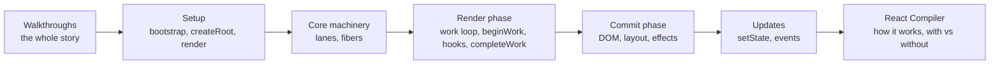

# React 源码深度剖析（React Internals）

你已经写过成千上万次 `useState`。本课程将为你打开这个黑盒，沿 React 内部真实的调用路径层层追溯：`createRoot` 究竟构建了什么数据结构、状态更新如何判定优先级、workLoop 如何遍历 Fiber 树、Hooks 数据究竟存放在哪里，以及 Commit 阶段是如何将变动施加到真实 DOM 上的。专栏最后几篇还将深入剖析 React 编译器是如何改写你的组件代码，从而让 React 能够自动跳过那些重复计算的。

本专栏专为**渴望建立坚固运行时心智模型、拒绝道听途说的一线 React 开发者**量身定制。你完全不需要预先通读过 React 源码。文中的每一个论点都附带了指向 GitHub 官方仓库具体代码行的超链接，且全篇内容基于 **React v19.3.1** 精准校验，确保行号与代码完全吻合。

> [!tip] 阅读建议
> 强烈建议先从两篇全流程穿透篇开始：[[20 Walkthrough - First Render End to End|首次渲染端到端全流程穿透]] 与 [[21 Walkthrough - setState to Pixels|从 setState 到像素呈现]]。它们用连贯的叙事一气呵成地讲清全局生命周期，并在关键分支处引导你跳转至更细致的专属篇章。此后，你可以按部就班通读各篇，或是针对当下工作中的具体疑问定向查阅。[[00 React Internals Index|专栏目录索引]] 为每一篇都提供了一句话核心概括。

## 目录索引

1. [[00 React Internals Index|第 00 篇 · 目录索引：从 createRoot 到像素呈现]]
2. [[01 Bootstrap - Packages, JSX and the Dispatcher|第 01 篇 · 初始化引导：包结构、JSX 转译与 Dispatcher]]
3. [[02 createRoot - FiberRoot and HostRoot|第 02 篇 · createRoot：FiberRoot 与 HostRoot]]
4. [[03 root.render - Scheduling the First Update|第 03 篇 · root.render：调度首次状态更新]]
5. [[04 Lanes and the Scheduler|第 04 篇 · Lanes 赛道模型与 Scheduler 调度器]]
6. [[05 The Fiber Data Structure|第 05 篇 · Fiber 数据结构底层剖析]]
7. [[06 The Work Loop - Render Phase|第 06 篇 · 工作循环（workLoop）：渲染阶段深度拆解]]
8. [[07 beginWork and Reconciliation|第 07 篇 · beginWork 与协调（Reconciliation）]]
9. [[08 completeWork - Building DOM Nodes|第 08 篇 · completeWork：构建宿主 DOM 节点]]
10. [[09 Commit Phase - Mutation, Layout, Passive Effects|第 09 篇 · Commit 阶段：Mutation、Layout 与被动副作用]]
11. [[10 Hooks on Mount|第 10 篇 · Hooks 挂载阶段原理]]
12. [[11 Hooks on Update|第 11 篇 · Hooks 更新阶段原理]]
13. [[12 setState - dispatchSetState and Batching|第 12 篇 · setState 底层实现：dispatchSetState 与批处理]]
14. [[13 The Event System|第 13 篇 · 事件系统底层运作原理]]
15. [[14 React Compiler - How It Works|第 14 篇 · React 编译器：底层工作原理深度拆解]]
16. [[15 Rendering With vs Without the Compiler|第 15 篇 · 启用与未启用编译器的渲染对比]]
17. [[20 Walkthrough - First Render End to End|第 20 篇 · 全流程穿透：首次渲染端到端源码追踪]]
18. [[21 Walkthrough - setState to Pixels|第 21 篇 · 全流程穿透：从 setState 到屏幕像素呈现]]

## 学习路线图

